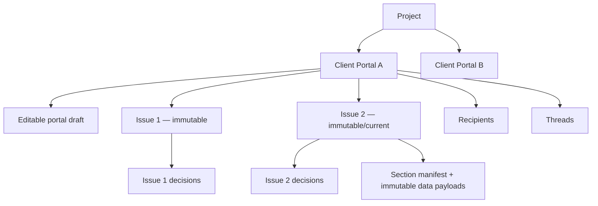
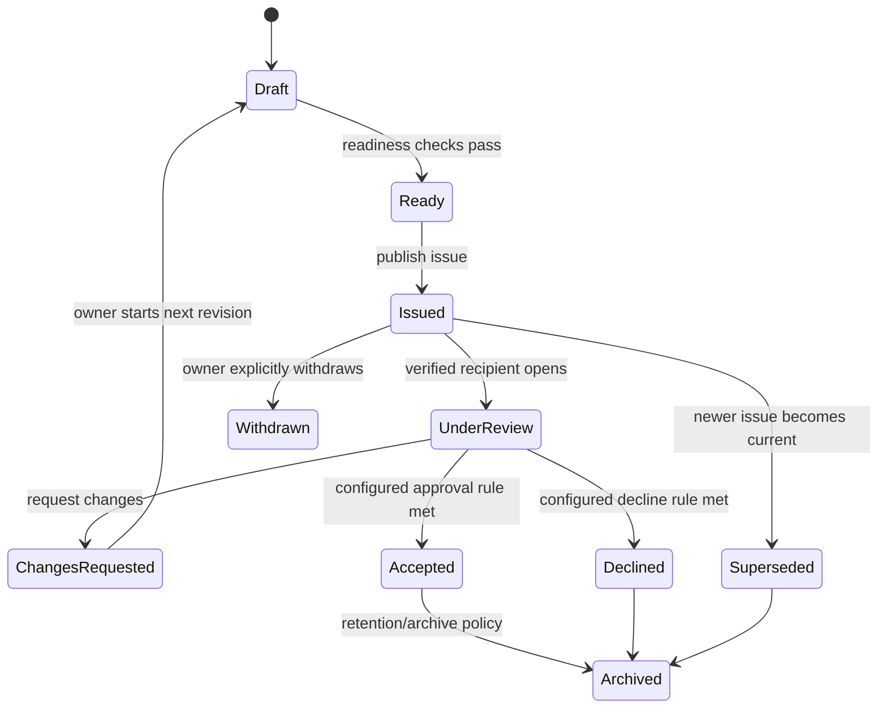

# 02 — Product Model and Terminology

## 1. Canonical vocabulary

| Term | Definition |
|---|---|
| **Client Portal** | Stable project-review workspace with a stable identity, URL, recipients, branding, configuration, and history |
| **Portal Draft** | Owner-editable current configuration that has not yet been issued |
| **Issue** | Immutable published version of portal content and financial data |
| **Section** | Top-level owner-configured portal destination such as Overview, Estimates, Financial Summary, Discussion, or Decision |
| **Block** | Typed content unit within a section; used only where needed |
| **Recipient** | External person granted access to a portal |
| **Role template** | Named bundle of common external capabilities |
| **Capability** | Specific server-evaluated permission such as `thread:create` or `decision:submit` |
| **Thread** | Contextual or general discussion container |
| **Message** | Attributable contribution inside a thread |
| **Decision** | Formal, version-bound recipient response to an explicitly stated scope |
| **Activity** | Client-safe collaboration timeline or owner-only audit/operational event |
| **Portal analytics** | Privacy-governed engagement data; distinct from the audit record |
| **Brand profile** | Owner/client identity, logos, color tokens, contact and attribution settings |

“Proposal” remains a valid issue type and customer-facing noun. It is no longer the only possible portal configuration.

## 2. Object hierarchy

## 3. Lifecycle

A portal may remain active while individual issues move through this lifecycle.

## 4. Product principles

### A stable relationship, not disposable links

The client should not lose the conversation, recipient identity, or portal history because the owner publishes a revision. A link rotation is a security operation. A new issue is a content operation. They are separate.

### Snapshot first

The public experience reads immutable issue data. It never joins live private estimate rows merely to render a client chart or table. This keeps the reviewed amount, hierarchy, and assumptions stable.

### Explicit scope

Every section declares:

- its data scope;
- its audience;
- its visible fields;
- whether it is commentable;
- whether it is downloadable;
- whether it participates in formal decision scope.

### Structured flexibility

Owners can compose a portal from safe known section types. They cannot inject scripts, arbitrary queries, arbitrary CSS, or formulas that bypass validation and totals parity.

### Conversation is part of the record

Discussion is not a decorative footer. Threads are attached to the exact issue and target, visible in the owner action queue, and preserved according to the activity/retention contract.

### A formal decision is not a comment

Comments can be exploratory and ongoing. A decision is explicit, confirmatory, attributable, issue-bound, and append-only.

### Client-safe does not mean internally complete

The system deliberately excludes hidden margins, unpublished drafts, internal notes, supplier negotiations, private source history, security logs, and other owner-only context unless a specific safe field is selected.

## 5. Portal templates

Start with templates rather than a blank builder.

### Proposal Review

- Overview
- Estimates
- Financial Summary
- Assumptions & Exclusions
- Discussion
- Decision
- optional Activity

### Cost Review

- Overview
- Estimate Comparison
- Cost Breakdown
- Estimates
- Discussion
- Decision

### Executive Summary

- Overview
- Financial Summary
- Top Cost Drivers
- Budget Variance
- Discussion
- optional Decision

### Custom

Starts with Overview and lets the owner add approved section types.

Templates copy configuration into a portal draft. They are not live-linked; later template updates cannot mutate existing portals.

## 6. Decision workflow modes

### First release

**Issue-wide decision.** A configured approver responds to the exact current issue. The UI states:

> This response applies to Issue #N, version V, total [currency amount], including the listed sections and estimate sheets.

Rule modes:

- **Any designated approver** — first valid formal response determines the recipient's own state; portal decision can be configured as any-one-accepts only for simple workflows.
- **All designated approvers** — recommended when multiple required approvers exist.

For MVP, “all designated approvers” should be the default if there is more than one approver. Do not implement ordered routing or quorum until there is demand.

### Later

- per-estimate/package decisions;
- ordered approval steps;
- quorum;
- conditional approval;
- delegated approver;
- legal e-signature;
- payment trigger.

## 7. Portal and issue status language

| Internal status | Owner copy | Recipient copy |
|---|---|---|
| `draft` | Draft | Not available |
| `ready` | Ready to publish | Not available |
| `issued` | Live | Awaiting review |
| `under_review` | In review | In review |
| `changes_requested` | Changes requested | Changes requested |
| `accepted` | Approved | Approved |
| `declined` | Declined | Declined |
| `superseded` | Superseded | A newer issue is available |
| `withdrawn` | Withdrawn | This issue was withdrawn |
| `revoked` portal access | Access off | Link unavailable |

Do not use “accepted” in one surface and “approved” in another without a deliberate mapping.

## 8. Scope guardrails

This product is a structured commercial review system. It is not yet:

- a general-purpose client extranet;
- a project management platform;
- a legal document automation platform;
- a BIM viewer;
- a procurement transaction system;
- a live team chat product;
- a custom BI tool;
- an e-signature provider;
- a payment platform.

The portal architecture should permit future expansion without claiming those capabilities now.
