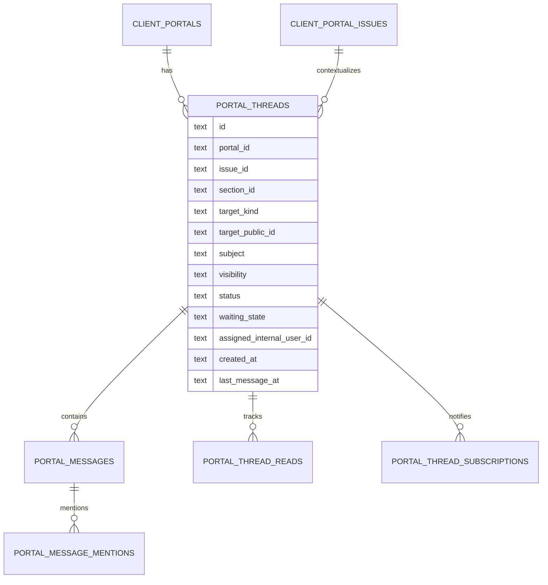

# 05 — Discussions, Threads, and Chat Specification

## 1. Recommendation

Build a **durable threaded discussion system with a conversational presentation**.

Do not build a single unstructured chat stream. Chat is fast, but it loses the relationship between a question and the exact cost item, chart, area, or issue. The system needs both:

- a general project conversation;
- contextual threads anchored to portal content.

This is the pattern seen across strong collaboration products: contextual pins/anchors, replies, mentions, resolution, unread state, and an aggregated discussion inbox.

## 2. Core model

### Thread

A thread is the unit of work and context.

Required fields:

- portal;
- issue;
- stable section;
- target kind and target public ID;
- subject;
- client-visible/internal audience;
- status;
- waiting state;
- assignee;
- creator actor;
- created/updated/last-message timestamps;
- resolved/reopened metadata;
- carried-forward origin where applicable.

### Message

A message is an immutable-attribution event with limited corrective editing.

Required fields:

- thread;
- actor type and actor ID;
- body;
- created timestamp;
- edited timestamp;
- tombstone/deleted timestamp;
- optional reply-to message for quoting only;
- optional attachments later;
- mentions;
- visibility inherited from thread;
- client-safe author presentation snapshot.

Keep replies flat within a thread. Do not create unlimited nested reply trees.

## 3. Target taxonomy

First-release targets:

- portal;
- issue;
- section;
- estimate;
- estimate tab;
- area/group node;
- row;
- chart;
- chart bucket;
- comparison row;
- assumption/exclusion;
- activity event.

A target reference stores:

- typed target kind;
- stable public target ID;
- display label snapshot;
- secondary label;
- issue version;
- optional source section ID.

The label snapshot preserves historical readability if the source name changes later.

## 4. Conversation surfaces

### Context rail

When a recipient selects a row, chart bucket, comparison row, or section:

- show existing threads for that target;
- create a new thread;
- reply;
- resolve if permitted;
- deep-link to all discussion;
- show issue/version context.

### Discussion inbox

Top-level Discussion section:

- all threads;
- open / waiting on us / waiting on client / resolved;
- unread;
- filter by section/author/assignee;
- direct jump to target;
- bulk “mark read” for owner only;
- no destructive bulk deletion.

### General conversation

A “General discussion” thread can act like a chat room, but it remains a thread with participants, unread state, status, and history. Multiple general threads can be allowed by subject; avoid one endless feed.

## 5. Roles and actions

| Action | Viewer | Commenter | Reviewer | Approver | Internal responder |
|---|---:|---:|---:|---:|---:|
| Read client-visible threads | Yes | Yes | Yes | Yes | Yes |
| Create general thread | No | Yes | Yes | Yes | Yes |
| Create contextual thread | No | Yes | Yes | Yes | Yes |
| Reply | No | Yes | Yes | Yes | Yes |
| Mention permitted participant | No | Yes | Yes | Yes | Yes |
| Resolve own thread | No | Conditional | Conditional | Conditional | Yes |
| Reopen | No | Conditional | Conditional | Conditional | Yes |
| Assign internal owner | No | No | No | No | Yes |
| Add internal note | No | No | No | No | Separate owner-only surface |
| Edit own recent message | No | Limited | Limited | Limited | Limited |
| Tombstone own message | No | Limited | Limited | Limited | Limited |

The server evaluates actual capabilities; this table is the default role template.

## 6. Thread states

Canonical status:

- `open`;
- `resolved`;
- `archived`.

Derived waiting state:

- `waiting_on_owner`;
- `waiting_on_client`;
- `no_response_required`.

The waiting state updates when a visible message changes actor side or when an owner explicitly marks no response required.

Owner action queue uses:

- unresolved;
- waiting on owner;
- overdue;
- mentions;
- carried forward from prior issue.

## 7. Message editing and deletion

### Editing

Permit authors to edit their own message within a bounded window. Preserve:

- original-created timestamp;
- edited timestamp;
- audit event;
- prior body hash or revision history according to retention policy.

For high-assurance issued records, preserve full revisions owner-side even if the public UI shows only the latest body.

### Deletion

Use a tombstone:

> Message removed by its author.

Do not physically erase the event from the owner audit record except through an approved privacy/retention process.

### Owner moderation

Owner can hide abusive or sensitive content from the client view through a moderated tombstone. The audit record captures who, why, and when.

## 8. Resolution

Threads can be resolved and reopened. Resolution is not deletion.

When resolved:

- composer remains available if role permits reopening;
- resolution actor/time shown;
- thread moves out of default open queue;
- target retains resolved count/history;
- client activity records resolution if Activity is shared.

A formal decision does not automatically resolve every thread.

## 9. Version transitions

When a new issue is published:

- issue-specific threads remain attached to the old issue;
- unresolved threads receive one of:
  - `closed_by_supersession`;
  - `carried_forward`;
  - `requires_revalidation`;
- the owner chooses which unresolved threads carry to the new issue;
- carried threads link both old and new issue targets;
- recipient unread state starts from the carry-forward event;
- decisions never carry automatically.

General portal threads may remain portal-wide if their subject is not issue-specific.

## 10. Notifications

Notify users when they:

- are mentioned;
- are assigned;
- started the thread;
- replied and subscribed;
- are designated portal approvers and a decision is requested.

Notification channels:

- in-app Publisher inbox;
- batched owner email digest;
- recipient email;
- optional immediate high-priority mention email.

Users can follow/unfollow a thread except when their formal role requires notification.

## 11. Real-time boundary

### MVP

- optimistic local messages;
- focus/visibility refetch;
- short polling or event invalidation where affordable;
- durable D1 writes;
- Queues/Email for notifications;
- clear “new messages” notice.

### Later

Durable Object transport can add:

- live message delivery;
- typing indicators;
- presence;
- active target indicators.

D1 remains the source of truth. A Durable Object must not become the only copy of a decision, message, or audit event.

## 12. Attachments

Reserve the model, but do not make attachments a hard MVP dependency.

When added:

- image/PDF allowlist;
- bounded size;
- malware/scanning pipeline;
- portal and issue authorization;
- token-scoped download;
- immutable metadata;
- tombstone, retention, and audit;
- no public bucket URLs;
- client-safe filename;
- thumbnail and alt text.

## 13. Internal notes boundary

Internal notes must not be a nearby toggle in the client reply composer. That is an accidental-disclosure trap.

Use a visually and technically separate owner-only notes surface:

- different component;
- different API/action;
- different table or visibility-enforced repository path;
- explicit internal badge;
- never returned by public APIs;
- denial tests.

## 14. Data model sketch

## 15. Migration from current comments

Each current `shared_link_comments` record becomes:

1. one thread if no compatible thread already exists for the same issue/target and migration grouping;
2. one message inside that thread;
3. target metadata preserved;
4. author side inferred from `recipient_id`;
5. unresolved/open state;
6. snapshot version mapped to issue;
7. old comment ID retained as a legacy reference.

Do not over-group unrelated comments merely because they share a row target.

## 16. Acceptance criteria

- Recipient can start a general or contextual thread.
- Owner can reply from Publisher.
- Replies appear to authorized recipients.
- Threads can be resolved and reopened.
- Unread state is per participant.
- Clicking a thread opens the exact target.
- Internal notes can never be fetched through public routes.
- New issue preserves old discussion and supports explicit carry-forward.
- Offline/retry behavior does not duplicate messages.
- A chat-like UI does not erase thread subject, target, status, actor, or version.
