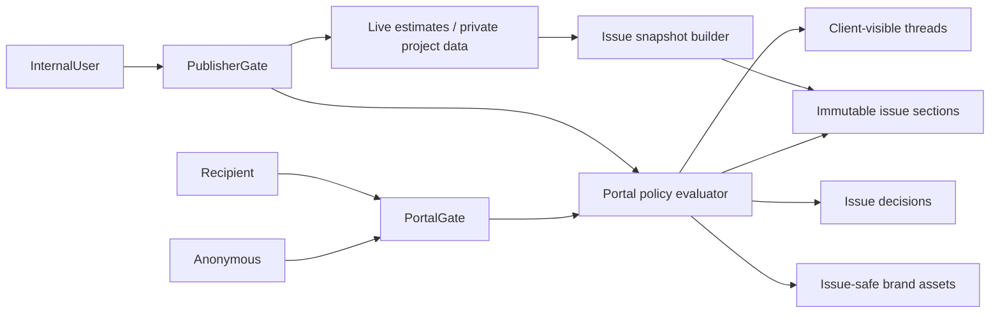

# 12 — Security, Privacy, Audit, and Issued Records

## 1. Security posture to preserve

Current implementation strengths:

- strong random publication tokens;
- HMAC token lookup;
- encrypted token recovery for owner copy;
- scrypt password hashing;
- access and recipient session cookies;
- credential-version binding;
- CSRF and origin checks;
- bounded public bodies;
- D1-backed rate limits;
- public ID obfuscation;
- snapshot version tokens;
- client-safe errors;
- hashed telemetry identifiers;
- application-layer tenant authorization.

The new model must preserve these controls while moving them to stable portal and issue resources.

## 2. Trust boundaries



Public routes do not cross into live private sources after issue publication.

## 3. Threat model

### Token leakage

Risks:

- URL forwarded;
- referrer leakage;
- logs;
- screenshots;
- browser history;
- email scanners.

Controls:

- recipient verification for write/high-risk view;
- raw token redaction;
- generic OG metadata;
- `Referrer-Policy`;
- no third-party scripts on portal;
- stable token rotation;
- recipient credential revocation;
- optional password;
- no-store;
- email verification.

### Cross-tenant access

Risks:

- guessed portal/issue/section IDs;
- missing workspace/project scope;
- manager accessing another portal.

Controls:

- server policy every request;
- opaque public IDs;
- relationship checks;
- repository methods require workspace/portal;
- negative authorization tests;
- no client-side authority.

### Hidden financial data leakage

Risks:

- full private row serialized then hidden;
- chart payload contains supplier/rates;
- error/log includes source data;
- print includes hidden fields.

Controls:

- allowlist serializer;
- issue-time sanitization;
- section payload schemas;
- chart aggregation;
- print uses same public payload;
- payload snapshot inspection;
- schema validation.

### Comment/internal-note leakage

Risks:

- `is_internal` filter missed;
- owner accidentally replies with internal mode;
- cache mixes audiences.

Controls:

- separate tables/actions/components;
- separate owner-only query;
- no visibility toggle beside public composer;
- public DTO excludes internal fields;
- no shared cache;
- denial tests.

### Decision ambiguity or replay

Risks:

- decision applies to changed issue;
- duplicate POST;
- recipient lacks authority;
- copied confirmation;
- signer mismatch.

Controls:

- issue ID/content hash in confirmation and write;
- view/session binding;
- idempotency key;
- unique active decision;
- required approver relationship;
- append-only void;
- rate limit;
- confirmation receipt.

### Asset attack

Risks:

- malicious SVG;
- decompression bomb;
- cross-tenant object path;
- MIME spoof;
- public private file.

Controls:

- magic-byte validation;
- decode/pixel limits;
- rasterization;
- workspace/portal asset ownership;
- content-addressed public-safe copies;
- brokered downloads;
- CSP/nosniff;
- no arbitrary HTML.

### Custom-domain takeover — later

Risks:

- stale DNS;
- reassigned hostname;
- unvalidated Host;
- certificate mismatch.

Controls defined in branding/domain plan.

### Abuse/spam

- comment/message quotas;
- per-recipient and per-portal rate limits;
- bounded length;
- attachment limits;
- moderation;
- notification cooldown;
- abuse logging;
- portal revoke.

## 4. Authorization rules

Follow:

- least privilege;
- deny by default;
- validate every request;
- resource-specific checks;
- safe failure;
- centralized policy;
- appropriate logging.

Roles aid administration. Final access depends on relationship, recipient status, issue/section policy, and action.

## 5. Caching and headers

All tokenized portal HTML, manifests, issue payloads, comments, decisions, activity, and recipient state require an explicit sensitive-response contract.

Recommended headers:

```text
Cache-Control: private, no-store, max-age=0
Pragma: no-cache
Referrer-Policy: no-referrer
X-Content-Type-Options: nosniff
X-Frame-Options: DENY
Content-Security-Policy: strict portal policy
Permissions-Policy: minimal
```

If future embedding is allowed, replace frame denial with a deliberate per-portal `frame-ancestors` policy. Do not weaken globally.

Verify headers on the final Cloudflare-hosted response, not only in Next source.

Immutable public-safe logo assets can use long cache lifetimes because the URL is content-addressed and contains no secret.

## 6. Session model

### Portal access session

Binds:

- portal;
- credential version;
- access mode;
- expiry.

### Recipient session

Binds:

- portal;
- recipient;
- credential version;
- verification level;
- expiry.

### Issue view token

Binds:

- portal;
- issue;
- content hash/version;
- permitted decision scope;
- short lifetime or session context.

Publishing a new issue invalidates stale write tokens, not necessarily the entire recipient portal session.

## 7. CSRF and origins

Every state-changing public request:

- POST/PUT/PATCH/DELETE only;
- same-origin validation;
- CSRF token;
- secure SameSite cookie;
- bounded content type/body;
- no mutation through GET;
- idempotency key where retries possible.

Custom domains require origin validation against the active portal hostname, not only `archestimator.com`.

## 8. Rate limiting

Scopes:

- portal render;
- password;
- verification;
- recipient bootstrap;
- thread create;
- message create/edit;
- decision;
- asset download;
- reminder;
- custom-domain validation later.

Composite keys should include portal and actor/IP-derived privacy-safe key. Return `Retry-After`.

Rate-limit failure cannot partially reserve other scopes without rollback.

## 9. Audit versus analytics

Audit events are integrity-sensitive and retained according to business/legal policy. Analytics has a shorter, disclosed retention and can be disabled/deleted independently.

Audit records should include:

- when;
- actor;
- action;
- portal;
- issue;
- target;
- result;
- request ID;
- reason code;
- previous/new state references where material.

Do not log secrets or full sensitive content.

## 10. Issued-record integrity

An issue should have:

- immutable manifest;
- immutable section hashes;
- overall content hash;
- issue number/version;
- issued timestamp;
- issuer identity;
- selected scope;
- total/currency;
- assumptions/exclusions;
- validity;
- supersedes reference;
- brand snapshot;
- decision policy snapshot.

This improves traceability. It does **not** make Archestimator a legally certified e-signature or immutable-record service by itself.

## 11. Decision record

Formal decision record includes:

- portal/issue;
- content hash;
- recipient;
- verified email snapshot;
- signer name;
- role;
- decision;
- note;
- submitted time;
- request ID;
- intent hash;
- confirmation delivery;
- void/supersession event.

A void never deletes the original.

## 12. Privacy boundaries

Client portal must never expose:

- internal notes;
- hidden recipients;
- raw IP/user agent;
- exact location telemetry;
- private source identifiers;
- internal team membership unless intentionally presented;
- margins;
- negotiations;
- unpublished drafts;
- other clients/workspaces;
- private documents;
- security events.

Recipient display names in shared discussion/activity require a clear portal policy. Avoid exposing email addresses to other recipients by default.

## 13. Data retention

Define before external Beta:

- active portal retention;
- superseded issue retention;
- accepted/declined issue retention;
- thread/message retention;
- audit retention;
- analytics retention;
- brand asset retention;
- invitation/delivery log retention;
- project deletion effect;
- privacy request search and erasure limits;
- owner export;
- archive policy.

Do not promise deletion-independent archive until the schema and policy are implemented.

## 14. Secure failure modes

- missing D1/R2/secrets: fail closed;
- snapshot section unavailable: block publish; historic issue returns clear unavailable state, not live fallback;
- policy evaluator error: deny;
- notification failure: business write succeeds with action-required delivery state;
- analytics failure: never blocks portal;
- audit write failure for critical mutation: mutation should fail or use atomic batch/outbox;
- chart truncation: block or explicitly omit section with warning before publish.

## 15. Security acceptance criteria

- No public route queries live private estimate rows for issued content.
- Hidden sections and fields are absent from response bytes.
- Cross-portal recipient token fails.
- Stale issue decision returns 409.
- Rotated/revoked credentials fail immediately.
- Internal notes cannot be returned through public repositories.
- Brand asset authorization prevents cross-workspace reads.
- Portal HTML and APIs return verified no-store/security headers.
- Audit and analytics records exclude secrets.
- All permission failures are deterministic and logged with safe reason codes.
