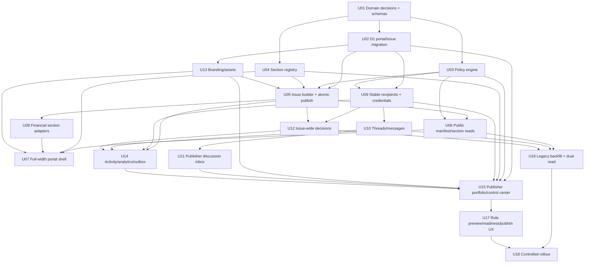

# 15 — Implementation Roadmap and Backlog

## 1. Delivery strategy

Build the new architecture in vertical slices while the legacy share flow remains readable. Do not start by redesigning every screen. First establish the stable portal/issue boundary; then add the full-width renderer, section registry, permissions, discussions, Publisher, and migration.

The roadmap below is dependency ordered. It is implementation-ready but remains a planning artifact.

## 2. Priority model

- **P0:** required to prevent wrong data, wrong authorization, broken continuity, or misleading decisions.
- **P1:** required for the intended first Client Portal release.
- **P2:** important follow-up after core validation.
- **Later:** demand-gated platform expansion.

## 3. Dependency DAG

## 4. Execution units

### UNIT-001 — Ratify domain contract and record decisions

**Priority:** P0  
**Scope:** docs/types only initially

Deliver:

- canonical portal/issue/section/thread/decision terminology;
- typed section kinds;
- role/capability catalog;
- decision scope fixed to issue for first release;
- stable portal/multiple portals rule;
- legacy compatibility rule;
- retention boundary recorded.

Acceptance:

- one source-of-truth spec;
- no old component uses “row decision” semantics in new model;
- migration assumptions enumerated.

### UNIT-002 — Add portal and issue D1 schema

**Priority:** P0  
**Depends:** UNIT-001

Deliver migrations for:

- client portals;
- draft sections;
- issues;
- issue sections;
- recipients/credentials/grants;
- brand profiles/assets metadata;
- threads/messages/reads/subscriptions;
- decisions;
- audit/analytics/outbox;
- legacy mapping.

Acceptance:

- foreign keys and indexes;
- constraints;
- no one-portal-per-project restriction;
- active decision uniqueness;
- migration preflight;
- rollback/fix-forward notes.

### UNIT-003 — Central portal policy evaluator

**Priority:** P0  
**Depends:** UNIT-001

Deliver:

- internal and external actor types;
- role templates;
- sparse overrides;
- section/field/action policy;
- reason codes;
- repository/action integration helper;
- preview adapter.

Acceptance:

- deny by default;
- hidden resources absent;
- same evaluator usable by public route and preview;
- no direct role-string authorization in new routes.

### UNIT-004 — Typed section registry

**Priority:** P0  
**Depends:** UNIT-001

Deliver initial kinds:

- overview;
- estimate browser;
- financial summary;
- cost breakdown;
- estimate comparison;
- assumptions/exclusions;
- discussion;
- activity;
- decision.

Acceptance:

- versioned draft and public schemas;
- unknown kind rejected;
- renderer/build/sanitize contracts;
- safe field policy.

### UNIT-005 — Issue builder and atomic publish

**Priority:** P0  
**Depends:** UNIT-002/003/004

Deliver:

- source reads;
- canonical calculations;
- section builders;
- public IDs;
- brand snapshot;
- content hashes;
- D1/R2 persistence;
- issue allocation;
- supersession;
- outbox;
- idempotency.

Acceptance:

- no partial issue;
- retry returns same issue;
- current issue changes only after full commit;
- historic issue independent of live project rows.

### UNIT-006 — Public portal access, manifest, and lazy section routes

**Priority:** P0  
**Depends:** UNIT-003/005

Deliver:

- stable portal token lookup;
- legacy token adapter;
- password/recipient session;
- manifest route;
- section route;
- explicit no-store/security headers;
- opaque IDs;
- issue selector/current issue behavior.

Acceptance:

- role-hidden sections not serialized;
- stale/withdrawn/superseded states clear;
- public path does not import live project repositories.

### UNIT-007 — Full-width Client Portal shell

**Priority:** P1  
**Depends:** UNIT-004/006

Deliver:

- full viewport shell;
- responsive navigation;
- section renderer;
- context rail/drawer;
- mobile action bar;
- status/identity header;
- print shell;
- deep links.

Acceptance:

- uses browser width;
- no global centered max cap;
- local prose measure;
- keyboard/focus/zoom behavior;
- current issue identity always visible.

### UNIT-008 — Estimate browser extraction and all-row contract

**Priority:** P1  
**Depends:** UNIT-004/005/007

Deliver:

- extract tree/details from `SharePageTabs`;
- sheet vs portal navigation hierarchy;
- paginated/virtualized all-row access;
- safe columns;
- subtotals;
- target actions;
- print all.

Acceptance:

- every published row reachable;
- hidden fields absent;
- no silent tree/detail caps;
- legacy snapshots readable.

### UNIT-009 — Financial section adapters

**Priority:** P1  
**Depends:** UNIT-004/005

Deliver:

- Financial Summary;
- Cost Breakdown;
- Estimate Comparison;
- chart/table equivalents;
- existing project chart aggregation adapters;
- payload hashes and completeness.

Acceptance:

- totals reconcile;
- no raw rate/supplier facts unless selected;
- accessible charts;
- chart/bucket discussion targets.

### UNIT-010 — Stable recipient identity and credentials

**Priority:** P0  
**Depends:** UNIT-002/003

Deliver:

- stable portal recipient;
- role template;
- required approver;
- credentials/session version;
- per-recipient revoke;
- invite/resend/reminder compatibility;
- issue-independent identity.

Acceptance:

- recipient survives new issue;
- rotate link does not erase history;
- revoke immediate;
- old bootstrap link migration safe.

### UNIT-011 — Thread and message domain

**Priority:** P1  
**Depends:** UNIT-002/003/006/010

Deliver:

- thread/message repositories;
- general/contextual targets;
- create/reply;
- resolve/reopen;
- unread/subscriptions;
- mentions;
- idempotency;
- message edit/tombstone policy;
- carry-forward metadata.

Acceptance:

- owner and recipient conversation;
- exact target deep link;
- no duplicate offline messages;
- no internal-note leakage.

### UNIT-012 — Publisher discussion inbox and owner replies

**Priority:** P1  
**Depends:** UNIT-011

Deliver:

- waiting/open/resolved inbox;
- target preview;
- public reply;
- separate internal note;
- assignment;
- mentions;
- resolve/reopen/carry forward.

Acceptance:

- owner can respond without database/manual workaround;
- public preview before send;
- action queue updates.

### UNIT-013 — Explicit issue-wide decisions

**Priority:** P0  
**Depends:** UNIT-003/005/010

Deliver:

- policy read;
- approver designation;
- approve/request changes/decline;
- issue/content hash binding;
- signer;
- idempotency;
- summary evaluator;
- append-only void/reset.

Acceptance:

- contextual row selection cannot change scope;
- unauthorized reviewer cannot approve;
- duplicate returns saved state;
- receipt names exact issue/amount/currency.

### UNIT-014 — Branding and brand assets

**Priority:** P1  
**Depends:** UNIT-002/003

Deliver:

- workspace/client/portal brand profiles;
- owner and client logos;
- safe image pipeline;
- co-branding mode;
- contrast validation;
- email/print/public brand snapshot.

Acceptance:

- historic issue brand immutable;
- no raw private asset path;
- malformed image rejected;
- both logos optional.

### UNIT-015 — Audit, client activity, analytics, notification outbox

**Priority:** P1  
**Depends:** UNIT-005/010/011/013

Deliver:

- event taxonomy;
- audit repository;
- client-safe projection;
- analytics gates;
- recipient funnel;
- action-required evaluator;
- outbox + queue delivery;
- reminders.

Acceptance:

- bot/preview separation;
- client activity policy;
- idempotent sends;
- audit/analytics separation.

### UNIT-016 — Publisher portal portfolio and control center

**Priority:** P1  
**Depends:** UNIT-002/003/004/010/012/014/015

Deliver:

- portal-level roster;
- server pagination/filtering;
- quick detail;
- full route control center;
- Content/Branding/People/Discussion/Decision/Analytics/Versions/Settings tabs;
- source freshness and next action.

Acceptance:

- multiple portals per project visible;
- no 8-query broad-scan regression;
- complex config not trapped in drawer.

### UNIT-017 — Composer, readiness, preview-as-role, publish flow

**Priority:** P1  
**Depends:** UNIT-005/007/016

Deliver:

- create portal;
- typed section composer;
- readiness evaluator;
- responsive preview;
- role simulation;
- issue publish confirmation;
- carry-forward selection;
- invitation/send step.

Acceptance:

- owner can configure complete portal end-to-end;
- preview uses real policy/DTO;
- publishing explicit;
- blockers/warnings clear.

### UNIT-018 — Legacy backfill and dual-read migration

**Priority:** P0  
**Depends:** UNIT-002/006/010/011/013

Deliver:

- map legacy publications to portal/issues;
- merge recipient identity carefully;
- comments to threads/messages;
- decisions to issue-wide legacy decisions;
- old token routing;
- old Publisher redirects;
- data validation report.

Acceptance:

- no lost historic rows/comments/decisions;
- old links work;
- ambiguous audiences are not incorrectly merged;
- row counts and hashes reported.

### UNIT-019 — Calculation/output parity gate

**Priority:** P0  
**Depends:** UNIT-005/008/009

Deliver golden fixtures proving:

- editor;
- project charts;
- draft preview;
- issued portal;
- print;
- XLSX.

Acceptance:

- same canonical totals;
- rounding documented;
- all-row count parity;
- section bucket reconciliation.

### UNIT-020 — Security and hosted header hardening

**Priority:** P0  
**Depends:** UNIT-006

Deliver:

- explicit hosted no-store/CSP/referrer/nosniff/frame policy;
- public denial matrix;
- token/session/CSRF/stale issue;
- brand asset denial;
- rate limit scopes;
- log redaction.

Acceptance:

- hosted proof on final Worker;
- cross-portal attempts fail;
- hidden bytes absent.

### UNIT-021 — Controlled rollout and legacy retirement

**Priority:** P0 release  
**Depends:** UNIT-017/018/019/020

Deliver:

- feature flags;
- internal dogfood;
- design-partner portals;
- migration rollback/fix-forward;
- support runbook;
- telemetry review;
- legacy write freeze;
- final release truth update.

Acceptance:

- named cohort;
- no P0 open;
- rollback exercised;
- support owner known;
- Notion/repo truth reconciled.

## 5. Recommended sequence

### Phase A — Correct the model

UNIT-001 to UNIT-006 and UNIT-010/013.

No large visual expansion before stable portal/issue/recipient/decision semantics exist.

### Phase B — Deliver the portal experience

UNIT-007 to UNIT-009, UNIT-011, UNIT-014.

### Phase C — Deliver owner operations

UNIT-012, UNIT-015 to UNIT-017.

### Phase D — Migrate and prove

UNIT-018 to UNIT-021.

## 6. Parallelism

Safe parallel lanes after contracts settle:

- full-width shell vs financial adapters;
- recipient/decision vs branding;
- discussions vs analytics;
- Publisher portfolio query vs section editor;
- migration tooling vs new feature UI, with schema coordination.

Serialize:

- D1 migrations;
- policy capability names;
- issue manifest schema;
- public token/session changes;
- legacy backfill writes;
- shared event taxonomy.

## 7. Deferred backlog

### P2

- revision comparison;
- attachments in threads;
- client-safe documents;
- role-specific historic issue visibility;
- recipient account inbox;
- live thread delivery;
- richer reminder automation;
- owner decision export package;
- portal template management.

### Later

- Client Admin;
- ordered/quorum approvals;
- custom domains;
- custom fonts;
- legal e-signature provider integration;
- payments;
- persistent paid client archive;
- private external channels;
- AI discussion/issue summaries;
- arbitrary report builder.

## 8. Definition of done

A unit is not done because files exist. It is done when:

- acceptance criteria pass;
- policy and failure paths are handled;
- evidence is recorded;
- migrations are safe;
- no stale docs/claims remain;
- the user-authorized validation boundary is respected;
- the exact product surface works end-to-end in its intended environment.

## 9. Canonical execution packet

This document is the single execution authority. Before starting any unit, the lead re-reads current source and `plan-pack.json`, confirms the unit is dependency-ready, and records the checkpoint in `LOOP_LEDGER.md`.

Every unit inherits this packet unless its section is more specific:

- **Outcome:** deliver only the linked `REQ-*` and acceptance claims; do not widen into deferred/later work.
- **Current paths:** use `13-TECHNICAL-ARCHITECTURE-AND-CODE-CHANGE-MAP.md` and re-resolve symbols immediately before edits because the planning baseline can drift.
- **Ownership:** one integrator owns shared schemas, capability names, issue manifests, event taxonomy, migrations, and `plan-pack.json`; disjoint UI/repository work may run in parallel only after those contracts freeze.
- **Invariants:** immutable issued content, stable portal identity, deny-by-default authorization, snapshot-only public financial reads, explicit issue-wide decisions, all-row reachability, no client/internal note path overlap, and no hidden-field serialization.
- **Evidence:** source/diff/static/provider readback by default. Automated tests, builds-as-gates, browser proof, screenshots, and broad QA require an explicit current-task `TEST_TASK`; see `16-QUALITY-TEST-RELEASE-AND-OPERATIONS.md` for proposals only.
- **Failure response:** stop the dependent layer, preserve prior valid evidence, fix forward or roll back the current unit, mark affected evidence stale, and resume from the last verified dependency.
- **Checkpoint:** record actual files/resources touched, decisions, evidence, cleanup, residual risk, and exact next unit in `LOOP_LEDGER.md`.

## 10. Exact implementation start

Start at `UNIT-001` with a source-fresh domain-contract pass. Its completion must freeze the portal/issue/section/thread/decision terminology, stable ID namespaces, role/capability catalog, decision scope, retention boundary, legacy compatibility rule, and the reconciled Shared Estimate findings in `21-SHARED-ESTIMATE-PAGE-AUDIT-DELTA.md` before `UNIT-002`, `UNIT-003`, or `UNIT-004` begins.
