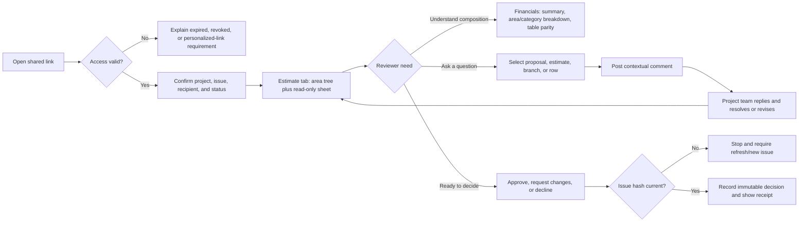

# User Research Matrix And Journeys

## Product Job

The shared page is the commercial handoff between the team that built the estimate
and the client who must understand, question, circulate, and decide on it. It is not
a marketing page and not a reduced workshop editor. It is a read-only presentation
surface plus a controlled review record.

## User Matrix

| Actor | Context | Primary jobs | Needs to see | Needs to do | Main failure to prevent |
|---|---|---|---|---|---|
| Estimator / quantity surveyor | Has authored the costing structure | Explain how total cost is composed; answer precise questions | Area/branch hierarchy, rows, totals, assumptions, client comments | Present, deep-link, reply, revise in the source product | Client sees a flattened total and cannot understand scope |
| Proposal owner / contractor principal | Commercially accountable | Send a credible issue and obtain a traceable decision | Issue/version, validity, recipient status, unresolved questions | Invite, monitor, respond, supersede, record approval | Approval applies to an unclear or stale scope |
| Client decision-maker | Occasional user, often non-technical | Understand the number and decide confidently | Executive total, major cost drivers, scope by area, open questions | Approve, request changes, decline, sign/name, add note | Dense estimating UI obscures meaning or action |
| Client reviewer / project manager | Reviews detail before recommendation | Validate inclusions, quantities, and area-level scope | Tree + sheet, assumptions, comparison, comment context | Comment at proposal/area/row, resolve uncertainty, share findings | Comments lose their target or version context |
| Client finance / procurement | Compares affordability and alternatives | Inspect totals, variance, categories, and commercial basis | Financial summary, chart/table parity, issue basis | Filter/compare, export/print, ask cost questions | Sensitive internal cost facts leak or totals do not reconcile |
| Client observer | Read-only stakeholder | Gain awareness without changing the record | Issued content and status | Navigate, search, print if permitted | UI promises actions their role cannot perform |
| Project team responder | Receives client feedback | Triage questions and return authoritative answers | Thread target, issue version, waiting state, recipient | Reply, resolve/reopen, link revision | Flat comments become an unmanageable inbox |
| Anonymous link visitor | Has a non-personalized or stale link | Determine whether the document is legitimate and accessible | Branding, issue identity, permitted content, access explanation | Read; obtain correct personalized link | Unclear denial, accidental write access, or leaked recipient identity |

## Jobs-To-Be-Done Matrix

| Moment | User intent | Required interface response | Success signal |
|---|---|---|---|
| Open | “Is this the right project and current issue?” | Brand, project, recipient, issue/version, status, validity | User can identify the commercial record before reading figures |
| Orient | “What am I looking at?” | Default Estimate tab, concise summary, visible area outline | User can explain the total and major scope structure |
| Inspect | “Where did this amount come from?” | Synchronized branch tree and read-only sheet rows | Selecting a branch reveals its rows/subtotal without losing context |
| Analyze | “What drives cost?” | Financial cards, area/category chart, accessible table | Chart buckets reconcile to the issued total |
| Question | “I need clarification on this exact item.” | Contextual comment action and visible target/version | Message is stored against proposal/estimate/branch/row and issue |
| Collaborate | “What is waiting on whom?” | Thread status, participants, replies, resolve/reopen | Both sides can distinguish open questions from completed discussion |
| Decide | “I am ready to respond.” | Clear issue-wide approve/change/decline flow | Decision records signer, note, issue hash, time, and role |
| Revisit | “What changed since last time?” | Issue status and later comparison/version history | User never mistakes a superseded issue for current scope |
| Export | “I need a formal copy.” | Print/PDF document rendering all permitted rows | Export matches issued data and excludes interactive chrome |

## Core Journey Diagram



## Information Architecture

```text
Shared Link
├── Persistent identity header
│   ├── Owner/client branding
│   ├── Project + issue/version + status
│   └── Recipient context + print/help
├── Estimate (default)
│   ├── Issue summary strip
│   ├── Area/branch outline
│   ├── Read-only estimate sheet
│   └── Context actions: discuss / copy link
├── Financials
│   ├── Total + key figures
│   ├── By area / category / discipline
│   ├── Chart / table toggle
│   └── Comparison when the issue contains comparable estimates
├── Discussion
│   ├── All threads / open / resolved
│   └── Targeted thread detail + composer
└── Decision
    ├── Current decision status
    ├── Approve / request changes / decline
    └── Signer, note, issue basis, receipt
```

## UX Principles

1. Costing first: the estimate is the product being presented.
2. Progressive disclosure: executive understanding first, estimating detail on
   demand, without hiding the complete issued dataset.
3. Context never detaches: comments and decisions always name their target and
   issue/version.
4. Trust through reconciliation: every visualization maps back to rows and totals.
5. External-user density: larger type and targets than the workshop; retain compact
   tabular rhythm only inside the sheet.
6. Agency with safety: navigation is unrestricted within permitted content; writes
   are role-gated and stale-snapshot guarded.

## Research Limits

The current run includes current source/runtime inspection and delegated external
research. Browser-control tooling was not exposed to this Codex Desktop session, so
the current visual audit is source/runtime grounded rather than screenshot-backed.
The audit artifact will be updated when captured visual evidence is available.
