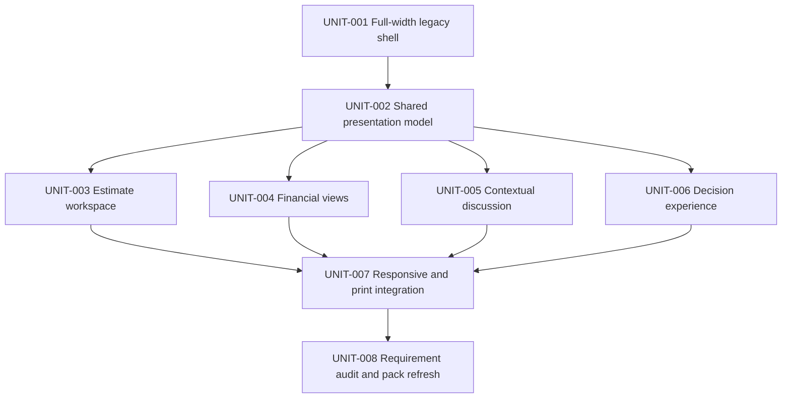

# Implementation Roadmap

## Unit DAG

## UNIT-001 — Full-Width Legacy Shell

Status: `VERIFIED`

- Goal: remove the global max-width from the actual example-token route while
  preserving responsive gutters and readable local content.
- Owned paths: `src/components/share/ShareContainer.tsx` and directly affected share
  layout call sites only.
- Evidence: source/diff inspection plus local HTTP rendering showing no global
  `max-w-*` on the share body.
- Recovery: revert the isolated width-token change.
- Complete when: estimate/tree content can consume the browser width at large
  desktop sizes.

## UNIT-002 — Shared Presentation Model

Status: `VERIFIED` · Depends on `UNIT-001`

- Goal: normalize legacy `ProjectPublicationSnapshot` and Client Portal issued
  sections into one presentation-facing model without exposing private fields.
- Own paths: share/client-portal adapters and types.
- Evidence: type/static contract showing explicit allowlisted fields, issue identity,
  role capabilities, totals, tree, chart buckets, thread targets, and decision basis.
- Recovery: retain token routing and swap adapters independently.

## UNIT-003 — Estimate Workspace

Status: `VERIFIED` · Depends on `UNIT-002`

- Goal: make the default view a wide split workspace with area/branch navigation and
  read-only estimate-sheet content.
- Includes: synchronized selection, search, expand/collapse, branch subtotals,
  sticky sheet header, row/branch discuss actions, complete row access, empty/loading
  states, and clear nested hierarchy.
- Own paths: `src/components/share/SharePageTabs.tsx`, tree/panel/grid components,
  and corresponding Client Portal section renderer.
- Evidence: source/LSP plus authorized runtime inspection.

## UNIT-004 — Financial Views

Status: `VERIFIED` · Depends on `UNIT-002`

- Goal: add issue-level financial summary and safe breakdowns by area/category with
  chart/table equivalence.
- Includes: reconciliation, data basis, rounding note, empty/incomplete state,
  accessible legend, and optional comparison only when issued data supports it.
- Own paths: public financial adapter and share/client-portal financial components.
- Evidence: static reconciliation fixtures only if later authorized as `TEST_TASK`;
  otherwise source/runtime payload inspection.

## UNIT-005 — Contextual Discussion

Status: `VERIFIED` · Depends on `UNIT-002`

- Goal: support proposal, estimate, branch, and row conversations with clear sender
  side, issue context, status, and all-discussion navigation.
- Includes: schema/type expansion for node targets when still missing, thread list,
  reply, resolve/reopen, composer target, optimistic/error recovery, and view-only
  explanation.
- Own paths: active D1 migrations, publication/client-portal repositories and routes,
  share/client-portal discussion components.
- Evidence: migration static validation, type/static checks, narrow D1 dry-run or
  test only with matching authorization.

## UNIT-006 — Decision Experience

Status: `VERIFIED` · Depends on `UNIT-002`

- Goal: provide a prominent, comprehensible issue-wide approve/change/decline flow.
- Includes: role gating, signer/note, stale-hash conflict, confirmation copy, result
  receipt, and no accidental real writes in manager preview.
- Own paths: decision components/routes and capability policy.
- Evidence: source/static contracts; mutation tests only if explicitly authorized.

## UNIT-007 — Responsive And Print Integration

Status: `VERIFIED` · Depends on `UNIT-003..006`

- Goal: integrate desktop rails, tablet drawers, mobile action surface, focus/scroll
  offsets, reduced motion, and full-data print behavior.
- Evidence: source/static checks; browser screenshots/automation only under explicit
  user authorization already granted for the audit/QA workflow when tooling exists.

## UNIT-008 — Requirement Audit And Pack Refresh

Status: `VERIFIED` · Depends on `UNIT-007`

- Goal: reconcile every requirement to fresh source/runtime evidence, update the
  research/audit findings, refresh the manifest, and archive only if all core work is
  achieved.
- Evidence: `validate:plan-pack`, planning-prompt validation, diff check, and the
  requirement-by-requirement completion table.
