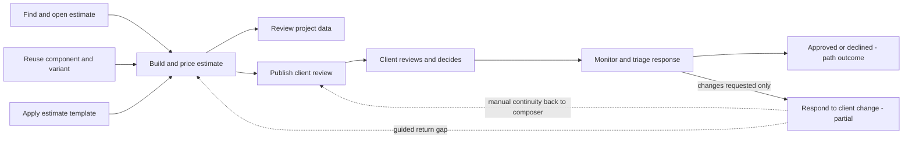

# Estimate System UX Brain — Implementation Plan

Status: Implementation ready — independently approved by architecture and adversarial scope review  
Date: 2026-07-15  
Execution ceiling: Local implementation only

## Goal Capsule

Extend the private `/admin/estimate-system` guide with a fourth `UX` view that explains who uses the product, the ordered MVP paths they follow, and the meaningful handoffs between estimate authoring, client publication, external review, and the internal response loop.

The result must remain a product guide, not a technical topology. It should help a reader answer four questions quickly:

1. Who is doing the work?
2. What outcome are they trying to reach?
3. What are the ordered steps and owning pages?
4. Where does responsibility or state pass to another path?

## Current-State Evidence

- The existing Product / Features / Pages map already separates orientation, behavior, and location.
- Existing feature records contain ordered steps, but they do not model actors, cross-feature journeys, or handoffs.
- The current primary product journey correctly runs from Workshop to project, estimate authoring, client publication, and client review.
- Client Portal publication produces a stable issued review package rather than exposing the live estimate editor.
- Recipient discussion and decisions return to the internal portal control center.
- A guided UI from `changes_requested` to source-estimate revision and republishing was not found. That return loop must be shown as partial, not as an implemented happy path.
- Personas are product contexts, not permission roles. Internal app access, recipient-token access, anonymous access, and platform administration remain distinct trust boundaries.

### Claim-to-source matrix

| Product claim | Current source evidence | Documentation rule |
| --- | --- | --- |
| Variant selection is row-owned while shared definition edits have broader impact | `src/lib/component-library/variant-display.ts`, `src/components/workshop/estimate-sheet/rows/cells.tsx`, `src/components/workshop/estimate-sheet/use-estimate-row-handlers.ts` | Keep row selection distinct from shared component or variant mutation. |
| Recipient capabilities are viewer, commenter, reviewer, and approver templates | `src/lib/client-portal/contracts.ts` | Treat the capability ladder as a recipient constraint, not as four fictional personas. |
| Anonymous access is a separate constrained branch | `src/lib/client-portal/policy.ts` | Do not merge anonymous viewing with a recipient session or internal role. |
| Issued Client Portal content is immutable | `src/lib/client-portal/contracts.ts`, `src/lib/client-portal/composer-actions.ts` | Model publication as an issue handoff, not access to the live estimate editor. |
| Formal decisions include approved, changes requested, and declined with stale-issue protection | `src/lib/client-portal/decision-service.ts`, `src/lib/client-portal/public-decision-handlers.ts` | Show all three outcomes and do not route approval or decline into revision. |
| Discussions, decisions, activity, and versions return to an internal monitoring surface | `src/components/workshop/publisher/ClientPortalControlCenter.tsx` | Separate publishing from internal monitoring and triage. |
| No connected guided return from changes requested to source-estimate revision and republishing was found | `src/components/workshop/publisher/ClientPortalControlCenter.tsx`, `src/lib/client-portal/publisher-discussion-actions.ts`, `src/lib/client-portal/publish-service.ts` | Keep existing estimate revision current; mark only the missing guided source navigation and next-issue continuation partial. |

Research and audit inputs inform the interaction model. Application-source claims are grounded separately by the claim-to-source matrix above:

- `estimate-system-map-ux-research.md`
- `estimate-system-map-ux-audit.md`
- `estimate-system-ux-primary-research.md`
- Current estimate, Client Portal, authorization, and public-review source paths named in those artifacts

## Product Contract

### REQ-001 — Typed UX documentation

The estimate-system documentation model must define and validate personas, experience paths, ordered path steps, and intersections. Broken references or duplicate IDs must fail immediately when the documentation is created.

### REQ-002 — Fourth UX view

The global view selector must add `UX` after Pages while keeping Product as the default. UX content must use the existing dense index/content shell and progressive disclosure.

### REQ-003 — Persona and journey navigation

The UX view must let a reader select a source-grounded persona, filter relevant MVP paths, inspect Step 1 / Step 2 / Step 3 ordering, and open the owning Page or Feature record without losing the selected persona or path.

### REQ-004 — Truthful intersections

The UX view must show the core handoff chain and supporting paths, distinguish current handoffs from partial gaps, and explicitly mark the client-change-request return loop as incomplete.

### REQ-005 — Accessible and responsive proof

The implementation must provide semantic ordered lists, a non-spatial relationship list, visible keyboard focus, focused cross-view navigation, compact stacking without horizontal page overflow, honest empty states, and fresh desktop/compact browser evidence.

## Persona Model

Personas describe jobs, context, observed behavior, constraints, and success. They do not create new authorization roles. Each typed record includes an evidence confidence, contexts, behaviors, constraints, unresolved assumptions, and source notes.

| Persona | Group | Confidence and observed context | Primary job |
| --- | --- | --- | --- |
| Estimator | Internal | High — estimate workspace, Library dock, and project estimate routes | Build and price a reliable estimate |
| Project lead | Internal | High — project dashboard and Client Portal control center | Own the client handoff and review outcome |
| Collaborator | Internal | Medium — project- or estimate-scoped contribution | Contribute within assigned scope without managing every boundary |
| Library steward | Internal | Medium — component, variant, and template management | Maintain reusable estimating content |
| Client recipient | External | High — recipient link/session and issued review surface | Understand, discuss, and decide on an issued proposal within granted capabilities |
| Anonymous visitor | External access branch | High — public token without recipient identity when anonymous view is allowed | Read only the content deliberately exposed without personalized access |
| Platform administrator | Operational | High — private `/admin/**` surfaces | Operate and understand the system without becoming part of the estimate journey |

The viewer → commenter → reviewer → required approver ladder remains a capability constraint on the Client recipient persona. It is not four separate biographies. Anonymous visitor remains a distinct external context rather than a recipient or internal role.

## MVP Experience Paths

Each path has one primary actor and scenario. Supporting personas are attached only where they materially participate.

| Path ID | Primary persona | Outcome | Status |
| --- | --- | --- | --- |
| `find-and-open-estimate` | Estimator | Reach the correct estimate workspace | Current |
| `build-and-price-estimate` | Estimator | Produce an organized, priced estimate | Current |
| `reuse-component-and-variant` | Estimator | Place reusable content and select the row-owned variant | Current |
| `apply-estimate-template` | Estimator | Materialize reusable structure in the estimate | Current |
| `review-project-data` | Project lead | Understand project-level estimate differences | Current |
| `publish-client-review` | Project lead | Publish a stable issue to recipients | Current |
| `review-and-decide` | Client recipient | Review, discuss, and record a decision on the issued content | Current |
| `monitor-client-response` | Project lead | Receive and triage discussions, decisions, activity, and issued versions | Current |
| `respond-to-client-change` | Project lead | Return feedback to estimate revision and a later issue | Partial |

Each path is capped at 2–7 verb-led steps. Current steps are ordered references to canonical existing feature steps; the UX layer resolves their action, description, owning page, and feature instead of restating them. The experience path owns the overall outcome. Only an explicitly partial gap step owns new explanatory copy.

Two canonical source repairs are part of UNIT-001:

- Update `review-decide` to say “Approve, request changes, or decline” so the current decision branch is truthful.
- Add `portal-triage` after `portal-track` inside `publish-client-portal`, representing the internal action of reviewing discussions/decisions and deciding whether the review is complete or change work is needed. `monitor-client-response` composes `portal-track` and `portal-triage`; it does not invent a parallel monitoring flow.

## Intersection Model

Intersections are meaningful handoffs, support relationships, or feedback returns. They are not every shared implementation dependency.

Current handoffs:

- Workshop/project selection → estimate authoring
- Component/variant reuse → estimate authoring
- Template insertion → estimate authoring
- Authored estimate → Project Data review
- Authored estimate → Client Portal issue composition
- Published issue → recipient review
- Recipient discussion/decision → internal monitoring and triage
- Approved or declined → terminal documented outcome inside the monitoring path, not a typed path-to-path intersection
- Changes requested → the visible start of an internal response path

Partial handoffs:

- Triaged `changes_requested` → guided opening and revision of the source estimate
- Revised estimate → guided continuity back to the existing composer. Creating and publishing another immutable issue already exists; the missing behavior is the connected handoff.

## UX View Information Architecture

### Global tab

- Label: `UX`
- Position: after Pages
- Default global tab remains Product
- Badge: experience-path count

### Left index

1. Persona selector grouped as Internal, External, and Operational
2. Journey search scoped to the UX view
3. MVP paths relevant to the selected persona
4. Match explanation when a step, page, or feature caused the result
5. Clear-search action and searchable-field explanation when no results match

### Main content

1. Persona and path context
2. Trigger and intended outcome
3. Local `Happy path` / `Intersections` switch
4. Semantic ordered step list
5. Page and feature links
6. Persona needs, access path, and success signal
7. Related intersection list with current/partial status
8. Collapsed source notes

The Intersections mode may use connected lanes visually, but the complete relationship set must also be available as ordered text. No pan/zoom, minimap, topology counters, backend nodes, storage boundaries, or inspector panel.

## Interaction Contract

- Selecting a persona filters paths and selects the first relevant path.
- Selecting a path replaces the ordered flow while preserving persona context.
- Selecting Page or Feature documentation switches to the existing view and moves focus to the destination heading.
- Returning to UX preserves the selected persona, path, search, and local mode for the mounted page session.
- Search covers path title, summary, trigger, outcome, step titles/descriptions, owning page, relevant feature, and persona text.
- UX persona, path, search, and local-mode state are parent-owned and separate from Feature/Page search state so cross-view navigation does not reset UX context.
- The dedicated UX shell renders outside `EstimateSystemGraph`; that graph is narrowed to Product, Features, and Pages with an exhaustive branch so `ux` cannot fall through to `PageMap`.
- Intersections derive from typed path and path-step IDs, responsible personas, conditions, visible results, and validated page/feature references.
- Current and partial states use text labels in addition to color.

## Accessibility And Compact Layout

- Paths render as semantic `<ol>` structures with “Step N of M” context.
- Decorative connectors remain `aria-hidden`.
- Intersections have a complete accessible list equivalent.
- Meaningful copy uses secondary text contrast rather than tertiary microcopy styling.
- Tab focus uses a visible focus ring; it must not be suppressed. `controlsPanels={false}` remains intentional because the component renders one dynamic tabpanel rather than four persistent panels.
- Cross-view navigation uses a dedicated status region and focused destination heading instead of a broad live region.
- Compact layout stacks the persona/path index above the content and converts the network to grouped relationship lists.
- No information may depend on hover or connector geometry.

## Typed Data Contract

Add the following source-owned records to `EstimateSystemDocumentation`:

- `personas[]`: identity, group, evidence confidence, access path, summary, contexts, jobs, behaviors, needs, constraints, success signal, unresolved assumptions, related pages/features, sources
- `experiencePaths[]`: identity, current/partial status, primary/supporting personas, trigger, outcome, ordered canonical-step references or explicit partial gap steps, sources
- `intersections[]`: identity, current/partial status, handoff/support/feedback kind, from/to path-step IDs, responsible persona, condition, visible result, optional owning page/features

Current experience steps use a path-local `{ id, featureId, featureStepId, actorPersonaId, state: "current" }` reference and resolve display content from `EstimateSystemFeature.steps`. Partial gap steps use a separate discriminated shape with a path-local ID, actor, owned title, description, result, and optional page/features. This keeps existing Feature flows canonical while allowing the UX view to document an honest missing continuation and gives intersections unambiguous endpoints.

The validator must enforce:

- Unique persona, path, path-step, and intersection IDs
- Valid persona, page, feature, and path references
- No self-intersections
- Two to seven steps per path
- Current step references resolve to the named feature and canonical feature step
- Referenced canonical steps must provide a `pageId`; step-level `result` remains optional because the path owns the outcome
- Partial gap steps include explicit title, description, and result
- Intersection endpoint step IDs belong to their declared paths
- Intersection responsible personas exist
- Current paths contain only current canonical references
- Partial paths contain at least one explicit partial gap step
- A partial intersection has at least one partial gap endpoint; current intersections connect current endpoints
- Valid optional page/feature references on intersections
- Integrity counts for personas, paths, and intersections

## Implementation Units

### UNIT-001 — Domain model and evidence-backed data

- Extend `src/lib/admin/estimate-system-map.ts`.
- Add personas, nine paths, and current/partial intersections to `src/lib/admin/estimate-system-map-data.ts`.
- Correct the canonical three-way decision wording and add the canonical internal triage step used by the monitoring path.
- Keep legacy share publication distinct from the project Client Portal in source notes and wording.

### UNIT-002 — UX tab and journey experience

- Add `UX` to `EstimateSystemMap.tsx`.
- Add one focused UX component under `src/components/admin/estimate-system-map/`.
- Update `EstimateSystemGraph.tsx` to exclude UX from its Product / Feature / Page render contract and remove page fallthrough.
- Preserve the current Product / Features / Pages behavior and shell.

### UNIT-003 — Navigation, accessibility, and compact behavior

- Restore visible tab focus.
- Move cross-view focus to the destination heading and use a small status region.
- Keep ordered paths and intersections fully readable on compact layouts.
- Handle filtered/no-match and persona-without-path states.

### UNIT-004 — Verification and evidence

- Run targeted TypeScript/static checks and `git diff --check`.
- Validate the plan pack and typed documentation load path.
- Use the in-app browser for fresh desktop and compact UltraQA. The current user explicitly invoked UltraQA for this goal, so this is a `TEST_TASK`, not inferred default testing.
- Inspect screenshots, keyboard focus, search/no-match, cross-navigation, intersection truth labels, and console output.
- Run independent simplification, code review, architecture review, and final change-impact detection.

## Verification Contract

Static proof:

- Focused TypeScript/lint command for the changed files or nearest configured static check
- `bun run validate:plan-pack -- .ai/03_plans/2026-07-15/Estimate-System-Map`
- `git diff --check`
- GitNexus/code-review-graph change detection against the expected map files

Browser proof:

- Product remains the default tab
- UX tab loads with Estimator and `Build and price estimate`
- Persona selection filters relevant paths
- Search finds path, step, page, and feature terms
- No-match state clears correctly and does not retain a stale path
- Path steps show ordered numbering and page/feature links
- Cross-links focus the selected Feature/Page record; returning to UX preserves UX state
- Intersections show the primary chain, support paths, and partial revision loop
- Approved and declined outcomes stop at monitoring; only changes requested enters the partial return path
- Desktop and compact layouts do not create page-level horizontal overflow
- Keyboard operation and focus indicators remain visible
- Browser console has no new errors

## Scope Guardrails

Not part of this unit:

- A general graph editor or graph dependency
- Pan, zoom, drag, minimap, or freeform canvas controls
- Backend/service/storage topology
- New authorization roles or recipient permissions
- New estimate, Client Portal, or revision workflow behavior
- Replacing legacy share links
- URL deep links for selected personas or paths
- Deployment, commit, push, or hosted proof

## Definition Of Done

- All five requirements are implemented and evidenced.
- The UX view is usable with mouse, keyboard, desktop, and compact layouts.
- Persona/access wording matches current source boundaries.
- The happy path from estimate authoring to client decision is visible.
- The client-feedback return loop is explicitly partial and never presented as complete.
- Product / Features / Pages behavior remains intact.
- Independent reviewers report no unresolved blocker or high-risk finding.
- The plan-pack manifest is updated to complete with fresh evidence hashes.
