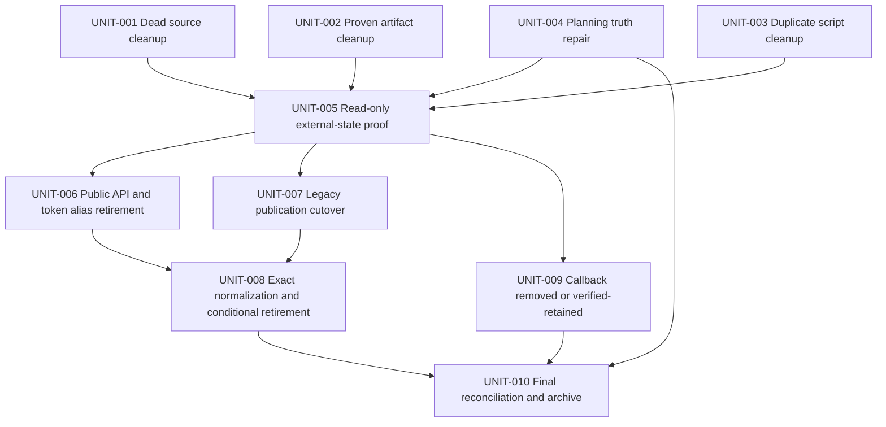

# Legacy Cleanup Implementation Plan

## Execution Contract

This is the canonical execution artifact. Execute the smallest ready unit, verify its stop condition, update `LOOP_LEDGER.md` and `plan-pack.json`, then choose the next dependency-closed unit.

General rules:

1. Inspect fresh scoped `git status` before every unit and preserve concurrent work.
2. Re-run symbol impact before editing any function/class/method not already covered by this audit.
3. Prefer deletion and existing canonical paths over wrappers or compatibility layers.
4. Do not edit applied D1 migrations or historical Supabase migrations.
5. Do not delete a public route, token alias, provider worker, or data fallback from repository-only evidence.
6. The owner explicitly authorized the scoped automated test edits and targeted commands named by `UNIT-001` and `UNIT-003` on 2026-07-15. Builds, browser QA, screenshots, later-unit tests, and broader suites remain unauthorized unless separately requested.
7. Static source scans, diffs, lint/type analysis, D1 read-only queries, and provider readback/log inspection are the default proof surfaces.
8. Stop immediately if a candidate gains a current production caller or its prerequisite evidence is not satisfied; reclassify it in the audit instead of forcing deletion.

## Unit DAG

`UNIT-001` through `UNIT-004` are independently ready under the scoped test authorization above; `UNIT-002` remains next. `UNIT-005` starts only after all four local units verify; later retirement units remain planned until their evidence gates pass.

## UNIT-001 — Remove Proven Dead Production Source

**Status:** `READY`
**Depends on:** none
**Goal:** delete current source symbols that have no production consumer while preserving active behavior and retargeting useful tests to canonical components.

### Edits

- Delete `src/components/share/SharePageSummaryCard.tsx`.
- Delete `tests/vitest/share/share-summary-card.test.tsx`; it tests only the deleted component, not the current share layout.
- Delete `src/components/workshop/publisher/PublisherProjectMembersPanel.tsx`.
- Retarget `tests/vitest/publisher-access-mode.test.tsx` to `ProjectMembersAccessPanel`.
- Remove compatibility-shim source assertions from:
  - `tests/vitest/publisher-page-contract.test.ts`
  - `tests/vitest/project-collaboration-actions.test.ts`
- Remove `EXPRESS_COMPONENTS_FLAG` and `isExpressComponentsAuthoringEnabled` from `src/lib/estimates/express-components.ts`.
- Remove their import/cases from `tests/vitest/express-components.test.ts`.
- Remove `CLIENT_PORTAL_LEGACY_COMPATIBILITY` from `src/lib/client-portal/contracts.ts`.

### Before Editing

- Use only the 2026-07-15 authorization for the listed focused test edits and targeted commands; do not expand into browser, build, or broad-suite testing.
- Re-run GitNexus upstream impact for any changed function whose source has drifted.
- Confirm `rg` still finds no production importer for the four candidates.
- Confirm the current share page uses `SharePageHero`, `SharePageOverview`, and `ShareFinancialOverview` rather than `SharePageSummaryCard`.

### Verification and Stop Condition

- `rg` finds no remaining source/test import of deleted symbols or files.
- Publisher access behavior coverage targets the canonical teamwork panel.
- No Client Portal migration service/action/UI symbol is removed in this unit.
- Run scoped lint/type analysis only if available and decisive.
- `git diff --check` passes for the unit scope.

## UNIT-002 — Delete Tracked Scratch and Obsolete Raw Artifacts

**Status:** `READY`
**Depends on:** none
**Goal:** remove repository noise and exact scaffold assets that have no runtime, documentation, external-contract, or current design-evidence consumer.

### Edits

- Delete root `=` and `test-table.tsx`.
- Delete `.playwright-mcp/**` and remove `.playwright-mcp/**` from `eslint.config.mjs` ignores.
- Delete `scripts/shot-glass-newdesign.mjs` and `scripts/shot-glass-crops.mjs`.
- Delete only the fourteen `.design-shots` outputs listed under `LC-017`.
- Delete only the seven owner-approved root screenshots in `LC-020`: `save-design-full.png`, `v10-full-1440.png`, `v10-final-full-1440.png`, `v10-mobile-375.png`, `v10-hero-1440.png`, `v10-final-hero.png`, and `intercom-hero.png`.
- Delete only the five untouched Next scaffold assets in `LC-038`: `public/file.svg`, `public/globe.svg`, `public/next.svg`, `public/vercel.svg`, and `public/window.svg`.

### Explicit Retentions

- Keep `.design-shots/add-component-modal/**` and all other unlisted design shots.
- Keep `public/Screenshot 2026-05-18 at 9.00.39 PM.png` until both provenance and public-demand evidence are complete.
- Keep every other public asset; the zero-reference/scaffold proof is specific to the five `LC-038` files.
- Keep `archestimator_pitch deck/`, `archestimator_executive_summary/`, `claude-design-reference/`, and `philip-lewis-cv/` untouched under the owner decision.
- Keep `.github/workflows-disabled/**` disabled and untouched.
- Keep archived `.ai` evidence that names deleted screenshots or components; historical prose does not become invalid merely because the old file is removed.

### Verification and Stop Condition

- `git ls-files` returns none of the deleted paths.
- No surviving script references `/tmp/sb-cookies.json` for these obsolete glass captures.
- The seven `LC-020` root screenshots are absent; the separate public screenshot is unchanged.
- Retained design and owner-asset directories are unchanged.
- `git diff --check` passes for the unit scope.

## UNIT-003 — Collapse Duplicate Scripts and Deployment Config

**Status:** `READY`
**Depends on:** none
**Goal:** leave canonical development, lint, performance, provider-exit, and schedule truth; minimize the still-required Vercel guard; and remove completed or stale Supabase-era executable capability without deleting historical evidence.

### Edits

- Remove `lint:font-size` from `package.json` and delete `scripts/enforce-app-font-size.mjs`.
- Delete root `enable-leaked-password-protection.sh`; retain its archived helper as historical evidence.
- Remove duplicate `predev:turbo` and `dev:turbo` aliases.
- Update `tests/vitest/dev-runtime-memory-safety.test.ts` source-contract assertions to canonical `predev` and `dev` only.
- Move Vercel cron parity assertions in `tests/vitest/cloudflare-scheduled-upload-jobs.test.ts` to `src/lib/cloudflare/scheduled-upload-jobs.ts` and/or `wrangler.jsonc`.
- Reduce `vercel.json` to the minimal `git.deploymentEnabled: false` guard: remove the stale `regions` and two-cron block, because Worker configuration owns all three current schedules.
- Restore `.vercel/` to `.gitignore` so local project metadata cannot be reintroduced while the linked Vercel project still exists.
- Remove `perf:collect-live-evidence` and its README command together with `scripts/collect-live-db-performance-evidence.ts`, or repoint the one canonical command to current D1-specific proof tooling; preserve any generated historical evidence.
- After preserving the final zero-blocker report and reconciling the authentication follow-up, remove `scripts/generate-supabase-type-reference-retirement-inventory.ts` and its focused self-referential test.
- Confirm canonical D1 duplicate-decision coverage, preserve any unique provider-parity evidence under `supabase/migration-evidence`, then remove `tests/vitest/share/duplicate-decision-race.provider.test.ts` from the active suite and provider allowlist.
- Repair stale provider-cleanup allowlist paths for notification RLS and upload storage denial proof so they point at retained `supabase/migration-evidence/provider-parity-proofs/tests/**` files or are removed as stale entries.

### Before Editing

- Use only the 2026-07-15 authorization for the listed focused test edits and targeted commands; do not expand into browser, build, or broad-suite testing.

### Explicit Retentions

- Keep `wrangler.jsonc`, `wrangler.next-dev.jsonc`, and `wrangler.auth-callback-normalizer.jsonc`.
- Keep all three active Wrangler schedules: `0 3 * * *`, `15 3 * * *`, and `30 3 * * *`.
- Keep the minimal deployment-disabled `vercel.json` guard until the Vercel project is decommissioned, Archestimator domains are detached, and a dated readback proves the guard unnecessary.
- Keep `tests/vitest/vercel-analytics-removed.test.ts`; it is a negative regression contract proving no Vercel Analytics runtime dependency.
- Keep `supabase/**` and generated provider-exit evidence as historical lineage.
- Keep current provider-exit/readiness scripts in `LC-039` while the authentication/provider-exit follow-up still consumes them; re-audit callers after that follow-up is reconciled.

### Verification and Stop Condition

- `package.json` has no duplicate command aliases.
- All cron-source assertions point to Worker-owned truth.
- `vercel.json` contains no stale region or cron ownership and still disables Git deployments; `.vercel/` is ignored.
- No canonical package/README command can execute the retired Supabase/Postgres performance collector.
- Completed Supabase type-retirement and active provider-race test loops are removed only with their callers/reports reconciled; retained provider-exit scripts still have named current consumers.
- Provider cleanup classifications name paths that exist.
- `rg` finds no executable root path to the archived Supabase password helper.
- JSON/config parsing and `git diff --check` pass.
- Static config and reference checks pass under the execution contract.

## UNIT-004 — Repair Planning Truth and Reconcile Stale Packs

**Status:** `READY`
**Depends on:** none
**Goal:** make active plans and current architecture/feature authority describe only real repository/provider truth while preserving unresolved obligations and historical lineage before archive moves.

### Edits

- Rebuild `.ai/03_plans/README.md` current inventory from the filesystem instead of preserving the stale 2026-06-19 table.
- Reconcile `.ai/03_plans/2026-07-13/Shared-Link-Page/plan-pack.json` so package, implementation, requirement, criterion, risk, and terminal states agree; archive only if source and evidence prove closure.
- Transfer unresolved obligations from `.ai/03_plans/2026-07-12/Workshop-Library-Audit/` into the current canonical component/estimate plan before archiving the predecessor.
- Triage remaining `correctKinds` and legacy `kind` work in `.ai/03_plans/000-Follow Ups/2026-06-14-Estimate-Tree-Unification-Followups/`; transfer live work, then archive the stale follow-up.
- Keep the Templates follow-up active.
- Reconcile the active authentication/provider-exit follow-up before retiring completed Supabase closure generators or scanners; preserve its final reports when it closes.
- Repair `.ai/00_corpus/ARCHESTIMATOR_MASTER.md`, `.ai/00_corpus/archestimator-app-bible.md`, `.ai/00_corpus/feature-flag-and-env-inventory.md`, `.ai/06_specs/deep/architecture-overview.md`, and `.ai/06_specs/feature-inventory.md` so current architecture, auth, persistence, storage, realtime, deployment, analytics, env, and source-path claims match Better Auth, D1, R2, Durable Objects, Workers/OpenNext, and current source.
- Classify broader Vercel/Supabase documentation hits before editing: repair current authority, retain historical evidence, and archive/supersede obsolete actionable plans. Do not bulk-replace provider names in historical records.
- Mark `docs/superpowers/plans/2026-05-24-component-variant-assets-and-cost-history.md` historical/superseded or archive it with a current successor pointer; do not leave its Supabase CLI/type/upload steps looking executable.

### Coordination Boundary

The July 14 component/estimate pack has concurrent ownership. Re-read its dirty state before any transfer and make additive, minimal updates. Never overwrite another agent's work or archive a pack solely because its date is older.

### Verification and Stop Condition

- Every active-index path exists and every archived pointer targets `.ai/09_archive`.
- No unresolved requirement disappears during reconciliation.
- Each archived pack has a truthful terminal tuple and a successor/reference note where needed.
- The five named current-authority documents contain no live claims that depend on deleted Supabase source paths or retired Vercel hosting/analytics assumptions.
- Historical provider lineage remains clearly historical rather than silently rewritten as current implementation guidance.
- Plan-pack validators pass for every manifest changed by this unit.
- `git diff --check` passes for the unit scope.

## UNIT-005 — Prove Compatibility Demand and External State

**Status:** `PLANNED`
**Depends on:** `UNIT-001`, `UNIT-002`, `UNIT-003`, `UNIT-004`
**Goal:** collect dated, privacy-safe, read-only proof before any public-contract, deployment-guard, environment-alias, or data-shape mutation.

### Evidence Collection

- Inventory all ten `/api/client-portal/[token]/**` handlers using the route matrix in `UNIT-006` and compare method-by-method behavior with canonical `/api/share/[token]/**` handlers.
- Inspect available Worker access logs for `/api/client-portal/` and legacy `?rt=` demand. Store only aggregate, redacted evidence; never persist tokens, client URLs, or PII.
- Inventory active/unexpired shared links and recipient URL formats from D1 without exposing token values.
- Count `client_portal_legacy_mappings` by `migration_status` and find active `project_publications` without a verified/cutover mapping.
- Reconcile migrated recipient credentials, comments, decisions, immutable issue content, and history counts per publication.
- Read back `ARCHESTIMATOR_AUTH_PROVIDER` values from every configured environment without changing them.
- Count legacy blank-row material/tag rows and the affected activity-history representations without changing them.
- Count records where canonical adjustment data is missing but `contingencyPercentage` fallback still supplies current behavior.
- Inspect current callback-normalizer route precedence and OAuth callback behavior without deploying changes.
- Re-confirm Vercel project/domain linkage and deployment settings without changing them before deleting the minimal guard. The 2026-07-15 receipt already proves the guard is currently required; unavailable or changed-but-incomplete evidence forces retention.

### Required Receipt Schema

The receipt records UTC collection time, environment, source system, query/log identifier, observation start/end, retention coverage, completeness limits, and aggregate result. For each legacy route and HTTP method it records request count and status-class counts separately for every deployed environment. Public-demand evidence must cover at least 30 consecutive days ending no more than 24 hours before the receipt; if provider retention is shorter, any environment is missing, or logs are sampled/incomplete, the candidate remains retained. Issued-link evidence separately records active, unexpired, expired, and revoked counts; the `rt` alias cannot retire until every alias-bearing link is expired or revoked and the 30-day route window is zero. No token, URL, email, IP address, or client identifier is stored.

### Pass Gates

- Public route/token retirement requires no active issued dependency, zero requests for every route/method across every deployed environment during the complete 30-day window, and no documented integration owner.
- Legacy migration retirement requires zero eligible unmigrated rows and per-publication reconciliation receipts.
- Data and auth mutation eligibility requires exact pre-change counts and an enumerated mutation scope; actual normalization occurs only in `UNIT-008`.
- Callback retirement remains authorization-bound even if readback is favorable.

### Stop Condition

Produce a dated, redacted compatibility receipt that marks each later unit `READY` or `PLANNED` and records each candidate recommendation as `REMOVE` or `RETAIN`. Absence of logs, missing access, incomplete retention, or an unknown environment forces a `RETAIN` recommendation. `UNIT-005` performs no D1, environment, provider, route, or deployment mutation.

## UNIT-006 — Retire Alternate Public APIs and Legacy Token Alias

**Status:** `PLANNED`
**Depends on:** `UNIT-005`
**Goal:** remove duplicate public contracts only after `UNIT-005` proves no active external obligation.

### Conditional Edits

- Delete only the proxy handlers whose exact route/method demand gate passes:

| Legacy route | Methods | Canonical route |
|---|---|---|
| `client-portal/[token]/decision` | `GET`, `POST` | `share/[token]/decision` |
| `client-portal/[token]/manifest` | `GET` | `share/[token]/manifest` |
| `client-portal/[token]/messages/[messageId]` | `PATCH`, `DELETE` | `share/[token]/messages/[messageId]` |
| `client-portal/[token]/password` | `POST` | `share/[token]/password` |
| `client-portal/[token]/sections/[sectionId]` | `GET` | `share/[token]/sections/[sectionId]` |
| `client-portal/[token]/session` | `POST` | `share/[token]/session` |
| `client-portal/[token]/threads/[threadId]/messages` | `GET`, `POST` | `share/[token]/threads/[threadId]/messages` |
| `client-portal/[token]/threads/[threadId]/read` | `POST` | `share/[token]/threads/[threadId]/read` |
| `client-portal/[token]/threads/[threadId]/status` | `POST` | `share/[token]/threads/[threadId]/status` |
| `client-portal/[token]/threads` | `GET`, `POST` | `share/[token]/threads` |

- Before promotion to `READY`, amend this table if current files, methods, or canonical behavior differ and attach the one-to-one handler comparison receipt.
- Remove legacy `rt` parsing from `src/app/share/[token]/page.tsx` and `src/app/api/share/[token]/unsubscribe/route.ts` if the issued-link gate passes.
- Preserve canonical `/api/share/[token]/**`, recipient session handling, and current Client Portal UI endpoints.
- Repair route maps, docs, source-contract checks, and public-link generation references affected by the removal.

### Stop Condition

- No source, issued link, integration, or observed request requires the removed contract.
- Canonical `/api/share` handlers cover every retained operation.
- Public tokens and recipient credentials remain opaque and no raw token appears in evidence.
- Static route/reference checks and `git diff --check` pass.

## UNIT-007 — Complete Legacy Publication Cutover

**Status:** `PLANNED`
**Depends on:** `UNIT-005`
**Goal:** migrate every eligible legacy publication to Client Portal and close the active migration/rollback corridor without losing recipient access or history.

### Sequence

1. Run dry-run reconciliation for every eligible publication.
2. Fix forward any count/hash/content mismatch before applying cutover.
3. Apply migration only inside bound `ARCH_DB` and record privacy-safe receipts.
4. Verify portal, immutable issue, sections, recipients/credentials, comments/messages, decisions, and activity/history parity.
5. Start a minimum 30-consecutive-day observation window after the last successful eligible cutover and after legacy issuance is disabled. Keep rollback source, mapping rows, and privacy-safe receipts available throughout; restart the window after any rollback, parity incident, or legacy write.
6. Close rollback only after the full window has zero migration incidents, zero rollback requests, zero parity mismatches, and zero demand on every externally callable legacy write endpoint. Unknown or incomplete request evidence forces retention.
7. When zero eligible rows remain and rollback obligations close, remove Publisher migrate/rollback UI, actions, service branches, and legacy write-freeze responses only where both source reachability and external-demand gates pass.

### Non-Goals

- Do not edit `0068`, `0070`, or `0071`.
- Do not delete `project_publications` or mapping/history tables in this unit.
- Do not deploy or mutate unrelated Cloudflare/Supabase resources.

### Stop Condition

All eligible publications are verified/cut over, current public links resolve through the retained canonical path, recipient/comment/decision/history reconciliation passes, and the completed 30-day receipt proves no UI, action, or external endpoint still requires migration, rollback, or write-freeze behavior.

## UNIT-008 — Retire Data Fallbacks and Redundant Schema Forward

**Status:** `PLANNED`
**Depends on:** `UNIT-006`, `UNIT-007`
**Goal:** remove compatibility reads and redundant schema only after current data and public contracts no longer require them.

### Sequence

- Apply environment and D1 normalization only from an amended, exact mutation manifest naming every environment, table, column/JSON field, row predicate, pre-count, expected post-count, and fix-forward recovery command. `UNIT-005` supplies the read-only baseline.
- Normalize any noncanonical `ARCHESTIMATOR_AUTH_PROVIDER` value to `better-auth` one environment at a time, read back after each change, and stop on mismatch.
- Normalize legacy blank-row material/tag and affected history representations only with pre/post counts and semantic-preservation checks.
- Backfill canonical adjustment data only for records whose effective legacy value is proven, across each enumerated row/template/projection/draft store.
- Add a new forward D1 migration for any required schema retirement; never rewrite applied history.
- Remove legacy blank-row material/tag branches only after D1 and history counts are zero or explicitly transformed.
- Remove `contingencyPercentage` fallback reads only after canonical adjustment values exist for rows, templates, projections, exports, and AI package drafts.
- Remove legacy mapping/publication joins only after the public route and migration corridor are closed.
- No table, column, index, trigger, mapping, or history deletion is authorized by this version of the pack. Before `UNIT-008` can become `READY`, amend the unit with the exact new migration filename and SQL operation list, affected source/type paths, retention basis, and rollback/fix-forward strategy. If that exact proof is unavailable, normalize only, record a `RETAIN` decision, and mark the unit `VERIFIED` when its approved normalization scope is complete.
- Update D1 types, repositories, actions, projections, scripts, and docs in one dependency-closed change.

### Stop Condition

Fresh pre/post counts prove normalized state, every configured environment reads back canonical values, source scans find no retired compatibility read/write, any exact forward migration preserves lineage, and retained history remains queryable. A partial mutation, unexpected count, or failed readback stops the unit and triggers fix-forward recovery before source deletion.

## UNIT-009 — Retire Callback Normalizer After Provider Proof

**Status:** `PLANNED`
**Depends on:** `UNIT-005`
**Authorization boundary:** `AUTH-001`
**Goal:** remove the separate callback-normalizer worker only when direct Better Auth/Google callback routing is proven and a fresh external deployment is authorized.

**Current decision (2026-07-15):** `RETAIN`. Read-only Cloudflare readback confirmed that active zone routes still front all apex and `www` traffic with the normalizer. The deployed main Worker contains corresponding OAuth reset handling, but no production-equivalent direct-main-Worker callback proof exists. The owner's conditional removal authorization does not satisfy that missing proof gate.

### Conditional Sequence

- Prove the primary Worker receives and handles canonical OAuth callbacks without path corruption or redirect loops.
- Record current Cloudflare route precedence and service-binding behavior.
- Prepare source/config deletion for `cloudflare/auth-callback-normalizer.ts` and `wrangler.auth-callback-normalizer.jsonc`.
- Confirm the owner's conditional removal authorization is still applicable after direct proof; ask again only if the eventual route change materially differs from this bounded removal.
- Deploy the least-risk route change, verify login/callback behavior, then remove obsolete source/config.

### Stop Condition

Choose one terminal outcome and record it as a manifest decision. `REMOVE`: direct callback behavior is proven on the real custom domain, external routing change is explicitly authorized, rollback is available, and the worker/config have no remaining obligation. `RETAIN`: authorization or decisive provider proof is unavailable, current routing is revalidated, the normalizer remains untouched, and the manifest records `UNIT-009=VERIFIED` plus an active `RETAIN` decision rather than inventing a custom unit status.

## UNIT-010 — Final Reference Reconciliation and Archive

**Status:** `PLANNED`
**Depends on:** `UNIT-004`, `UNIT-008`, `UNIT-009`
**Goal:** prove the cleanup is complete, update current authority, and archive this pack only after every core unit is verified.

### Actions

- Run final scoped reference scans for every deleted symbol, file, route, config, environment alias, migration branch, and plan pointer.
- Run GitNexus `detect_changes` and review affected processes for the complete cleanup diff.
- Reconcile `README.md`, current-state references, active plan index, manifests, and archive pointers.
- Confirm retained assets/evidence and applied migrations were not modified unintentionally.
- Mark risks, criteria, units, implementation status, release status, lifecycle, and terminal state from fresh evidence.
- Archive only when the validator passes, every core unit is `VERIFIED`, and every conditional candidate has an evidence-backed manifest decision stating `REMOVE` or `RETAIN`.

### Stop Condition

All core units are `VERIFIED`; every acceptance criterion is `PASS` or a reconciled boundary; every conditional candidate has an evidence-backed `REMOVE` or `RETAIN` decision; the plan validator, JSON parse, path checks, `git diff --check`, and final graph/reference review pass; and no dangling current pointer remains.

## Verification Summary by Unit

| Unit | Decisive non-test evidence | Product test status |
|---|---|---|
| `UNIT-001` | GitNexus impact, production/test `rg`, scoped lint/type analysis, diff review | Scoped test edits and targeted commands explicitly authorized on 2026-07-15. |
| `UNIT-002` | `git ls-files`, filename/reference scans, retained-path diff | Not required. |
| `UNIT-003` | package/config parsing, source-contract scan, canonical cron comparison | Scoped test edits and targeted commands explicitly authorized on 2026-07-15. |
| `UNIT-004` | path existence, manifest validators, successor/requirement reconciliation | Static validator allowed. |
| `UNIT-005` | complete redacted 30-day route/method receipt, issued-link inventory, D1 counts, environment/Vercel/provider readback; no mutations | Not required. |
| `UNIT-006` | route map, demand receipt, canonical endpoint coverage, static reference scan | Not authorized unless separately requested. |
| `UNIT-007` | migration dry-run/apply reconciliation receipts and D1 counts | Not authorized unless separately requested. |
| `UNIT-008` | forward-migration dry run/readback, D1 counts, source/type/static checks | Not authorized unless separately requested. |
| `UNIT-009` | current-route readback plus a `RETAIN` decision, or provider route plus real callback evidence after authorization plus a `REMOVE` decision | Browser/runtime proof and external mutation require a fresh authorized task. |
| `UNIT-010` | validator, JSON/path/diff checks, GitNexus change impact, status reconciliation | Not required for plan closure unless separately requested. |
