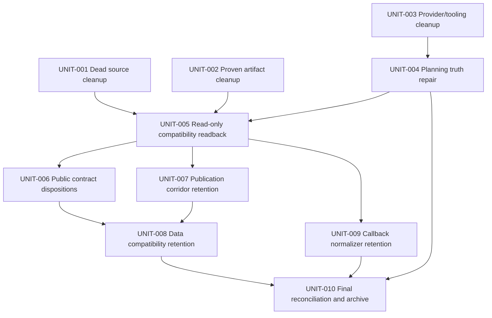

# Legacy Cleanup Implementation Plan

## Execution Contract

This is the canonical execution artifact. A fresh executor may begin at `next_unit` without reading another planning document. All paths are repository-relative unless they begin with `evidence/`, which is relative to this pack.

The package is implementation-ready, not implemented. Every core unit is fully specified as `READY`; dependencies still control execution order. Missing external demand, provider, or data proof never creates an internal planning blocker: the affected candidate ends in the named `RETAIN` outcome and the unit becomes `VERIFIED`.

Binding rules:

1. Before each unit, record `UNIT_START_HEAD=$(git rev-parse HEAD)` and inspect `git status --short --branch`; preserve unrelated work.
2. Before editing a function, class, or method, run fresh GitNexus upstream impact if the source has changed since the 2026-07-15 audit. Stop and warn on `HIGH` or `CRITICAL` risk.
3. Use one writer for the pack and any shared current-authority file. `UNIT-004` follows `UNIT-003` because both touch active provider follow-ups.
4. Do not reset, clean, stash, bulk-restore, rewrite applied migrations, mutate `supabase/**`, or deploy anything.
5. Do not delete a public method, token alias, data fallback, callback Worker, or historical mapping from repository-only evidence.
6. The owner authorized only the exact focused test edits and commands in `UNIT-001` and `UNIT-003`. No browser QA, screenshots, builds-as-tests, broader suites, later-unit tests, or production-domain testing are authorized.
7. `UNIT-005` is read-only. It may query the bound production and preview `ARCH_DB` databases and read provider metadata/log aggregates, but it must not persist tokens, URLs, cookies, emails, IPs, client IDs, or row-level client data.
8. Every unit writes one redacted JSON receipt under `evidence/`, updates `LOOP_LEDGER.md` and `plan-pack.json`, refreshes pack hashes last, and validates the pack before advancing.

## Receipt Contract

Reserve these exact files during implementation:

| Unit | Artifact ID | Evidence ID | Receipt |
|---|---|---|---|
| `UNIT-001` | `ART-101` | `EVID-101` | `evidence/UNIT-001-dead-source-cleanup.json` |
| `UNIT-002` | `ART-102` | `EVID-102` | `evidence/UNIT-002-artifact-cleanup.json` |
| `UNIT-003` | `ART-103` | `EVID-103` | `evidence/UNIT-003-provider-tooling-cleanup.json` |
| `UNIT-004` | `ART-104` | `EVID-104` | `evidence/UNIT-004-planning-truth-repair.json` |
| `UNIT-005` | `ART-105` | `EVID-105` | `evidence/UNIT-005-compatibility-readback.json` |
| `UNIT-006` | `ART-106` | `EVID-106` | `evidence/UNIT-006-public-contract-dispositions.json` |
| `UNIT-007` | `ART-107` | `EVID-107` | `evidence/UNIT-007-publication-corridor-retention.json` |
| `UNIT-008` | `ART-108` | `EVID-108` | `evidence/UNIT-008-data-compatibility-retention.json` |
| `UNIT-009` | `ART-109` | `EVID-109` | `evidence/UNIT-009-callback-normalizer-retention.json` |
| `UNIT-010` | `ART-110` | `EVID-110` | `evidence/UNIT-010-closeout.json` |

Each receipt contains: `schemaVersion`, `unitId`, `sourceRevision`, `startedAt`, `completedAt`, `ownedPaths`, `resourceIdentities`, redacted command/query fingerprints, expected signals, actual aggregate signals, `completeness`, candidate-level `REMOVE|RETAIN|NOT_APPLICABLE` decisions, recovery used or available, validation results, `nextState`, and stale triggers. Raw provider output remains ephemeral. A receipt with incomplete evidence must say why and must choose `RETAIN` for the affected candidate.

When a unit verifies, register its exact `ART-1xx` record with role `evidence` and current hash. Register its exact `EVID-1xx` with `artifact_path` set to the receipt, the same `sha256`, `status=PASS`, `source_revision` set to the completed source HEAD, `valid_until=null`, and `claim_ids` containing the unit plus its matching criterion. Replace that unit's planning-only `EVID-002` link and matching criterion evidence link with the receipt evidence in the same transition. `TEST-001` remains `PLANNED` after `UNIT-001`; after both authorized commands pass in `UNIT-003`, set `TEST-001=PASS` with `evidence_ids=[EVID-101,EVID-103]`. Add `TEST-001` to `EVID-101` and `EVID-103` claim IDs. `UNIT-010` also links `EVID-110` to `GATE-COMPLETION-001`; callback boundary gates also link `EVID-109`. Refresh artifact and manifest hashes only after all status/link edits.

## Unit DAG



`UNIT-002` is the exact next unit. All units are specification-ready; only dependency-satisfied units are executable at a given moment.

## UNIT-001 — Remove Proven Dead Production Source

**Status:** `READY`

**Depends on:** none

**Goal:** delete four production-dead compatibility surfaces and retarget useful coverage to canonical source.

### Owned paths

- `src/components/share/SharePageSummaryCard.tsx`
- `tests/vitest/share/share-summary-card.test.tsx`
- `src/components/workshop/publisher/PublisherProjectMembersPanel.tsx`
- `tests/vitest/publisher-access-mode.test.tsx`
- `tests/vitest/publisher-page-contract.test.ts`
- `tests/vitest/project-collaboration-actions.test.ts`
- `src/lib/estimates/express-components.ts`
- `tests/vitest/express-components.test.ts`
- `src/lib/client-portal/contracts.ts`

### Implementation

1. Reconfirm no production importer for `SharePageSummaryCard`, `PublisherProjectMembersPanel`, `isExpressComponentsAuthoringEnabled`, or `CLIENT_PORTAL_LEGACY_COMPATIBILITY`.
2. Delete `SharePageSummaryCard.tsx` and its component-only test.
3. Delete `PublisherProjectMembersPanel.tsx`; import `ProjectMembersAccessPanel` directly in `publisher-access-mode.test.tsx`; remove only shim-existence assertions from the two source-contract tests.
4. Remove `EXPRESS_COMPONENTS_FLAG` and `isExpressComponentsAuthoringEnabled`; remove only their test imports/cases.
5. Remove `CLIENT_PORTAL_LEGACY_COMPATIBILITY`; leave all migration actions, services, routes, and rollout logic intact.
6. Run exactly:

```sh
bun x vitest run \
  tests/vitest/publisher-access-mode.test.tsx \
  tests/vitest/publisher-page-contract.test.ts \
  tests/vitest/project-collaboration-actions.test.ts \
  tests/vitest/express-components.test.ts \
  --maxWorkers=1
```

### Acceptance evidence

- Receipt: `evidence/UNIT-001-dead-source-cleanup.json`.
- The exact test command passes.
- `rg` finds no current import/reference to deleted symbols or files.
- No Client Portal migration symbol is deleted.
- `git diff --check` passes for the unit diff.

### Recovery

If a current caller appears or the canonical panel cannot preserve the covered behavior, restore only the affected named file from `UNIT_START_HEAD`, revert only its paired test edit, record that candidate as `RETAIN`, and continue the remaining independent deletions. Never reset the worktree.

### Completion and next state

Set `UNIT-001=VERIFIED`. If `UNIT-002` is not verified, `next_unit=UNIT-002`; otherwise advance to `UNIT-003`.

## UNIT-002 — Delete Tracked Scratch and Obsolete Raw Artifacts

**Status:** `READY`

**Depends on:** none

**Goal:** remove only the exact tracked noise, obsolete capture outputs, approved root screenshots, and untouched Next scaffold SVGs.

### Owned delete set

- Root files: `=`, `test-table.tsx`.
- Raw captures: `.playwright-mcp/**` plus only its ignore entry in `eslint.config.mjs`.
- Obsolete scripts: `scripts/shot-glass-newdesign.mjs`, `scripts/shot-glass-crops.mjs`.
- Script-owned outputs:
  - `.design-shots/01-glass-newdesign.png`
  - `.design-shots/01-glass-newdesign-full.png`
  - `.design-shots/03-ref-estimates-list.png`
  - `.design-shots/03-ref-estimates-list-full.png`
  - `.design-shots/04-ref-project-dashboard.png`
  - `.design-shots/05-ref-workshop.png`
  - `.design-shots/crops/crop-center.png`
  - `.design-shots/crops/crop-footer.png`
  - `.design-shots/crops/crop-gutter-left.png`
  - `.design-shots/crops/crop-header.png`
  - `.design-shots/crops/crop-library.png`
  - `.design-shots/crops/crop-mobile.png`
  - `.design-shots/crops/crop-node-top.png`
  - `.design-shots/crops/crop-tree.png`
- Owner-approved root screenshots: `save-design-full.png`, `v10-full-1440.png`, `v10-final-full-1440.png`, `v10-mobile-375.png`, `v10-hero-1440.png`, `v10-final-hero.png`, `intercom-hero.png`.
- Starter assets: `public/file.svg`, `public/globe.svg`, `public/next.svg`, `public/vercel.svg`, `public/window.svg`.

### Mandatory retentions

- `.design-shots/add-component-modal/**` and every unlisted design shot.
- `public/Screenshot 2026-05-18 at 9.00.39 PM.png`; the separator before `PM` is U+202F NARROW NO-BREAK SPACE.
- `archestimator_pitch deck/**`, `archestimator_executive_summary/**`, `claude-design-reference/**`, `philip-lewis-cv/**`.
- `.github/workflows-disabled/**` unchanged and disabled.
- Historical `.ai` prose that names deleted files.

### Implementation

Delete only the owned delete set. Use a filename-safe listing for the retained public screenshot before and after deletion. Do not generalize zero-reference evidence to any other public or design asset.

### Acceptance evidence

- Receipt: `evidence/UNIT-002-artifact-cleanup.json`.
- `git ls-files` returns none of the delete set.
- `git diff --name-status` contains no mandatory-retention path.
- No surviving script references the obsolete glass-capture cookie path.
- `git diff --check` passes.

### Recovery

If any mandatory-retention path is touched, restore only that path from `UNIT_START_HEAD` before continuing. If a delete candidate gains a current consumer, restore that candidate only and record `RETAIN` in the receipt.

### Completion and next state

Set `UNIT-002=VERIFIED`; `next_unit=UNIT-003` unless it is already verified.

## UNIT-003 — Collapse Duplicate Provider-Era Tooling and Config

**Status:** `READY`

**Depends on:** none

**Goal:** leave one canonical command/config path for current Cloudflare/D1 operation while preserving historical provider evidence and a minimal dormant-Vercel guard.

### Owned paths

- `package.json`, `README.md`, `.gitignore`, `vercel.json`.
- `scripts/enforce-app-font-size.mjs`, `enable-leaked-password-protection.sh`.
- `scripts/collect-live-db-performance-evidence.ts`.
- `scripts/generate-supabase-type-reference-retirement-inventory.ts`.
- `scripts/generate-provider-cleanup-allowlist.ts`.
- `tests/vitest/dev-runtime-memory-safety.test.ts`.
- `tests/vitest/cloudflare-scheduled-upload-jobs.test.ts`.
- `tests/vitest/supabase-type-reference-retirement-inventory-script.test.ts`.
- `tests/vitest/share/duplicate-decision-race.provider.test.ts`.
- `tests/vitest/provider-cleanup-allowlist-script.test.ts`.
- `.ai/03_plans/000-Follow Ups/2026-07-03-Authentication-Audit-And-Improvement/11_IMPLEMENTATION_PLAN.md`.
- `.ai/03_plans/000-Follow Ups/2026-07-03-Authentication-Audit-And-Improvement/26_PHASE_5_LEGACY_PROVIDER_CLEANUP_PLAN.md`.
- `.ai/03_plans/000-Follow Ups/2026-07-03-Authentication-Audit-And-Improvement/28_PHASE_5_REMAINING_PROVIDER_FIXTURE_CLEANUP_PLAN.md`.
- `.ai/03_plans/000-Follow Ups/2026-07-03-Authentication-Audit-And-Improvement/29_PHASE_5_PROVIDER_STRING_FILE_INVENTORY.md`.
- `.ai/03_plans/000-Follow Ups/2026-07-02-API-Rate-Limiting-Security-Consolidation/IMPLEMENTATION_PLAN.md`.
- `.ai/03_plans/000-Follow Ups/2026-07-02-API-Rate-Limiting-Security-Consolidation/evidence/request-semantics-matrix.md`.
- `.ai/03_plans/000-Follow Ups/2026-07-02-API-Rate-Limiting-Security-Consolidation/evidence/route-action-inventory.md`.

### Exact implementation decisions

1. Remove `lint:font-size`; delete `scripts/enforce-app-font-size.mjs`.
2. Delete root `enable-leaked-password-protection.sh`; retain its archived helper.
3. Remove `predev:turbo` and `dev:turbo`; update `dev-runtime-memory-safety.test.ts` to assert only `predev` and `dev`.
4. Rewrite `cloudflare-scheduled-upload-jobs.test.ts` to read `wrangler.jsonc`, not `vercel.json`, and assert all four current Worker schedules exactly: `*/5 * * * *`, `0 3 * * *`, `15 3 * * *`, `30 3 * * *`. Preserve upload cleanup/scan mappings against `src/lib/cloudflare/scheduled-upload-jobs.ts`.
5. Replace `vercel.json` with only:

```json
{
  "git": {
    "deploymentEnabled": false
  }
}
```

6. Restore `.vercel/` in `.gitignore`; retain the ESLint ignore and `tests/vitest/vercel-analytics-removed.test.ts`.
7. Delete, do not repoint, the obsolete Postgres/Supabase performance collector: remove `perf:collect-live-evidence`, its root README line, `scripts/collect-live-db-performance-evidence.ts`, and its allowlist override. Preserve `cf:d1-runtime-proof` and `cf:d1-performance-proof`.
8. Preserve both final type-retirement reports under the authentication follow-up, then delete the generator and its self-referential test. Remove `HISTORICAL_SUPABASE_TYPES_PATH` and the retired test from `ACTIVE_AUDIT_TOOLING_TESTS`; update the four named current follow-up files so the preserved reports are terminal evidence, not an executable loop.
9. Delete `tests/vitest/share/duplicate-decision-race.provider.test.ts` and remove it from `ACTIVE_AUDIT_TOOLING_TESTS`. Preserve `supabase/migration-evidence/provider-parity-proofs/prove-shared-link-duplicate-decision-race-http.ts`. Point current API-follow-up guidance to `tests/vitest/project-publication-decision.test.tsx` and `tests/vitest/project-publication-public-repository.test.ts` as canonical D1 coverage.
10. Remove the two stale allowlist overrides for nonexistent `tests/vitest/notification-rls-proof.test.ts` and `tests/vitest/upload-storage-denial-proof.test.ts`; do not repoint them into `supabase/**`, because the scanner intentionally skips that historical tree.
11. In `provider-cleanup-allowlist-script.test.ts`, remove the historical-types and two nonexistent cleanup-candidate fixtures/assertions, leave the remaining classifications unchanged, and make the intentional-fixtures case expect a ready allowlist with no cleanup candidate.

### Focused test command

Run exactly:

```sh
bun x vitest run \
  tests/vitest/dev-runtime-memory-safety.test.ts \
  tests/vitest/cloudflare-scheduled-upload-jobs.test.ts \
  tests/vitest/provider-cleanup-allowlist-script.test.ts \
  tests/vitest/project-publication-decision.test.tsx \
  tests/vitest/project-publication-public-repository.test.ts \
  tests/vitest/vercel-analytics-removed.test.ts \
  --maxWorkers=1
```

### Acceptance evidence

- Receipt: `evidence/UNIT-003-provider-tooling-cleanup.json`.
- Exact test command passes.
- `vercel.json` has only the deployment guard; `.vercel/` is ignored.
- All four schedules come from Worker truth.
- No current command executes the retired collector, generator, provider race test, or root Supabase helper.
- Preserved reports and historical `supabase/**` evidence remain.
- Config/JSON parsing and `git diff --check` pass.

### Recovery

If a retained current script loses its only caller, restore only that caller edit from `UNIT_START_HEAD` and reclassify it in the receipt. If a focused test shows unique behavior in a proposed deletion, keep that exact file and its allowlist entry; do not recreate wrappers or aliases.

### Completion and next state

Set `UNIT-003=VERIFIED`; `next_unit=UNIT-004`.

## UNIT-004 — Repair Planning Truth and Current Authority

**Status:** `READY`

**Depends on:** `UNIT-003`

**Goal:** make current planning and architecture authority truthful without archiving unresolved work or rewriting historical lineage.

### Owned paths

- `.ai/03_plans/README.md`.
- `.ai/03_plans/2026-07-13/Shared-Link-Page/README.md`.
- `.ai/03_plans/2026-07-13/Shared-Link-Page/04-IMPLEMENTATION-REEVALUATION-2026-07-13.md`.
- `.ai/03_plans/2026-07-13/Shared-Link-Page/plan-pack.json`.
- `.ai/03_plans/2026-07-12/Workshop-Library-Audit/README.md`.
- `.ai/03_plans/2026-07-12/Workshop-Library-Audit/09-IMPLEMENTATION-READY-RECONCILIATION.md`.
- `.ai/03_plans/000-Follow Ups/2026-06-14-Estimate-Tree-Unification-Followups/README.md`.
- The four authentication follow-up files already named in `UNIT-003`.
- `.ai/00_corpus/ARCHESTIMATOR_MASTER.md`.
- `.ai/00_corpus/archestimator-app-bible.md`.
- `.ai/00_corpus/feature-flag-and-env-inventory.md`.
- `.ai/06_specs/deep/architecture-overview.md`.
- `.ai/06_specs/feature-inventory.md`.
- `docs/superpowers/plans/2026-05-24-component-variant-assets-and-cost-history.md`.

### Exact reconciliation decisions

1. Replace `.ai/03_plans/README.md` with a concise current inventory containing every path that exists in these groups: the standalone 2026-06-29 Cloudflare pack; all three 2026-07-12 packs; the 2026-07-13 Shared-Link pack; the 2026-07-14 Component pack; both 2026-07-15 packs; and all seven folders under `000-Follow Ups`. Keep archived packs in a separate archive section.
2. Keep `Shared-Link-Page` active. Set its six requirements to `ACCEPTED`; preserve `IMPLEMENTATION_READY / COMPLETE / NOT_EVALUATED / ACTIVE / ACTIVE`, verified units, passing criteria, and open release/hosted risks. Update stale “implementation pending” rationale; do not archive it.
3. Keep `Workshop-Library-Audit` active as a predecessor/reference, not canonical execution authority. Point overlap to `2026-07-14/Component-Variant-And-Estimate-Row-Audit`, but preserve distinct unresolved U1–U6 obligations: direct-upload authorization, upload/attachment atomicity, write guards/bulk archive, template reads/pagination, proposal XLSX audience/formula safety, and export/import product choice. Do not transfer or archive without a later exact crosswalk.
4. Keep the Estimate-Tree follow-up active. Mark FU-4 `RETAIN`: `src/lib/share/reconstruct-share-tree.ts` still affects designation-fallback share hierarchy because `src/components/share/ShareEstimateTreeView.tsx` and `src/components/share/ShareEstimateTreePanel.tsx` consume `node.kind`. Keep FU-1–FU-3 as user-gated browser/visual proof and FU-5–FU-6 as historical/future migration depth. Do not delete `correctKinds` or archive the folder.
5. Keep the Templates follow-up active and untouched.
6. Keep the authentication/provider-exit follow-up active for hosted/operator/legal closure; reconcile only references made stale by `UNIT-003`.
7. Rewrite the five current-authority documents to Better Auth, D1, R2, Durable Objects, Queues/Cron, Workers/OpenNext, and current source paths. Do not bulk-replace provider names in historical records.
8. Add a top-of-file historical/superseded notice to the May 24 component plan with a pointer to the July 14 Component pack. Leave its historical implementation steps intact below the notice.
9. Make no archive move in this unit.

### Acceptance evidence

- Receipt: `evidence/UNIT-004-planning-truth-repair.json`.
- Every active-index path exists and every archive pointer targets `.ai/09_archive`.
- The Shared-Link manifest validates with accepted requirements and no false archive claim.
- The Workshop and Estimate-Tree packs retain their named unresolved work.
- The five current-authority files contain no live Supabase/Vercel-runtime claim.
- All changed pack validators and `git diff --check` pass.

### Recovery

If a concurrent pack changed after unit start, stop editing that pack, retain its current state, and record the deferred path; do not overwrite it. Restore only any incorrect current-authority statement from `UNIT_START_HEAD`, then replace it with the source-proven claim.

### Completion and next state

Set `UNIT-004=VERIFIED`. When `UNIT-001`, `UNIT-002`, and `UNIT-004` are verified, set `next_unit=UNIT-005`.

## UNIT-005 — Collect Read-Only Compatibility and Provider Evidence

**Status:** `READY`

**Depends on:** `UNIT-001`, `UNIT-002`, `UNIT-004`

**Goal:** produce one privacy-safe aggregate receipt that mechanically drives `REMOVE|RETAIN` outcomes without mutating data, provider configuration, or routes.

### Owned read-only surfaces

- Main Worker `archestimator-proof`, its workers.dev hostname, `archestimator.com`, and `www.archestimator.com` as returned by current Cloudflare readback.
- Bound production D1 `archestimator-proof-db` (`ARCH_DB`) and preview D1 ID from `wrangler.jsonc`.
- The ten route files under `src/app/api/client-portal/[token]/**` and their canonical mappings in `UNIT-006`.
- `src/lib/publication/email-links.ts`, `src/app/share/[token]/page.tsx`, and `src/app/api/share/[token]/unsubscribe/route.ts`.
- `client_portal_legacy_preflight`, `client_portal_legacy_mappings`, `project_publications`, `client_portals`, `client_portal_recipients`, `client_portal_recipient_credentials`, `estimate_row_items`, and `estimate_sheet_events`.

### Exact D1 aggregate query

Write the following to an ephemeral `/tmp/legacy-cleanup-unit-005.sql`, hash its bytes into the receipt, run it once with `--remote` and once with `--preview`, then delete the temporary file:

```sql
SELECT status, COUNT(*) AS count FROM project_publications GROUP BY status ORDER BY status;
SELECT migration_status, COUNT(*) AS count FROM client_portal_legacy_mappings GROUP BY migration_status ORDER BY migration_status;
SELECT legacy_status, COALESCE(migration_status, 'unmapped') AS migration_status, COUNT(*) AS count
FROM client_portal_legacy_preflight
GROUP BY legacy_status, COALESCE(migration_status, 'unmapped')
ORDER BY legacy_status, migration_status;
SELECT status, COUNT(*) AS count FROM client_portals GROUP BY status ORDER BY status;
SELECT status, COUNT(*) AS count FROM client_portal_recipients GROUP BY status ORDER BY status;
SELECT status, COUNT(*) AS count FROM client_portal_recipient_credentials GROUP BY status ORDER BY status;
SELECT COUNT(*) AS live_legacy_blank_rows
FROM estimate_row_items
WHERE trim(material) = 'Drag or add a component here'
   OR EXISTS (
     SELECT 1
     FROM json_each(estimate_row_items.metadata_json, '$.tags')
     WHERE value = 'manual-row-placeholder'
   );
SELECT COUNT(*) AS history_events_with_legacy_blank_marker
FROM estimate_sheet_events
WHERE instr(COALESCE(old_snapshot, ''), 'Drag or add a component here') > 0
   OR instr(COALESCE(new_snapshot, ''), 'Drag or add a component here') > 0
   OR instr(COALESCE(payload, ''), 'manual-row-placeholder') > 0;
```

Run exactly:

```sh
bun x wrangler d1 execute ARCH_DB --remote --file /tmp/legacy-cleanup-unit-005.sql --json
bun x wrangler d1 execute ARCH_DB --preview --file /tmp/legacy-cleanup-unit-005.sql --json
```

Store only aggregate counts and resource identity in the receipt.

### Demand and configuration evidence

1. Build a method-level route matrix from the exact source files. For each method record shared delegate, token class, origin/CSRF rule, rate limit, request body, cookies, success/error status, response shape, and cache headers.
2. Attempt a read-only Cloudflare Observability query for `/api/client-portal/` grouped by route template, method, environment/hostname, and status class. A removal candidate requires a complete unsampled 30-consecutive-day window ending within 24 hours of the receipt. Live-only `wrangler tail`, sampled logs, missing hostnames, short retention, or unavailable credentials are `incomplete`, not zero demand.
3. Do not inspect or reconstruct raw issued URLs. `shared_link_recipients` stores token hashes but no alias-format or expiry provenance, while current issuance uses `recipient`. Therefore legacy `rt` is predetermined `RETAIN` in this pack.
4. Do not read secret values or add a debug endpoint for `ARCHESTIMATOR_AUTH_PROVIDER`. Source truth plus unavailable hosted secret-value proof predetermines provider aliases as `RETAIN` in `UNIT-008`.
5. Do not re-confirm Vercel in this shared evidence gate. The minimal deployment guard remains until a separate administrative decommission task supplies proof.

### Acceptance evidence

- Receipt: `evidence/UNIT-005-compatibility-readback.json`.
- Production and preview D1 results are aggregate-only and identify query hash/resource.
- Every legacy route/method has a source-equivalence row and demand-completeness result.
- Every incomplete source forces candidate-level `RETAIN`.
- `rt`, auth aliases, publication corridor, data fallbacks, and callback normalizer have explicit downstream disposition inputs.
- No repository, D1, provider, Vercel, route, or environment mutation occurs.

### Recovery

This unit is read-only. If a command emits sensitive row data, delete the local/raw output immediately, do not commit it, rerun only the aggregate query, and record the recovery without preserving the sensitive material.

### Completion and next state

Set `UNIT-005=VERIFIED`; `next_unit=UNIT-006`.

## UNIT-006 — Resolve Alternate Public API and Token-Alias Candidates

**Status:** `READY`

**Depends on:** `UNIT-005`

**Goal:** remove only independently proven legacy method exports; retain every method with incomplete demand proof and retain `rt` unconditionally for this pack.

### Exact route map

| Legacy file | Methods | Canonical file |
|---|---|---|
| `src/app/api/client-portal/[token]/decision/route.ts` | `GET`, `POST` | `src/app/api/share/[token]/decision/route.ts` |
| `src/app/api/client-portal/[token]/manifest/route.ts` | `GET` | `src/app/api/share/[token]/manifest/route.ts` |
| `src/app/api/client-portal/[token]/messages/[messageId]/route.ts` | `PATCH`, `DELETE` | `src/app/api/share/[token]/messages/[messageId]/route.ts` |
| `src/app/api/client-portal/[token]/password/route.ts` | `POST` | `src/app/api/share/[token]/password/route.ts` |
| `src/app/api/client-portal/[token]/sections/[sectionId]/route.ts` | `GET` | `src/app/api/share/[token]/sections/[sectionId]/route.ts` |
| `src/app/api/client-portal/[token]/session/route.ts` | `POST` | `src/app/api/share/[token]/verify/route.ts` |
| `src/app/api/client-portal/[token]/threads/[threadId]/messages/route.ts` | `GET`, `POST` | `src/app/api/share/[token]/threads/[threadId]/messages/route.ts` |
| `src/app/api/client-portal/[token]/threads/[threadId]/read/route.ts` | `POST` | `src/app/api/share/[token]/threads/[threadId]/read/route.ts` |
| `src/app/api/client-portal/[token]/threads/[threadId]/status/route.ts` | `POST` | `src/app/api/share/[token]/threads/[threadId]/status/route.ts` |
| `src/app/api/client-portal/[token]/threads/route.ts` | `GET`, `POST` | `src/app/api/share/[token]/threads/route.ts` |

### Mechanical decision rule

For each method independently:

- `REMOVE` only when `UNIT-005` records complete 30-day zero demand on every hostname, no documented integration owner, and full handler-contract equivalence.
- Otherwise `RETAIN` without further discussion.
- Remove an exported method, not the whole file, when another method in that file is retained. Delete the file only when every method is `REMOVE`.
- `rt=RETAIN`: do not edit `src/app/share/[token]/page.tsx` or `src/app/api/share/[token]/unsubscribe/route.ts` in this unit.
- Preserve every canonical `/api/share/[token]/**` file and `ClientPortalShell` fetch.
- Update the API follow-up route matrix only for methods actually removed.

No test command is authorized. Use source equivalence, route/reference scans, TypeScript/LSP diagnostics if available, and `git diff --check`.

### Acceptance evidence

- Receipt: `evidence/UNIT-006-public-contract-dispositions.json`.
- Every route/method and `rt` has a separate `REMOVE|RETAIN` decision with its evidence completeness.
- Removed exports have no observed/documented demand and retain canonical behavior.
- Retained exports are unchanged.
- No raw token, URL, cookie, client identifier, or request row is stored.

### Recovery

For a removed method that gains a caller or later release incident, restore only its exact proxy delegate from `UNIT_START_HEAD`, mark that method `RETAIN`, and restart its future demand window. Restore a deleted route file only if all of its methods were removed. Do not alter canonical handlers.

### Completion and next state

Set `UNIT-006=VERIFIED`; `next_unit=UNIT-007`.

## UNIT-007 — Retain the Active Legacy Publication Cutover Corridor

**Status:** `READY`

**Depends on:** `UNIT-005`

**Goal:** close the cleanup candidate with an evidence-backed `RETAIN` decision instead of starting a migration program inside a repository-cleanup pack.

### Owned read-only paths

- `src/components/workshop/publisher/PublisherDrawer.tsx`
- `src/components/workshop/publisher/usePublisherDrawer.ts`
- `src/lib/client-portal/legacy-migration-actions.ts`
- `src/lib/client-portal/legacy-migration-service.ts`
- `src/lib/client-portal/rollout.ts`
- `src/lib/client-portal/public-repository.ts`
- `src/lib/publication/d1-store.ts`
- `src/lib/publication/public-repository.ts`
- `src/lib/publisher/drawer-actions.ts`
- `src/lib/publisher/roster-repository.ts`
- `src/app/api/share/[token]/comment/route.ts`
- `src/app/api/share/[token]/decision/route.ts`
- `migrations/0068_client_portal_foundation.sql`
- `migrations/0070_client_portal_legacy_migration_rollout.sql`
- `migrations/0071_client_portal_legacy_write_freeze.sql`

### Binding disposition

`RETAIN_ACTIVE`. Current Publisher UI and manager-authorized actions expose migration/verify/rollback; public reads and writes still depend on mappings and write-freeze semantics; current service writes `verified` but does not provide a complete `verified -> cutover_complete` closure corridor; and `UNIT-005` may find active or unmapped publications. This pack will not invent a compare-and-set writer, disable legacy issuance, mutate hosted rows, run an observation campaign, or delete applied migration lineage.

Implementation is limited to recording the current aggregate counts, source reachability, and retention reason in the receipt and manifest. A future dedicated cutover pack must separately define issuance shutdown across create/republish/rotate/recipient-add/resend actions, manager-authorized state transitions, rollback, observation, and external release proof.

### Acceptance evidence

- Receipt: `evidence/UNIT-007-publication-corridor-retention.json`.
- Decision is exactly `RETAIN`.
- All named source, mapping, migration, write-freeze, recipient, comment, decision, and rollback paths remain unchanged.
- No D1 write, feature-flag change, source deletion, or applied-migration edit occurs.

### Recovery

No intended mutation exists. Restore any accidental change to an owned path from `UNIT_START_HEAD` and keep the retention decision.

### Completion and next state

Set `UNIT-007=VERIFIED`. When `UNIT-006` is also verified, set `next_unit=UNIT-008`.

## UNIT-008 — Retain Data and Historical Compatibility Boundaries

**Status:** `READY`

**Depends on:** `UNIT-006`, `UNIT-007`

**Goal:** close four risky candidates as retained compatibility rather than inventing unproven data/schema mutations.

### Candidate decisions

| Candidate | Owned surfaces | Decision and reason |
|---|---|---|
| Auth-provider aliases | `src/lib/auth/auth-provider-selection.ts` and configured secret values | `RETAIN_ACTIVE`: hosted secret values are not safely readable through current tooling, aliases are low-cost, and removing them can break auth. Do not mutate secrets or add a debug endpoint. |
| Legacy blank row material/tag | `src/lib/estimates/express-components.ts`, `src/lib/estimates/actions.ts`, `src/components/workshop/estimate-sheet/activity-history-model.ts`, `estimate_row_items`, `estimate_sheet_events` | `RETAIN_ACTIVE`: live rows and immutable history can contain either marker; `UNIT-005` counts inform risk but do not authorize rewriting live or historical JSON. |
| Adjustment fallback | `src/components/workshop/component-library/helpers.ts`, `src/components/workshop/estimate-sheet/rows/row-table.tsx`, `src/components/workshop/estimate-sheet/template-insertion-model.ts`, `src/components/workshop/estimate-tree-data.ts`, `src/components/workshop/library/template-editor/template-editor-model.ts`, `src/lib/component-library/project-component-projection.ts`, `src/lib/estimates/d1-action-client.ts`, `src/lib/estimates/estimate-row-total.ts`, `src/lib/estimates/estimate-row-tree-patch.ts`, `src/lib/project-charts/aggregate-project-charts.ts`, `src/lib/proposal-export/build-proposal-export-model.ts`, `src/lib/publication/snapshot.ts`, `src/lib/repositories/component-library-repository.ts`, `src/lib/repositories/workspace-repository.ts` | `RETAIN_ACTIVE`: current relational row/template columns are non-null, but immutable snapshots, projections, package drafts, and imported shapes may omit canonical adjustment data. Do not backfill issued Client Portal content or historical snapshots. |
| Legacy mapping schema and migrations | `client_portal_legacy_mappings`, `project_publications`, migrations `0068`, `0070`, `0071` | `RETAIN_EVIDENCE`: `UNIT-007` retains the corridor. No table, column, index, trigger, history, or mapping deletion and no new migration in this pack. |

### Implementation

Reconcile the `UNIT-005` aggregate results against the four fixed decisions and write the receipt. Make no product source, data, environment, secret, migration, issued-content, or schema change. A future candidate may reopen only with a dedicated exact normalization/cutover plan and new evidence.

### Acceptance evidence

- Receipt: `evidence/UNIT-008-data-compatibility-retention.json`.
- All four candidates are `RETAIN` with source/data rationale and stale triggers.
- No owned product path changes.
- No D1 or secret mutation; no migration file is added or edited.

### Recovery

No intended mutation exists. Restore any accidental owned-path change from `UNIT_START_HEAD`; if aggregate evidence contradicts a rationale, retain the candidate and record the contradiction for a separate plan.

### Completion and next state

Set `UNIT-008=VERIFIED`; `next_unit=UNIT-009`.

## UNIT-009 — Verify-Retain the OAuth Callback Normalizer

**Status:** `READY`

**Depends on:** `UNIT-005`

**Goal:** finish this cleanup candidate as `RETAIN` without browser testing or production routing mutation.

### Owned read-only surfaces

- `cloudflare/auth-callback-normalizer.ts`
- `wrangler.auth-callback-normalizer.jsonc`
- `worker.ts`
- Current Cloudflare routes, deployed version identity, and `ARCH_APP` service binding.

### Binding disposition

`RETAIN_ACTIVE`. The normalizer currently fronts apex and `www` traffic and performs stale/duplicate Better Auth state-cookie recovery before forwarding to `archestimator-proof`. Main-Worker source similarity is not independent real-domain callback proof.

Attempt a fresh read-only route/version/service-binding snapshot. If unavailable or changed, still retain and mark evidence incomplete. Do not run credentialed Google OAuth, browser QA, deploy, change route precedence, remove a service binding, or delete source/config.

Future `REMOVE` work is outside this pack and requires both true boundaries:

- `AUTH-001`: authorization for credentialed production-domain Google OAuth and `state_mismatch` recovery proof.
- `AUTH-002`: fresh authorization for the resulting Cloudflare production route/deployment mutation after rollback context is captured.

### Acceptance evidence

- Receipt: `evidence/UNIT-009-callback-normalizer-retention.json`.
- Decision is exactly `RETAIN` and records route/readback completeness.
- Worker source, config, routes, service binding, and deployed ownership are unchanged.
- The two future authorization boundaries remain release-only and do not block cleanup implementation.

### Recovery

No intended mutation exists. Restore any accidental source/config edit from `UNIT_START_HEAD`. If a readback differs, retain first and open a separate provider investigation; do not “repair” production routing from this unit.

### Completion and next state

Set `UNIT-009=VERIFIED`. When `UNIT-004` and `UNIT-008` are verified, set `next_unit=UNIT-010`.

## UNIT-010 — Final Reconciliation and Archive

**Status:** `READY`

**Depends on:** `UNIT-004`, `UNIT-008`, `UNIT-009`

**Goal:** prove all cleanup work and retention decisions reconcile, then archive the completed pack without claiming external release proof.

### Owned paths

- This pack, including `README.md`, `01-LEGACY-AUDIT.md`, `IMPLEMENTATION_PLAN.md`, `LOOP_LEDGER.md`, `plan-pack.json`, and `evidence/**`.
- `.ai/03_plans/README.md`.
- `.ai/10_state/current-state.md` only if it contains a live pointer to this pack.
- Archive destination: `.ai/09_archive/store/2026-07-15-Legacy-Cleanup-complete/`.

### Implementation

1. Require `UNIT-001` through `UNIT-009=VERIFIED`; stop otherwise.
2. Run final exact reference scans for every removed symbol/file/command/method and retained candidate.
3. Confirm owner assets, disabled workflows, historical `supabase/**`, applied `migrations/**`, callback files, retained public screenshot, and retained compatibility source were not unintentionally changed.
4. Run GitNexus `detect_changes(scope=all)` and review only affected flows.
5. Mark removal and retained-candidate criteria, including `AC-009`, `PASS` when their receipts prove the requested outcome. Keep only the callback release gates `BOUNDARY` for `AUTH-001` and `AUTH-002`.
6. Mark tests `PASS` only from the exact `UNIT-001` and `UNIT-003` receipts. Mark all risks `MITIGATED`, `ACCEPTED`, or `CLOSED` from evidence; none may remain `OPEN` or `REALIZED`.
7. Set every core unit `VERIFIED`, `implementation_status=COMPLETE`, `package_status=IMPLEMENTATION_READY`, `release_status=BOUNDARY`, `plan_lifecycle=ARCHIVED`, `terminal_status=ACHIEVED`, `next_unit=null`, and `ready_slices=[]`.
8. Create `evidence/UNIT-010-closeout.json`, refresh all hashes last, and validate before and after moving the folder to the exact archive destination.
9. Replace the active index entry with the archive pointer and repair any current-state pointer found in step 3.

### Acceptance evidence

- Receipt: `evidence/UNIT-010-closeout.json`.
- Every core unit is `VERIFIED`; every candidate is evidence-backed `REMOVE`, `RETAIN`, or `NOT_APPLICABLE`.
- Exact focused tests are proven only by their receipts; no unrun test is claimed.
- `bun run validate:plan-pack -- <archive-path>`, `bun run validate:planning-prompts`, JSON/path checks, `git diff --check`, and GitNexus change review pass.
- No dangling active pointer remains.

### Recovery

If pre-move validation fails, leave the pack active, fix only the failing artifact/status/hash, and retry. If post-move path repair fails, move the folder back to its original path, restore only the index/current-state pointers from `UNIT_START_HEAD`, and retry; do not leave duplicate copies.

### Completion and next state

Terminal state is `ACHIEVED` with no next unit. The retained callback, public API, publication, data, or Vercel-administration candidates may be reopened only by a new evidence-backed pack or explicitly authorized external task.

## Verification Summary

| Unit | Decisive evidence | Test decision |
|---|---|---|
| `UNIT-001` | Impact/reference scan, exact focused command, diff | `TEST_TASK`, explicitly authorized. |
| `UNIT-002` | Tracked-file and retained-path diff | `NOT_REQUIRED`. |
| `UNIT-003` | Config/source scan, exact focused command, diff | `TEST_TASK`, explicitly authorized. |
| `UNIT-004` | Path/source truth plus plan validators | `NOT_REQUIRED`. |
| `UNIT-005` | Aggregate production/preview D1 and provider completeness receipt | `NOT_REQUIRED`. |
| `UNIT-006` | Method contract and complete demand receipt; otherwise retain | `NOT_REQUIRED`; no later test authorization. |
| `UNIT-007` | Current source plus D1 aggregate receipt supporting retain | `NOT_REQUIRED`. |
| `UNIT-008` | Current compatibility/source invariants supporting retain | `NOT_REQUIRED`. |
| `UNIT-009` | Read-only route snapshot or incomplete-proof retain | `NOT_REQUIRED`; browser proof is `AUTH-001`. |
| `UNIT-010` | Receipts, validators, path/diff/graph reconciliation | `NOT_REQUIRED`. |
