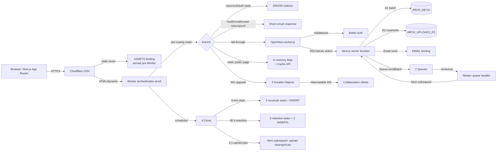
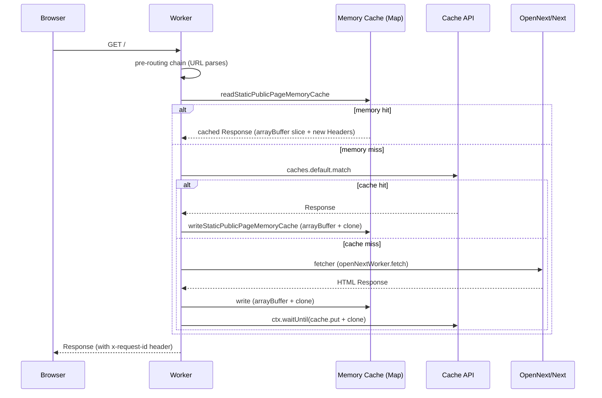
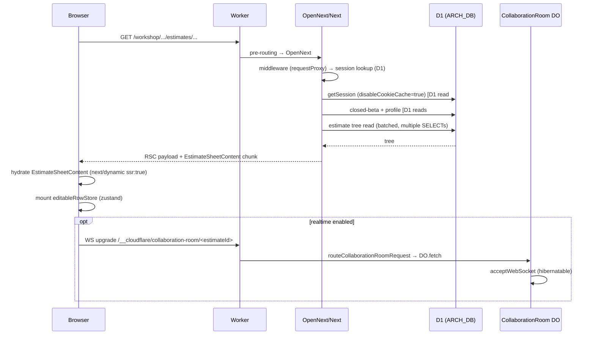
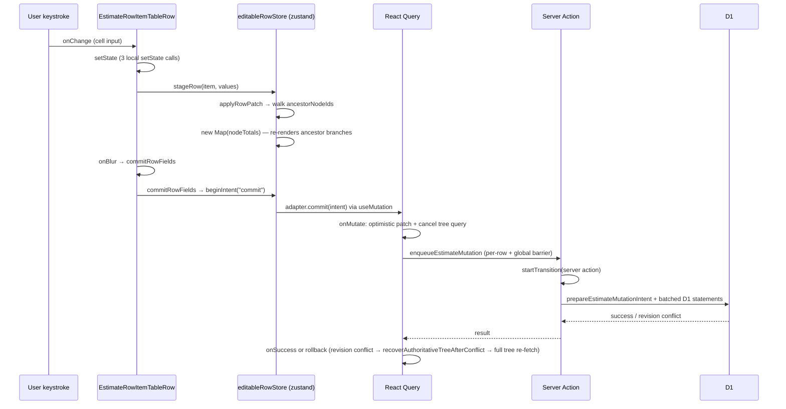
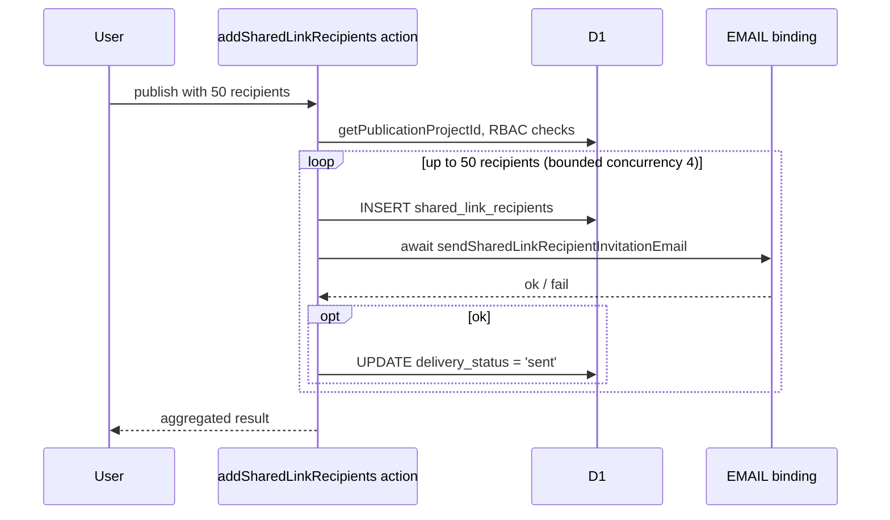
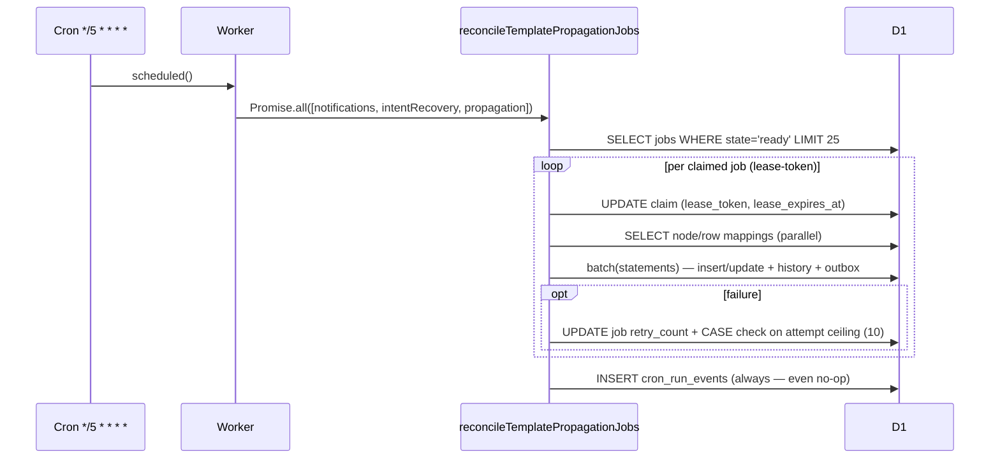
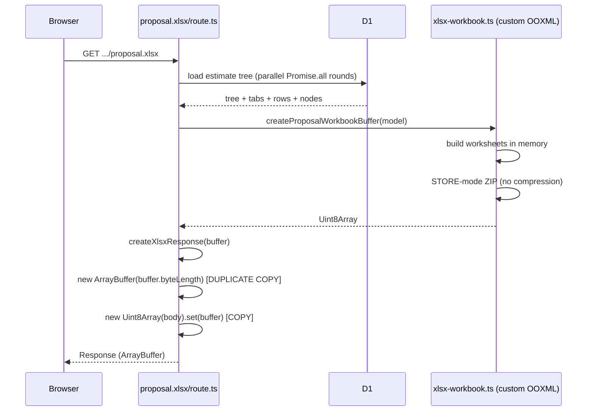

# 03 — Runtime and Dataflow Map

Source maps: `artifacts/raw/{worker-do-queue-cron-map,react-estimate-editor-map,exports-uploads-auth-observability-map}.md` plus lead recon.

## Topology overview

## Worker pre-routing chain (`worker.ts:141-199`)

Every Worker invocation that is not served as a static asset passes through these branches in order. Each may short-circuit; otherwise control falls through.

1. **`resolveRequestId`** — reads `x-request-id` or mints `req_<uuid>`; wraps all subsequent work in `AsyncLocalStorage`.
2. **Canonical host redirect** (`:146`; impl `worker-route-optimizations.ts:141-151`) — one `new URL()` + `Map.get`. 308 on match.
3. **Auth-state mismatch retry** (`:149,152,155`; impl `:236-283`) — three sequential checks, each one `new URL()` parse. On match emits up to **60 Set-Cookie headers** (4 names × 5 paths × 3 domains).
4. **Fast health** (`:158`; impl `:127-139`) — `/api/health` JSON.
5. **Malformed share token** (`:161`; impl `:302-318`) — 43-char base64url regex; 404 for malformed.
6. **Protected proof** (`:164`; impl `protected-proof-routes.ts:23-60`) — pathname parse on every request; six matches; dynamic `import()` of sub-router only on match.
7. **Collaboration DO** (`:167`; impl `collaboration-room-router.ts:29-43`) — DO subrequest on match.
8. **Global presence DO** (`:173`; impl `global-presence-router.ts:22-32`) — routes all to singleton `idFromName("global")`.
9. **Support inbox DO** (`:179`; impl `support-inbox-router.ts:29-43`).
10. **Static public page cache** (`:185-190`; impl `:320-360`) — GET + no cookie/auth + 10 marketing paths only (`:3-14`); in-memory Map + Cache API; `response.clone()` up to twice on cold-cache fill.
11. **OpenNext** (`:192`) — delegates to `.open-next/worker.js`. Response post-processed by `normalizeAuthStateMismatchRedirectResponse`.

**Per-request baseline cost**: every fall-through request pays ~6 `new URL()` parses before OpenNext is reached. WS upgrade responses bypass `responseWithRequestId` header stamping.

## Request flows — critical user journeys

### Public marketing (`/`, `/pricing`, `/features`, `/about`, `/contact`, `/trust`, `/privacy`, `/terms`, `/signup`, `/access-required`)

- **In-memory Map is bounded to 10 keys** but **never evicts** (no TTL/delete). Bounded by path list, not cardinality risk.
- Always ships `AppProviders` client bundle (QueryClient + 7 providers) even on unauthenticated pages — see K-05.

### Estimate editor open (`/workshop/projects/:id/estimates/:id`)

### Estimate row edit (optimistic mutation path)

### Publication + recipient invitation (K-04 — still on request path)

**Problem**: 50 recipients / concurrency 4 = ~13 sequential external email round-trips on the request path, plus 50-100 D1 writes. Stalls workshop UI; risks Workers CPU/wall-clock limit; partial-commit risk on mid-loop failure.

### Linked Template propagation (K-10 — new surface)

### XLSX export (K-13)

## Mutation / batch model

- All multi-statement writes use D1 `database.batch([...])` for atomicity.
- **Hard-throw policy** enforced across the codebase: `if (!database.batch) throw new Error("… requires atomic D1 batch support …")`. Sites: `reusable-sources/actions.ts:626`, `mutation-receipts.ts:57`, `d1-intents/{rows:2430,templates:504,890,tabs:526}.ts`, `projects/actions.ts:347`, `template-propagation-d1.ts:653,675`, `template-mutations.ts:133`.
- `assertD1MutationStatementLimit` guards intent batches.
- `prepareEstimateMutationIntent` correlation/receipt model — idempotency via `correlation_id`.
- `placeholders(values)` helper used everywhere for `IN` clauses — no string concatenation; SQL injection rejected by existing audit.

## Realtime topology

- 3 DO classes, all using **hibernatable WebSockets** (`acceptWebSocket` + `webSocketMessage/Close/Error/alarm`).
- `CollaborationRoom` — per-estimate room, **cap 100 connections/room** enforced (429 on overflow).
- `GlobalPresence` — **singleton DO** (`idFromName("global")`) — global hot point; **no connection cap** in `fetch`.
- `SupportInbox` — per-conversation DO; no cap.
- **No `bufferedAmount`/backpressure handling anywhere** — `sendJson` is fire-and-forget `ws.send`; on throw close with 1011.
- `GlobalPresence.broadcastTimer` (1s debounce setTimeout) is **never cancelled on close** — pending timer prevents hibernation.

## Background job topology

- 2 Queues, both with **`max_concurrency` unset** (use Wrangler default).
- `UPLOAD_JOBS_QUEUE` is **effectively bypassed by cron** — the cron path calls Next routes directly via `fetcher`; the queue's only production producer is `/__cloudflare/jobs-proof` runtime-proof POST.
- `CLIENT_PORTAL_NOTIFICATIONS_QUEUE` has proper cross-batch idempotency via `lease_token` + 5-min lease; but has **two parallel dead-letter channels** (in-code `state='dead'` AND Wrangler DLQ after `max_retries: 10` — both trip at attempt 10).
- 4 Crons; the `*/5 * * * *` cron performs 3 reconciliation tasks in parallel and always inserts a `cron_run_events` row.

## Authentication overhead on every authenticated request

`disableCookieCache: true` passed to `auth.api.getSession` at `src/lib/auth/better-auth-cloudflare.ts:317-319` forces a D1 session lookup on **every authenticated request**, bypassing Better Auth's cookie cache. Plus 2 more sequential D1 reads at `src/lib/auth/session.ts:65-77` (closed-beta + profile). React `cache()` at `session.ts:98` collapses duplicates within one request only.

## Cost-relevant Cloudflare configuration (`wrangler.jsonc`)

| Setting | Value | Cost/observability implication |
|---|---|---|
| `observability.enabled` | true | always on |
| `observability.head_sampling_rate` | **1** | full sampling |
| `logs.head_sampling_rate` | **1** | full log sampling |
| `logs.invocation_logs` | true | every invocation logged |
| `logs.persist` | true | logs persisted |
| `traces.enabled` | false | traces off |
| Crons | 4 (incl. `*/5 * * * *`) | 291 cron invocations/day baseline |
| Queue `max_concurrency` | unset on both | Wrangler default |
| Upload vars | 128 MB / 4 MB body / 30 s / 3 concurrent | bounded |

## Surfaces excluded from runtime audit (intentional)

- `supabase/migrations/` — provider-exit archaeology, must not mutate.
- `.ai/09_archive/store/**` — historical evidence only (consulted selectively).
- Agent config dirs (`.cursor/`, `.agents/`, etc.) — not runtime.
- Generated artifacts (`.next/`, `.open-next/`, tsbuildinfo).
