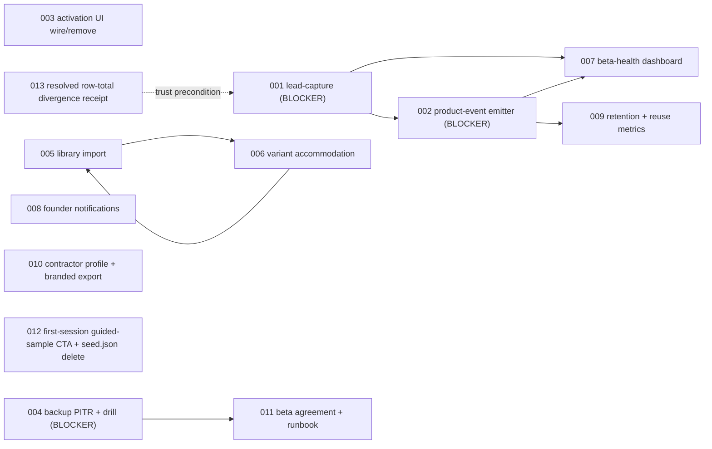

# 00 — PLAN

**Plan pack:** `.ai/03_plans/2026-07-18-MVP-Startup-Readiness-Audit/`
**Suite version:** `2026-07-12`
**Status:** `CONDITIONALLY_READY` / `NOT_STARTED` / `NOT_EVALUATED` · `next_unit: UNIT-001`.
**Generated:** 2026-07-18 (1st pass); 2026-07-19 (2nd pass: schema conformance, defect repair, variant accommodation).
**Audit commit:** `a41a07d0143abf72289a97cd8bd023cfa9986361` on `main`.
**Audit method:** 5 parallel read-only census agents (public conversion, auth/onboarding, library/estimate, proposal/share/support, admin/analytics/billing) + 3 verification agents (validator-shape, pack-defect, variant-accommodation). Lead deep-verified every CRITICAL/HIGH finding against current source before encoding. Speculation, marketing claims, and ungrounded numerics rejected or labeled as inference.
**Companion documents:** narrative depth lives in `00-EXECUTIVE-VERDICT.md`, `01-CAPABILITY-AND-GAP-AUDIT.md`, `02-PRIORITIZED-MVP-BACKLOG.md`, `03-EXPERIMENTS-METRICS-AND-OPERATING-PLAN.md`, `04-FOUNDER-DECISION-PACKET.md`. This file is the canonical execution index; per-unit docs hold the bounded execution detail.

This pack is **distinct from** the three other 2026-07-18 audits (Codebase-Improve, Whole-App-Consistency, Whole-Repo-Performance). Those are engineering lenses; this is the startup/ICP/beta-ops/learning lens. Where they overlap, this pack cross-references the engineering owner rather than duplicating.

---

## 1. Objective And Stop Condition

Determine what Archestimator still needs to become a **learning-capable,
founder-operable, commercially credible MVP** for 5–8 invited design partners,
without writing any product code.

The **planning stage** is complete when every gap is reconciled to a
requirement with current-source evidence, a fix direction, a test decision,
and a dependency-ordered unit that can be picked up by a future executor. The
**execution stage** (separately authorized) is complete when every CORE Stage
A/B requirement is implemented and verified with the cheapest decisive
evidence per the Validation Matrix. Stage C/D items are mapped here only
enough to avoid dead-end architecture; they are not part of the executable
backlog.

The core question:

> Can Philip recruit 5–8 highly qualified design partners, get them to
> meaningful value quickly, observe what they do, support them without
> operational chaos, retain the right users, and obtain credible
> willingness-to-pay evidence — without unacceptable trust, data, or workflow
> risk?

## 2. Scope

**In scope:** the startup-side surfaces that turn a visitor into a qualified
design partner into an activated user into a returning user into a willing
payer. Specifically: acquisition/lead-capture, activation/onboarding,
retention/reuse measurement, product analytics instrumentation, founder
operations and dashboard, pricing evidence, trust/legal minimums, PH AEC
market fit, variant accommodation on the import/export surfaces.

**Out of scope (non-goals):**

- Implementing any product code, migration, or provider change.
- Re-deriving engineering defects owned by sibling audits (consistency
  F-01..F-31, improve 001..033, performance audit findings).
- Stage C/D build-out (Stripe, self-serve signup, automated billing, abuse
  prevention, PDF, mobile, enterprise). These are mapped in
  `02-PRIORITIZED-MVP-BACKLOG.md` Milestone 5/6 only as decision prerequisites
  and architectural dead-ends to avoid; they are not in `ready_slices`.
- Hosted/production deployment proof. All evidence is source-only.
- Tests, builds, browser automation, screenshots, visual QA (User Test
  Authorization Gate).

## 3. Summary Of Verified Findings

15 Stage A/B findings: **5 BLOCKER** (4 startup-side + 1 trust cross-reference),
6 P0 learning/experience, 4 P1 experience. Plus 1 variant-accommodation finding
(G-19) added in the 2nd pass.

Counts by area: Acquisition 2 (G-01, G-18); Activation 4 (G-02, G-03, G-06,
G-19); Learning 4 (G-04, G-05, G-07, G-08); Trust 2 (G-11, cross-reference
E-01/E-02); Credibility 1 (G-09); Founder ops 2 (G-15 runbook + dashboard).
Stage C/D items (G-10, G-12..G-17) are NOT in the executable backlog — they
are mapped in the deferred register (`02-…md` Milestone 5/6) and are not
encoded as units.

**2nd-pass evidence corrections applied (DEF-30, DEF-31, DEF-37):**

- **G-04 GA4 claim corrected.** GA4 IS wired via `@next/third-parties`
  (`LandingAnalyticsLoader.tsx:3,27`, gated on `NEXT_PUBLIC_GA_MEASUREMENT_ID`,
  declared at `package.json:140`). The load-bearing gap is narrower: no
  first-party activation-funnel or attribution events are emitted; the A/B
  tracker fires only landing-page variant events. The fix scope is unchanged
  (emit ~8 funnel events), but the framing no longer erases the existing GA4
  mounting.
- **G-03 activation subsystem framing.** The sibling consistency audit REFUTED
  F-08 (`FirstEstimateChecklist` mounted nowhere) and reclassified the
  activation-checklist subsystem as dead code. G-03 is restated to acknowledge
  this: the entire activation-progress UI is unwired — the checklist component
  is unmounted AND the `health_reviewed` producer never fires. Confidence stays
  CONFIRMED; the unit scope expands to "mount + wire or remove."
- **Admin route count.** `find src/app/admin -name page.tsx | wc -l` returns
  **21** (not "~22"). Cited precisely going forward.

## 4. Requirements

| ID | Requirement (statement) | Source | Class |
| --- | --- | --- | --- |
| `REQ-001` | Every public CTA must persist a lead in D1 with qualification fields and source attribution; no lead may be lost to mailto abandonment. | G-01 | CORE |
| `REQ-002` | A first-party product-event emitter must record funnel events from landing through reuse so activation/retention/pricing decisions rest on evidence. | G-04 | CORE |
| `REQ-003` | The activation-progress UI must be wired (checklist mounted + missing producers emitted) OR removed; the cohort funnel must not show a permanent gap. | G-03 | CORE |
| `REQ-004` | A solo estimator must be able to migrate their existing spreadsheet library into Archestimator with column mapping, validation, and per-workspace caps. | G-02 | CORE |
| `REQ-005` | Spreadsheet import and BOQ export must accommodate the one-component-many-variants pattern (alternates per line item), because PH bid-prep routinely has 2–3 supplier variants per component. | G-19 | CORE |
| `REQ-006` | The founder must see acquisition, activation, retention, support, and incidents in a single dashboard view, replacing the placeholder "Active teams — Repository lane pending" metric. | G-05 | CORE |
| `REQ-007` | Beta feedback, client comments, and client decisions must surface as targeted in-app notifications to the founder within the existing notification system, so critical issues are not missed between manual queue reviews. | G-07 | CORE |
| `REQ-008` | Week-1 / week-4 retention and library-reuse rate must be computable from existing D1 records, so the reuse thesis is testable with data. | G-08 | CORE |
| `REQ-009` | D1 backups / point-in-time recovery must be enabled, documented, and drill-proven before any real design-partner data is at risk. | G-11 | CORE |
| `REQ-010` | Each invited design partner must receive a one-page beta agreement (data backup expectation, support SLA, feedback cadence, founder-member offer terms placeholder) before access. | G-15 | CORE |
| `REQ-011` | The XLSX proposal export must carry the estimator's identity, default payment terms, and validity — not workspace-name placeholders and "To be confirmed" rows. | G-09 | CORE |
| `REQ-012` | The activation-milestone taxonomy must not carry dead entries: either wire `health_reviewed` at its call site or remove it from `ACTIVATION_MILESTONES`. | G-03 (subset) | CORE |
| `REQ-013` | The first-session empty workspace must surface a single clear primary CTA (guided sample) rather than requiring the user to discover it one nav hop away. | G-06 | CORE |
| `REQ-014` | The beta operations workflow (grant access, suspend/reactivate, announce, pause cohort, weekly review, incident triage, restore) must be documented in a single runbook. | G-15 (ops) | CORE |
| `REQ-015` | Source attribution must be captured on every access request so the founder can identify which CTA produced each qualified design partner. | G-01 (subset) + G-18 | CORE |
| `REQ-016` | The former E-01 row-total divergence trust precondition must remain resolved; the 2026-07-19 quality master reverified `CONSISTENCY-001` as already implemented. | E-01 resolved receipt | AUXILIARY |

## 5. Findings Register (Authoritative)

Each finding has a dedicated unit doc `NNN-*.md`. Severity is the audit's;
Priority is the execution ranking. Effort uses S/M/L.

| ID | Sev | Confidence | Title | Unit | Pri | Status |
| --- | --- | --- | --- | --- | --- | --- |
| G-01 | BLOCKER | CONFIRMED | Acquisition funnel dead-ends in `mailto:`; `ClosedBetaGate` `POST /contact` has no handler; zero D1 lead tables | `001` | P0 | TODO |
| G-04 | BLOCKER | CONFIRMED | No first-party product-event emitter; GA4 is mounted but fires only landing-page variant events; activation/reuse side is unmeasured | `002` | P0 | TODO |
| G-03 | BLOCKER | CONFIRMED | Activation-progress UI is unwired: `FirstEstimateChecklist` has zero production consumers AND `health_reviewed` has no producer; `/workshop/onboarding` is a 5-line redirect | `003` | P0 | TODO |
| G-11 | BLOCKER | CONFIRMED-schema, **STRONG_INFERENCE-PITR-default** (re-verify against current Cloudflare D1 docs before locking) | No `backups`/`time_travel` config in `wrangler.jsonc`; no restore runbook; no drill evidence | `004` | P0 | TODO |
| G-02 | HIGH | CONFIRMED | No spreadsheet import; library insert is single-row modal only (2688 lines); the largest adoption blocker | `005` | P1 | TODO |
| G-19 | HIGH | CONFIRMED | Variant-blind import + BOQ export: PH bid-prep uses 2–3 supplier variants per line; current surfaces drop them | `006` | P1 | TODO |
| G-05 | HIGH | CONFIRMED | No single founder dashboard; "Active teams" metric hard-coded `"—"` (`admin/page.tsx:107`); insight scattered across exactly 21 admin pages | `007` | P0 | TODO |
| G-07 | HIGH | CONFIRMED | Notification fan-out kinds (`collaboration`, `publication_activity`, `beta_feedback`) defined but no producer writes them; broadcast-only | `008` | P0 | TODO |
| G-08 | HIGH | CONFIRMED | `activation-retention.ts` is data-TTL only; no week-N retention metric; no reuse-rate metric | `009` | P0 | TODO |
| G-09 | MED | CONFIRMED | XLSX Commercial Terms sheet placeholder-only; contractor identity is interim workspace name; no contractor profile / letterhead | `010` | P1 | TODO |
| G-15 | MED | CONFIRMED | No pre-access beta agreement beyond Terms clickwrap; ops workflow undocumented | `011` | P0 | TODO |
| G-18 | MED | CONFIRMED | No source-attrution field on leads; no referral tracking | `001` (subset) | P0 | TODO |
| G-06 | MED | CONFIRMED | `data/local/seed.json` is dead weight (zero importers); first-session CTA buried one nav hop away | `012` | P1 | TODO |
| E-01 | CRITICAL (historical) | REVERIFIED_RESOLVED | The 2026-07-19 quality master records `CONSISTENCY-001` as already implemented; UNIT-013 is a non-runnable receipt, not an active blocker. | `013` | — | SUPERSEDED |
| E-02 | HIGH (eng) | CONFIRMED-dormant | Closed-beta not enforced on every protected route — owned by consistency audit UNIT-009; dormant while `CLOSED_BETA_ACCESS_ENABLED=false` | (external) | P2 | EXTERNAL-OWNER |

**Deferred / out-of-executable-scope** (Stage C/D; mapped in `02-…md`
Milestone 5/6; NOT encoded as units): G-10 (billing/entitlement), G-12
(uptime monitor), G-13 (overbuild), G-14 (legal counsel), G-16 (collaboration
secondary), G-17 (DSAR helper), plus FD-06/founder-member offer terms,
FD-07/paid value metric, FD-09/counsel engagement, FD-01/outreach target.
These require WTP evidence, paid volume, or external human decisions that do
not yet exist.

## 6. Decisions And Boundaries

| Decision | Status | Rationale |
| --- | --- | --- |
| `DEC-AUTO-001` Build lead-capture as one D1 table + server action (not a CRM, not mailto-only) | Active | One table is the smallest coherent scope for 5–8 design partners; a CRM is ceremony; the mailto path demonstrably loses leads (`ContactForm.tsx:73-84` + `contact/page.tsx` is `force-static`). |
| `DEC-AUTO-002` Build product-event emitter as local D1 `product_events` table; no external SDK | Active | Local table keeps PII inside D1, avoids external dependency, and is sufficient for Stage A/B volume. GA4 is already mounted for landing-side pageviews/A-B events (`LandingAnalyticsLoader.tsx:27`); the gap is first-party funnel events, not SDK adoption. Backfill to PostHog later is reversible. |
| `DEC-AUTO-003` Default first-session to guided sample; do not auto-seed workspace | Active | `startGuidedSample()` (`activation-actions.ts:85-146`) is the only live sample path. Auto-seeding risks polluting real user data; the explicit CTA preserves user agency. |
| `DEC-AUTO-004` Delete `data/local/seed.json` (zero importers); do not wire | Active | Negative grep confirms nothing in `src/` imports it. Kernel §4 mandates deletion of dead code as the autonomous default. |
| `DEC-AUTO-005` Wire `health_reviewed` producer if and only if a health-review UI call site exists in source; else remove from `ACTIVATION_MILESTONES` | Active | A 5-minute grep resolves which; the audit does not need to pre-decide. Either branch is reversible. |
| `DEC-AUTO-006` Stage A proposal surface = legacy shared link (ships today); defer Client Portal consolidation to Stage C | Active | Legacy is simpler and BOQ-XLSX-coupled; Client Portal is richer but overbuilt for solo beachhead. Decision is reversible at Stage C. |
| `DEC-AUTO-007` Stage C payment channel default = GCash + bank transfer (PH-native); defer Stripe indefinitely | Active | Lowest-friction for PH solo operators; no provider integration; reversible. |
| `DEC-AUTO-008` Uptime monitor vendor default = Better Stack free tier | Active | Commodity SaaS choice; free tier sufficient for closed beta; reversible. |
| `DEC-AUTO-009` No new tests unless user authorizes | Active | `NOT_REQUIRED` default; `TEST_PROPOSAL` only where money/auth logic materially benefits. Per User Test Authorization Gate (2026-07-11 decision). |
| `DEC-AUTO-010` Variant accommodation is CORE, not auxiliary | Active | 2nd-pass finding: PH bid-prep routinely has 2–3 supplier variants per line item; an import path that cannot represent them structurally breaks the #1 activation fix. Schema already supports variants; only import/export surfaces are variant-blind. |
| `DEC-AUTO-011` Separate this pack from sibling 2026-07-18 audits | Active | Different intent (startup vs defects/perf). Cross-reference overlaps; do not duplicate engineering findings. |
| `DEC-AUTO-012` Cut 1st-pass Stage C/D forward projections from the executable backlog | Active | Improve-Plan-Prompt §2 forbids speculative scope; M5/M6 had no current evidence justification. Kept as deferred narrative only. |
| `DEC-AUTO-013` Supersede UNIT-013 as an active external dependency | Active | The 2026-07-19 quality master reverified the historical row-total remediation as already implemented; keep only a resolved receipt. |

**Genuine founder decisions** (not encoded as schema records; documented in
`04-FOUNDER-DECISION-PACKET.md` and listed here for traceability):

- **FD-01** Outreach target: real external humans, irreversible time cost.
- **FD-06** Founder-member offer terms: external pricing commitment.
- **FD-07** Paid value metric / entitlement boundary: paid boundary decision.
- **FD-09** Counsel engagement: external paid relationship.

The schema has no `FD-*` slot. These four are real owner decisions and live
as narrative; they do not gate the executable Stage A/B units.

**Authorization boundary:**

- `AUTH-001` — **Not a blocker.** All fixes are local source/migration work
  inside bound `ARCH_DB` and the existing Worker/queue/cron resources
  (standing authorization in `AGENTS.md`). The M1-04 restore drill operates
  against the preview D1 only (`wrangler.jsonc` `preview_database_id`); live
  D1 PITR enablement, if required by current Cloudflare D1 docs, is an
  operational configuration action Philip performs in the Cloudflare
  dashboard — it is not a code change and does not block planning. Remote
  apply, deployment, paid services, and cross-provider work remain excluded.

## 7. Execution Graph

Most units are independent. Hard dependencies:

- `001 → 002` (event emitters include `access_request_submitted`).
- `001, 002 → 007` (dashboard composes leads + activation + events).
- `002 → 009` (retention/reuse metric reads event ledger).
- `006 ↔ 005` (variant accommodation amends the import spike; G-19b export
  extension should land before G-02 implementation so the round-trip is
  consistent).
- `004 → 011` (runbook references restore procedure).
- `013` (external) is a trust precondition for `001`-triggered cohort
  recruitment, not a code dependency.

## 8. Execution Order (Tiered)

Status values: `TODO | IN PROGRESS | DONE | BLOCKED (reason) | REJECTED (rationale)`.

### Tier 1 — Pre-recruit BLOCKERs (do first; the bundled spike from verdict §12)

| Unit | Title | Pri | Effort | Risk | Depends | Status |
| --- | --- | --- | --- | --- | --- | --- |
| 001 | lead-capture table + server action | P0 | S | LOW | — | TODO |
| 002 | product-event emitter + 8 events | P0 | S–M | LOW | 001 | TODO |
| 003 | activation UI mount + `health_reviewed` resolve | P0 | S | LOW | — | TODO |
| 004 | backup PITR enablement + restore drill | P0 | S+M | LOW | — | TODO |

### Tier 2 — Before user #1

| Unit | Title | Pri | Effort | Risk | Depends | Status |
| --- | --- | --- | --- | --- | --- | --- |
| 007 | beta-health dashboard card | P0 | S | LOW | 001, 002 | TODO |
| 008 | founder notification wiring | P0 | S | LOW | — | TODO |
| 011 | beta agreement + ops runbook | P0 | S | LOW | 004 | TODO |
| 012 | first-session guided-sample CTA + delete `seed.json` | P1 | S | LOW | — | TODO |

### Tier 3 — Before user #5

| Unit | Title | Pri | Effort | Risk | Depends | Status |
| --- | --- | --- | --- | --- | --- | --- |
| 005 | library CSV/XLSX import | P1 | M | MED | 002 | TODO |
| 006 | variant accommodation (import + export) | P1 | S+M | LOW | 005 | TODO |
| 009 | retention + reuse metrics | P0 | S | LOW | 002, 007 | TODO |
| 010 | contractor profile + branded export | P1 | S | LOW | — | TODO |

### External / not in `ready_slices`

| Unit | Title | Pri | Effort | Risk | Depends | Status |
| --- | --- | --- | --- | --- | --- | --- |
| 013 | resolved row-total divergence receipt | — | — | LOW | — | SUPERSEDED |

The 15-item Stage A/B list in `02-PRIORITIZED-MVP-BACKLOG.md` consolidates
these units with their full outcome/reason/scope/acceptance/metric/effort
fields; this table is the execution-order index.

## 9. Test Strategy

Default `test_requirement = NOT_REQUIRED` for every unit (ValidationMatrix +
User Test Authorization Gate). Verification uses the cheapest decisive
evidence: source diff, type-check, scoped lint, SQL/migration inspection,
and (for UNIT-004) a documented restore drill against preview D1.

`TEST_PROPOSAL` (does NOT authorize execution — only the user does):

- **Unit 002 (event emitter):** propose running the existing focused
  activation tests (`CHEAPEST_DECISIVE_EXISTING_TEST`) after the mirror
  events land, to prove the funnel counter advances at each milestone.
  Risk: silent event-loss is exactly the class of bug a unit test catches
  and static review misses.
- **Unit 005 (import):** propose a focused parser test once column mapping
  lands. Risk: silent data corruption on malformed spreadsheets.
- **Unit 009 (retention):** propose a SQL fixture test once the queries
  land. Risk: off-by-one in week bucketing silently misreads the cohort.

No `TEST_TASK` is authorized by this pack.

## 10. Evidence Strategy

Every Stage A/B finding's evidence is current-source at commit `a41a07d01`,
recorded in the unit doc with `file:line` citation and mirrored in the
manifest `evidence_index` as `EVID-NNN` with `source_revision:
a41a07d0143abf72289a97cd8bd023cfa9986361` and `valid_until: 2026-08-18`
(30-day audit freshness). Evidence classes used:

- `CONFIRMED` — direct `file:line` grep or negative-grep evidence at HEAD.
- `STRONG_INFERENCE` — source shape plus reasonable extrapolation (e.g. PITR
  default-state pending current Cloudflare docs re-verification).
- `HYPOTHESIS` — no source evidence; experiment goal only (e.g. week-4
  retention predictor).

The pack does not claim hosted/production proof.

## 11. Recovery And Resume

If execution is interrupted, resume from `LOOP_LEDGER.md`:

- Read `LOOP_LEDGER.md` Current State for `package_status`, `next_unit`, and
  the latest event ledger entry.
- Confirm `baseline.head` in `plan-pack.json` still matches `git rev-parse
  HEAD`; if HEAD has moved, re-verify affected units against current source
  before resuming.
- Pick up at `next_unit`; do not restart completed units.
- If a finding is refuted during execution, mark the unit `SUPERSEDED`,
  record the refutation in the unit doc, and update `plan-pack.json`
  (`--write` refreshes hashes).

## 12. Cross-Reference Map (avoid duplication with sibling audits)

Current engineering execution authority is
`.ai/03_plans/2026-07-31/Code-Improvement/`. Legacy Quality Master identifiers
below are historical provenance and do not assign current ownership.

| Topic | Historical record / current owner | This pack's relationship |
| --- | --- | --- |
| Row-total divergence (F-01) | Historical Quality Master `CONSISTENCY-001`; current authority: `.ai/03_plans/2026-07-31/Code-Improvement/` | Reverified already implemented; UNIT-013 is superseded. |
| Closed-beta enforcement (F-09) | Historical Quality Master `CONSISTENCY-009` / `UNIT-036`; current authority: `.ai/03_plans/2026-07-31/Code-Improvement/` | Trust latent risk; evidence-gated outside this pack. |
| Library bulk-import spike | Historical Quality Master `IMPROVE-031`; current owner: this pack UNIT-005/006 | This pack's UNIT-005/006 are the canonical owner; the old spike is duplicate. |
| Onboarding checklist (F-08) | Historical Quality Master `CONSISTENCY-008`; current owner: this pack UNIT-003 | Refuted; this pack's UNIT-003 owns the broader activation decision. |
| Performance / loading | Historical Quality Master performance dispositions; current authority: `.ai/03_plans/2026-07-31/Code-Improvement/` | Cited for first-load behavior; not duplicated. |
| Cost-intelligence layer spike | Historical Quality Master `IMPROVE-030` / `UNIT-050`; current authority: `.ai/03_plans/2026-07-31/Code-Improvement/` | `SUPERSEDED/DEFERRED_NO_ACTIVE_OWNER`; reopen only through a current-source successor decision and a new named cost-intelligence plan pack. This MVP pack is not the owner. |
| AEC classification decision | Historical Quality Master `IMPROVE-032`; current authority: `.ai/03_plans/2026-07-31/Code-Improvement/` | Refuted because the toy classifier has no production callers. |
