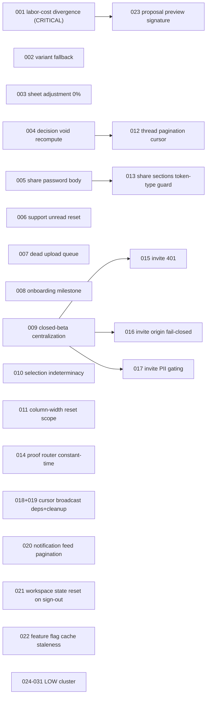

# 2026-07-18 Whole-App Consistency Audit — Plan Pack

**Plan pack:** `.ai/03_plans/2026-07-18-Whole-App-Consistency-Audit/`
**Suite version:** `2026-07-11` (manifest); these docs follow the `2026-07-12` schema notes.
**Status:** `CONDITIONALLY_READY` / `NOT_STARTED` / `NOT_EVALUATED` · `next_unit: UNIT-001`.
**Validated:** `bun run validate:plan-pack` PASS (manifest hash refreshed via `--write`).
**Generated:** 2026-07-18, against `main` (clean at session start, commit `a41a07d01`)
**Audit method:** 6 parallel general-purpose audit agents partitioned by domain, each mandated to surface only concrete logical/factual/feature bugs and inconsistencies with `file:line` evidence. The lead then deep-verified every CRITICAL/HIGH finding against current source before encoding it here. Speculation and style nits were rejected.

> **Status terminology:** the human-readable tables below use `TODO | IN PROGRESS | DONE | BLOCKED | REJECTED`. The canonical `plan-pack.json` uses the validator's `PLANNED | READY | IN_PROGRESS | DONE | VERIFIED | BLOCKED | SUPERSEDED` taxonomy — they map 1:1 (`TODO`≡`PLANNED`/`READY`, `DONE`≡`DONE`/`VERIFIED`, `REJECTED`≡`SUPERSEDED`). Tier-1 units (001–009) are `READY` in `SLICE-001`; the rest are `PLANNED`, hence `CONDITIONALLY_READY`.

This pack is **distinct from** `.ai/03_plans/2026-07-18-Codebase-Improve-Audit-Plan-Pack/`
(the `/improve` audit). That pack is a broad nine-category improvement backlog; this pack
is a focused **logical/factual/feature inconsistency and bug** audit. Where the two
overlap, this pack cross-references the `/improve` plan rather than duplicating it
(see §11 Cross-Reference Map).

---

## 1. Objective And Stop Condition

Surface and disposition every concrete logical, factual, and feature-level
inconsistency and bug found across the whole application, then encode each as a
dependency-ordered, evidence-backed implementation unit.

The **planning stage** is complete when every verified finding is reconciled to a
unit with current-source evidence, a fix direction, a test decision, and a
dependency ordering. The **execution stage** (separately authorized) is complete
when every CORE requirement unit is implemented and verified with the cheapest
decisive evidence per the Validation Matrix.

## 2. Scope

**In scope:** logical errors, factual errors, wrong-feature behavior, state-machine
deadlocks/skips, money/currency/state divergence across surfaces, authz gaps,
orphaned infrastructure, stale-cache bugs, and lifecycle inconsistencies across
the following surfaces:

- Estimate core (estimate sheet, rows, totals, component library, templates,
  variants, linked instances, reusable sources, favorites, bulk selection).
- Publish / share / client-portal / proposal-export pipeline.
- Auth, authorization, accounts, membership, middleware, invites, compliance.
- `/admin` control plane (support inbox, feature flags, analytics, saved replies).
- Uploads, R2/Images, worker, queues, cron, webhooks, internal proof endpoints.
- Client state (Zustand, TanStack Query, hooks), cross-cutting utilities,
  notifications, onboarding, charts, email.

**Out of scope (non-goals):**

- Style, formatting, naming, a11y, visual design, and test-coverage expansion.
- The `/improve` backlog items that are improvements rather than defects.
- Supabase / legacy provider surfaces (frozen; not to be mutated).
- Hosted/production deployment proof, paid services, or external cross-provider work.
- Refactors not required to fix a verified defect.

## 3. Summary Of Verified Findings

31 findings total: **1 CRITICAL**, 8 HIGH, 13 MEDIUM, 9 LOW. One finding (F-01)
was verified at deeper precision than the initial audit and corrected: the labor
divergence has **5** drop sites (not 4), and charts is a PASS site (not a drop).

Counts by area: Estimate core 7; Publish/Share/Portal 5; Auth/Security 7;
Admin 3; Uploads/Infra 4; UI State/Cross-cutting 5.

## 4. Requirements

| ID | Requirement (statement) | Source | Class |
| --- | --- | --- | --- |
| `REQ-001` | A single estimate row must show the same total across every surface (UI editor, D1 authoritative, charts, proposal export, publication snapshot, duplication, list summaries). | F-01 | CORE |
| `REQ-002` | Variant deletion during linked-Template propagation must fall back to the default variant instead of bricking all instances. | F-02 | CORE |
| `REQ-003` | Proposal export must reflect the authoritative server-resolved sheet adjustment (including a cleared/0% mode), not a cached prior value. | F-03 | CORE |
| `REQ-004` | Voiding a Client Portal decision must recompute the issue status so an issue is not stuck in a terminal state after its qualifying decision is voided. | F-04 | CORE |
| `REQ-005` | Every share/client-portal password-gate response must use one body shape so clients gating on `passwordRequired` detect the gate on all paths. | F-05 | CORE |
| `REQ-006` | The support inbox `unread_for_admin` flag must clear on admin reply/thread-read so the action inbox does not stay permanently elevated. | F-06 | CORE |
| `REQ-007` | The `UPLOAD_JOBS_QUEUE` binding must either receive messages or be removed; dead queue infrastructure must not ship. | F-07 | CORE |
| `REQ-008` | The onboarding checklist must not mark "Create an estimate" complete before any project/estimate exists. | F-08 | CORE |
| `REQ-009` | Closed-beta access must be enforced on every protected route so a route that forgets `getCurrentUserContext` cannot bypass it. | F-09 | CORE |
| `REQ-010` | Cross-cutting state/correctness gaps (selection indeterminacy, column-width reset scope, thread pagination cursors, share route guards, constant-time secret compare, invite CSRF/PII, cursor-broadcast deps, notification feed pagination, ephemeral store reset, locale consistency) must each be fixed at their root. | F-10..F-22 | CORE |
| `REQ-011` | Low-severity inconsistencies (preview cache signature, field naming, dry-run default inversion, DO timer leak, locale drift, limit clamping, inbox pagination, bearer timing, invite redirect trust) must each be dispositioned. | F-23..F-31 | AUXILIARY |

## 5. Findings Register (Authoritative)

Each finding has a dedicated unit doc `NNN-*.md` with full evidence. Severity is
the audit's; Priority is the execution ranking. Effort uses S/M/L. Risk is
reversibility/blast-radius.

| ID | Sev | Title | Unit | Pri | Effort | Risk | Status |
| --- | --- | --- | --- | --- | --- | --- | --- |
| F-01 | CRITICAL | `laborUnitCost` dropped from row totals in 5 of 9 total-computing sites → money diverges across surfaces | `001` | P1 | M | HIGH | TODO |
| F-02 | HIGH | `selectedVariantId` deletion throws instead of falling back to default variant | `002` | P1 | S | LOW | TODO |
| F-03 | HIGH | Sheet adjustment rate silently dropped when `percentage === 0` | `003` | P1 | S | LOW | TODO |
| F-04 | HIGH | Voiding a Client Portal decision never reverts the issue status | `004` | P1 | S | MED | TODO |
| F-05 | HIGH | Legacy share decision GET uses a different password-error body | `005` | P1 | S | LOW | TODO |
| F-06 | HIGH | Support inbox `unread_for_admin` never resets on admin reply | `006` | P1 | S | LOW | TODO |
| F-07 | HIGH | `UPLOAD_JOBS_QUEUE` is dead infrastructure (zero producers) | `007` | P2 | S | LOW | TODO |
| F-08 | HIGH | Onboarding "Create an estimate" gated on the wrong milestone | `008` | P1 | S | LOW | TODO |
| F-09 | HIGH | Closed-beta gate not enforced in middleware | `009` | P2 | M | MED | TODO |
| F-10 | MEDIUM | `getSelectionState` hides partial selection under a selected parent | `010` | P3 | S | LOW | TODO |
| F-11 | MEDIUM | `resetEstimateColumnWidths` wipes the global last-used key | `011` | P3 | S | LOW | TODO |
| F-12 | MEDIUM | Client Portal thread pagination cursor can point at a filtered-out row | `012` | P2 | M | MED | TODO |
| F-13 | MEDIUM | `share/[token]/sections/*` duplicate client-portal routes without a token-type guard | `013` | P3 | S | LOW | TODO |
| F-14 | MEDIUM | Proof routers use non-timing-safe `===` secret comparison | `014` | P2 | S | LOW | TODO |
| F-15 | MEDIUM | `acceptInvite` POST forwards a null user to the acceptance RPC | `015` | P3 | S | LOW | TODO |
| F-16 | MEDIUM | `isAllowedInviteOrigin` fails open when Origin+Referer absent | `016` | P2 | S | LOW | TODO |
| F-17 | MEDIUM | Invite preview leaks PII to any signed-in token-holder | `017` | P2 | S | LOW | TODO |
| F-18 | MEDIUM | Cursor broadcast re-subscribes on every displayName/userId change | `018` | P3 | S | LOW | TODO |
| F-19 | MEDIUM | Cursor broadcast cleanup resets identity refs to stale props | `019` | P3 | S | LOW | TODO |
| F-20 | MEDIUM | Notification feed optimistic update skips paginated cursors | `020` | P3 | M | LOW | TODO |
| F-21 | MEDIUM | `useEstimateWorkspaceState` never resets on sign-out (PII leak on shared device) | `021` | P2 | S | LOW | TODO |
| F-22 | MEDIUM | `featureFlagCache` module singleton — cross-isolate staleness, local-only invalidation | `022` | P3 | S | MED | TODO |
| F-23 | LOW | Proposal preview signature omits labor/contingency fields | `023` | P3 | S | LOW | TODO |
| F-24 | LOW | Share snapshot GET labels opaque project id as `publicationId` | `024` | P4 | S | LOW | TODO |
| F-25 | LOW | `CLOUDFLARE_UPLOAD_JOBS_DRY_RUN` default semantics inverted | `025` | P3 | S | LOW | TODO |
| F-26 | LOW | `GlobalPresence` DO leaks broadcast timer on idle | `026` | P4 | S | LOW | TODO |
| F-27 | LOW | `NotificationListItem` locale drift (no `en-PH` pin) | `027` | P4 | S | LOW | TODO |
| F-28 | LOW | `clampNotificationLimit` swallows NaN/empty-string cursor | `028` | P4 | S | LOW | TODO |
| F-29 | LOW | Support inbox caps at 100 with no total/indication | `029` | P4 | S | LOW | TODO |
| F-30 | LOW | Bearer-auth secret loop runs past a match (timing leak) | `030` | P4 | S | LOW | TODO |
| F-31 | LOW | `buildAcceptedInviteRedirect` trusts form-body display fields | `031` | P4 | S | LOW | TODO |

## 6. Decisions And Boundaries

| Decision | Status | Rationale |
| --- | --- | --- |
| `DEC-001` Separate pack from `/improve` audit | Active | Different intent (defects vs improvements); avoids diluting either. Cross-reference overlaps instead of duplicating. |
| `DEC-002` Group the MEDIUM UI-state cluster into one unit where fixes are mechanical and disjoint | Active | F-18/F-19 share a file; batching reduces churn. Other mediums stay standalone for clear ownership. |
| `DEC-003` Money-math (F-01) fix follows the existing oracle, not a new abstraction | Active | The canonical `computeEstimateRowCostParts` is correct; the defect is call sites that omit `labor_rate`. Fix the call sites + the record type, do not invent a parallel calculator. |
| `DEC-004` Closed-beta (F-09) gate moves to a single shared helper, not middleware-only nor handler-only | Active | Centralize so forgetting the helper cannot bypass it. |
| `DEC-005` Dead queue (F-07): prefer wired-in queue over deletion if the retry/DLQ semantics are wanted; else delete | Active | Decision deferred to owner during execution (see `AUTH-001`). Both are safe; pick by whether retry semantics are wanted. |
| `DEC-006` No new tests unless user authorizes | Active | `NOT_REQUIRED` default; `TEST_PROPOSAL` only where money/auth logic materially benefits. |

**Authorization boundary:**

- `AUTH-001` — **Not a blocker.** All fixes are local source/migration work inside bound
  `ARCH_DB` and the existing Worker/queue/cron resources (standing authorization in
  `AGENTS.md`). F-07's "wire the queue" option uses the already-bound
  `UPLOAD_JOBS_QUEUE`; F-01 may add a read-only/select-only schema normalization but
  requires no destructive migration (see unit 001 for the chosen approach). Remote
  apply, deployment, paid services, and cross-provider work remain excluded.

## 7. Execution Graph

Most units are independent. Hard dependencies:
- `001 → 023` (the preview signature must include the labor fields once 001 defines them).
- `009 → 015/016/017` (invite hardening should land after the beta gate is centralized so the auth surface is stable).
- `004 → 012` (the thread-pagination cursor fix is simpler once void recompute lands).

## 8. Execution Order (Tiered)

Status values: `TODO | IN PROGRESS | DONE | BLOCKED (reason) | REJECTED (rationale)`.

### Tier 1 — CRITICAL + money/auth-coupled HIGH (do first)

| Unit | Title | Pri | Effort | Risk | Depends | Status |
| --- | --- | --- | --- | --- | --- | --- |
| 001 | labor-cost divergence | P1 | M | HIGH | — | TODO |
| 002 | variant deletion fallback | P1 | S | LOW | — | TODO |
| 003 | sheet adjustment 0% passthrough | P1 | S | LOW | — | TODO |
| 004 | decision void status recompute | P1 | S | MED | — | TODO |
| 005 | share password body unify | P1 | S | LOW | — | TODO |
| 006 | support unread_for_admin reset | P1 | S | LOW | — | TODO |
| 008 | onboarding milestone fix | P1 | S | LOW | — | TODO |

### Tier 2 — Security hardening + infra (M effort)

| Unit | Title | Pri | Effort | Risk | Depends | Status |
| --- | --- | --- | --- | --- | --- | --- |
| 007 | dead upload queue disposition | P2 | S | LOW | — | TODO |
| 009 | closed-beta centralization | P2 | M | MED | — | TODO |
| 012 | thread pagination cursor | P2 | M | MED | 004 | TODO |
| 014 | proof router constant-time | P2 | S | LOW | — | TODO |
| 016 | invite origin fail-closed | P2 | S | LOW | 009 | TODO |
| 017 | invite PII gating | P2 | S | LOW | 009 | TODO |
| 021 | workspace state reset on sign-out | P2 | S | LOW | — | TODO |

### Tier 3 — Correctness, UX, state (M effort)

| Unit | Title | Pri | Effort | Risk | Depends | Status |
| --- | --- | --- | --- | --- | --- | --- |
| 010 | selection indeterminacy | P3 | S | LOW | — | TODO |
| 011 | column-width reset scope | P3 | S | LOW | — | TODO |
| 013 | share sections token-type guard | P3 | S | LOW | 005 | TODO |
| 015 | invite 401 | P3 | S | LOW | 009 | TODO |
| 018 | cursor broadcast deps + cleanup | P3 | S | LOW | — | TODO |
| 020 | notification feed pagination | P3 | M | LOW | — | TODO |
| 022 | feature flag cache staleness | P3 | S | MED | — | TODO |
| 023 | proposal preview signature | P3 | S | LOW | 001 | TODO |

### Tier 4 — LOW cluster (batch; optional)

| Unit | Title | Pri | Effort | Risk | Depends | Status |
| --- | --- | --- | --- | --- | --- | --- |
| 024–031 | See §10 LOW register | P4 | S | LOW | — | TODO |

## 9. Test Strategy

Default `test_requirement = NOT_REQUIRED` for every unit (ValidationMatrix +
User Test Authorization Gate). Verification uses the cheapest decisive evidence:
source diff, type-check, scoped lint, and SQL/migration inspection.

`TEST_PROPOSAL` (does NOT authorize execution — only the user does):

- **Unit 001 (money math):** propose running the existing focused estimate-total
  tests (`CHEAPEST_DECISIVE_EXISTING_TEST`) to prove labor is included at every
  call site after the fix. Risk: silent money divergence is exactly the class of
  bug a unit test catches and static review misses.
- **Unit 004 (decision void):** propose the client-portal decision test to prove
  issue status recomputes after void.
- **Unit 006 (support unread):** propose the support-repository test to prove the
  flag clears on admin reply.

No browser automation, screenshots, builds-as-gates, or broad QA is requested.

## 10. LOW Register (Tier 4 detail)

| Unit | Title | file:line | Fix direction |
| --- | --- | --- | --- |
| 024 | share snapshot `publicationId` naming | `src/app/api/share/[token]/route.ts:88` | thread real `publicationAccess.publicationId` or rename |
| 025 | dry-run default inverted | `src/lib/cloudflare/scheduled-upload-jobs.ts:63-65` | default dry-run only when `UPLOAD_JOBS_ENABLED !== "1"` |
| 026 | GlobalPresence timer leak | `src/lib/cloudflare/global-presence.ts:74,187-193` | clear `broadcastTimer` in `webSocketClose` when no authorized sockets remain |
| 027 | notification locale drift | `src/features/notifications/components/NotificationListItem.tsx:47` | pin `en-PH` via shared formatter |
| 028 | limit clamping swallows bad input | `src/lib/notifications/repository.ts:66-69` | distinguish `undefined`/`null` (default) from non-numeric (reject) |
| 029 | inbox cap 100 with no total | `src/app/api/admin/support/conversations/route.ts:10` | return total or surface "showing newest 100" |
| 030 | bearer secret loop timing | `src/lib/security/bearer-auth.ts:30-33` | precompute valid digests at module load |
| 031 | invite redirect trusts form fields | `src/app/invite/[token]/accept/route.ts:35-71` | source display fields from server-resolved invitation row |

## 11. Cross-Reference Map (vs `/improve` pack)

To avoid duplicate execution, units here that overlap `/improve` plans are noted.
If both are executed, pick one owner and close the other.

| This pack | `/improve` plan | Relationship |
| --- | --- | --- |
| 001 (labor divergence) | `008-money-arithmetic-through-oracle` | Same root: route all money through the oracle. `/improve` 008 is the general principle; this unit 001 is the specific labor-leak bug with the exact call-site list. Execute **001** (more precise) and let it satisfy `/improve` 008's labor aspect. |
| 014 (proof router constant-time) | `004-csrf-constant-time-compare`, `015-fail-closed-on-missing-secrets` | Adjacent. `/improve` 004 covers CSRF; this 014 covers the proof-router Bearer compare. Both should land. |
| 030 (bearer loop timing) | `004-csrf-constant-time-compare` | Same theme; `/improve` 004 + this 030 can be one PR. |
| 007 (dead upload queue) | `009-upload-queue-cross-batch-idempotency`, `010-scope-cron-secret-off-upload-job-routes` | `/improve` 009 assumes the queue is live; this 007 proves it is dead. **Resolve 007 first** — if the queue is deleted, `/improve` 009 is moot. |

Everything else in this pack is **net-new** relative to `/improve`.

## 12. Recovery / Resume State

- **Current mode:** planning complete; execution not started.
- **First ready unit:** `001` (P1, no dependencies, CRITICAL).
- **Git:** `main`, clean at pack creation. Do not branch/commit unless requested.
- **Resume rule:** pick the lowest-numbered TODO unit whose dependencies are DONE;
  reread current source before editing; update the status table after each unit.

## 13. Stop Condition

Planning stops here (all 31 findings reconciled to units with evidence). Execution
stops when every CORE unit (001–022) is DONE with decisive evidence and every
AUXILIARY unit (023–031) is DONE or explicitly REJECTED with rationale. Terminal
status `ACHIEVED` requires the requirement-by-requirement audit in `LOOP_LEDGER.md`.
