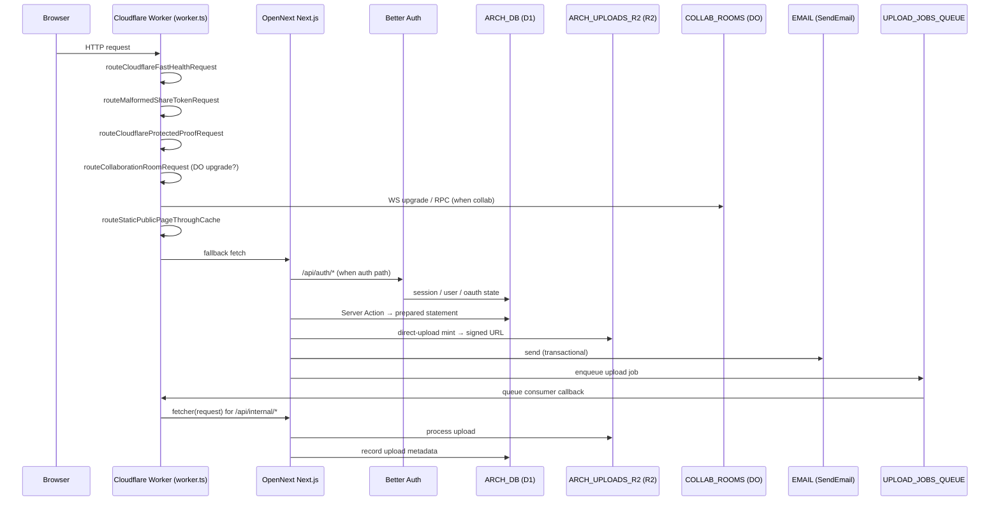
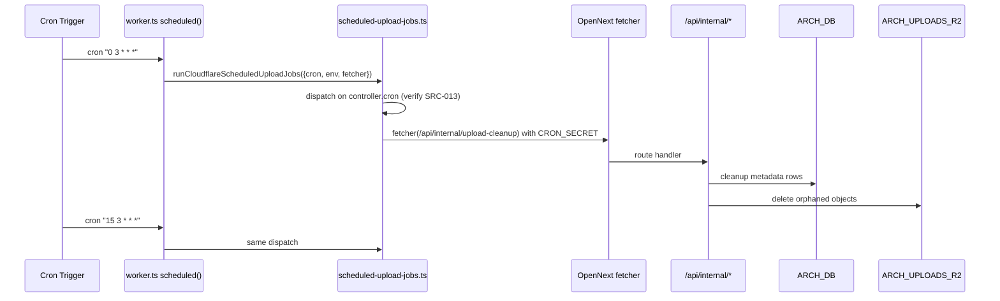
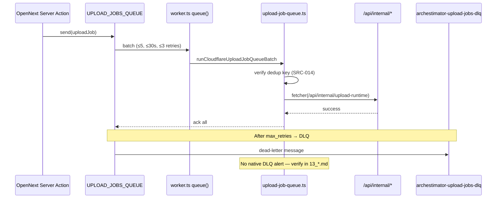

# 06 — Architecture and Technical Design

> Plan pack: Archestimator API Audit
> Plan folder: `.ai/03_plans/2026-07-21-API-Audit/`
> Verification mode: `emulated`

## Current-state architecture (active runtime)

Archestimator runs as a Next.js 16 application deployed to **Cloudflare Workers** via **OpenNext**. The Worker entry is `worker.ts`, which routes through a fenced optimization chain (fast health, malformed-share fail-closed, protected proof, collaboration DO, static public-page cache) before falling through to the OpenNext-generated handler.

### Component boundaries (live)

```
                    [ Browser / Client ]
                           │
                           ▼
            ┌──────────────────────────────┐
            │  Cloudflare Worker (worker.ts)│
            │   fetch → ordered routers     │
            │   scheduled → cron handler   │
            │   queue → upload-job handler │
            └──────────────┬───────────────┘
                           │
        ┌──────────────────┼─────────────────────┐
        ▼                  ▼                     ▼
[ OpenNext Next.js ]  [Collaboration DO]  [Protected proof routes]
   - 51 app routes      - CollaborationRoom   - /__cloudflare/*
   - 29 Route Handlers  - WS hibernation         (release-gate probes)
   - 30 Server Actions  - SQLite storage
   - 29 D1 migrations   - alarm()
        │
        ▼
┌──────────────────────────────────────────────────┐
│  Cloudflare Bindings (per wrangler.jsonc)         │
│  - ARCH_DB (D1) → system of record               │
│  - ARCH_UPLOADS_R2 (R2Bucket) → object storage   │
│  - UPLOAD_JOBS_QUEUE (Queue) → background jobs    │
│  - EMAIL (SendEmail) → transactional email       │
│  - IMAGES (ImagesBinding) → image processing     │
│  - ASSETS (Fetcher) → OpenNext static assets     │
└──────────────────────────────────────────────────┘
```

### Layered responsibilities (live)

| Layer | Owner | Examples |
|---|---|---|
| Edge Worker entry | `worker.ts` | fetch/scheduled/queue dispatch, route short-circuit |
| OpenNext / Next.js | `src/app/**` | RSC pages, layouts, route handlers, Server Actions |
| Better Auth | `src/app/api/auth/[...all]/route.ts`, `src/lib/auth/**` | session, OAuth, magic link, admin plugin |
| Domain services | `src/lib/**/actions.ts` | Server Actions — primary write surface |
| D1 access layer (RLS-equivalent) | `src/lib/cloudflare/**`, helpers in `src/lib/**/repositories/*` (if present) | prepared statements, RPC-equivalents, workspace scoping |
| Durable Object (realtime) | `src/lib/cloudflare/collaboration-room{,-router,-client}.ts` | Cursor / presence / WS hibernation |
| R2 access layer | `src/lib/uploads/**`, route handlers mint signed URLs | object store for attachments/images |
| Queue / Cron | `src/lib/cloudflare/scheduled-upload-jobs.ts`, `src/lib/cloudflare/upload-job-queue.ts` | background uploads, cleanup, scan |
| Email | `src/lib/email/transactional-email-client.ts` | outbound transactional |
| Auth provider glue | `src/lib/auth/better-auth-cloudflare.ts`, `src/lib/auth/cloudflare-better-auth-runtime.ts`, `src/lib/cloudflare/better-auth-proof-router.ts` | D1 storage adapter, runtime, proof router |
| Cache (public pages) | `worker.ts` `routeStaticPublicPageThroughCache` | incremental cache for tenant-agnostic pages |

## Target-state architecture (audit recommendation)

The target state is **not a migration**. The audit recommends the active architecture remain Cloudflare-only, with these compressions applied as part of future remediation:

1. **Pull D1 access layer into a single repository module** so per-table `workspace_id`/`owner_id` scoping is enforced in ONE place. Today, prepared statements are likely scattered across `src/lib/cloudflare/**` and `src/lib/**/actions.ts` (which is itself a P0 finding if confirmed — see `08_*.md`).
2. **Introduce a structured error envelope** for every Route Handler and Server Action (`{ok, data, error}`). The audit survey will confirm whether an envelope exists; if not, target-state mandates one.
3. **Move Workers Observability sampling rate decision to a GATE** so P0 errors are guaranteed visible. Currently `head_sampling_rate: 0.1` for logs and `0.05` for traces; this is a deliberate cost-quality trade-off, but `OPEN-002` asks whether it's enough for the rare P0 forensic case.
4. **Establish a credential-material taxonomy module** so future code generation cannot collapse tokens into one "token" concept. Target state: a `src/lib/auth/credentials/*` module with distinct types and lifecycle per material.
5. **Set DMARC `p=reject`** when the Email Sending surface faces external recipients (per `current-state.md:74` Wrangler recommends this; current observed `p=none` is a policy choice). Tracked as `OPEN-006` in `15_*.md`.
6. **Document Server Action fingerprint** surface: every `"use server"` export is a POST endpoint. Target state: a route manifest auto-generated from `"use server"` exports so future agents can SEE the API surface, not re-discover it.
7. **Cache invalidation gate**: which Server Action revalidates which cache tag. Target state: a `revalidateTag`/`revalidatePath` matrix in `09_*.md`.

## Component boundary review

| Boundary | Current state | Audit verdict preview |
|---|---|---|
| Edge Worker ↔ OpenNext | `worker.ts` ordered chain before OpenNext `fetch` | OK; verify `routeStaticPublicPageThroughCache` cache invalidation |
| OpenNext ↔ Better Auth | Better Auth mount at `/api/auth/[...all]` | OK; verify trusted-origins parsing (SRC-002) |
| OpenNext ↔ D1 | Direct D1 access from Server Actions + better-auth adapter | P0 finding: confirmed scattered access; target centralization |
| OpenNext ↔ Durable Objects | `routeCollaborationRoomRequest` short-circuits | OK; verify WS ticket minting surface |
| OpenNext ↔ R2 | Direct R2 access from `src/lib/uploads/**` and `component-library/attachments/direct-upload` route | Verify signed-URL mint authorization |
| Worker `scheduled` ↔ internal routes | Cron calls `/api/internal/*` via `openNextWorker.fetch` | Verify `CRON_SECRET` gating (SRC-006) |
| Worker `queue` ↔ consumer | `runCloudflareUploadJobQueueBatch` consumer | Verify idempotency (SRC-014) |
| OpenNext ↔ Cloudflare Email | `EMAIL` SendEmail binding via `src/lib/email/transactional-email-client.ts` | Verify rate limit + bounce handling |

## Architectural alternatives (considered, rejected)

| Alternative | Considered for | Why rejected |
|---|---|---|
| Migrate auth/DB back to Supabase | Auth + DB | Rejected: regression after the Cloudflare-only cutover that became READY 2026-07-01 |
| Use KV for rate limiting / sessions | Rate limit / session storage | Rejected per Cloudflare guidance: KV is eventually consistent, not suitable for rate limits or session truth |
| Use D1 RPC-style stored functions for all writes | All mutations | D1 RPC support is limited; prepared statements + app code are sufficient |
| Move Server Actions to Route Handlers for explicit surface | Server Actions | Server Actions are inherently Route Handlers under the hood per Next 16; the audit treats them as POST endpoints and they ARE the surface |
| Adopt a third API framework (Hono, tRPC) for some routes | Some routes | Would require parallel infrastructure; OpenNext is already the chosen abstraction |
| Use Cloudflare Pages instead of Workers | Hosting | Workers-only is the canonical posture per FAST PATH |

## Decision rationale (architectural)

1. **Cloudflare-only** is locked: production cutover READY 2026-07-01.
2. **OpenNext** is locked: the Worker is OpenNext-generated.
3. **Better Auth** is locked: audit may recommend config changes (rate limiter, trusted origins, account-linking rules) but not replacement.
4. **D1 as system of record** is locked: D1 has no RLS; audit recommends centralizing access scoping in app code, not replacing D1.
5. **R2 for object storage** is locked: audit may recommend signed-URL mint posture changes, not replacing R2.
6. **Durable Objects for Realtime** is locked: CollaborationRoom is in production; audit may recommend hibernation tuning, not replacement.

## Cross-cutting decisions recorded for downstream docs

| Decision | Source | Affects |
|---|---|---|
| All Route Handlers and Server Actions MUST return `{ok, data, error}` envelope | `08_*.md` after audit | `11_*.md`, `12_*.md` |
| Every D1 access path MUST filter by `workspace_id`/`owner_id` in app code | `07_*.md` (per-table matrix) | `08_*.md`, `11_*.md`, `12_*.md` |
| Server Actions are POST endpoints — every action MUST auth + validate + idempotency | `08_*.md` per-action verdict | `11_*.md`, `12_*.md`, `14_*.md` |
| Internal `/api/internal/*` routes MUST be `CRON_SECRET`-gated | `08_*.md` | `11_*.md` |
| Token surfaces MUST separate encryption-secret vs hash-secret | `08_*.md` credential material | `11_*.md`, `14_*.md` |
| Workers Observability sampling rate is an OPEN decision | `09_*.md`, `15_*.md` | owner: Philip / ops |

## Diagram — request flow



## Diagram — cron flow



## Diagram — queue flow



## Decision IDs emitted

(See `15_DECISIONS_ASSUMPTIONS_AND_ALTERNATIVES.md` for full DEC-* rationale table.) The architectural decisions above will be carried as `DEC-001` through `DEC-0xx` in `15_*.md`.