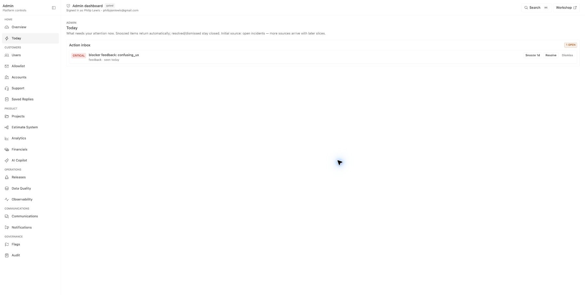
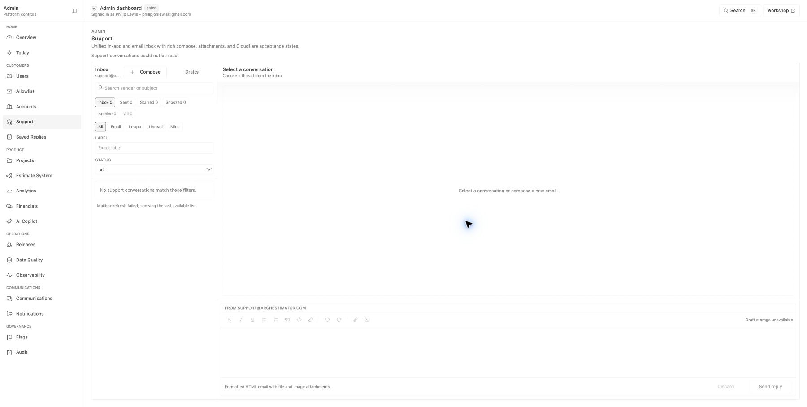
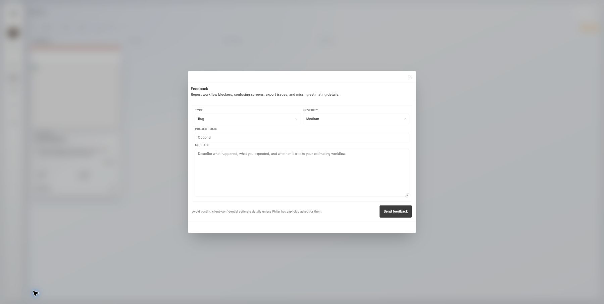
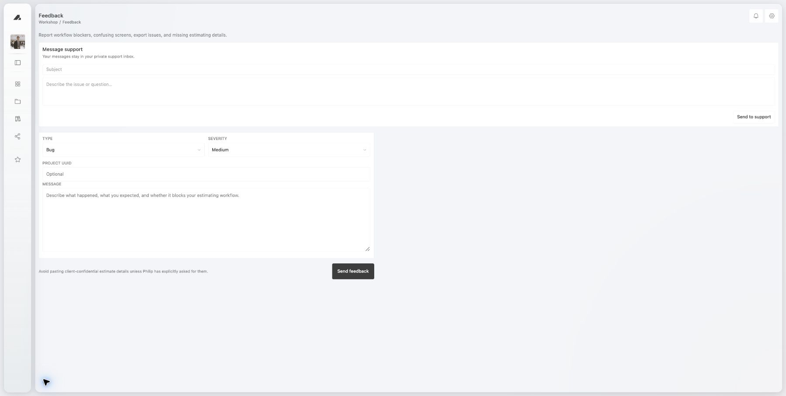

# User Support System: Rendered UX Audit

**Audit date:** 2026-07-22

**Environment:** authenticated live `https://archestimator.com` session

**Scope:** `/admin/today`, `/admin/support`, global feedback modal, and
`/workshop/feedback`
**Method:** browser DOM inspection plus rendered screenshots. No mutation was
performed.

## Step health

| Step | Surface | Health | Decisive evidence |
| --- | --- | --- | --- |
| 1 | Founder sees a support/feedback attention item | Partial | `/admin/today` displays the legacy blocker feedback item. |
| 2 | Founder opens the underlying message | Broken | The item exposes only Snooze, Resolve, and Dismiss. There is no open/details control even though the record has an `href`. |
| 3 | Founder finds the same message in Support | Broken | `/admin/support` reports that support conversations could not be read and contains zero canonical conversations, while bound D1 contains one legacy beta-feedback submission. |
| 4 | User explains a problem | Broken | The modal asks the user to classify Type and Severity and manually enter Project UUID before the actual message. |
| 5 | User attaches evidence and context | Missing | There is no screenshot intake, preview/removal, or disclosed diagnostic context. |
| 6 | User receives and continues a reply | Partial | `/workshop/feedback` contains a rudimentary private support conversation widget, but it sits beside a separate feedback form and is not a coherent inbox. |

## Evidence 1: Action Inbox cannot open its source

- The information hierarchy stops at a generated title and source label.
- The three controls alter queue state but none reveals the complaint.
- Resolve and Dismiss are dangerous on support-derived items because they can
  disagree with the canonical conversation status.
- Required correction: the primary action is `Open conversation`; support
  resolution and snooze happen inside the canonical thread. Remove generic
  Resolve, Dismiss, and Snooze controls from support-derived Action Inbox rows.

## Evidence 2: Admin Support is not operational

- The route visibly reports `Support conversations could not be read.`
- The mailbox rail, empty thread state, and draft warning are present, but the
  founder cannot inspect the user message.
- Read-only D1 reproduction proved the count query fails on the reserved alias
  `all`; migrations are current and the support tables exist.
- Required correction: restore the mailbox first, preserve an explicit degraded
  state, and deep-link `/admin/support?c=<conversationId>&folder=all`.

## Evidence 3: Feedback asks the user to do support triage

- Type, Severity, and Project UUID are internal classification/context needs,
  not user tasks.
- Users cannot reliably map their experience to product severity, and requiring
  them to do so makes the resulting priority untrustworthy.
- Manual UUID entry is hostile and error-prone when the authenticated product
  already knows the user's workspace and current route.
- Required correction: one message field, optional screenshot, a compact
  `Included details` disclosure, and one `Send to support` action.

## Evidence 4: User support is fragmented

- `Message support` and the legacy beta-feedback form represent the same user
  intent but write to different ledgers.
- The existing conversation widget proves the D1-backed chat foundation exists,
  but its visual treatment, thread history, statuses, unread state, and composer
  do not yet form a dependable Support Center.
- Required correction: replace both with one surface containing `Requests`,
  `New request`, and `Conversation` states backed by the support ledger.

## Target information architecture

### Global entry

- Keep the existing footer lifebuoy as the persistent Support trigger.
- Show the user's unread reply count as a capped `9+` badge with the full count in
  its accessible label.
- Open a responsive Support Center surface. Select the newest unread request;
  otherwise open Requests when history exists and New request when it does not.
  Desktop uses the existing modal; narrow screens use the existing sheet
  composition at full usable height.

### New request

1. `How can we help?` textarea, required, 2 to 4,000 characters.
2. Optional screenshot area supporting pick, paste, and drop.
3. Local preview with filename, size, and Remove before send.
4. `Included details` disclosure:
   - always: signed-in account, request reference, time, and a sanitized route
     template with opaque dynamic segments replaced;
   - optional as one per-message toggle, default on and not saved as a preference:
     validated workspace/project/estimate references, viewport, timezone,
     normalized browser/OS family, and safe app release when available.
5. Confidentiality reminder: do not include client secrets or unrelated
   sensitive information in the screenshot.
6. One primary action: `Send to support`.

### Requests

- Row content: status, last-message preview, updated time, unread badge, and
  stable short reference.
- User-facing status language:
  - `open` -> `Received` or `Waiting for support`;
  - `pending` -> `Waiting on you`;
  - `resolved` or `archived` -> `Conversation closed`.
- Opening a request marks it read only after the message history is visible.

### Conversation

- Chronological message cards with `You` and `Support` attribution.
- Screenshot thumbnails open through an authenticated preview route.
- Simple reply textarea, optional screenshot, explicit sending/offline/retry
  states, and stable retry behavior.
- A user can reopen a resolved request; the server moves it back to `open` and
  marks admin attention without creating a second conversation.

### Admin thread

- Header: requester identity, status, priority, assignee, labels, age, channel.
- Each message owns its screenshot and an expandable `Included details`
  disclosure containing its sanitized route and validated resource references,
  release/browser/viewport facts. Stable identity and triage remain in the thread
  header; there is no ambiguous thread-global diagnostics panel.
- No raw query string, tokens, cookies, browser storage, DOM/form content,
  request bodies, estimate totals, or client/project names are captured.

## Required interaction states

- Empty request history.
- Loading initial list and thread.
- Sending message; uploading screenshot; upload rejected; retry available.
- Offline before send; connection lost after send; response uncertain.
- Durable send succeeded but realtime degraded.
- Message idempotently recovered after a lost response.
- Screenshot can be removed before sending. After sending, it remains part of the
  support record until authorized admin lifecycle handling or privacy erasure;
  disclose that consequence before submission.
- Admin mailbox degraded; legacy import incomplete; stale Action Inbox item.

## Accessibility and responsive contract

- Reuse the repository Dialog/Sheet focus trap, Escape handling, inert
  background, title/description semantics, and focus return.
- Every icon-only trigger has a visible tooltip or accessible name.
- Dropzone is supplemental; file input and paste are keyboard-available.
- Upload progress and errors use polite live regions; send failure uses an alert.
- Preview Remove is a button with the filename in its accessible name.
- Status is never communicated by color alone.
- Touch targets remain at least the repository's authenticated control minimum;
  narrow layout never requires horizontal scrolling.

## Stop condition

The UX is complete only when one user message submitted from any authenticated
page appears as one canonical admin conversation, the Action Inbox opens that
exact thread, the user can see and continue it, and every degraded/error state
preserves message identity without silent loss or duplication.
