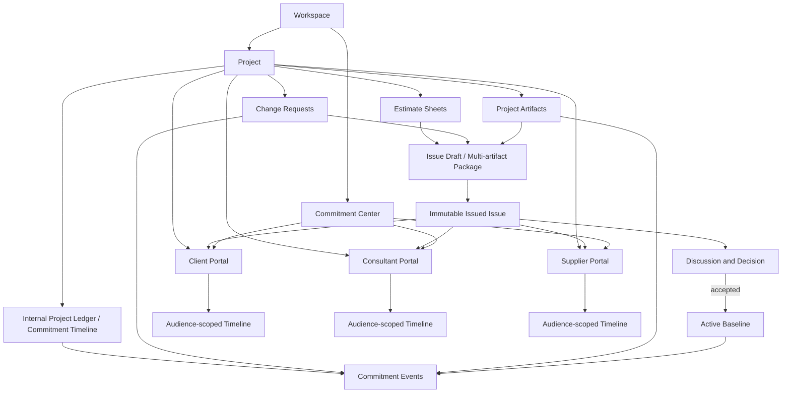

# Project Ledger & Commitment Timeline Plan

## Task Contract

Transform Archestimator's existing estimate publication and Client Portal systems into a project-level contractual commitment architecture without creating a third parallel publication stack.

The completed product must provide:

- one complete internal Project Ledger per project;
- one or more audience-scoped Client Portals per project;
- a Commitment Timeline as the primary human-readable interface for official commercial moments;
- first-class client-initiated change requests;
- first-class project artifacts and immutable artifact versions;
- multi-artifact issued commitment packages;
- deterministic version-to-version change logs;
- attributable discussions and decisions;
- a separately tracked active approved baseline for each portal or contractual relationship;
- a workspace-level command center for monitoring every external commitment.

The project-level record is canonical for authoring and evidence. Portal timelines are permission-scoped projections. `/workshop/publisher` is a portfolio control center.

## Product thesis carried into execution

Archestimator manages the living record of contractual financial commitments in construction, from the first estimate through every issued revision, discussion, and decision.

The implementation must support these product invariants:

1. **One commitment scope, one active approved baseline.**
2. **Every prior official truth remains preserved and explainable.**
3. **Internal drafting may remain private; external contractual moments are curated and attributable.**
4. **A client request is not authorization to proceed.**
5. **A newly issued proposal does not replace the approved baseline until it is accepted.**
6. **Published content and artifact versions are never silently overwritten.**
7. **The current state must be understandable without reading the full timeline; the timeline must explain why that state exists.**
8. **The timeline is a narrative index, not a duplicate source of truth.**
9. **AI may draft prose but cannot determine, alter, approve, or publish contractual facts.**

## Paid-for-itself outcome

The product succeeds when a user can say:

> “One disputed change was resolved in minutes because the request, evidence, exact issued documents, financial effect, exclusions, discussion, and approval were all in one record.”

This is the primary product outcome the architecture must make possible.

## Current evidence

The observed repository already contains much of the foundation:

- `/workshop/publisher` is a workspace-level Client Links roster backed mainly by legacy `project_publications`.
- The legacy Share Wizard already selects multiple estimate sheets from one project.
- Modern Client Portals already exist under `/workshop/projects/[projectId]/client-portals`.
- One project can already have multiple portals.
- Each portal already has a stable token and a persistent `/share/[token]` public destination.
- The modern portal already supports typed sections, immutable numbered issues, recipients, discussions, decisions, activity, versions, branding, and access policy.
- The public share route already dispatches Client Portal tokens to `ClientPortalShell`.
- Internal project Activity already aggregates estimate, publication, comment, response, Client Portal, and collaboration events.
- The upload system already provides private R2 storage, upload lifecycle records, checksum metadata, scan states, cleanup claims, and delayed cleanup.
- The permission system already separates internal project roles, portal grants, recipient role templates, capability overrides, recipient/organization section policy, and required approvers.

The main architecture gaps are:

- the workspace Publisher is still conceptually and technically legacy-link-first;
- the public Client Portal is issue-section-first rather than timeline-first;
- project Activity is an audit feed rather than a commitment narrative;
- client-initiated change requests do not exist as first-class objects;
- project documents do not exist as first-class versioned artifacts;
- issued content is estimate/section oriented rather than a multi-artifact package;
- current issue and active approved baseline are conflated;
- historical issued rows lack private stable source identity required for reliable deterministic diffs;
- domain role, permission role, and approval authority are not fully separated;
- portal-scoped exposure of project timeline events is not modeled.

## Scope

### Included

- D1 schema additions and necessary safe table rebuilds.
- R2-backed project artifact versions.
- PDF and image evidence uploads.
- Internal and recipient-authenticated upload paths.
- Client-initiated change requests from the public portal.
- Internal request assessment and request-to-issue linkage.
- Issue draft/package authoring.
- Normalized published issue relationships to estimates, requests, and artifact versions.
- Private source projections for deterministic comparisons.
- Deterministic change-set generation.
- Human-editable revision notes.
- Optional AI-assisted narrative drafting after deterministic change generation.
- Active baseline establishment upon issue acceptance.
- Project Commitment Timeline.
- Portal-scoped timeline projection.
- Updated project navigation.
- Public portal timeline, issue detail, artifact viewer, request creation, discussion, and decision journeys.
- Workspace Commitment Center replacing legacy Client Links behavior.
- Legacy publication migration, write freeze, backfill, and eventual authoring removal.
- Q2 security, migration, access-control, upload, concurrency, browser, and quality proof.

### Non-goals

- CAD, BIM, 3D, or drawing authoring.
- Full graphical redlining, drawing overlays, or design clash detection.
- General-purpose document management or cloud drive replacement.
- RFI, submittal, transmittal, procurement, purchase-order, invoice, payment, ERP, or accounting workflows.
- Automatic downstream-impact prediction.
- Autonomous scope interpretation.
- Legally binding signature certification or legal-advice claims.
- Cross-customer data pooling.
- AI-generated contractual facts or automatic publishing.
- Publicly deleting or rewriting already-issued history.
- Adding a third link/publication architecture.
- Large-scale unrelated UI redesign.

## Requirements

### REQ-001 — Project-owned ledger architecture

Every commercial request, artifact, issue, discussion, decision, and baseline belongs to a project. Portal and workspace views reference or project that record rather than becoming independent authoring silos.

### REQ-002 — Audience-scoped portals

A project may have multiple Client Portals. Each portal represents a contractual or review audience and exposes only explicitly permitted project events and content.

### REQ-003 — Commitment Timeline

The project receives a curated Commitment Timeline that displays official commercial moments and causality. It includes a current-state header and a separate raw “All activity” view.

### REQ-004 — First-class client change requests

Verified external recipients with permission can submit, amend through new versions, discuss, attach evidence to, and withdraw their own change requests. Submission is explicitly not authorization to proceed.

### REQ-005 — First-class project artifacts

Users can upload project-owned PDFs and supported evidence images as logical artifacts with immutable versions, metadata, checksums, scan state, provenance, and relationship links.

### REQ-006 — Multi-artifact issue packages

An issued Client Portal issue can contain selected estimate sheets, exact artifact versions, request versions, evidence, revision notes, assumptions, exclusions, unresolved items, structured change logs, and a requested decision.

### REQ-007 — Deterministic change logs

Every revision issue compares against a defined baseline or prior issue using private stable source identity. Structured changes are authoritative and include financial, scope, artifact, request, assumption, and exclusion deltas.

### REQ-008 — Controlled AI narrative assistance

When existing AI infrastructure is enabled, it may draft a human-readable summary from the sanitized deterministic change set. The draft must be explicitly reviewed and accepted by the publisher before issue publication. A deterministic template remains available without AI.

### REQ-009 — Correct baseline semantics

Publishing a new issue does not replace the active approved baseline. Acceptance creates a new baseline and supersedes the previous baseline record. Unaccepted proposals may be replaced without rewriting accepted history.

### REQ-010 — Role and authority separation

Domain role, product permission role, and financial approval authority are modeled separately. Internal project roles remain distinct from external recipient roles.

### REQ-011 — Audience projection integrity

External timeline content is exposed through explicit portal mappings and policy snapshots. Internal notes and unexposed project activity never leak. Previously exposed official content cannot disappear silently.

### REQ-012 — Workspace commitment command center

`/workshop/publisher` becomes a modern portal/request/decision command center backed directly by Client Portal and commitment-domain data. It monitors and routes work but is not the canonical project authoring surface.

### REQ-013 — Legacy cutover

Existing legacy shared links are migrated through the current Client Portal migration machinery, become read-only at cutover, and remain accessible until verified migration. No new legacy links are created after cutover.

### REQ-014 — Security, retention, and evidentiary integrity

Uploads remain private, content-sniffed, scanned when required, tenant-scoped, attributable, and covered by cleanup/retention policy. Public access is token-, recipient-, portal-, issue-, and policy-scoped. Legal claims remain bounded.

### REQ-015 — Accessibility, performance, and recoverability

Critical internal and external journeys work across keyboard, mobile, zoom, reduced motion, supported browsers, large issues, and degraded services. Migrations and backfills are idempotent and rehearsed.

### REQ-016 — Q2 completion evidence

The final implementation produces fresh `Q2_CRITICAL_CHANGE_GATE` evidence, independent quality review, distinct security review, and a requirement-to-evidence completion audit.

## Architecture decisions

### DEC-AUTO-001 — Create at project, configure at portal, monitor at workspace

- The Project Timeline is the main record-creation surface.
- The Portal control center configures audience, visibility, issue content, and access.
- The workspace Publisher monitors action across projects and portals.

### DEC-AUTO-002 — Complete the modern Client Portal architecture

The existing modern Client Portal domain is the target platform. Legacy `project_publications` remains only for migration and read compatibility during cutover.

### DEC-AUTO-003 — Timeline is a projection, not an event-sourced rewrite

Authoritative truth remains in request, artifact, issue, decision, baseline, and discussion tables. A normalized append-only project commitment-event table provides a curated read model and causal index.

### DEC-AUTO-004 — One active baseline per portal commitment scope

Multiple portals may represent distinct contractual relationships. Each portal has at most one active approved baseline. The project can designate one primary portal for the main client agreement and summarize other portal baselines separately.

### DEC-AUTO-005 — Separate current proposal from active baseline

`current_issue_id` continues to identify the current proposal/review issue. A separate baseline table identifies the active accepted commitment. Accepted historical issues remain accepted; baseline supersession is represented in baseline history rather than by erasing acceptance.

### DEC-AUTO-006 — Published Issue is a multi-artifact commitment package

An Issue is not an estimate snapshot. It is the exact package presented for a decision, including estimates, document versions, requests, evidence, revision notes, assumptions, exclusions, unresolved items, and the change set.

### DEC-AUTO-007 — Project artifacts own files

`client_portal_assets` remains a branding/public-asset concern. The master document library is project-owned and uses the existing upload lifecycle and private R2 boundary.

### DEC-AUTO-008 — Artifact versions are immutable

A working artifact may receive new versions. A published issue references an exact immutable artifact version. Uploading or editing a later version does not change a prior issue.

### DEC-AUTO-009 — Recipient requests are first-class from initial release

A permitted client or reviewer can initiate a request directly in the portal. The request becomes visible internally and in its originating portal without being treated as an approved change.

### DEC-AUTO-010 — Domain role and permission role are separate

Examples:

- `Engineer` + `Reviewer`
- `Client Representative` + `Requester` + `Approver`
- `Contractor Estimator` + internal `Editor` + portal `Manager`

Domain labels explain who the participant is. Permission roles determine what the participant can do. Approval designation determines whether a formal financial decision counts.

### DEC-AUTO-011 — Structured diff is authoritative

The system must retain private stable source identities at issue publication. It must not derive contractual comparison solely from public opaque IDs, free text, or AI.

### DEC-AUTO-012 — AI is draft-only

AI reads a sanitized deterministic change set, not raw hidden commercial fields. It writes a draft. It cannot alter structured changes, mark a request resolved, submit a decision, establish a baseline, or publish an issue.

### DEC-AUTO-013 — Exposed official history is append-only

Before exposure, the owner can keep project work private. After an event or artifact is exposed as an official portal moment, correction occurs through withdrawal, replacement, redaction/tombstone, or a new event—not silent deletion.

### DEC-AUTO-014 — Activity remains available as raw audit

The existing Activity feed is preserved as an “All activity” view or audit surface. The primary Timeline filters out keystroke noise and emphasizes contractual moments.

### DEC-AUTO-015 — Stable portal URL; deep links inside it

A portal retains one stable `/share/[token]` destination. Requests, issues, artifacts, and timeline entries receive deep links inside that portal. New issues do not require new external destinations.

### DEC-AUTO-016 — PDF-first artifact scope

The first project document release supports PDFs. Request evidence additionally supports safe images. Office-document and broader file support is deferred until the PDF/evidence path is proven.

### DEC-AUTO-017 — No silent evidence substitution

A Viber, Gmail, or other external link is a reference. The preserved evidence is an uploaded snapshot, exported message, screenshot, or file with provenance metadata. Links alone are not treated as immutable evidence.

### DEC-AUTO-018 — Direct beta cutover with verified data preservation

Do not create a new general rollout flag. Use the existing Client Portal legacy migration and write-freeze controls where needed for existing data, then make the modern flow the only authoring path.

## Target architecture

## Dependency-ordered units

### UNIT-001 — Characterize and freeze current contracts

**Status:** Ready  
**Depends on:** none

**Owned work**

- Inventory current legacy publication, Client Portal, activity, upload, policy, issue, decision, and migration paths.
- Record exact current behavior for:
  - legacy multi-estimate link creation;
  - portal creation and stable token;
  - issue publication and supersession;
  - recipient roles and capabilities;
  - decision submission and status calculation;
  - project activity aggregation;
  - upload lifecycle and scan gates.
- Add failing or characterization evidence for the active-baseline defect, stable-identity gap, and legacy Publisher data dependency.
- Run GitNexus/source impact analysis before changing central symbols.

**Principal paths**

- `src/app/workshop/publisher/**`
- `src/lib/publisher/**`
- `src/app/workshop/projects/[projectId]/client-portals/**`
- `src/components/workshop/publisher/**`
- `src/lib/client-portal/**`
- `src/lib/publication/**`
- `src/lib/repositories/project-activity-feed-repository.ts`
- `src/lib/uploads/**`
- relevant D1 migrations and tests.

**Exit condition**

Current behavior is executable and documented, proposed table names do not collide, and the direct/transitive blast radius is known.

### UNIT-002 — Add domain schema, state contracts, and migration proofs

**Status:** Planned  
**Depends on:** UNIT-001

Implement additive D1 migrations and TypeScript contracts for:

- project artifacts and versions;
- change requests, versions, state events, and evidence links;
- issue drafts and draft selections;
- normalized issued estimates, requests, artifacts, private source rows, and change sets;
- portal baselines;
- project commitment events and portal exposures;
- domain-role fields and requester capability;
- discussion targets for requests, artifacts, artifact pages, and timeline events.

Add indexes, unique active-baseline enforcement, idempotency keys, foreign-key checks, lifecycle triggers, clean-apply proof, and backfill scripts.

### UNIT-003 — Implement secure project artifact lifecycle

**Status:** Planned  
**Depends on:** UNIT-002

Extend the upload system with:

- `project-artifact` and `portal-request-evidence` upload policies;
- private R2 object naming;
- PDF magic-byte validation and scan requirement;
- safe image processing for evidence images;
- logical artifact and immutable version services;
- internal upload/list/version/archive/download routes;
- recipient-authenticated evidence upload;
- range-capable portal PDF serving;
- cleanup, tombstone, retention, and legal-hold integration.

Run the PDF viewer compatibility spike defined in the artifact design document and implement the selected viewer contract.

### UNIT-004 — Implement first-class change requests

**Status:** Planned  
**Depends on:** UNIT-002, UNIT-003

Add:

- internal request repository/actions;
- public request list/create/amend/withdraw endpoints;
- request status transition service;
- request version content hashes;
- request evidence links;
- affected estimate/row/artifact targets;
- acknowledgment, assessment owner, internal notes, and external discussion;
- automatic commitment events and originating-portal exposure;
- explicit “not authorization to proceed” language and state.

### UNIT-005 — Implement issue draft and multi-artifact package composition

**Status:** Planned  
**Depends on:** UNIT-002, UNIT-003, UNIT-004

Replace portal-section-only publishing with issue-instance composition:

- draft metadata and optimistic revision;
- selected estimates;
- exact artifact versions;
- included request versions;
- revision note;
- assumptions and exclusions;
- unresolved consequences;
- requested decision;
- section/layout template snapshot;
- readiness checks and source-current checks;
- atomic publication into the existing immutable issue architecture.

Add “Publish to Timeline” from estimate surfaces as a deep link into the appropriate portal issue draft.

### UNIT-006 — Implement private source projection and deterministic change set

**Status:** Planned  
**Depends on:** UNIT-005

At publication:

- preserve private original estimate, tab, node, row, component, and revision identity;
- compare the draft against the active baseline or explicitly selected comparison issue;
- calculate total, estimate, row, scope, rate, quantity, artifact, request, assumption, and exclusion deltas;
- record match method and confidence;
- produce deterministic human-readable fallback notes;
- block publication when selected source changed after review;
- include the final change set in the issue content hash.

### UNIT-007 — Correct issue and baseline semantics

**Status:** Planned  
**Depends on:** UNIT-002, UNIT-005, UNIT-006

Refactor publication and decision transactions so:

- new publication updates current proposal without superseding an accepted baseline;
- replacing a pending proposal may supersede that pending proposal;
- acceptance atomically inserts a new active baseline, supersedes the prior baseline record, and emits a baseline event;
- decline and changes-requested do not alter the active baseline;
- current issue and active baseline are both visible in internal and external summaries;
- historical accepted issues remain accepted.

### UNIT-008 — Build the internal Project Commitment Timeline

**Status:** Planned  
**Depends on:** UNIT-003, UNIT-004, UNIT-006, UNIT-007

Create `/workshop/projects/[projectId]/timeline` with:

- current-agreement summary;
- portal/commitment-scope selector;
- pending issue and open-request counts;
- curated commitment timeline;
- related-event grouping;
- filters;
- request creation and assessment entry points;
- artifact upload and library view;
- issue preparation entry points;
- raw All Activity view using the current activity repository;
- deep links to requests, artifacts, issues, decisions, and baseline receipts.

Update project navigation from Activity to Timeline without losing audit access.

### UNIT-009 — Build audience-scoped portal timelines and client actions

**Status:** Planned  
**Depends on:** UNIT-004, UNIT-005, UNIT-007, UNIT-008

Restructure the public portal shell around:

- current approved baseline;
- pending issued proposal;
- audience-scoped timeline;
- issue detail;
- artifact viewer;
- discussions;
- decision action;
- “Request change” action;
- request status and amendments;
- role-aware actions;
- stable token and deep-link navigation;
- portal visibility/exposure policy.

### UNIT-010 — Complete RBAC, domain roles, and exposure controls

**Status:** Planned  
**Depends on:** UNIT-002, UNIT-004, UNIT-009

Add:

- `requester` recipient template;
- request capabilities;
- domain role fields and custom labels;
- recipient and organization event visibility;
- portal-level capability ceilings;
- artifact/download/comment policy snapshots;
- required approver and decision-policy preservation;
- policy previews for every role;
- cross-portal confidentiality tests.

### UNIT-011 — Transform `/workshop/publisher` into the Commitment Center

**Status:** Planned  
**Depends on:** UNIT-007, UNIT-008, UNIT-009, UNIT-010

Replace the legacy publication roster with a workspace query over:

- projects;
- Client Portals;
- active baselines;
- current/pending issues;
- open change requests;
- waiting discussions;
- decisions;
- recipients;
- access and delivery status;
- latest commitment event.

Provide global action views and deep links. Keep authoring in the project/portal surfaces.

### UNIT-012 — Finish legacy migration and cutover

**Status:** Planned  
**Depends on:** UNIT-011

Use existing migration and write-freeze machinery to:

- stop creation of legacy shared links;
- migrate eligible legacy publications to Client Portals;
- preserve stable public access;
- backfill baseline and timeline history where evidence permits;
- record legacy-baseline comparison limitations honestly;
- switch the Publisher data source;
- make legacy interactions read-only;
- remove legacy authoring UI and code after verified zero-write use;
- retain historical read paths until explicit later archival.

### UNIT-013 — Add AI-assisted revision narrative

**Status:** Planned / non-blocking  
**Depends on:** UNIT-006, UNIT-005

Use current AI infrastructure only when enabled. Generate a draft from the sanitized deterministic change set. Store generation provenance, prompt/schema version, result hash, human edits, and publisher approval. Never block deterministic publishing when AI is unavailable.

### UNIT-014 — Q2 integrated verification and independent review

**Status:** Planned  
**Depends on:** UNIT-003 through UNIT-013, except AI may be deferred if explicitly removed from core scope

Run all focused and aggregate evidence described in `10-VERIFICATION-QUALITY-AND-ACCEPTANCE.md`, including:

- D1 clean apply and migration/backfill replay;
- upload scan and access boundaries;
- request and decision idempotency;
- issue publish consistency;
- baseline concurrency;
- timeline projection;
- portal confidentiality;
- legacy cutover;
- keyboard/mobile/zoom/browser journeys;
- critical mutation and changed-branch coverage;
- independent quality and security reviews.

## Ready slices

### SLICE-001 — Contracts and schema

- UNIT-001
- UNIT-002

This slice may start immediately.

### SLICE-002 — Project-owned artifacts and requests

- UNIT-003
- UNIT-004

Starts after schema proof.

### SLICE-003 — Issue package, diff, and baseline

- UNIT-005
- UNIT-006
- UNIT-007

Starts after artifacts and requests have stable IDs.

### SLICE-004 — Internal and public timeline experiences

- UNIT-008
- UNIT-009
- UNIT-010

Starts after issue/baseline contracts are stable.

### SLICE-005 — Workspace cutover

- UNIT-011
- UNIT-012

Starts after modern project and portal paths are complete.

### SLICE-006 — AI enhancement and final proof

- UNIT-013
- UNIT-014

AI is additive. Q2 proof is mandatory.

## Acceptance criteria

### AC-001 — Project architecture

All commitment-domain objects resolve to one workspace/project. Portal and workspace surfaces do not own independent mutable copies of project truth.

### AC-002 — Portal confidentiality

Two portals on one project can expose different events, artifacts, estimates, and actions without cross-portal leakage.

### AC-003 — Client request lifecycle

A verified permitted recipient can submit a request with evidence; the owner can acknowledge and assess it; the request can drive one or more issues; submission alone never changes the estimate or baseline.

### AC-004 — Artifact integrity

A project artifact can have multiple immutable versions. An issued issue displays the exact version it references even after a newer working version exists.

### AC-005 — Multi-artifact issue

An issue can be published with selected estimates, artifact versions, request versions, assumptions, exclusions, unresolved items, change set, and decision request in one immutable content identity.

### AC-006 — Deterministic diff

For fully mapped post-migration issues, added, removed, and changed rows and artifacts are computed from stable private source identities and correct financial math. Ambiguous matches are not silently guessed.

### AC-007 — Baseline semantics

Publishing a pending revision leaves the approved baseline unchanged. Acceptance creates a new baseline. Changes requested, decline, withdrawal, or replacement of an unaccepted proposal do not rewrite the approved baseline.

### AC-008 — Timeline clarity

The internal timeline shows current truth at the top and only meaningful contractual events in the primary narrative. Raw technical activity remains available separately.

### AC-009 — Portal timeline

External recipients see only the portal's exposed timeline and can open its issue, artifact, request, discussion, and decision objects through stable deep links.

### AC-010 — Roles and approval

Domain role does not grant permission. Permission role does not automatically count as approval authority. Required approvers and policy snapshots are honored.

### AC-011 — Secure uploads

Unsupported, oversized, spoofed, infected, quarantined, unauthorized, cross-project, cross-portal, stale-token, or removed assets cannot be read or published.

### AC-012 — Workspace command center

The Publisher route reports modern portal/request/decision state across the workspace and routes the user to canonical project/portal actions without duplicating authoring.

### AC-013 — Legacy preservation

Existing legacy links remain readable or are migrated without losing issued content, comments, decisions, and public access. New authoring uses modern portals only.

### AC-014 — AI safety

The structured change set and final human-approved issue remain valid without AI. AI output cannot publish or alter authoritative state.

### AC-015 — Scale and accessibility

Large issues, long timelines, several portals, large PDFs, mobile, keyboard, 200% zoom, reduced motion, and supported browsers remain operable within defined performance budgets.

### AC-016 — Q2 evidence

Every core requirement maps to fresh passing evidence and independent review with no unresolved high/critical finding.

## Risks

### RISK-001 — Current issue and baseline corruption

A careless state refactor could lose or mislabel accepted history. Mitigate with additive baseline history, transactional state tests, backfill rehearsal, and no destructive issue rewrite.

### RISK-002 — Cross-portal data leakage

Multiple audiences on one project create a high-severity confidentiality boundary. Mitigate with explicit exposure joins, section/field policy, recipient/organization checks, negative access matrices, and a distinct security review.

### RISK-003 — Upload attack surface

PDFs and external evidence introduce malware, spoofed MIME, oversized payloads, range abuse, and storage cleanup risk. Reuse current upload lifecycle, require scanning, keep private R2, and fail closed.

### RISK-004 — False contractual confidence

Poor copy or AI output could imply legal enforceability or complete consequence detection. Preserve claims boundaries and make exclusions/unresolved items explicit.

### RISK-005 — Diff misclassification

Public opaque IDs change by issue and cannot support comparison. Preserve private stable source identity and avoid ambiguous heuristic matches.

### RISK-006 — D1 transaction and statement limits

Large estimate projections and issue packages may exceed batch limits. Use packed inserts, R2 for large payloads, explicit size/readiness checks, and deterministic failure before partial publication.

### RISK-007 — Timeline duplication or inconsistency

A derived event may diverge from its authoritative object. Insert events in the same D1 batch where possible, enforce idempotency, and provide deterministic rebuild/backfill.

### RISK-008 — Legacy migration breakage

A rushed cutover could strand links or decisions. Use current migration mapping, write freeze, idempotent backfill, and public-token verification before authoring removal.

### RISK-009 — UI surface confusion

Timeline, Portals, and Publisher may overlap. Enforce the architecture rule: project creates, portal configures, workspace monitors.

### RISK-010 — PDF viewer incompatibility or bundle cost

Use a bounded viewer spike and dynamic loading. If the selected viewer fails Cloudflare/Next/browser/bundle criteria, ship artifact-level review first and record page-level comments as deferred rather than weakening security.

### RISK-011 — Recipient upload abuse

Public request evidence requires stricter rate, size, scan, and verification gates than internal uploads. Do not allow anonymous uploads.

### RISK-012 — AI narrative hallucination

AI output may omit or invent changes. It remains draft-only, schema-constrained, reviewed, and compared against deterministic facts.

## Authorization boundaries

This pack authorizes local repository planning and, when separately executed under repository rules, local implementation and local evidence.

It does not authorize:

- production or hosted deployment;
- live D1/R2/provider mutation;
- paid service activation;
- new legal claims;
- counsel decisions;
- remote GitHub branch, commit, push, PR, or protection changes;
- deletion of legacy hosted data;
- disclosure of tokens, customer documents, or private evidence.

## Quality classification

The implementation is at least `Q2_CRITICAL_CHANGE_GATE` because it changes:

- persisted D1 data and migrations;
- public token access;
- uploads and private storage;
- tenant and portal boundaries;
- recipient permissions;
- decision and baseline semantics;
- external effects and notifications;
- broad shared architecture;
- critical client journeys.

`Q3_RELEASE_GATE` applies only if the same task includes a production release decision.

## Recovery and resume state

- The first executable unit is `UNIT-001`.
- Every unit records current head, owned paths, changed symbols, evidence, and next unit in `plan-pack.json`.
- D1 migrations are additive until legacy authoring removal.
- Backfills are idempotent and re-runnable.
- No accepted issue or exposed event is hard-deleted as part of recovery.
- Failed publication must leave no partial issue package.
- Failed upload must be claimable for cleanup through the existing upload lifecycle.
- Failed legacy cutover returns to read/write state only through the existing audited migration controls.
- If a core unit becomes impossible after materially different local approaches fail, mark `TECH_BLOCKED`; optional AI or page-level rendering cannot block the core ledger.

## Stop condition

Stop only when:

1. all core requirements are implemented;
2. the modern project/portal architecture is the only authoring path;
3. active-baseline semantics are correct;
4. request, artifact, issue, decision, baseline, and exposure integrity is proven;
5. legacy public access is preserved or migrated;
6. the internal and public commitment journeys pass Q2;
7. independent quality and security reviews have no unresolved high/critical finding;
8. the requirement-to-evidence audit is complete;
9. `plan-pack.json` reaches a valid terminal state.

Do not stop at a visually complete timeline if the underlying domain, access, migration, or evidence contracts remain incomplete.
