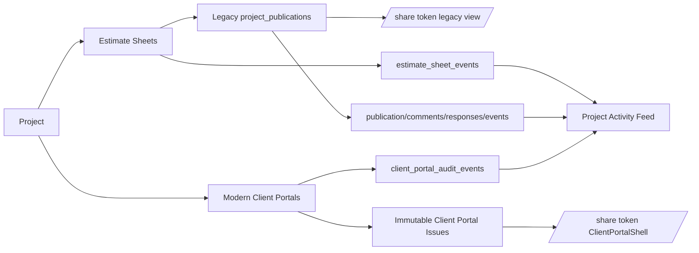

# Current State and Blast Radius

## Baseline

This plan was prepared against the repository state visible at:

```text
pjel888/archestimator
main
1c26b29edd969357c389c6432439dec82cb54389
```

The implementation agent must refresh the repository head, dirty-state hashes, and direct/transitive impact before editing. The paths below describe the observed architecture, not a license to skip current-source inspection.

## Executive diagnosis

Archestimator does not need a third publication system. It already has:

1. a legacy project publication/shared-link system;
2. a modern project-level Client Portal system;
3. an internal project Activity aggregation layer;
4. a reusable private-upload lifecycle.

The target work is to finish and connect these foundations around the new product thesis.

### Current architecture



### Target shift

```text
Current:
Estimate → link → current proposal view

Target:
Project Ledger
  → request/evidence/artifact
  → issue package
  → portal review
  → discussion/decision
  → approved baseline
  → preserved commitment timeline
```

## Source map

### Legacy workspace Publisher

| Path | Current responsibility | Target disposition |
|---|---|---|
| `src/app/workshop/publisher/page.tsx` | Workspace Client Links route, filters, onboarding shell | Keep route; change visible role to Commitment Center |
| `src/components/workshop/publisher/PublisherRosterClient.tsx` | Project/publication roster, drawer and link wizard state | Replace with modern portal/action roster |
| `src/components/workshop/publisher/PublisherDrawer.tsx` | Legacy link overview, recipients, activity, migration controls | Replace or retire after modern roster lands |
| `src/components/workshop/publisher/ShareWizard.tsx` | Select project estimates, password, client name, create/update legacy link | Stop new legacy authoring; replace with portal/issue deep links |
| `src/lib/publisher/roster-repository.ts` | Reads `project_publications`, comments, responses, recipients, status | Replace with `client_portals`/requests/issues/baselines query |
| `src/lib/publisher/permissions.ts` | Workspace roster read/manage rules | Reuse or map to modern portal policies |
| `src/components/workshop/publication/RecipientEmailComposer.tsx` | Legacy recipient delivery | Migrate supported delivery behavior to portal recipients/outbox |

Important current truth: the legacy Share Wizard is already **project-level** and can select multiple estimate sheets. The redesign is not fixing an estimate-level data limitation. It is replacing a link-oriented mental model with a persistent project portal and commitment narrative.

### Modern project Client Portals

| Path | Current responsibility | Target use |
|---|---|---|
| `src/app/workshop/projects/[projectId]/client-portals/page.tsx` | Lists portals for one project | Keep; expand portal purpose/audience and baseline summary |
| `src/app/workshop/projects/[projectId]/client-portals/[portalId]/page.tsx` | Portal control center route | Keep; add timeline/compose/current-baseline behavior |
| `src/components/workshop/publisher/ClientPortalControlCenter.tsx` | Internal tabs: overview, content, branding, people, discussions, decisions, activity, versions, settings | Evolve into portal configuration and issue-package control |
| `src/components/workshop/publisher/ClientPortalComposer.tsx` | Configures portal sections and publishes current selections | Split portal template configuration from issue-instance composition |
| `src/components/workshop/publisher/ClientPortalCreateForm.tsx` | Creates project-bound portal and stable token | Keep; add audience type and primary relationship |
| `src/components/workshop/publisher/ClientPortalRecipientManager.tsx` | Invites recipients, role, organization, required approver | Extend domain role and requester role |
| `src/lib/client-portal/composer-service.ts` | Portal draft/section CRUD and readiness | Retain portal template logic; add issue-draft services separately |
| `src/lib/client-portal/composer-actions.ts` | Server actions for composer and publish | Split portal config from issue draft/package actions |
| `src/lib/client-portal/control-center-service.ts` | Loads portal summary, issues, decisions, recipients, discussions, audit | Expand baseline, requests, artifacts, and timeline state |
| `src/lib/client-portal/publish-service.ts` | Builds selected estimate snapshot and typed section payloads | Extend to issue draft/package inputs |
| `src/lib/client-portal/issue-builder.ts` | Creates immutable numbered issue and section payloads | Preserve as atomic issue foundation; fix supersession semantics |
| `src/lib/client-portal/decision-service.ts` | Records attributable decisions and issue status | Add atomic baseline establishment on acceptance |
| `src/lib/client-portal/activity-service.ts` | Client-safe and owner audit events | Retain as audit; emit project commitment events separately |
| `src/lib/client-portal/contracts.ts` | Section kinds, discussion targets, roles, capabilities, retention boundary | Extend requester, artifact/request/timeline targets |
| `src/lib/client-portal/policy.ts` | Internal/recipient/anonymous authorization | Extend request and exposure checks |
| `src/lib/client-portal/section-registry.ts` | Typed portal section validation and public-payload sanitization | Add artifact/request/change-log sections or package projection |
| `src/lib/client-portal/public-repository.ts` | Resolves token, portal, issue, sections, payload hashes | Add timeline, historical issue, artifact, and request reads |
| `src/components/client-portal/ClientPortalShell.tsx` | Public issue-section UI | Restructure around persistent timeline and issue detail |

### Public share dispatch

| Path | Current responsibility | Target use |
|---|---|---|
| `src/app/share/[token]/page.tsx` | Dispatches modern Client Portal token or legacy publication token | Keep stable URL; modern timeline becomes default |
| `src/app/api/share/[token]/**` | Manifest, sections, decisions, threads, access, assets | Extend with timeline, requests, issue detail, and artifact content |
| `src/lib/client-portal/public-*` | Public handler layer | Preserve fail-closed route architecture |
| `src/lib/publication/security.ts` | Token, password, cookie, and session primitives | Reuse; do not expose raw tokens |

### Project Activity and navigation

| Path | Current responsibility | Target use |
|---|---|---|
| `src/app/workshop/projects/[projectId]/activity/page.tsx` | Internal project activity route | Replace with or move under Timeline |
| `src/lib/repositories/project-activity-feed-repository.ts` | Aggregates seven current activity sources | Retain as raw “All activity” view |
| `src/components/workshop/project-activity/**` | Filters and activity UI | Reuse where suitable inside Timeline |
| `src/components/workshop/navigation/project-navigation.ts` | Dashboard, Estimates, Data, Activity, Portals | Change Activity to Timeline |
| `src/components/workshop/ProjectMiniSidebar.tsx` | Renders project navigation | Update active route only |

The existing Activity feed aggregates:

- `estimate_sheet_events`;
- `project_publications`;
- `shared_link_comments`;
- `shared_link_responses`;
- `shared_link_events`;
- `client_portal_audit_events`;
- `collaboration_audit_events`.

It is valuable audit infrastructure. It is not yet a commitment model because it lacks typed requests, artifact versions, issue packages, baseline transitions, causal relationships, and portal exposure.

### Estimate authoring and publication projection

| Path | Current responsibility | Target use |
|---|---|---|
| `src/lib/publication/authoring-projection.ts` | Canonical estimate authoring projection and semantic hash | Reuse; add private stable source snapshot |
| `src/lib/publication/snapshot.ts` | Public-safe publication snapshot and opaque IDs | Preserve external privacy |
| `src/lib/client-portal/estimate-browser.ts` | Public estimate payload and row projections | Reuse for issue detail and public browsing |
| `src/lib/estimates/d1-intents/history-events.ts` | Internal mutation events with old/new snapshots and cost delta | Feed raw activity, not official portal narrative |
| estimate-sheet header/action components | Estimate authoring actions | Add `Publish to Timeline` deep link into issue draft |

Critical current limitation: public opaque IDs use a namespace derived from the issue semantic hash. They are intentionally different across changed issues. They cannot be the basis of reliable cross-version comparison. The target must preserve a private source-ID projection at publication.

### Upload and storage foundation

| Path | Current responsibility | Target use |
|---|---|---|
| `src/lib/uploads/policy.ts` | Upload surfaces, buckets, MIME, size, scan policy | Add project artifact/evidence surfaces |
| `src/lib/uploads/upload-records.ts` | Atomic upload session/asset/event recording | Reuse |
| `src/lib/uploads/scanning.ts` | Scan-gate decision | Reuse |
| `src/lib/uploads/admission-control.ts` | Upload rate/admission limits | Reuse and extend recipient scopes |
| `src/lib/uploads/removal-claims.ts` | Claim storage objects for removal | Reuse |
| `src/lib/uploads/cleanup-job.ts` | Delayed cleanup lifecycle | Reuse |
| `src/lib/uploads/runtime-storage-provider.ts` | R2 runtime provider | Reuse |
| `src/app/api/projects/images/route.ts` | Private project image upload/read | Pattern reference, not general document route |
| `src/app/api/component-library/attachments/route.ts` | PDF/XLS/XLSX attachment sniffing, scan gate, private read | Primary security pattern for PDF artifacts |
| `migrations/0084_upload_lifecycle_integrity.sql` | Session/asset integrity, removal claims, cleanup objects | Preserve and extend |

Current upload surfaces are:

- `project-image`;
- `component-image`;
- `component-attachment`.

The new artifact implementation should add new explicit surfaces rather than pretending project documents are component attachments.

### D1 Client Portal foundation

Relevant current migration areas include:

- `migrations/0068_client_portal_foundation.sql`;
- subsequent Client Portal message, migration, write-freeze, discussion-target, and estimate-projection migrations;
- current upload lifecycle migrations through at least `0084`.

Current tables include:

- `client_portals`;
- `client_portal_sections`;
- `client_portal_issues`;
- `client_portal_issue_sections`;
- `client_portal_recipients`;
- recipient credentials and grants;
- threads and messages;
- decisions;
- audit and analytics;
- legacy mappings;
- row projections;
- Client Portal brand assets.

## Current strengths to preserve

1. **Project ownership** — portals are already bound to a workspace and project.
2. **Stable portal token** — portal creation already issues a persistent path.
3. **Multiple portals** — project-level portal list already supports more than one audience.
4. **Immutable issued content** — issue manifests and section payload hashes exist.
5. **Atomic publish** — issue builder uses D1 batch and source consistency guards.
6. **Attributable decisions** — signer, role, email snapshot, note, timestamp, issue hash.
7. **Granular roles** — viewer, commenter, reviewer, approver plus capability overrides.
8. **Recipient/organization visibility** — policy supports section scoping.
9. **Client-safe activity** — official portal events are already separated from owner/security audit.
10. **Upload lifecycle** — checksums, scan states, cleanup, private storage.
11. **Legacy migration machinery** — mappings, feature control, public dispatch, write freeze.
12. **Project activity aggregation** — useful foundation for raw audit.

## Current gaps and tensions

### GAP-001 — Publisher is legacy-first

The workspace route reads `project_publications` and only surfaces a modern portal through a legacy migration mapping. The target must query modern portals directly.

### GAP-002 — Current issue is treated as current truth

Publishing currently moves `current_issue_id` and supersedes the prior issue before the new issue is approved. The target separates pending proposal from active approved baseline.

### GAP-003 — Portal sections are being used as issue authoring

`client_portal_sections` are persistent portal configuration. They should not be the only storage for a specific revision package. An issue draft needs instance-level content selections and notes.

### GAP-004 — No project artifact domain

`client_portal_assets` is designed around branding and issued brand assets. `upload_assets` tracks storage lifecycle but not logical project documents or versions.

### GAP-005 — No change-request domain

Discussions can request changes, but there is no durable request number, request version, assessment lifecycle, evidence set, affected scope, or request-to-issue relationship.

### GAP-006 — No stable private comparison identity

The public issue payload intentionally obscures source IDs. Reliable diffs require private published source identity.

### GAP-007 — Activity is too broad and too technical

Raw estimate edits, collaboration events, opens, and official decisions are mixed. The target needs a curated contractual narrative with causal grouping.

### GAP-008 — External portal is tied to current issue sections

The public shell loads the current issue manifest and section views. A persistent portal timeline must span issues and expose historical detail.

### GAP-009 — Domain role is missing

Recipient role currently describes permission, not construction identity.

### GAP-010 — Upload route is owner-centric

Current internal routes assume authenticated project or workspace editors. Recipient evidence upload requires a separate verified portal-session boundary.

## Expected blast radius

### High-risk central symbols

Before editing, run direct and upstream impact analysis for at least:

- `publishClientPortalIssue`;
- `publishClientPortalDraft`;
- `submitClientPortalDecision`;
- `resolveClientPortalPublicContext`;
- `evaluateClientPortalPolicy`;
- `loadClientPortalControlCenter`;
- `readWorkspacePublicationsRoster`;
- `readProjectActivityFeed`;
- `recordUploadAsset`;
- `decideUploadScanGate`;
- `createClientPortalDraft`;
- `saveClientPortalSectionDraft`.

### Expected modified path families

```text
migrations/
src/app/workshop/projects/[projectId]/timeline/
src/app/workshop/projects/[projectId]/client-portals/
src/app/workshop/publisher/
src/app/api/projects/[projectId]/artifacts/
src/app/api/share/[token]/
src/components/workshop/project-timeline/
src/components/workshop/publisher/
src/components/client-portal/
src/lib/project-ledger/
src/lib/project-artifacts/
src/lib/change-requests/
src/lib/client-portal/
src/lib/publication/
src/lib/publisher/
src/lib/uploads/
src/lib/repositories/
tests/unit/
tests/vitest/
e2e/
scripts/
quality or artifacts/evidence configuration where required
```

### Expected new domain modules

```text
src/lib/project-ledger/contracts.ts
src/lib/project-ledger/event-service.ts
src/lib/project-ledger/repository.ts
src/lib/project-ledger/projection.ts
src/lib/project-artifacts/contracts.ts
src/lib/project-artifacts/repository.ts
src/lib/project-artifacts/service.ts
src/lib/change-requests/contracts.ts
src/lib/change-requests/repository.ts
src/lib/change-requests/service.ts
src/lib/client-portal/issue-draft-contracts.ts
src/lib/client-portal/issue-draft-service.ts
src/lib/client-portal/change-set.ts
src/lib/client-portal/baseline-service.ts
```

Exact names may adapt to current conventions, but do not hide all behavior inside one monolithic repository or route file.

## Concurrency and ownership

This work should use one writer per central file family:

- **Schema/domain contracts owner** — migrations and core contracts.
- **Artifact owner** — upload and document lifecycle.
- **Request owner** — request state and APIs.
- **Issue/baseline owner** — composer, publish, decision, diff.
- **Timeline owner** — internal read model and UI.
- **Portal owner** — public timeline and RBAC.
- **Publisher/cutover owner** — workspace roster and legacy migration.
- **Quality lead** — integrated evidence and review coordination.

The lead agent owns integration. Shared central files such as `contracts.ts`, `policy.ts`, `issue-builder.ts`, and migrations cannot be concurrently edited without an explicit handoff.

## Do not assume

- Do not assume current README feature status is current.
- Do not assume every `client_portal_assets` document row is a usable project document.
- Do not assume public row IDs are stable across issues.
- Do not assume `current_issue_id` is the approved baseline.
- Do not assume a request-changes decision is a first-class change request.
- Do not assume “download disabled” is DRM.
- Do not assume AI infrastructure is enabled or a launch promise.
- Do not assume every portal represents the same contractual relationship.
- Do not assume legacy records have enough source identity for row-level diff backfill.
