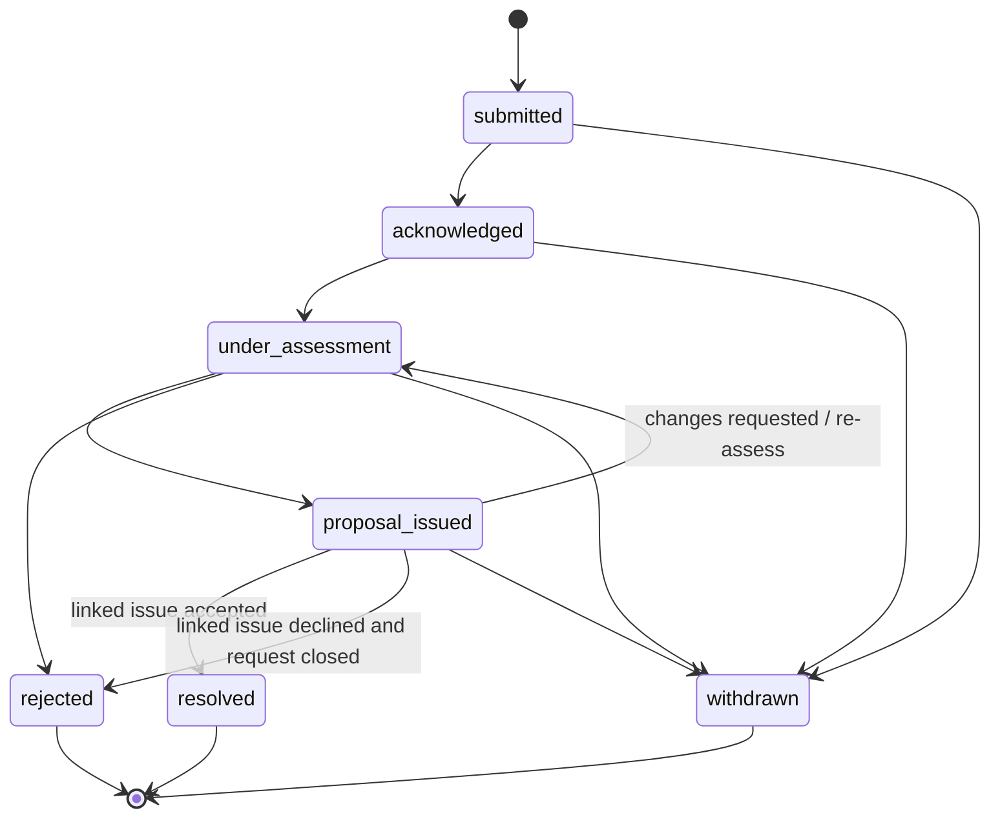
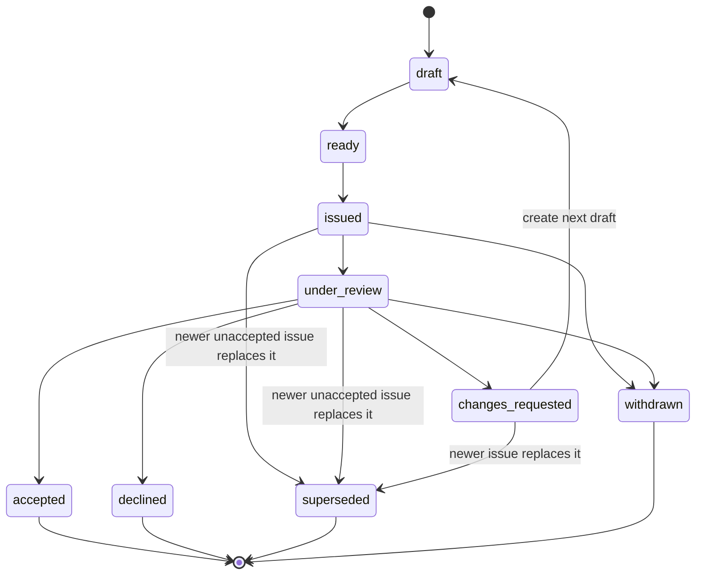
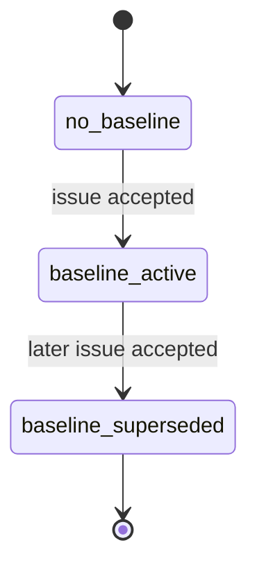
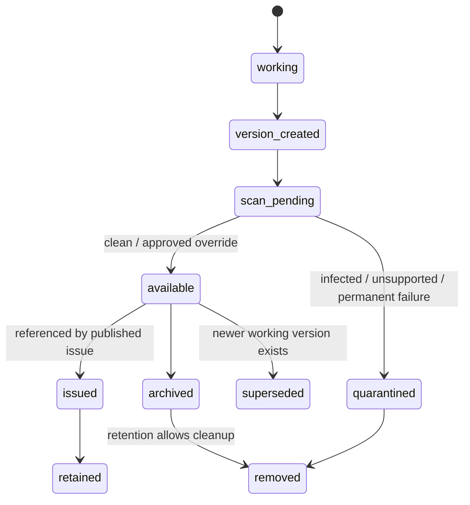

# Target Product and Domain Model

## Product architecture in one sentence

> **Archestimator is a project-owned ledger of contractual financial commitments, presented through audience-scoped portals and monitored through a workspace commitment center.**

## Surface hierarchy

```text
Workspace
├── Commitment Center
│   ├── action-required queue
│   ├── portal portfolio
│   ├── requests
│   ├── decisions
│   └── access/delivery health
└── Project
    ├── Timeline
    │   ├── Commitments
    │   ├── Requests
    │   ├── Files
    │   └── All activity
    ├── Estimates
    ├── Data
    └── Portals
        ├── Client Portal
        ├── Consultant Portal
        └── Supplier Portal
```

The public portal mirrors only what its audience is allowed to see:

```text
Stable Portal URL
├── Current approved baseline
├── Pending issue, if any
├── Audience-scoped timeline
├── Requests
├── Issued packages
├── Documents
├── Discussions
└── Decisions
```

## Domain definitions

### Project Ledger

The complete internal commercial record for one project. It includes every first-class request, artifact, issue, discussion, decision, baseline, and curated commitment event.

The ledger is not one giant mutable document. It is the relationship among durable domain objects.

### Commitment Scope

A contractual or review relationship inside a project. In the first implementation, a Client Portal is the practical commitment scope.

Examples:

- owner ↔ contractor;
- architect ↔ client;
- general contractor ↔ electrical subcontractor;
- developer ↔ furniture supplier.

A project can contain several scopes without exposing one scope’s commercial record to another.

### Client Portal

A persistent external relationship and access boundary. It has:

- one stable public token;
- an audience type and purpose;
- recipients;
- role and capability policy;
- an issue history;
- at most one active approved baseline;
- an audience-scoped timeline.

### Change Request

A first-class request to alter scope, design, quantity, price, timing, or another commitment condition.

A Change Request is not:

- an estimate mutation;
- a comment;
- an approved change order;
- authorization to proceed.

It is the starting object for assessment and negotiation.

### Change Request Version

An immutable version of the client’s or participant’s request. Editing a submitted request creates another version. The system preserves what the original request said.

### Project Artifact

A logical project document or evidence item.

Examples:

- design proposal;
- drawing package;
- contract;
- quotation;
- site instruction;
- correspondence export;
- Viber screenshot;
- photo;
- marked-up PDF;
- change-order document.

### Artifact Version

An immutable file and metadata snapshot belonging to a logical artifact.

The artifact may evolve:

```text
Bedroom Design Proposal
├── Version 1 — uploaded
├── Version 2 — internal working version
└── Version 3 — exact version published in Issue 4
```

Issue 4 always references Version 3, even if Version 4 is uploaded later.

### Issue Draft

A mutable internal package being prepared for one portal. It selects the exact source objects and content that will become an issued commitment request.

### Issued Issue

An immutable version presented to an external audience.

An Issue can contain:

- one or more estimate sheets;
- exact artifact versions;
- one or more request versions;
- evidence;
- revision note;
- assumptions;
- exclusions;
- unresolved consequences;
- deterministic change set;
- final publisher-approved narrative;
- requested decision and decision policy.

### Change Set

The deterministic structured difference between the issue and its comparison basis.

### Discussion

An attributable conversation anchored to a request, issue, estimate, row, artifact, artifact page, assumption, exclusion, timeline event, or other supported target.

### Decision

An attributable response to an exact issue content hash:

- approved;
- changes requested;
- declined.

### Baseline

An accepted issue elevated into the active contractual financial truth for one portal commitment scope.

A baseline has its own history:

```text
Baseline 1 — active
  ↓ Issue 2 accepted
Baseline 1 — superseded
Baseline 2 — active
```

The underlying Issue 1 remains historically accepted. “Superseded baseline” does not mean the prior acceptance never happened.

### Commitment Event

An immutable human-readable timeline event that points to an authoritative domain object.

Examples:

- request submitted;
- evidence added;
- request acknowledged;
- assessment started;
- issue published;
- discussion opened;
- decision submitted;
- baseline established;
- artifact withdrawn;
- issue replaced.

### Portal Exposure

The explicit mapping that makes a project commitment event visible in one portal. An internal event has no external visibility until it is exposed or automatically created in a portal context.

## Invariants

### INV-001 — Project ownership

Every request, artifact, event, portal, issue, decision, and baseline has an unambiguous project and workspace.

### INV-002 — Portal isolation

A portal cannot read another portal’s recipients, exposures, issues, decisions, threads, or private artifacts unless the underlying object is deliberately exposed to both through separate policy records.

### INV-003 — Stable portal destination

Publishing an issue does not create a new portal destination. The issue receives a deep link inside the stable portal.

### INV-004 — Immutable issue identity

The issue content hash includes every externally meaningful package element and its exact version.

### INV-005 — Immutable artifact version

An artifact version’s file hash, upload-asset reference, and published metadata cannot change after issuance.

### INV-006 — Request submission is not approval

No request status or message changes an estimate, starts work, creates a baseline, or grants payment entitlement by itself.

### INV-007 — Accepted baseline survives pending revision

A new pending issue cannot remove or replace the active approved baseline.

### INV-008 — One active baseline per portal

A unique partial index or equivalent transactional invariant permits at most one active baseline for one portal.

### INV-009 — Attributable external action

Every external request, discussion message, decision, or evidence upload records actor identity, permission role, domain role snapshot, organization where available, timestamp, and idempotency context.

### INV-010 — No internal-field leakage

Margin, internal markup, internal source, private provenance, internal notes, storage paths, raw IDs, and security metadata never enter public payloads.

### INV-011 — Append-only official narrative

A published or externally exposed official event is corrected through another event, withdrawal, replacement, or tombstone—not silent mutation or deletion.

### INV-012 — Timeline references truth

A timeline event cannot be the only copy of the contractually meaningful data. It references a request version, artifact version, issue, decision, baseline, or discussion record.

### INV-013 — Deterministic diff precedence

The structured change set is authoritative over AI or human prose where the two conflict.

### INV-014 — AI cannot commit

AI cannot publish, accept, decline, request changes, establish a baseline, or mark a request resolved.

## Request lifecycle



### Request state rules

- `submitted` — externally or internally created; no work authorization.
- `acknowledged` — owner confirms receipt, not acceptance.
- `under_assessment` — cost/scope impacts are being assessed.
- `proposal_issued` — at least one current issue addresses the request.
- `resolved` — a linked accepted issue resolves the request.
- `rejected` — request will not proceed.
- `withdrawn` — requester or authorized owner withdrew it.
- Amendments create a new immutable request version and an event.

A request may be linked to several issue attempts. Only one may be the current addressing issue for the originating portal at a time.

## Issue and baseline lifecycle



Baseline behavior is separate:



### Important distinction

- **Issue status** says what happened to the proposal.
- **Baseline status** says whether an accepted proposal is currently in force.

An accepted issue does not need its issue status rewritten to `superseded`. Its baseline relationship becomes superseded when another accepted issue replaces it.

## Artifact lifecycle



Artifact logical status and upload lifecycle are related but not identical. A version can be superseded as the latest working version while remaining retained forever because it was issued.

## Commitment event taxonomy

### Request events

- `request_submitted`
- `request_amended`
- `request_acknowledged`
- `request_assessment_started`
- `request_evidence_added`
- `request_proposal_issued`
- `request_resolved`
- `request_rejected`
- `request_withdrawn`

### Artifact events

- `artifact_created`
- `artifact_version_added`
- `artifact_exposed`
- `artifact_withdrawn`
- `artifact_archived`
- `artifact_tombstoned`

### Issue events

- `issue_draft_created`
- `issue_published`
- `issue_replaced`
- `issue_withdrawn`
- `issue_changes_requested`
- `issue_declined`
- `issue_accepted`

### Baseline events

- `baseline_established`
- `baseline_superseded`
- `baseline_voided`

### Discussion and decision events

- `discussion_started`
- `discussion_updated`
- `discussion_resolved`
- `discussion_reopened`
- `decision_submitted`
- `decision_voided`

### Access events

Access/security audit remains separate. Only user-meaningful external access moments enter the commitment timeline, such as `recipient_invited` when it materially affects the decision process. Raw password attempts and rate-limit events do not belong in the contractual narrative.

## Timeline presentation model

### Current state header

The internal timeline must show, without scrolling:

- selected commitment scope / portal;
- active approved baseline;
- approved total and currency;
- baseline date and approvers;
- pending issue;
- open requests;
- waiting discussions;
- unresolved consequences;
- latest official event.

When multiple portals exist, the user can select a portal scope. The project’s primary portal is shown first.

### Timeline body

Entries are chronological but can be grouped by a root request:

```text
CR-004 · Bedroom revision
├── 12 Mar · Client submitted request
├── 12 Mar · Viber screenshot attached
├── 13 Mar · Contractor acknowledged
├── 15 Mar · Electrical and cabinetry impacts recorded
├── 17 Mar · Issue 3 published
├── 18 Mar · Client requested clarification
├── 19 Mar · Issue 4 published
└── 20 Mar · Issue 4 approved → Baseline 4 established
```

The interface should use causality and indentation, not a Git branch metaphor. Multiple requests can be open simultaneously, while each portal still has one active approved baseline.

## Portal projection model

### Internal event

An internal event can be:

- internal-only;
- automatically exposed to its originating portal;
- manually exposed to one or more portals;
- included through an issued package.

### Exposure rules

- Client-submitted requests are automatically exposed in the originating portal.
- Issues, decisions, and baseline transitions are automatically exposed in their portal.
- Internal assessment notes are not exposed.
- Artifact uploads remain private until attached to a request or issue and explicitly exposed.
- An event exposed to two portals receives two independent exposure records.
- Exposure carries a policy snapshot for recipient/organization restrictions where required.
- A later visibility-policy change affects future access according to legal/privacy policy but does not erase the fact that the event was previously exposed.

## Example: convenience-outlet change

### Initial baseline

```text
Issue 1 accepted
10 convenience outlets
Active baseline total: ₱X
```

### Client request

```text
CR-002
“Add five convenience outlets.”
Evidence: Viber screenshot
Status: submitted
```

### Assessment

```text
Known:
- five outlets
- device purchase
- additional wiring
- labor

Excluded pending verification:
- cabinetry demolition
- cabinetry restoration
- finishing repair
- schedule impact
```

### Issue package

```text
Issue 2 — Additional convenience outlets
- Revised estimate
- Electrical plan PDF
- CR-002 request version
- Viber evidence screenshot
- Structured change set
- Inclusion/exclusion note
- Requested decision
```

### Decision

If approved:

```text
Issue 2 accepted
Baseline 2 established
Baseline 1 preserved as prior accepted truth
```

If changes are requested or declined:

```text
Baseline 1 remains active
Issue 2 status changes
CR-002 returns to assessment or is closed
```

## Edge cases

### No approved baseline

The first published issue is pending. The portal shows “No approved baseline yet.” Acceptance creates Baseline 1.

### Several requests in one issue

The issue links each included request version. The change set groups changes by request where known and lists unassigned changes separately.

### One request across several issues

Only the accepted issue resolves the request. Replaced issues remain in history.

### One artifact in several portals

The project stores one artifact version. Each portal has its own issue association, public identifier, exposure policy, comment/download policy, and timeline event.

### Artifact version replaced before publication

The issue draft revision changes. Readiness invalidates. The publisher must review the new version before publishing.

### Artifact version replaced after publication

The issued version remains unchanged. A new issue is required to expose the newer version.

### Client disputes evidence interpretation

The original evidence remains preserved. The client can add an attributable clarification or dispute. The system does not adjudicate truth.

### Legacy issue without private source map

Display and decisions remain valid. Row-level deterministic comparison is marked unavailable or aggregate-only until a new fully mapped baseline is accepted.

### Portal archived

Internal ledger remains. Public access is off. Issued history and retention records remain according to policy.

### Project deleted

Use retention tombstone and legal-hold rules. Do not cascade-delete issued evidence blindly.
