# Database and Migration Design

## Purpose

This document defines the target D1 persistence model and the safe migration sequence. It is a design contract, not ready-to-run SQL. The implementation agent must reconcile names and constraints against the latest migrations before assigning sequential migration numbers.

## Migration principles

1. **Add first, cut over later.** Do not destructively replace the current Client Portal or legacy publication data in the foundation migrations.
2. **Use current upload lifecycle.** Project artifacts reference `upload_assets`; they do not create a parallel storage ledger.
3. **Preserve accepted history.** Never rewrite an accepted issue solely to fit the new baseline model.
4. **Fail before partial publication.** Issue creation, package relationships, source projection, change set, audit event, timeline event, and notification outbox must commit atomically or not at all.
5. **Use private stable identity for comparison.** Public opaque IDs remain public-only.
6. **Enforce one active baseline per portal.**
7. **Keep event tables append-only.**
8. **Use `ON DELETE RESTRICT` for issued evidence and contractual relationships.**
9. **Use tombstones and cleanup claims for retention instead of cascade deletion.**
10. **Preflight every table rebuild.** SQLite CHECK enum changes require careful copy/verify/swap.
11. **Every backfill is idempotent.**
12. **Every migration ends with foreign-key and invariant assertions.**

## Proposed schema overview

```mermaid
erDiagram
  projects ||--o{ project_artifacts : owns
  project_artifacts ||--o{ project_artifact_versions : versions
  upload_assets ||--|| project_artifact_versions : stores

  projects ||--o{ project_change_requests : owns
  project_change_requests ||--o{ project_change_request_versions : versions
  project_change_requests ||--o{ project_change_request_state_events : transitions
  project_change_request_versions ||--o{ project_change_request_artifacts : evidence
  project_artifact_versions ||--o{ project_change_request_artifacts : attached

  projects ||--o{ client_portals : contains
  client_portals ||--o{ client_portal_issue_drafts : drafts
  client_portal_issue_drafts ||--o{ client_portal_issue_draft_estimates : selects
  client_portal_issue_drafts ||--o{ client_portal_issue_draft_artifacts : selects
  client_portal_issue_drafts ||--o{ client_portal_issue_draft_requests : selects

  client_portals ||--o{ client_portal_issues : issues
  client_portal_issues ||--o{ client_portal_issue_estimates : contains
  client_portal_issues ||--o{ client_portal_issue_artifacts : contains
  client_portal_issues ||--o{ client_portal_issue_requests : contains
  client_portal_issues ||--o{ client_portal_issue_source_rows : private_snapshot
  client_portal_issues ||--|| client_portal_issue_change_sets : compares

  client_portals ||--o{ client_portal_baselines : baselines
  client_portal_issues ||--o| client_portal_baselines : establishes
  client_portal_decisions ||--o| client_portal_baselines : evidence

  projects ||--o{ project_commitment_events : timeline
  project_commitment_events ||--o{ client_portal_event_exposures : exposed
  client_portals ||--o{ client_portal_event_exposures : timeline_view
```



## A. Project artifacts

### `project_artifacts`

Logical document identity.

Suggested columns:

```sql
id TEXT PRIMARY KEY
workspace_id TEXT NOT NULL
project_id TEXT NOT NULL
artifact_code TEXT
title TEXT NOT NULL
artifact_type TEXT NOT NULL
discipline TEXT
description TEXT
status TEXT NOT NULL DEFAULT 'active'
current_version_id TEXT
created_by TEXT NOT NULL
created_at TEXT NOT NULL
updated_at TEXT NOT NULL
archived_at TEXT
```

Suggested `artifact_type` values:

```text
drawing
design_proposal
contract
quotation
site_instruction
change_order
correspondence
photo
evidence
specification
report
other
```

Rules:

- `artifact_code` is optional and unique within the project when present.
- `current_version_id` points to the latest working version, not necessarily the latest issued version.
- `status` is `active | archived | tombstoned`.
- Project/workspace foreign key is restrictive.
- An issued artifact cannot be hard-deleted.

Indexes:

```text
(project_id, status, updated_at DESC)
(project_id, artifact_type, updated_at DESC)
(project_id, artifact_code) WHERE artifact_code IS NOT NULL
```

### `project_artifact_versions`

Immutable file and metadata version.

Suggested columns:

```sql
id TEXT PRIMARY KEY
workspace_id TEXT NOT NULL
project_id TEXT NOT NULL
artifact_id TEXT NOT NULL
version_number INTEGER NOT NULL
revision_label TEXT
upload_asset_id TEXT NOT NULL
file_name TEXT NOT NULL
content_type TEXT NOT NULL
size_bytes INTEGER NOT NULL
content_sha256 TEXT NOT NULL
source_kind TEXT NOT NULL
source_platform TEXT
source_reference_url TEXT
original_authored_at TEXT
description TEXT
metadata_json TEXT NOT NULL DEFAULT '{}'
created_by_actor_type TEXT NOT NULL
created_by_actor_id TEXT NOT NULL
created_by_domain_role_snapshot TEXT
created_at TEXT NOT NULL
supersedes_version_id TEXT
```

Rules:

- Unique `(artifact_id, version_number)`.
- Unique `(artifact_id, content_sha256)` may be considered only if re-uploading identical bytes should reuse the same version. Default recommendation: allow a new version only when metadata materially differs; reject accidental exact duplicates in the service.
- `upload_asset_id` must reference a finalized, allowed, clean/overridden upload asset.
- `source_kind`: `internal_upload | recipient_upload | email_export | message_snapshot | imported_reference`.
- `source_reference_url` is reference metadata; it is not treated as preserved evidence without the file.
- Version rows are append-only. Correct metadata through a replacement version or explicit correction record, not in-place mutation after issue reference.

Indexes:

```text
(artifact_id, version_number DESC)
(project_id, created_at DESC)
(upload_asset_id) UNIQUE
(content_sha256)
```

### `project_artifact_version_events` (optional but recommended)

Use only if artifact corrections/withdrawals need richer state than the project commitment event can safely provide.

Otherwise, artifact lifecycle events can be represented directly in `project_commitment_events`.

## B. Change requests

### `project_change_requests`

Logical request.

Suggested columns:

```sql
id TEXT PRIMARY KEY
workspace_id TEXT NOT NULL
project_id TEXT NOT NULL
origin_portal_id TEXT
request_number INTEGER NOT NULL
request_code TEXT NOT NULL
current_version_id TEXT NOT NULL
status TEXT NOT NULL
requested_by_actor_type TEXT NOT NULL
requested_by_actor_id TEXT NOT NULL
requested_by_name_snapshot TEXT
requested_by_email_snapshot TEXT
requested_by_domain_role_snapshot TEXT
requested_by_permission_role_snapshot TEXT
requested_by_organization_snapshot TEXT
requested_at TEXT NOT NULL
acknowledged_by_user_id TEXT
acknowledged_at TEXT
assessment_owner_user_id TEXT
resolved_by_issue_id TEXT
resolved_at TEXT
withdrawn_at TEXT
created_at TEXT NOT NULL
updated_at TEXT NOT NULL
```

Status values:

```text
submitted
acknowledged
under_assessment
proposal_issued
resolved
rejected
withdrawn
```

Rules:

- Unique `(project_id, request_number)`.
- `request_code` may be `CR-0001`, generated transactionally.
- Origin portal is optional for internal requests.
- A request cannot move directly to `resolved` without a linked accepted issue or an explicitly recorded non-financial resolution policy.
- Request status changes occur through the service and create state events in the same D1 batch.
- The request is not authorization to proceed.

### `project_change_request_versions`

Immutable request content.

Suggested columns:

```sql
id TEXT PRIMARY KEY
request_id TEXT NOT NULL
version_number INTEGER NOT NULL
title TEXT NOT NULL
description TEXT NOT NULL
reason TEXT
requested_effective_date TEXT
content_hash TEXT NOT NULL
metadata_json TEXT NOT NULL DEFAULT '{}'
created_by_actor_type TEXT NOT NULL
created_by_actor_id TEXT NOT NULL
created_at TEXT NOT NULL
supersedes_version_id TEXT
```

Rules:

- Unique `(request_id, version_number)`.
- Unique `(request_id, content_hash)` to make idempotent submissions safe.
- The current request points to the latest version.
- Amendments do not overwrite previous wording.

### `project_change_request_state_events`

Authoritative request transition history.

Suggested columns:

```sql
id TEXT PRIMARY KEY
request_id TEXT NOT NULL
from_status TEXT
to_status TEXT NOT NULL
actor_type TEXT NOT NULL
actor_id TEXT
note TEXT
idempotency_key TEXT NOT NULL
occurred_at TEXT NOT NULL
metadata_json TEXT NOT NULL DEFAULT '{}'
```

Unique:

```text
(request_id, actor_type, actor_id, idempotency_key)
```

### `project_change_request_targets`

Affected scope references.

Suggested columns:

```sql
request_version_id TEXT NOT NULL
target_kind TEXT NOT NULL
estimate_id TEXT
estimate_tab_id TEXT
node_id TEXT
row_id TEXT
artifact_id TEXT
target_label_snapshot TEXT NOT NULL
metadata_json TEXT NOT NULL DEFAULT '{}'
PRIMARY KEY (request_version_id, target_kind, stable target columns)
```

Target kinds:

```text
project
estimate
estimate_tab
area_group
row
artifact
discipline
location
other
```

Use explicit nullable columns and CHECK rules rather than a single unvalidated generic target ID where practical.

### `project_change_request_artifacts`

Links evidence to exact request version.

```sql
request_version_id TEXT NOT NULL
artifact_version_id TEXT NOT NULL
relationship TEXT NOT NULL
sort_order INTEGER NOT NULL
created_at TEXT NOT NULL
PRIMARY KEY (request_version_id, artifact_version_id, relationship)
```

Relationships:

```text
evidence
reference
markup
instruction
correspondence
supporting_document
```

## C. Issue drafts

### `client_portal_issue_drafts`

A mutable package instance. This is separate from persistent `client_portal_sections`.

Suggested columns:

```sql
id TEXT PRIMARY KEY
workspace_id TEXT NOT NULL
project_id TEXT NOT NULL
portal_id TEXT NOT NULL
status TEXT NOT NULL DEFAULT 'draft'
draft_revision INTEGER NOT NULL DEFAULT 1
issue_kind TEXT NOT NULL
version_label TEXT
based_on_issue_id TEXT
based_on_baseline_id TEXT
comparison_issue_id TEXT
revision_note TEXT
assumptions_json TEXT NOT NULL DEFAULT '[]'
exclusions_json TEXT NOT NULL DEFAULT '[]'
unresolved_items_json TEXT NOT NULL DEFAULT '[]'
requested_decision TEXT NOT NULL DEFAULT 'formal'
decision_policy_json TEXT NOT NULL DEFAULT '{}'
section_overrides_json TEXT NOT NULL DEFAULT '{}'
created_by TEXT NOT NULL
updated_by TEXT NOT NULL
created_at TEXT NOT NULL
updated_at TEXT NOT NULL
published_issue_id TEXT
published_at TEXT
abandoned_at TEXT
```

Status values:

```text
draft
ready
publishing
published
abandoned
```

Issue kinds:

```text
initial_estimate
revision
change_order
design_review
quotation
information
other
```

Rules:

- At most one active draft per portal is recommended for MVP:
  `UNIQUE(portal_id) WHERE status IN ('draft','ready','publishing')`.
- Updates use `draft_revision` compare-and-swap.
- `publishing` is short-lived and must recover safely.
- The draft cannot reference mutable “current artifact” aliases; it selects exact version IDs.
- Portal sections remain reusable presentation/template configuration. The draft captures per-issue content and overrides.

### `client_portal_issue_draft_estimates`

```sql
draft_id TEXT NOT NULL
estimate_id TEXT NOT NULL
sort_order INTEGER NOT NULL
included INTEGER NOT NULL DEFAULT 1
PRIMARY KEY (draft_id, estimate_id)
```

### `client_portal_issue_draft_artifacts`

```sql
draft_id TEXT NOT NULL
artifact_version_id TEXT NOT NULL
purpose TEXT NOT NULL
commentable INTEGER NOT NULL
downloadable INTEGER NOT NULL
decision_relevant INTEGER NOT NULL
sort_order INTEGER NOT NULL
display_title TEXT
description TEXT
PRIMARY KEY (draft_id, artifact_version_id)
```

Purpose:

```text
reference
review
approval
evidence
contract
drawing
supporting
```

### `client_portal_issue_draft_requests`

```sql
draft_id TEXT NOT NULL
request_id TEXT NOT NULL
request_version_id TEXT NOT NULL
relationship TEXT NOT NULL
sort_order INTEGER NOT NULL
PRIMARY KEY (draft_id, request_version_id)
```

Relationships:

```text
origin
addresses
supports
related
```

## D. Published issue package relationships

The existing `client_portal_issues` and `client_portal_issue_sections` remain the immutable issue foundation.

### Additive issue columns

Only add columns that are safe and useful at the issue level:

```text
issue_kind
draft_id
based_on_baseline_id
comparison_issue_id
revision_note
change_set_hash
```

Avoid duplicating large change-set or artifact data directly on `client_portal_issues`.

### `client_portal_issue_estimates`

Normalized private issue-to-estimate association.

```sql
issue_id TEXT NOT NULL
source_estimate_id TEXT NOT NULL
public_estimate_id TEXT NOT NULL
sort_order INTEGER NOT NULL
source_revision INTEGER
source_hash TEXT NOT NULL
PRIMARY KEY (issue_id, source_estimate_id)
```

Keep `selected_estimate_ids_json` during migration for compatibility; the normalized table becomes authoritative after cutover.

### `client_portal_issue_artifacts`

Exact artifact versions issued.

```sql
id TEXT PRIMARY KEY
issue_id TEXT NOT NULL
artifact_id TEXT NOT NULL
artifact_version_id TEXT NOT NULL
public_artifact_id TEXT NOT NULL
purpose TEXT NOT NULL
display_title TEXT NOT NULL
description TEXT
file_name_snapshot TEXT NOT NULL
content_type_snapshot TEXT NOT NULL
size_bytes_snapshot INTEGER NOT NULL
content_sha256_snapshot TEXT NOT NULL
commentable INTEGER NOT NULL
downloadable INTEGER NOT NULL
decision_relevant INTEGER NOT NULL
sort_order INTEGER NOT NULL
policy_snapshot_json TEXT NOT NULL DEFAULT '{}'
created_at TEXT NOT NULL
```

Rules:

- Unique `(issue_id, artifact_version_id)`.
- Unique `(issue_id, public_artifact_id)`.
- No storage path in the public manifest.
- The content hash includes these snapshots and ordering.

### `client_portal_issue_requests`

```sql
issue_id TEXT NOT NULL
request_id TEXT NOT NULL
request_version_id TEXT NOT NULL
relationship TEXT NOT NULL
request_code_snapshot TEXT NOT NULL
title_snapshot TEXT NOT NULL
content_hash_snapshot TEXT NOT NULL
sort_order INTEGER NOT NULL
PRIMARY KEY (issue_id, request_version_id)
```

## E. Private source projection for diffs

### Why it is required

Current public IDs are intentionally opaque and derived from a semantic-hash namespace. They can change between issues. The comparison engine must not use public IDs as stable identity.

### `client_portal_issue_source_estimates`

```sql
issue_id TEXT NOT NULL
source_estimate_id TEXT NOT NULL
sheet_code_snapshot TEXT
name_snapshot TEXT NOT NULL
total_minor_units INTEGER NOT NULL
currency_code TEXT NOT NULL
source_hash TEXT NOT NULL
PRIMARY KEY (issue_id, source_estimate_id)
```

### `client_portal_issue_source_rows`

Suggested columns:

```sql
issue_id TEXT NOT NULL
source_estimate_id TEXT NOT NULL
source_tab_id TEXT
source_node_id TEXT
source_row_id TEXT NOT NULL
source_component_id TEXT
source_variant_id TEXT
row_revision INTEGER NOT NULL
description TEXT NOT NULL
designation TEXT NOT NULL
discipline TEXT NOT NULL
material TEXT NOT NULL
quantity_scaled INTEGER NOT NULL
unit TEXT NOT NULL
unit_cost_minor_units INTEGER NOT NULL
misc_cost_minor_units INTEGER NOT NULL
contingency_basis_points INTEGER NOT NULL
adjustment_basis_points INTEGER NOT NULL
row_total_minor_units INTEGER NOT NULL
scope_status TEXT NOT NULL
canonical_row_hash TEXT NOT NULL
sort_order INTEGER NOT NULL
PRIMARY KEY (issue_id, source_estimate_id, source_row_id)
```

Use integer minor units and scaled quantities; do not compare floating-point currency.

### `client_portal_issue_source_nodes`

Recommended when tree moves/renames must appear in diffs.

```sql
issue_id
source_estimate_id
source_tab_id
source_node_id
parent_source_node_id
kind
name
sort_order
canonical_node_hash
```

## F. Deterministic change sets

### `client_portal_issue_change_sets`

```sql
issue_id TEXT PRIMARY KEY
comparison_issue_id TEXT
comparison_baseline_id TEXT
schema_version INTEGER NOT NULL
structured_diff_json TEXT NOT NULL
structured_diff_hash TEXT NOT NULL
deterministic_summary TEXT NOT NULL
ai_draft TEXT
ai_run_id TEXT
ai_model_snapshot TEXT
ai_prompt_schema_version INTEGER
final_narrative TEXT NOT NULL
narrative_source TEXT NOT NULL
narrative_approved_by TEXT
narrative_approved_at TEXT
created_at TEXT NOT NULL
```

`narrative_source`:

```text
deterministic
human
ai_reviewed
```

Rules:

- `structured_diff_hash` enters issue content identity.
- Final narrative must exist before publish.
- AI fields are optional.
- If `narrative_source=ai_reviewed`, approval actor/time is required.
- AI draft never replaces structured diff.

## G. Baselines

### `client_portal_baselines`

```sql
id TEXT PRIMARY KEY
workspace_id TEXT NOT NULL
project_id TEXT NOT NULL
portal_id TEXT NOT NULL
baseline_number INTEGER NOT NULL
issue_id TEXT NOT NULL
status TEXT NOT NULL
content_hash TEXT NOT NULL
total_cost REAL NOT NULL
total_minor_units INTEGER NOT NULL
currency_code TEXT NOT NULL
established_by_decision_id TEXT NOT NULL
established_at TEXT NOT NULL
superseded_by_baseline_id TEXT
superseded_at TEXT
voided_at TEXT
voided_by TEXT
void_reason TEXT
created_at TEXT NOT NULL
```

Status:

```text
active
superseded
voided
```

Constraints:

- Unique `(portal_id, baseline_number)`.
- Unique `issue_id` for non-voided baseline.
- Unique partial index:
  `UNIQUE(portal_id) WHERE status='active'`.
- An active baseline requires an accepted issue and non-voided accepted decision.
- Baseline transition occurs in the decision batch.

The portal does not need an `active_baseline_id` column if the unique active row is efficiently indexed. This avoids circular foreign keys and duplicate current-state truth.

## H. Commitment events and portal exposures

### `project_commitment_events`

Append-only human narrative index.

Suggested columns:

```sql
id TEXT PRIMARY KEY
workspace_id TEXT NOT NULL
project_id TEXT NOT NULL
origin_portal_id TEXT
event_type TEXT NOT NULL
source_type TEXT NOT NULL
source_id TEXT NOT NULL
source_version_id TEXT
root_request_id TEXT
correlation_id TEXT NOT NULL
causation_event_id TEXT
actor_type TEXT NOT NULL
actor_id TEXT
actor_name_snapshot TEXT
actor_domain_role_snapshot TEXT
actor_permission_role_snapshot TEXT
title TEXT NOT NULL
summary TEXT
client_safe_snapshot_json TEXT NOT NULL DEFAULT '{}'
internal_metadata_json TEXT NOT NULL DEFAULT '{}'
occurred_at TEXT NOT NULL
created_at TEXT NOT NULL
```

Constraints:

- Unique `(source_type, source_id, event_type, correlation_id)` or an equivalent event-specific idempotency key.
- No update/delete in ordinary application flows.
- Client-safe and internal metadata are separate.
- The event title/summary is a projection; authoritative content remains in the source record.

Indexes:

```text
(project_id, occurred_at DESC, id DESC)
(project_id, root_request_id, occurred_at, id)
(origin_portal_id, occurred_at DESC, id DESC)
(source_type, source_id, occurred_at)
```

### `client_portal_event_exposures`

```sql
event_id TEXT NOT NULL
portal_id TEXT NOT NULL
status TEXT NOT NULL DEFAULT 'visible'
exposure_kind TEXT NOT NULL
policy_snapshot_json TEXT NOT NULL DEFAULT '{}'
exposed_by_actor_type TEXT NOT NULL
exposed_by_actor_id TEXT
exposed_at TEXT NOT NULL
withdrawn_at TEXT
withdrawal_reason TEXT
PRIMARY KEY (event_id, portal_id)
```

Status:

```text
visible
withdrawn
redacted
```

Rules:

- Absence means not exposed.
- Once created, exposure is not deleted in ordinary flow.
- Withdrawal/redaction remains visible as a state or tombstone according to policy.
- Issue, decision, baseline, and originating request events are automatically exposed to their portal.
- Internal notes cannot receive exposure.

## I. Portal and participant extensions

### `client_portals`

Recommended additive fields:

```text
audience_kind TEXT NOT NULL DEFAULT 'client'
is_primary INTEGER NOT NULL DEFAULT 0
```

Audience kinds:

```text
client
owner
consultant
contractor
subcontractor
supplier
procurement
custom
```

Unique partial index:

```text
UNIQUE(project_id) WHERE is_primary=1 AND status <> 'archived'
```

If current SQLite constraints make this unsafe, use a separate `project_primary_portals` table.

### `client_portal_recipients`

Add:

```text
domain_role TEXT
domain_role_label TEXT
```

Domain role values:

```text
client
owner_representative
contractor
architect
engineer
quantity_surveyor
project_manager
supplier
subcontractor
consultant
procurement
other
```

Add `requester` to role templates and `request:*` capabilities.

### `project_members`

Add optional project-specific domain role fields if current schema can safely support them:

```text
domain_role
domain_role_label
```

Do not replace existing collaboration roles.

### `client_portal_decisions`

Add snapshots where absent:

```text
signer_domain_role_snapshot
signer_organization_snapshot
```

Historical rows remain valid with null values.

## J. Discussion target extension

The existing CHECK constraint on `client_portal_threads.target_kind` must be extended for:

```text
change_request
artifact
artifact_page
timeline_event
baseline
```

Because SQLite cannot alter the CHECK directly, use a controlled table rebuild:

1. preflight duplicate/foreign-key/status assertions;
2. create replacement table with complete current and new enum values;
3. copy all columns and rows;
4. verify row count and hashes/critical columns;
5. recreate indexes and triggers;
6. swap tables;
7. run `pragma_foreign_key_check`;
8. leave no temporary table.

Update:

- `CLIENT_PORTAL_DISCUSSION_TARGET_KINDS`;
- target resolver;
- public and owner thread creation;
- policy;
- tests.

## Migration sequence

Use next available migration numbers at implementation time.

### MIG-A — Domain identity and roles

- add portal audience/primary fields or primary mapping table;
- add recipient/project-member domain roles;
- add decision domain/organization snapshots;
- add requester capabilities/role support where schema-enforced;
- add safe indexes.

### MIG-B — Project artifacts

- create `project_artifacts`;
- create `project_artifact_versions`;
- create request-artifact link prerequisites;
- extend upload surface acceptance in application, not necessarily a DB enum if surface is free text;
- add retention/legal-hold relationships if required.

### MIG-C — Change requests

- create request, version, state-event, target, and artifact-link tables;
- create project request-number allocator or transaction strategy;
- indexes and idempotency.

### MIG-D — Issue drafts and published package relationships

- create issue draft and selection tables;
- create normalized issue estimate/artifact/request tables;
- add safe issue columns;
- create private source projection tables;
- create change-set table.

### MIG-E — Baselines

- create baseline table and unique active index;
- backfill accepted issues;
- add baseline event support.

### MIG-F — Commitment events and exposure

- create event and exposure tables;
- create backfill markers;
- add indexes.

### MIG-G — Discussion target rebuild

- extend target kinds with full preflight/copy/swap proof.

### MIG-H — Backfill and legacy reconciliation

May be a script rather than a migration where runtime access and complex logic are required.

- backfill modern issues, decisions, and discussions into commitment events;
- backfill active baseline;
- backfill private source rows only where current semantic hash proves exact source parity;
- create honest legacy limitation markers where parity cannot be proven;
- map legacy publication history into modern portal events.

## Backfill strategy

### Existing accepted issues

For each portal:

1. list accepted issues ordered by issue number;
2. create baseline history in acceptance order;
3. mark only the newest non-voided accepted issue as active;
4. link to the decision that established acceptance;
5. emit/backfill baseline events;
6. do not change issue status.

If acceptance decision evidence is ambiguous, do not invent a baseline. Record a backfill exception for manual review.

### Existing current pending issue

Retain `current_issue_id`. It remains the current proposal. It may differ from active baseline.

### Existing source mapping

A historic issue can receive a full private source backfill only if:

- its stored authoring semantic hash equals a freshly computed hash from the current source revision; and
- the selected estimate set and currency match.

If not, record:

```text
comparison_capability = aggregate_only | unavailable
reason = legacy_source_identity_missing
```

Do not heuristically claim row-level certainty.

### Existing Client Portal audit events

Backfill only human-meaningful commitment events. Security and raw analytics stay in their audit tables.

### Existing `client_portal_assets` with `asset_kind='document'`

Inspect actual rows first. Do not automatically turn branding/support assets into project artifacts. Migrate only rows with proven project ownership and intended document semantics.

### Legacy `project_publications`

Use existing `client_portal_legacy_mappings` where available. Preserve public token access and historical comments/decisions. Do not generate duplicate portal issues.

## Transaction boundaries

### Request submission

One D1 batch should:

- allocate/validate request number;
- insert request;
- insert request version;
- link clean evidence artifact versions;
- insert request state event;
- insert project commitment event;
- create originating portal exposure;
- insert owner notification outbox;
- insert analytics/audit as appropriate.

### Issue publication

One logical atomic operation should:

- compare draft revision;
- verify source estimates are current;
- verify artifact versions are clean and accessible;
- verify request versions;
- calculate deterministic change set;
- create issue and sections;
- insert normalized estimates/artifacts/requests;
- insert private source projections;
- insert change set;
- update/close prior pending proposal if appropriate;
- update portal current issue;
- mark draft published;
- emit issue event and portal exposure;
- insert notifications.

If D1’s batch statement budget is exceeded, fail readiness before commit or stage large immutable payloads in R2 while keeping the final metadata commit atomic.

### Decision acceptance

One D1 batch should:

- insert idempotent decision;
- recalculate issue decision status;
- if accepted:
  - supersede existing active baseline row;
  - insert new active baseline;
  - resolve linked requests as appropriate;
  - emit issue-accepted and baseline-established events;
  - expose events;
- insert audits, analytics, and owner notifications.

## Retention and deletion

- Issued issue relationships use `ON DELETE RESTRICT`.
- Issued artifact versions cannot be purged while referenced by an issue, active legal hold, or retention policy.
- Removing a working artifact creates an archive/tombstone and cleanup claim only when no protected relationship exists.
- Requester identity may be anonymized only according to a documented retention policy and legal hold.
- Portal access revocation does not delete historic activity.
- Project deletion requires a retention tombstone and explicit handling of issued records.
- Cleanup scripts must consult artifact/issue/request/baseline references before object removal.

## Migration proof

Each migration/backfill must produce:

- clean empty-database apply;
- upgrade from current local schema and realistic fixture;
- idempotent replay result;
- row-count and critical-value parity;
- `pragma_foreign_key_check` result;
- unique-active-baseline proof;
- cross-project/portal foreign-key denial;
- restore or fix-forward rehearsal;
- exact script and artifact hashes.

No migration is considered complete because its SQL parses.
