# Issue Packages, Deterministic Diff, and AI Narrative

## Product contract

> **A published Issue is a multi-artifact commitment package, not an estimate-only snapshot.**

The package is exactly what the recipient is asked to review and decide on.

## Issue package contents

A package may include:

1. issue metadata;
2. selected estimate sheets;
3. exact project artifact versions;
4. change requests being addressed;
5. evidence;
6. deterministic change set;
7. final revision narrative;
8. assumptions;
9. exclusions;
10. unresolved consequences;
11. discussion context;
12. requested decision;
13. decision policy;
14. portal template/presentation snapshot.

Example:

```text
Issue 4 — Bedroom Revision
├── Revised Architectural Estimate
├── Bedroom Design Proposal Rev 2.pdf
├── Electrical Plan Rev 4.pdf
├── CR-004 Client bedroom revision request
├── Viber screenshot evidence
├── Structured change log
├── Publisher-approved revision note
├── Inclusions
├── Exclusions
├── Unresolved cabinetry condition
└── Formal approval requested
```

## Separate portal template from issue draft

### Portal template

Persistent presentation/access defaults:

- section order;
- default visible fields;
- branding;
- layout;
- commentability/download defaults;
- audience settings.

Stored through current `client_portal_sections` and portal settings.

### Issue draft

Specific commitment package:

- issue type and label;
- comparison basis;
- selected estimate IDs;
- selected artifact version IDs;
- selected request version IDs;
- revision note;
- assumptions/exclusions;
- unresolved items;
- requested decision;
- per-issue policy overrides.

The current composer must be split conceptually:

```text
Portal configuration
+ Issue draft instance
= Published immutable issue
```

Do not mutate the portal template to simulate revision-specific content.

## Issue draft workflow

```mermaid
flowchart LR
  A[Create/open draft] --> B[Select comparison basis]
  B --> C[Select estimates]
  C --> D[Select requests]
  D --> E[Select artifact versions]
  E --> F[Generate deterministic change set]
  F --> G[Draft/review narrative]
  G --> H[Assumptions / exclusions / unresolved]
  H --> I[Review audience and decision policy]
  I --> J[Readiness]
  J --> K[Publish atomic issue]
```



## Readiness checks

Block publication when:

- no visible issue content;
- no estimate or artifact where issue type requires one;
- selected estimate changed after change-set review;
- selected artifact version is missing, pending scan, quarantined, removed, or inaccessible;
- request version no longer exists or does not belong to project;
- comparison basis is invalid;
- structured diff generation failed;
- final narrative is absent;
- assumptions/exclusions/unresolved structure is malformed;
- decision policy has no eligible approver when formal approval is requested;
- public field/section policy is inconsistent;
- total minor-unit math is unsafe;
- D1 statement/payload budget would be exceeded;
- active issue draft CAS revision is stale.

Warnings:

- no recipients;
- no required approver;
- legacy comparison is aggregate-only;
- unresolved consequence remains;
- artifact is view-only/no download;
- request has unacknowledged amendment;
- AI summary unavailable.

Warnings require explicit review, not automatic dismissal.

## Comparison basis

Preferred order:

1. active baseline issue for the portal;
2. explicitly selected accepted issue;
3. explicitly selected prior issue;
4. no comparison for first issue.

The issue records:

- `comparison_issue_id`;
- `comparison_baseline_id`;
- comparison capability (`full | aggregate_only | unavailable`);
- reason when limited.

Do not automatically compare against “latest published” if the approved baseline is different.

## Private stable source projection

### Problem

Current public issue IDs are opaque and namespaced by semantic hash. They are not stable across changed issues.

### Solution

At publication, store private original source IDs and normalized values.

Public issue:

```text
row_public_id = opaque
```

Private source projection:

```text
source_row_id = original D1 row UUID
source_estimate_id = original estimate UUID
source_tab_id
source_node_id
source_component_id
row_revision
canonical financial values
```

The private projection is never returned to public APIs.

## Matching strategy

### Primary match

Exact source row ID within the same source estimate.

### Secondary match

When a row was deliberately replaced but retains a stable source component identity:

- source component ID;
- source variant ID;
- unique unambiguous relationship;
- matching estimate/discipline/target context.

Secondary matches must record:

```json
{
  "matchMethod": "source_component",
  "confidence": "high"
}
```

### No silent heuristic match

Do not match solely by:

- description;
- material;
- row order;
- price;
- AI semantic similarity.

If identity is ambiguous, classify as remove + add. The publisher may add narrative context manually.

## Structured change categories

### Estimate-level

- estimate added;
- estimate removed;
- estimate renamed;
- sheet code changed;
- estimate total changed;
- currency changed (normally a blocker rather than a simple delta).

### Tree-level

- group/area added;
- removed;
- renamed;
- moved;
- reordered where contractually meaningful.

### Row-level

- row added;
- row removed;
- description/designation/discipline/material changed;
- quantity changed;
- unit changed;
- unit cost changed;
- miscellaneous cost changed;
- contingency changed;
- adjustment changed;
- scope status changed;
- source/link state changed;
- row total changed;
- row moved to another scope node.

### Artifact-level

- artifact added to issue;
- artifact removed from issue;
- artifact version changed;
- issue purpose changed;
- download/comment policy changed;
- decision relevance changed.

### Request-level

- request added;
- request version changed;
- request removed;
- relationship changed.

### Narrative policy

- assumption added/removed/changed;
- exclusion added/removed/changed;
- unresolved item added/resolved/changed;
- requested decision changed;
- validity changed.

## Currency math

- Compare currency using integer minor units.
- Use the repository’s canonical calculation scale.
- Reject unsafe integer overflow.
- Quantity comparisons use an explicit scale/decimal normalization.
- Total delta equals current total minus comparison total.
- Per-row deltas reconcile to estimate totals according to the current calculation basis.
- Do not invent tax, labor, or markup fields that are not part of the issued basis.

## Change-set schema

Example:

```json
{
  "schemaVersion": 1,
  "comparison": {
    "issueId": "issue_...",
    "baselineId": "baseline_...",
    "capability": "full"
  },
  "currencyCode": "PHP",
  "summary": {
    "previousTotalMinorUnits": 719150000,
    "currentTotalMinorUnits": 724000000,
    "totalDeltaMinorUnits": 4850000,
    "addedRows": 3,
    "removedRows": 0,
    "changedRows": 4,
    "addedArtifacts": 2,
    "changedArtifacts": 1,
    "addressedRequests": ["CR-004"]
  },
  "estimateChanges": [
    {
      "sourceEstimateId": "private-only",
      "publicLabel": "Architectural Works",
      "totalDeltaMinorUnits": 4850000,
      "changes": [
        {
          "type": "quantity_changed",
          "sourceRowId": "private-only",
          "publicLabel": "Convenience outlet",
          "before": { "quantity": 10 },
          "after": { "quantity": 15 },
          "deltaMinorUnits": 2500000,
          "matchMethod": "source_row_id",
          "confidence": "exact"
        }
      ]
    }
  ],
  "artifactChanges": [
    {
      "type": "version_changed",
      "artifactLabel": "Bedroom Design Proposal",
      "beforeVersion": "Rev 1",
      "afterVersion": "Rev 2"
    }
  ],
  "requestChanges": [
    {
      "type": "addressed",
      "requestCode": "CR-004",
      "requestVersion": 2
    }
  ],
  "assumptionChanges": [],
  "exclusionChanges": [],
  "unresolvedItemChanges": []
}
```

Private IDs remain in private stored JSON or normalized tables. The public change payload replaces them with opaque public IDs/labels and sanitized fields.

## Deterministic summary

Always provide a non-AI summary generated from the change set:

```text
Issue 4 increases the issued total by PHP 48,500.00.
It adds 5 convenience outlets, updates the Bedroom Design Proposal from Rev 1 to Rev 2, and addresses CR-004.
One cabinetry-restoration consequence remains unresolved and excluded.
```

The deterministic summary:

- uses templated facts;
- contains no interpretation beyond structured fields;
- is available when AI is disabled;
- can be selected as the final narrative;
- is included in tests.

## Human revision narrative

The publisher may edit a narrative that explains:

- why the change occurred;
- relationship to requests;
- included scope;
- excluded scope;
- unresolved dependencies;
- next action.

The system must show structured facts beside the text during review.

If the human narrative conflicts with the structured diff, show a blocking or high-severity warning. Do not automatically change the structured diff to fit prose.

## AI-assisted narrative

### Preconditions

- current AI infrastructure is explicitly enabled;
- user has permission to generate;
- sanitized deterministic change set exists;
- no forbidden internal fields enter the prompt;
- issue draft has not changed after generation.

### Input

Only:

- public-safe change set;
- issue kind;
- public request titles;
- public artifact labels/revisions;
- public assumptions/exclusions/unresolved items;
- approved style instruction.

Do not send:

- raw portal token;
- emails unless required and policy-approved;
- internal notes;
- margin/internal markup;
- private supplier source;
- storage paths;
- hidden provenance;
- unrelated project documents;
- cross-customer data.

### Output schema

```json
{
  "summary": "string",
  "included": ["string"],
  "excluded": ["string"],
  "unresolved": ["string"],
  "warnings": ["string"]
}
```

Limit length and reject schema-invalid content.

### Required provenance

Store:

- AI run ID;
- model/provider snapshot;
- prompt schema version;
- input structured-diff hash;
- output hash;
- generated at;
- generating user;
- accepted/edited by;
- accepted at;
- final narrative source.

### Human gate

The UI must require:

- review;
- edit or accept;
- explicit confirmation;
- source revision unchanged.

AI cannot mark itself accepted.

### Failure behavior

If AI:

- times out;
- is disabled;
- returns invalid schema;
- references unsupported facts;
- produces a stale result;

then:

- keep deterministic summary;
- show safe error;
- allow publishing without AI;
- audit generation failure without exposing prompt content.

## Issue content hash

The issue content identity should include canonical ordered representations of:

- portal ID;
- issue metadata;
- comparison basis;
- selected estimate source semantic hash;
- public estimate projection;
- normalized issue estimate associations;
- exact artifact version checksums and policy snapshots;
- exact request-version hashes;
- structured change-set hash;
- final narrative;
- assumptions;
- exclusions;
- unresolved items;
- requested decision and decision policy;
- section/layout/field policy snapshot;
- branding snapshot;
- valid-through date.

It should not include:

- mutable delivery state;
- recipient open state;
- comments created after issue;
- decision created after issue;
- raw R2 paths;
- internal draft IDs unless needed for provenance and canonicalized consistently.

## Publish concurrency

### Draft CAS

`client_portal_issue_drafts.draft_revision` increments on every content change.

Publish request includes:

- draft ID;
- expected draft revision;
- idempotency key;
- expected estimate source revision/hash;
- expected change-set hash.

### Source verification

Before final commit:

- re-read source revision;
- re-check selected estimates;
- re-check artifact version status/hash;
- re-check request version hashes;
- re-check draft revision;
- re-check comparison baseline.

Any change invalidates readiness and returns a typed stale result.

### Idempotency

Same idempotency key + same canonical intent returns the same issue.

Same idempotency key + different intent fails.

Same content hash may reuse existing current nonterminal issue according to current policy, but must not silently attach a different draft or request set.

## D1 statement budget

Estimate row projections can be large. The publish planner must calculate:

- number of issue/section statements;
- private source rows;
- public estimate projection rows;
- artifact/request associations;
- event/audit/outbox statements.

If above D1 batch budget:

1. stage large immutable section/private projection payloads in R2 using content hashes;
2. or pack rows according to existing D1 packing patterns;
3. preserve one final atomic metadata commit;
4. never create a partial issue.

The readiness UI should report a user-actionable size failure, not a generic database error.

## Baseline transition

### On issue publish

- create current proposal;
- do not change active baseline;
- if replacing a pending proposal, mark only that pending proposal superseded;
- emit issue published/replaced event.

### On changes requested

- current proposal becomes `changes_requested`;
- active baseline unchanged;
- linked requests return to assessment;
- draft next issue can be created.

### On decline

- current proposal becomes declined;
- active baseline unchanged;
- linked request resolution depends on owner policy.

### On acceptance

In one transaction:

1. record final decision;
2. set issue accepted;
3. supersede previous active baseline row;
4. create active baseline row for accepted issue;
5. resolve linked requests where appropriate;
6. emit decision, issue accepted, prior baseline superseded, and new baseline established events;
7. expose events to portal;
8. notify owner/recipients.

## Historical comparison limitation

For legacy issues without private stable mapping:

- preserve issue and decision;
- calculate total/section-level deltas where reliable;
- do not claim row-level added/removed/changed classification;
- show limitation;
- after a fully mapped issue becomes accepted baseline, subsequent comparisons become full.

## Public change-log display

The client sees:

1. total before/current/delta;
2. grouped material changes;
3. documents changed;
4. requests addressed;
5. assumptions/exclusions changed;
6. unresolved items;
7. publisher-approved narrative;
8. comparison limitation, if any.

Private source IDs, internal costs, and hidden fields never appear.

## Tests and adversarial cases

- added/removed/changed rows;
- row moved;
- source-component secondary match;
- ambiguous match becomes add/remove;
- duplicate row IDs across estimates;
- currency mismatch blocker;
- safe integer boundary;
- quantity precision;
- artifact version change;
- request version change;
- assumption/exclusion reorder versus semantic change;
- stale draft;
- stale estimate source;
- artifact scan status changes during publish;
- baseline changes during draft;
- idempotency replay/race;
- D1 statement budget;
- AI invalid schema;
- AI stale input;
- AI hallucinated unsupported claim detection;
- deterministic fallback.
