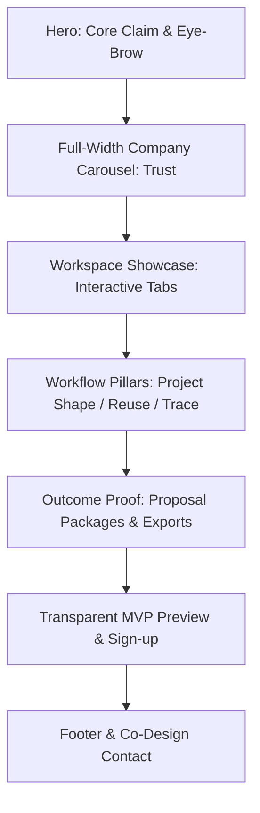

# B2B SaaS & Estimation Landing Page Best Practices

**Date:** 2026-05-21  
**Status:** Research & Best Practice Synthesis  
**Parent folder:** `.ai/03_plans/landing-page-improvement/`  
**Focus:** Industry-standard landing page frameworks tailored to vertical B2B SaaS (construction estimation).

---

## 1. Core Best Practices for Tech Startups (General B2B SaaS)

High-converting B2B SaaS landing pages must balance cognitive load with trust building. Because B2B buyers have higher friction and longer decision-making cycles, startup landing pages should address specific, high-priority concerns immediately.

### A. Messaging & The "5-Second" Rule

- **Outcome-First Headings:** Visitors must know _what_ the product is, _who_ it is for, and _what_ specific outcome it delivers within five seconds.
  - _Bad:_ "Redefining the Future of Productivity" (Vague, cognitive overhead).
  - _Good:_ "Create Construction Cost Estimates in Hours, Not Days" (Outcome-focused, clear category).
- **Targeted Eyebrow Copy:** A small, high-contrast label above the main header establishes immediate relevance (e.g., "Built for construction cost estimators").

### B. High-Intent conversion & Friction Reduction

- **Frictionless CTA Paths:** Eliminate administrative steps. If the app is self-serve, the CTA should represent immediate utility.
  - _Traditional B2B:_ "Get Demo" (Implies scheduling a call with a salesperson, high friction).
  - _Modern PLG (Product-Led Growth):_ "Try Workspace" or "Start Free Preview" (Immediate access).
- **Dynamic CTAs:** Swap page headers or buttons dynamically based on whether a user is logged in (e.g., changing "Try Workspace" to "Go to Workspace") to reduce user friction.

### C. Strategic & Authentic Social Proof

- **Social Proof Placement:** Position trust signals (logos, numbers, quotes) high up on the page to reassure visitors before they invest time in reading product features.
- **Truth and Specificity over Claims:** Analytical buyers ignore broad statements like "The World's Best Estimating Tool." They respond to concrete statements of relationship, such as:
  - "Design partners & early pilot users include..." (For pre-release/MVP stages).
  - "Used by estimators at..." (Once confirmed).

### D. Technical & Performance Standards

- **Fast Loading (Core Web Vitals):** Sub-second page rendering is directly tied to lower bounce rates. B2B pages must load instantly, capping initial payload weight and excluding complex app-shell dependencies (like dragging libraries or rich interactive grids) from the marketing bundle.
- **Clean DOM & SEO Crawlability:** Avoid polluting heading tags (`h1`-`h6`). Headings should form a logical document outline. Infinite-loop marquees or decorative components must not repeat heading tags, which dilutes SEO topical authority.

---

## 2. Vertical-Specific Best Practices: Construction Estimation

Vertical B2B SaaS apps targeting traditional industries (like construction, engineering, or logistics) face unique audience psychology. Estimators, contractors, and builders are highly practical and naturally skeptical of modern software marketing.

### A. The Skeptics' Filter

- **Zero Marketing Fluff:** Avoid words like "AI-powered workflow optimization," "disruptive," or "revolutionary" unless backed by instant visual evidence. Use industry vocabulary like _quantities_, _line items_, _revisions_, _cost components_, and _Excel exports_.
- **Transparent Product Mockups:** Show real, dense workspace views. Construction pros want to see the hierarchy, columns, and totals. Abstract or simplified vector illustrations fail to build credibility.

### B. Value over Features

- **Method-Driven Narrative:** Focus on _how_ the tool replaces their current spreadsheet mess:
  1.  **Scope & Structure:** Estimating in the shape of the actual project (Tree structures instead of flat tabs).
  2.  **Logic Continuity:** Reusing cost logic that repeats (Component Libraries instead of copy-pasting).
  3.  **Traceability:** Comparing revision options without losing weekends (Revision tracking instead of versioned files).
  4.  **Handoff:** Getting proposal-ready outputs in Excel & PDF.

### C. Collaborative Early-Access Strategy

- **Co-Design Invitations:** Turn early-stage MVP limitations into an advantage. Invite estimators to "co-design" the workspace, signaling that their practical feedback directly shapes the product's direction.

---

## 3. Gap Analysis: Archestimator

Applying these B2B SaaS and vertical estimation best practices to Archestimator's current landing page reveals several opportunities:

| Best Practice Category    | Industry Standard                                                       | Archestimator Current State                                                               | Recommended Correction                                                                      |
| ------------------------- | ----------------------------------------------------------------------- | ----------------------------------------------------------------------------------------- | ------------------------------------------------------------------------------------------- |
| **SEO Heading Hierarchy** | Unique headers outlining key sections. No redundant headings.           | logo marquee uses `h3` tags, causing 12 redundant heading records in crawlers.            | Refactor logos in `CompanyProofCarouselSection` to use styled `span` elements.              |
| **Metadata Relevance**    | 50-60 character title; 150-160 character description with target terms. | Title is 13 chars ("Archestimator"); Meta description is 64 chars; lacks search keywords. | Optimize in `src/app/layout.tsx` with high-intent keywords (Estimating, Proposal, Excel).   |
| **Scroll Experience**     | Smooth scrolling with snappy visual response.                           | Lenis smooth scroll has slow lerp (`0.105`), creating a heavy or laggy feel.              | Tune Lenis config `lerp` parameters to `0.12` for a punchy scroll feel.                     |
| **Fidelity of Proof**     | Direct, clear product visuals matching real functionality.              | Placeholder media blocks visible, reducing trust on a public page.                        | Replace placeholders with high-fidelity, app-derived screenshots or diagrams.               |
| **PLG Call to Action**    | Frictionless self-service workspace onboarding.                         | Alternates between "Get demo" and "Workspace," creating confusion.                        | Harmonize CTA to "Try Workspace" or "Start MVP Preview" for unauthenticated users.          |
| **Rendering Performance** | No console warnings, errors, or GPU stalls.                             | WebGL rendering in background triggers 4 synchronous read-back stalls on load.            | Inspect context initialization parameters in `@firecms/neat` canvas to avoid driver blocks. |

---

## 4. Proposed Landing Page Structure & Content Matrix

To maximize conversion, the Archestimator landing page should follow this structured sequence:

### Section Breakdown & Wording

1.  **Locked Hero Section**
    - _Claim:_ "Only the smart ones create cost estimates this way."
    - _Role:_ Establish category and target audience. Keep layout locked.
2.  **Company Proof Carousel**
    - _Layout:_ Full-bleed edge-to-edge scrolling track.
    - _Wording:_ Neutral labels like "Early design partners & pilot users" to preserve credibility during MVP. No `h3` tags.
3.  **Product Showcase (Interactive Previews)**
    - _Tabs:_ Estimate Workspace, Component Library, Revision Intelligence, Proposal Comparisons.
    - _Visuals:_ Realistic screenshots of the workspace in action.
4.  **Value Narrative (Clarity from Mess)**
    - _Focus:_ Explain why disconnected sheets cause errors. Introduce the Archestimator workflow (Structure → Components → Revisions → Exports).
5.  **Reassurance & Action**
    - _CTA Wording:_ "Start MVP Preview" or "Try Workspace" (Frictionless entry).
    - _Feedback Invitation:_ "Co-design the workspace with us. Send feedback directly to our team."
