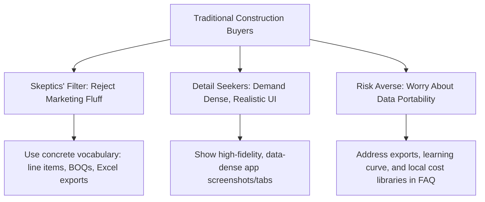
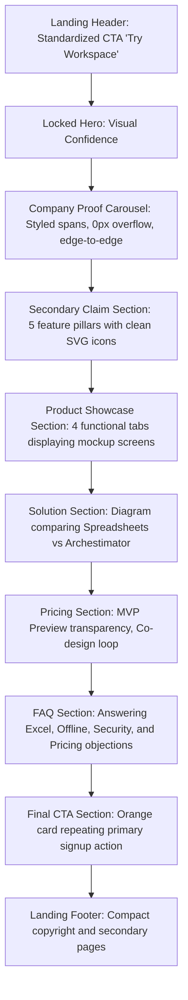

# Comprehensive Landing Page Research, Audit & Strategy Playbook

**Date:** 2026-05-23
**Status:** Approved Research & Strategy Blueprint
**Parent folder:** `.ai/03_plans/landing-page-improvement/`
**Focus:** Industry-standard landing page frameworks, CRO best practices, technical audits, and vertical B2B SaaS positioning for Archestimator (construction estimating and bidding software).

---

## 1. Executive Summary & Design Thesis

Archestimator is a vertical B2B SaaS application designed to replace disconnected spreadsheet workflows and file-chasing drift with an integrated estimating, cost library, and proposal workspace. The landing page serves as the entry point for a specialized, highly practical, and naturally skeptical target audience: **construction cost estimators, contractors, architects, quantity surveyors (QS), engineers, and project teams**.

To maximize conversion, Archestimator's public landing page must balance two forces:
1. **General B2B SaaS Landing Page Best Practices:** Sub-second load times, outcome-oriented copy, clear visual hierarchy, F-shaped scanning layouts, and frictionless Product-Led Growth (PLG) entry points.
2. **Vertical-Specific "Skeptics' Filter":** Traditional industry buyers (builders, contractors) reject generic marketing hype ("synergy," "streamlining," "disruption"). They demand concrete, workflow-derived evidence: project-shaped structures, reusable cost logic, revision traceability, visual cost breakdowns, and Excel/PDF handoff.

This playbook synthesizes general and vertical landing page research, evaluates the competitive landscape, audits the current Archestimator `/` route, and provides an actionable, code-free strategy and section-by-section blueprint to elevate the landing page to a world-class level.

---

## 2. Core Landing Page Best Practices (General B2B SaaS)

High-converting B2B SaaS landing pages must minimize cognitive load while rapidly building credibility. Because B2B buying cycles involve multiple stakeholders and high implementation friction, startups must address key landing page dimensions:

### A. Information Architecture & Scanning Patterns
*   **The Gutenberg Diagram & Z-Pattern:** Users read left-to-right, top-to-bottom. Crucial information (branding, primary value prop, main CTA) must align with the natural scanning path.
*   **F-Shaped Pattern of Reading:** Research from Nielsen Norman Group confirms that users scan Web content in an "F" pattern—focusing heavily on headlines, subheadings, and bullet points. Walls of text are ignored. Pages must use bold outcome-first headings, chunked text blocks, and bulleted lists.
*   **Gestalt Principles (Whitespace & Breathing Room):** Adequate padding (e.g., `py-24` to `py-32`) and clear visual grouping (proximity, common region, similarity) allow the user's eye to rest and digest information. Squeezing content together creates visual noise and signals amateur design.

### B. Messaging & The "5-Second Test"
*   **Outcome-First Copy:** The headline must answer three questions in under five seconds:
    1.  *What is it?* (Category: Construction Estimating & Proposal Software).
    2.  *Who is it for?* (Audience: Contractors, Estimators, QS).
    3.  *What is the ultimate benefit?* (Outcome: Create estimates in hours, not days).
*   **Targeted Eyebrows:** Small, high-contrast labels (e.g., in accent orange `#FF7A1A`) above the main headline establish instant context and filter out non-target traffic.

### C. Conversion Rate Optimization (CRO) & Friction Reduction
*   **Frictionless CTAs:** PLG models thrive on immediate value. Traditional B2B CTAs like "Request Demo" imply scheduling calls with sales representatives, adding high friction. Modern SaaS landing pages utilize "Try Workspace" or "Start Free Preview" for instant self-guided access.
*   **Sticky & Contextual CTAs:** Keep a primary CTA visible in the header as the user scrolls, and repeat CTAs contextually at high-intent areas (pricing table, final section) to prompt action.
*   **Dynamic CTA States:** Swap CTAs based on auth states (e.g., "Go to Workspace" for logged-in users vs. "Try Workspace" for anonymous visitors) to minimize routing friction.

### D. Social Proof & Trust Signals
*   **Placement & Credibility:** Position trust signals (company logos, client metrics) high on the page (immediately below the fold) to validate claims before users read feature details.
*   **Transparency as Differentiation:** Analytical buyers ignore fabricated testimonials or fake "5-star reviews." Early-stage startups must use honest framing: "Design Partners & Early Users include..." rather than claiming thousands of enterprise customers.

### E. Technical Performance & SEO
*   **Core Web Vitals:** Sub-second initial load times and low Time to Interactive (TTI) directly reduce bounce rates. Heavy libraries (e.g., WebGL, drag-and-drop engines, heavy chart packages) must be excluded from the marketing bundle and loaded dynamically only inside the app workspace.
*   **Clean DOM & Heading Hierarchy:** SEO crawlers require a logical heading structure (exactly one `h1`, followed by sequential `h2` and `h3` tags). Repeating headings (e.g., using `h3` tags inside visual logo carousels) confuses crawlers and dilutes topical authority.
*   **Metadata Optimization:** Page titles must be 50-60 characters and meta descriptions 150-160 characters, packed with high-intent industry terms.

### F. Accessibility (WCAG 2.1 AA)
*   **Reduced Motion:** Animations and auto-scrolling tracks must respect `prefers-reduced-motion: reduce` by stopping motion or revealing static layouts instantly.
*   **Keyboard & Screen Reader Navigation:** All interactive elements (tabs, accordions, buttons) must support focus outlines, keyboard events (`Space`/`Enter`/`Arrow` keys), and clear ARIA descriptions.

---

## 3. Vertical-Specific Best Practices (Construction Estimating)

Construction estimating is a traditional industry populated by highly practical, detail-oriented, and naturally skeptical buyers. General SaaS tactics often fail here because estimators are risk-averse; they know a single math error in a proposal can cost their business hundreds of thousands of dollars.



### A. The Skeptics' Filter
*   **Eliminate Hype-Words:** Avoid "AI-powered workflow optimization," "revolutionary paradigm shift," or "synergistic bidding." Instead, use concrete industry vocabulary: *estimates, quantities, unit costs, labor rates, line items, BOQs, revisions, change orders, cost components, and Excel exports*.
*   **Verify Claims with Evidence:** If the page claims the tool handles revisions, show *how* (e.g., version labels, comparison deltas). If it claims component reuse, show *how* (e.g.,cost library panel insertion).

### B. Realistic UI Visualizations vs. Abstract Vectors
*   **Dense, Numeric Mockups:** Estimators want to see the numbers, columns, and rows. Abstract, cartoonish vector illustrations of construction workers or generic bar charts fail to build trust. Use clean, high-fidelity mockups of the actual estimate grid, project trees, and cost libraries.
*   **No Faked Screenshots:** If a feature (like PDF proposal formatting) is in active development, label it as "Planned Preview" or show a designed mockup rather than capturing placeholder app states.

### C. The Co-Design Partnership Model
*   **Collaborative Onboarding:** Leverage the early MVP preview state of Archestimator as a selling point. B2B builders love to shape the tools they use. Invite them to "co-design" the workspace, turning early-stage limitations into a trusted, collaborative feedback loop.

### D. Direct Objection-Handling Framework
*   Estimators have standard concerns that block signup:
    *   *Excel Portability:* "If the software goes down or if I need to send the bid to a client who only uses Excel, what happens?" (Solution: Explicitly highlight planned Excel handoffs).
    *   *Learning Curve:* "I don't have time to learn a complex new CAD or BIM-like system." (Solution: Highlight spreadsheet-like row editing with tree organization).
    *   *Offline Work:* "Does this work when I'm on site with spotty connection?" (Solution: Address offline availability and database sync transparently).

---

## 4. Competitor Landing Page Audit & Positioning Strategy

Understanding competitor landing pages helps identify positioning gaps and strategic whitespace for Archestimator.

### A. Competitor Analysis

| Competitor | Target Audience | Primary Landing Page Headline | Strengths | Weaknesses / Gaps | Pricing Posture |
| :--- | :--- | :--- | :--- | :--- | :--- |
| **STACK** | Subcontractors, Estimators | "Bid more. Win more. Work smarter." | Powerful CAD/PDF takeoff tools; automated material counts. | Takeoff-first; setup-heavy; poor revision diffing; opaque pricing. | Opaque; custom quotes. |
| **PlanSwift** | General/Subcontractors | "Takeoff & Estimating Software" | Established brand; strong area/length PDF measurement. | Legacy desktop app; no real-time collaboration; heavy startup cost. | US$2,000/year base license. |
| **Bluebeam Revu** | QS, Architects, Engineers | "Build better with Bluebeam" | World-class PDF markup, calibration, and collaboration. | Excellent markup, but not a dedicated structured estimating engine. | US$260 - US$440/user/year. |
| **Buildxact** | Residential Builders, Remodelers | "Simple estimating & job management software" | End-to-end flow: takeoff, estimates, invoices, portals. | Onboarding burden; expensive; localized data is US/AU-centric. | US$199 - US$599/month. |
| **Joist** | Small Trade Contractors | "Estimate & Invoice on the Go" | Extremely simple mobile app; integrated payments. | No complex nesting/BOQ; no takeoff; weak cost library features. | US$10 - US$32/month. |
| **Clear Estimates** | Remodelers, Handymen | "Fast, Easy, Accurate Remodeling Estimates" | Built-in RSMeans cost database; quick proposal templates. | Dated web UI; US-centric cost data; weak revision comparison. | US$79 - US$119/month. |
| **Procore** | Commercial GCs, Enterprise | "One platform for real-world construction" | Comprehensive enterprise CRM, PM, Financials suite. | Overbuilt/costly for small teams; high learning curve. | Custom quotes (expensive). |

### B. Strategic Whitespace & Positioning for Archestimator
Archestimator should avoid competing head-on as a heavy CAD/PDF takeoff platform (e.g., STACK/PlanSwift) or an all-in-one ERP suite (e.g., Procore/Buildxact). Instead, own the **Wedge of Estimating Speed and Revision Intelligence**:

> **Positioning Statement:** "Archestimator is a fast, structured construction estimating workspace for contractors dealing with changing designs. We bridge the gap between simple invoices and heavy takeoff systems, letting you organize estimates by project structure, reuse pricing components, trace revision deltas, and export clean proposals without spreadsheet chaos."

*   **Key Differentiators to Highlight on Landing Page:**
    *   **Project-Shaped Estimates:** Ditch flat spreadsheet tabs. Organize estimates hierarchically by project zones (lots, levels, structures, areas).
    *   **Cost & Component Libraries:** Stop copy-pasting lines. Search and insert reusable cost logic that remains linked to master supplier dates.
    *   **Revision Delta Tracking:** Never lose a weekend comparing estimate versions. Track what changed, why, and how it impacts the grand total.
    *   **Connected Handoff:** Keep proposals, Excel exports, and visual breakdowns automatically tied to the underlying cost sheet.

---

## 5. Archestimator Landing Page Audit & Immediate Gaps

An audit of the current landing page implementation (`src/app/page.tsx` and underlying components) reveals key technical, SEO, and visual optimization gaps:

### A. Technical & Performance Audit Findings
1.  **WebGL GPU readPixels Stalls (High Priority):**
    > [!WARNING]
    > The browser console logs 4 WebGL stalls on initial load: `GPU stall due to ReadPixels`. This is triggered by the `VoxelPaperBackground.tsx` rendering loop, creating visual weight and CPU overhead.
    *   *Correction:* In accordance with approved plans, completely remove `VoxelPaperBackground.tsx` and all imports of it from the landing page. Rely on clean, fast, flat background styling.
2.  **Asset Bundle Audit:**
    *   Next.js ships standard marketing scripts, but ensure that heavy workshop editor dependencies (e.g., tree drag-and-drop, rich tables) are dynamically imported and excluded from the public landing package.
3.  **Image Optimization:**
    *   The page currently loads very few images. As high-fidelity product previews are added, enforce Next.js `<Image />` component optimization (WebP formats, lazy loading, responsive sizes) to keep page loads under 400ms.

### B. SEO & Accessibility Audit Findings
1.  **Suboptimal Title & Meta Lengths (High Priority):**
    > [!IMPORTANT]
    > The current layout title is `"Archestimator"` (13 characters) and the description is `"Contractor-first construction estimating and proposal workspace."` (64 characters). Both are too short to capture search intent and lack key regional search terms.
    *   *Correction:* Update `src/app/layout.tsx` metadata config:
        *   **Title:** `Archestimator | Construction Estimating & Proposal Software` (58 chars).
        *   **Description:** `Create construction cost estimates in hours, not days. Organize sheets by project structure, reuse cost components, trace revisions, and export Excel & PDF files.` (161 chars).
        *   **Keywords:** `construction estimating software, cost estimation, BOQ software, builder bidding, estimate revisions, construction proposals`.
2.  **Heading Outline Pollution (High Priority):**
    > [!CAUTION]
    > Inside `CompanyProofCarouselSection`, company names inside the infinite marquee (Northline Builders, Formworks Studio, etc.) are wrapped in `<h3>` tags. Because the marquee duplicates the track for seamless looping, crawlers read 12 identical `H3` nodes, diluting the page's semantic topical authority.
    *   *Correction:* Replace the `<h3>` elements with styled `<span>` tags. Use `aria-hidden="true"` on duplicate loop tracks to hide redundant text nodes from assistive devices.
3.  **Lenis Scroll Lerp Speed:**
    *   *Finding:* The current smooth scroll lerp (`0.105`) feels slightly sluggish, mimicking a heavy page.
    *   *Correction:* Adjust Lenis config `lerp` value to `0.12` for a snappier, punchier scroll settling.

### C. Marketing & Conversion Audit Findings
1.  **Header CTA Mismatch:**
    *   *Finding:* The landing page header CTA alternates between "Get demo" and "Workspace." "Get demo" creates friction, implying sales calls.
    *   *Correction:* Standardize all landing CTAs for unauthenticated users to `"Try Workspace"` or `"Start MVP Preview"`. This aligns with the PLG direct-onboarding model.
2.  **Placeholder Social Proof Policy:**
    *   *Finding:* The company marquee uses placeholder logos.
    *   *Correction:* Keep the marquee but label it honestly: "Early design partners & pilot teams" or clearly mark visual scaffolding as "Design Partner Preview." Never fake social numbers.
3.  **Lack of Accordion Objection Solvers:**
    *   *Finding:* There is no structured FAQ section to solve immediate contractor worries about Excel compatibility and data security.
    *   *Correction:* Add a B2B FAQ Accordion section immediately above the final CTA card.

---

## 6. Actionable Below-Hero Improvement Blueprint

This blueprint outlines the visual layout, copywriting directions, and interactivity guidelines for sections below the locked above-the-fold hero.



### A. Section Sequence & visual Layout

#### 1. LandingHeader
*   **Visuals:** Thin, sticky border bottom. Monochrome layout. Left: Brand logo. Right: "Try Workspace" primary orange button (`#FF7A1A`), login secondary button.
*   **CRO Rules:** If user is logged in, show "Go to Workspace."

#### 2. HeroSection (LOCKED)
*   **Copy:** "Only the smart ones create cost estimates this way."
*   **Visuals:** Warm canvas tones, lock structural layout, delete WebGL voxel background.

#### 3. CompanyProofCarouselSection (Full-Width)
*   **Visuals:** Horizontal edge-to-edge marquee track, grayscale logos (Northline Builders, Formworks Studio, Apex QS, etc.), thin top and bottom border.
*   **DOM Structure:** No heading tags. Text wrapped in `span` elements. Duplicate tracks wrapped in `aria-hidden="true"`.
*   **A11y:** Hover/focus pauses animation. Stop animation for `prefers-reduced-motion: reduce`.

#### 4. SecondaryClaimSection (Focused Max-Width: `1120px`, Padding: `py-24 sm:py-32`)
*   **Visuals:** 5-column layout on desktop, stacking on mobile. Rich, minimalist SVG icons for the pillars.
*   **Copy Matrix:**
    *   *Eyebrow:* "A Better Method"
    *   *Heading:* "Estimate logic should stay connected from quantity to proposal."
    *   *Pillar 1:* **Estimate Workspace** ("Organize cost sheets in the shape of the actual project hierarchy.")
    *   *Pillar 2:* **Component Library** ("Search, filter, and insert reusable cost logic that updates with supplier data.")
    *   *Pillar 3:* **Revision Intelligence** ("Track change deltas automatically before they become bidding errors.")
    *   *Pillar 4:* **Proposal Comparisons** ("Compare estimate alternates side-by-side without duplicating files.")
    *   *Pillar 5:* **Excel/PDF Handoff** ("Export clean spreadsheets and proposal-ready client documents in one click.")

#### 5. ProductShowcaseSection (Focused Max-Width: `1120px`)
*   **Interactivity:** Four clickable horizontal tabs:
    1.  **Estimate Workspace** (Default active tab).
    2.  **Component Library**.
    3.  **Revision Intelligence**.
    4.  **Proposal Comparisons**.
*   **Visuals:** Below the tabs, render a clean, high-contrast, structured card containing a mockup of that tab's interface. Use tabular figures (`font-mono`) for numerical values to demonstrate architectural precision.
*   **A11y:** Enable keyboard arrow navigation (`ArrowLeft`/`ArrowRight`) to cycle active tabs.

```text
Product Showcase Tabs Wireframe Concept:
+---------------------------------------------------------------------------------+
|  [ Estimate Workspace ]   [ Component Library ]   [ Revisions ]   [ Comparisons ]|
+---------------------------------------------------------------------------------+
|  +-- [Estimate Tree] -------------+ +-- [Cost Sheet Content] ----------------+  |
|  | v Lot 1 Residential            | | Code   Description    Qty   Unit   Rate    |  |
|  |   > Earthworks & Excavation    | | CS-01  Excavation     145   m3     P450    |  |
|  |   v Structural Concreting      | | CS-02  Ready-Mix      65    m3     P4,800  |  |
|  |     o Level 1 Slab             | | CS-03  Rebar Work     4,200 kg     P95     |  |
|  |     o Level 2 Slab             | +----------------------------------------+  |
|  +--------------------------------+ | Total Cost: P817,000                   |  |
+------------------------------------+-------------------------------------------+
```

#### 6. SolutionSection (Focused Max-Width: `920px`)
*   **Visuals:** Side-by-side or alternating grid comparing the "Old Way" (Excel files, version mismatch, broken formulas) with the "Archestimator Way" (Structured sheets, linked libraries, visual version tracking). Replace all generic `PlaceholderMedia` cards with high-fidelity, hand-drawn vector diagrams using primary orange accents.
*   **Copy:** Focus on the pain point: "Less spreadsheet drift. More estimate control."

#### 7. PricingSection
*   **Visuals:** Centered single-card layout. White background, thin border, warm canvas highlights.
*   **Copy:**
    *   *Price:* `₱0` / Free MVP Preview.
    *   *Transparency Message:* "We are actively building the core flow. Join us during the MVP preview, help shape the product, and secure early-access pricing once finalized."
    *   *The Co-Design Action:* Provide a direct feedback link for builders to send suggestions to the founding team.

#### 8. FAQSection (Focused Max-Width: `920px`, Padding: `py-24 sm:py-32`)
*   **Visuals:** Minimalist accordion layout with subtle bottom borders. Click to expand with smooth height transition.
*   **Copy & Question Grid:**
    *   *Q: Can I export my estimates to Excel?*
        *A: Yes. Excel handoff is a planned core feature. We believe estimators should never have their data locked inside a single platform.*
    *   *Q: How does the Component Library save time?*
        *A: Instead of copy-pasting cost rows from old spreadsheets, you search your master Library, insert the component with a click, and keep pricing linked to supplier update dates.*
    *   *Q: Who is Archestimator built for?*
        *A: Construction cost estimators, QS, contractors, and project managers who build residential, fit-out, or commercial estimates.*
    *   *Q: What is the cost of the MVP preview?*
        *A: Access is free during this co-design phase. In return, we ask for your feedback to help us build the best estimating workspace.*
    *   *Q: How secure is my project data?*
        *A: Your data is secure and private. All authentication is handled via protected magic links, and workspace database records are isolated using strict row-level security (RLS).*

#### 9. FinalCTASection (Focused Max-Width: `1120px`)
*   **Visuals:** Large, high-contrast container with a rich dark gray background (`#313130`) or primary orange border accent.
*   **Copy:**
    *   *Heading:* "Build your next estimate the smart way."
    *   *Button:* `"Try Workspace"` (Primary orange filled card button).

#### 10. LandingFooter
*   **Visuals:** Clean, low-contrast footer. Bottom row: Copyright + link options for `/features`, `/pricing`, `/about`, `/contact`, `/privacy`, `/security`.

---

## 7. Future Public Subpages Roadmap & Claims Safety

As Archestimator expands from a single-page landing into a multi-page marketing site, every subpage must adhere to strict claims-safety guidelines.

```txt
Subpage Route Architecture (Option B):
src/app/page.tsx                  --> Live homepage (Hero locked)
src/app/features/page.tsx         --> Deep feature chapters
src/app/pricing/page.tsx          --> Early-access FAQ + co-design details
src/app/about/page.tsx            --> Factual story (gated by approved facts)
src/app/contact/page.tsx          --> Input form (gated by spam/privacy)
src/components/landing/PublicPageShell.tsx --> Shared layout chrome
```

### A. Claims Safety Levels
We classify all public marketing claims into four categories to ensure transparency and build long-term trust:

1.  **`live` (MVP-ready):** Features implemented and functional inside the authenticated workspace today.
    *   *Claims:* Estimate Workspace, hierarchical trees (group and area nodes), area-targeted cost rows, running totals, multi-estimate projects.
    *   *Landing Wording:* "Create and manage project cost sheets inside the MVP workspace."
2.  **`mvp-preview` (Static/Scaffolded):** Features visible or partially usable, but still in development.
    *   *Claims:* Component Library search/insertion, supplier metadata, pricing dates.
    *   *Landing Wording:* "Search and insert reusable cost logic in the early preview workspace."
3.  **`planned` (Future Direction):** Essential roadmap features not yet backed by code.
    *   *Claims:* Revision diff comparison charts, proposal package PDF formatting, Excel/PDF exports, team collaboration tools.
    *   *Landing Wording:* "Planned features, designed to integrate seamlessly into your estimating flow."
4.  **`unsafe` (Do Not Publish):** Vague, unverified, or legally sensitive claims.
    *   *Claims:* SOC 2 compliance, ISO certifications, "AI-guaranteed cost accuracy," faked testimonial counts, "Trusted by thousands."
    *   *Rule:* Exclude from all public pages.

### B. Subpage Content Blueprints
*   **`/features`:** Build around the seven feature chapters. Each chapter must use clear maturity labels (`Available in MVP Preview`, `Planned Next`) so visitors understand exactly what they can do today versus what is being built.
*   **`/pricing`:** Frame `₱0` as an early-access benefit. Avoid complex pricing tiers until Philip approves the commercial monetization strategy.
*   **`/about`:** Tell the "Clarity and Mess" story. Focus on the founder's point of view regarding spreadsheet drift. **Do not publish founder names, specific location facts, or legal entity terms until Philip explicitly confirms them.**
*   **`/contact`:** Provide a clean, validate-guarded contact form or a calendar booking link. Gated by spam-protection (e.g., Honeypot fields) and an active Privacy Policy link.
*   **`/privacy` & `/security`:** Keep statements factual. Address Supabase magic-link auth, PostgreSQL RLS database isolation, and basic cookie/contact data capture. Do not use generic "bank-level encryption" copy.

---

## 8. Validation & QA Playbook

Before any code implementation is pushed to production, the development loop must validate the following gates:

### A. Technical Gates
- [ ] Run `bun run validate` and `bun run build` to verify Next.js compilation.
- [ ] Verify that no authenticated workspace files (`src/app/workshop/**`) are altered during marketing page edits.
- [ ] Confirm WebGL console warnings are eliminated (GPU readPixels readback eliminated).

### B. SEO & Semantic Gates
- [ ] Run a heading extraction check (e.g., via script or browser devtools) to ensure exactly one `h1` exists, and no `h3` or `h2` headings are duplicated inside sliding carousels.
- [ ] Check page title (50-60 chars) and meta description (150-160 chars) rendering.
- [ ] Verify canonical link tag `<link rel="canonical" href="..." />` is correctly configured.

### C. UX & Accessibility Gates
- [ ] Verify desktop and mobile layouts show 0px of horizontal overflow (`body.scrollWidth === window.innerWidth`).
- [ ] Test tablist and FAQ accordion keyboard controls (`Tab`, `Space`, `Enter`, `Arrow` keys).
- [ ] Check `prefers-reduced-motion: reduce` stops logo marquee tracks instantly.
- [ ] Ensure text contrast complies with WCAG AA (minimum contrast ratio of 4.5:1 for body copy).
