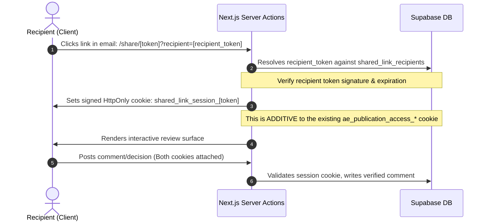

# Security, Privacy, & Auth Plan — Shared Link Overhaul

**Status:** Proposed Planning
**Date:** 2026-05-28

This document details the security threat model, recipient identity verification mechanism, anti-abuse gates, privacy controls, and CORS policy for the client-facing Shared Link (V2) features.

---

## 1. Threat Model & Abuse Scenarios

Transitioning the view-only `/share/[token]` route into an interactive surface (comments, accept/decline decisions) introduces new write vectors from unauthenticated public internet traffic.

### Threat Scenarios & Mitigations

| Threat | Target | Mitigation |
|--------|--------|------------|
| **Comment Spam & Flooding** | Comments section | Rate limiting (IP + token bound), maximum character limits (1,000), server-side content sanitization (strip HTML). |
| **Identity Spoofing** | Comment authoring | Signed recipient-specific access tokens. We do not allow anonymous public comments; all comments must map to a verified recipient email. |
| **Brute-force Password Entry** | Password gate | Progressive cooling-off delay (1s, 2s, 4s, 8s...) and hard lockout (max 5 attempts per IP/token per hour) recorded in a temporary PostgreSQL table or in-memory cache. |
| **Unauthorized Action Spoofing** | Accept/Decline decision | Token-bound signed requests. Once a decision is submitted, it is finalized in the database and cannot be modified or re-submitted. |
| **Information Disclosure** | Snapshot database | Secure resolvers using service role client only. Row Level Security (RLS) is disabled for direct public query, but access is gated by token hashing. |
| **Search Engine Scraping** | Project estimates | Strict `<meta name="robots" content="noindex, nofollow" />` headers, `X-Robots-Tag: noindex, nofollow, nosnippet`, and search engine crawler verification. |
| **Cross-Site Request Forgery** | Comment/Decision POST endpoints | Reuse existing `assertSameOriginPublicPost` pattern: origin validation + `ae_publication_csrf` cookie + `x-archestimator-csrf` header. |
| **Snapshot Version Tampering** | Decision validity | Server-side `snapshot_version` validation at decision time. Client cannot override the version they are deciding on. |

---

## 2. Recipient Identity Verification (Zero-Auth Flow)

We must allow clients/recipients to add comments and approve/decline estimates without forcing them to register a full Supabase Auth account.

### The Token-Binding Mechanism

To prove identity without password logins, we implement a **Signed Token-Binding Flow** that extends the existing `ae_publication_access_*` cookie pattern:



1. **Generation**: When the owner adds `client@example.com` to the recipient list, a cryptographically secure, high-entropy `recipient_token` (and its hash) is generated using the same `createPublicationToken` pattern.
2. **Delivery**: The recipient receives a unique link: `/share/[token]?recipient=[recipient_token]`.
3. **Session Issuance**: Upon visiting, the server validates the `recipient_token` against `shared_link_recipients.recipient_token_hash`. If valid, the server sets a signed, HttpOnly, SameSite=Lax cookie: `shared_link_session_[token]`.
4. **Validation**: Subsequent actions (comments, decisions) require this cookie. The server decrypts it, validates the email and link context, and performs the write.
5. **Relationship to Password Gate**: If the publication requires a password, the recipient must first pass the password gate (setting `ae_publication_access_*`) BEFORE the recipient session cookie is issued. The two cookies are independent but both required for write access on password-protected links.

### Cookie Specification

```http
Set-Cookie: shared_link_session_[token_suffix]=[prefix]:[payload]:[signature]; Path=/; HttpOnly; SameSite=Lax; Max-Age=86400; Secure
```

- **Payload**: `{ recipientId, email, publicationId, expiresAt }`
- **Signature**: HMAC-SHA256 using `PUBLICATION_ACCESS_COOKIE_SECRET` (reuse existing secret).
- **Max-Age**: 24 hours (shorter than the publication access cookie to reduce exposure window).

---

## 3. Rate Limiting & Input Sanitization

### Rate Limiting Implementation

**Chosen Approach for MVP**: In-memory LRU cache with TTL (no external Redis dependency).

- **Comments**: Limit to 5 comments per minute per recipient session, and 20 comments per hour.
- **Decisions**: 1 accept/decline action allowed per recipient per publication.
- **IP-based block**: Maximum 50 total POST requests per hour to any `/api/share/[token]/*` surface.
- **Password attempts**: Maximum 5 attempts per IP per token per hour. Lockout duration: 15 minutes.

**Implementation Sketch**:
```typescript
// Simple in-memory rate limiter (Node.js global)
const rateLimitStore = new Map<string, { count: number; resetAt: number }>();

function checkRateLimit(key: string, maxRequests: number, windowMs: number) {
  const now = Date.now();
  const record = rateLimitStore.get(key);
  if (!record || record.resetAt <= now) {
    rateLimitStore.set(key, { count: 1, resetAt: now + windowMs });
    return { allowed: true };
  }
  if (record.count >= maxRequests) {
    return { allowed: false, retryAfter: Math.ceil((record.resetAt - now) / 1000) };
  }
  record.count++;
  return { allowed: true };
}
```

*Note*: This is process-local and resets on deploy. For multi-instance deployments, upgrade to Redis or a shared cache.

### Input Sanitization

- Use standard server-side string escaping to scrub HTML/script tags from comments before storage.
- Truncate comments to a maximum of 1,000 characters.
- Strip all HTML tags using a whitelist approach (allow only plain text + newlines).
- Escape output in React using JSX's default escaping (never use `dangerouslySetInnerHTML` for comments).

---

## 4. Audit & Event Logs

Actions taken on the Shared Link are client-facing and must not contaminate the internal project or AI audit trails. We record metadata-only events:

- **Table**: `shared_link_events` (or extend `project_publication_events` with new event types).
  - `recipient_id`: FK to the recipient (nullable if anonymous/open URL access).
  - `event_type`: `open`, `comment_add`, `accept_decision`, `decline_decision`, `password_attempt`.
  - `ip_hash` and `user_agent_hash`: Anonymized using SHA-256 (no raw PII stored in event log).
  - `metadata_json`: Additional context (e.g., comment ID, decision type).

---

## 5. Security & Privacy Headers

All `/share/[token]` responses and related API routes must enforce:

```http
Cache-Control: no-store, must-revalidate
X-Robots-Tag: noindex, nofollow, nosnippet
Content-Security-Policy: default-src 'self'; script-src 'self' 'unsafe-inline' https://www.clarity.ms; style-src 'self' 'unsafe-inline'; img-src 'self' data: https://*.supabase.co;
```

**Current State Gap**: `next.config.ts` currently sets `Content-Security-Policy-Report-Only` for `/share/:path*`. Before V2 launch, evaluate upgrading to enforced CSP because interactive POST surfaces increase XSS risk.

**Additional Headers for API Routes**:
```http
X-Content-Type-Options: nosniff
X-Frame-Options: DENY
Referrer-Policy: no-referrer-when-downgrade
```

---

## 6. CORS Policy for Share API

The existing `assertSameOriginPublicPost` already enforces same-origin for POST requests. No CORS preflight changes are needed unless we explicitly want to allow third-party domains to embed the share page (not recommended).

- **Same-Origin Enforcement**: Continue using `assertSameOriginPublicPost` for all new POST endpoints (`/api/share/[token]/comment`, `/api/share/[token]/decision`).
- **GET Requests**: The existing `GET /api/share/[token]` does not require CORS headers because it is consumed by the same-origin Next.js app or server-side renders.

---

## 7. GDPR & Privacy Compliance

- **Analytics Gating**: The landing page uses `archestimator_cookie_consent` with `parseLandingConsentValue`. The share page must NOT fire GA4, Microsoft Clarity, or any tracking scripts unless the viewer has explicitly accepted analytics cookies via this consent mechanism.
- **Recipient Data**: Emails stored in `shared_link_recipients` are PII. The table must be covered by the Supabase DPA. On link revocation, cascade delete removes recipient data promptly.
- **Right to Erasure**: If a recipient requests deletion, we must provide a mechanism for the owner to remove their record from `shared_link_recipients` (and thus cascade-delete their comments).
- **Privacy Notice Update**: The `/privacy` page must disclose the collection of recipient emails, comments, and decisions as part of the client estimate-review features.
