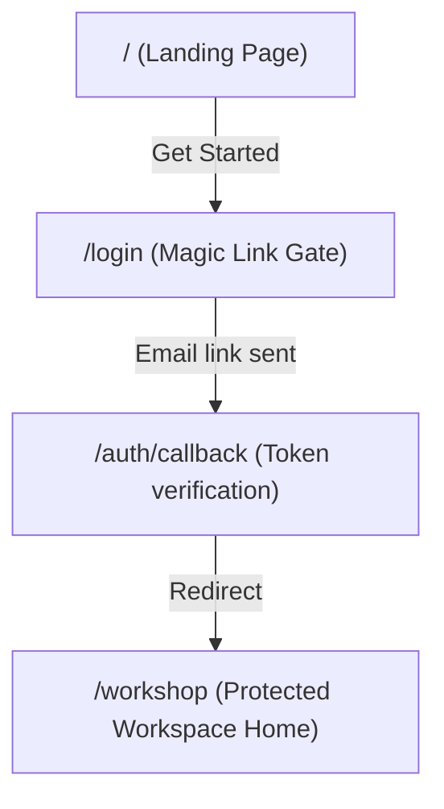

# MVP User Experience Flows

**Date:** 2026-05-29<br />
**Status:** Active<br />
**Purpose:** Maps the user journeys and interface navigation paths for the Archestimator MVP.

---

## 1. Marketing & Authentication



### 1.1 Landing Page (`/`)
*   Provides product value proposition focusing on structured quotations, cost catalogs, revision track record, and client-ready exports.
*   Runs automated A/B headline tests (e.g. "Only the smart ones create quotes this way" vs. "Your competitors are already a step ahead").

### 1.2 Access & Login (`/login`, `/auth/callback`)
*   Email magic links act as primary login credential (no passwords for standard onboarding).
*   CEO/platform administrator access is mapped automatically based on email role resolver.
*   Redirect cookies (`archestimator_pending_invite`) route users directly to pending project invitations after authentication.

---

## 2. Protected Workshop Homebase (`/workshop`)

The **Workshop Homebase** is a dashboard layout featuring:
*   **Bento Grid Tiles:** Direct shortcuts to Projects list, Component Library, and Templates.
*   **Favorites Rail:** Quick-access links to user-starred projects and individual estimate sheets.
*   **Intake Banner:** Alerts users of successful project addition or sheet sharing upon accepting invitations.

---

## 3. Project & Sheet Management

### 3.1 Project Pipeline (`/workshop/projects`)
*   Shows a listing of all workspaces (Owned vs. Shared).
*   **New Project Form:** Triggers a dialog capturing project details (name, client, location, budget), creates the project, and automatically redirects to the Project Dashboard.

### 3.2 Project Dashboard (`/workshop/projects/[projectId]`)
*   **Teamspaces Modal:** Allows managers to invite collaborators by email, copy invite tokens, manage roles (manager, editor, viewer), and configure specific sheet access controls.
*   **Public Link Manager Modal:** Lets managers configure password-protected public snapshots (`/share/[token]`).

### 3.3 Estimates Listing (`/workshop/projects/[projectId]/estimates`)
*   Displays a spreadsheet table listing all estimate sheets (e.g., `ES-001`).
*   Supports **inline sheet name/code editing** and **sheet duplication** (which deep-copies the entire node tree and row snapshots into a new sheet code).

---

## 4. Detailed Estimate Workspace (`/workshop/projects/[projectId]/estimates/[nodeId]`)

This workspace implements a high-density, three-pane layout for estimating work.

```
+-----------------------------------------------------------------------------------+
| Project Header / Collaboration Avatars / Teamspaces / Settings Button             |
+------------------------+---------------------------------+------------------------+
|                        |                                 |                        |
|  Left Pane:            |  Center Pane:                   |  Right Pane:           |
|  Estimate Node Tree    |  Estimate Sheet Grid            |  Component & Template  |
|                        |                                 |  Library               |
|  - Group Nodes         |  - Area Node title              |                        |
|  - Area Nodes          |  - Table headers (material,     |  - Categories Tree     |
|                        |    qty, unit, cost, total)      |  - Suppliers Tree      |
|  - Drag/Drop reorder   |  - Quantity & contingency edits |  - Brands Tree         |
|  - Context menu for    |  - Add blank rows (click zone)  |  - Templates Tab       |
|    rename/delete       |  - Drag/Drop component cells    |                        |
|                        |                                 |                        |
+------------------------+---------------------------------+------------------------+
```

### 4.1 Node Tree Panel (Left)
*   Differentiates node types: **Group Nodes** (organizer folders) and **Area Nodes** (leaf locations owning cost items).
*   Supports context menu (Radix Context Menu) to Rename (inline) and Delete (with confirmation).
*   Allows **drag and drop reordering** of the hierarchy with optimistic client updates and database RPC alignment.

### 4.2 Estimate Sheet Panel (Center)
*   Displays item lists for the selected Area Node.
*   Provides inline text inputs for **Quantity**, **Contingency/Discount** percentage, and **Misc Cost**. Commits trigger optimistic TanStack cache updates with background rollback safeguards.
*   **Activity History Button:** Opens a slideout ledger detailing changes (inserts, edits, deletes) filtered by date, author, and node scope.

### 4.3 Library Panel (Right)
*   **Components Tab:** User filters cost catalog items by Category, Supplier, or Brand, then inserts them via click or drag-and-drop.
*   **Templates Tab:** User inserts structural multi-node assemblies (e.g. "3-Bedroom Condo layout") into Group Nodes.

---

## 5. Cost Visualizations (`/workshop/projects/[projectId]/charts`)

Provides a diagnostic dashboard comparing estimate sheets:
*   Displays up to three estimate columns.
*   Renders high-quality **D3 Donut Charts** (color-coded by space, category, or supplier) and alternative **D3 Packed Bubble Charts**.
*   Centers total sums in headers and shows detailed flat/nested item ledgers below the charts.

---

## 6. Client Publication & Feedback (`/share/[token]`)

A view-only pipeline for client presentation:
*   **Security Barrier:** If password-locked, prompts users for a passcode and saves access via HttpOnly cookie. IP lockouts trigger on consecutive failed attempts.
*   **Client Sheet View:** Renders estimate totals and D3 donut charts. Sub-tabs toggle between a reconstructed designation Tree View and flat Grid Preview.
*   **Engagement Tools:** Allow clients to submit comments on rows and issue decisions (Accept / Decline / Request Revision). Events dispatch rate-limited digests to the project owner via email.
