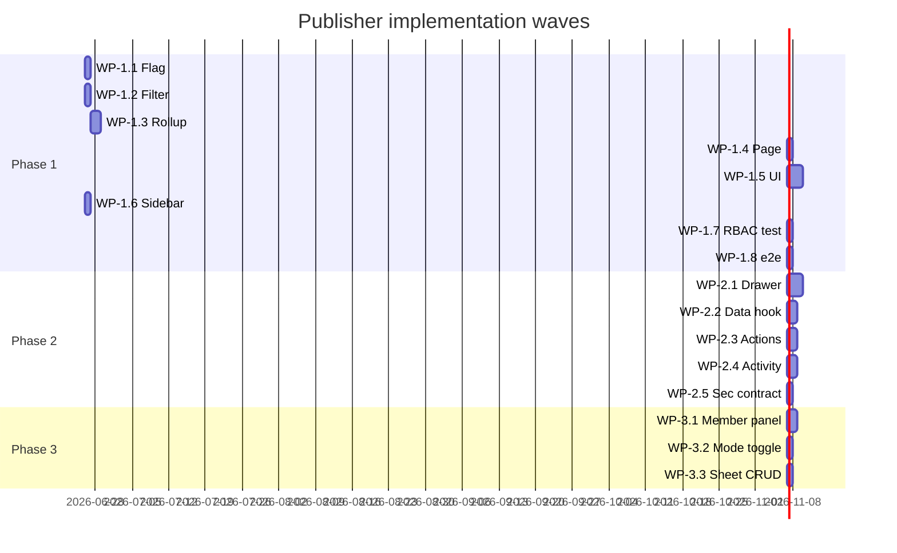

# 11 — Implementation Plan

> **PASS-2 AUDIT BANNER (2026-06-25).** This document has 2 CRITICAL Phase 0 corrections and 3 HIGH work-package updates recorded in `18_AUDIT_FINDINGS_AND_CORRECTIONS_2026-06-25.md`. Headlines: FAB-A08 (Phase 0 MUST specify branch switch from `codex/estimate-sheet-orchestration` → `main` → `feat/publisher-page`), FAB-A07 (remove fabricated `feat/sidebar-redesign` prerequisite — replace with `git branch | grep -i sidebar` check), FAB-A09 (WP-1.1 roster function lives in NEW `src/lib/publisher/roster-repository.ts` NOT in workspace-repository.ts — Ponytail T2.3 contradiction), FAB-U01 (WP-1.x MUST add design-system lint verification step), ARCH-DEFECT-04 (WP-1.x MUST add old-token UI flash test), ARCH-DEFECT-01 (WP-1.x MUST add stress test with seeded 50×5×10 workspace). Read doc 18_ for full evidence.

---

**Purpose.** The authoritative execution guide for the future implementation AI. Phased, dependency-aware, with exit criteria per phase. Each phase lists exact files, symbols, validation commands, tests, and rollback.

**Agent-neutral.** Any coding agent (Codex, Claude, OpenCode, etc.) can execute. Follow DISCOVER → PLAN → EXECUTE → VERIFY → RECORD → DECIDE per `archestimator-plan-pack` SKILL.

---

## Phase 0 — Pre-flight (prerequisite, no code change)

**Objective.** Verify repo state, concurrent-branch status, corrected symbols, and resolved Phase 0 decisions before code changes.

**Tasks.**
- 0.1 `git status --short --branch` — confirm on `main` or fresh `feat/publisher-page` branch.
- 0.2 Check current local/remote branches for touched files before editing; do not rely on stale branch-name claims. Pay special attention to `src/components/sidebar/MainSidebar.tsx`, `src/lib/repositories/workspace-repository.ts`, `src/app/workshop/publisher/page.tsx`, `next.config.*`, and new `src/lib/publisher/*`.
- 0.3 Read docs 18, 19, 20, then this implementation plan before other pack docs.
- 0.4 Confirm the six resolved owner decisions in doc 15 are still the latest instruction: D-ARCH-05 DB rotate serialization, D-ARCH-06 reject concurrent same-publication mutations, D-ARCH-07 50/action recipient cap, D-ARCH-08 snapshot bump without access-cookie invalidation, D-SEC-05 DPoP future research only, D-OPS-01 `/workshop/:path*` `no-referrer`.
- 0.5 Verify action/RPC symbols from source before calling them; never use names listed as fabricated in doc 18.
- 0.6 Read the relevant Next.js 16 docs under `node_modules/next/dist/docs/` before adding route headers for D-OPS-01.

**Exit criteria.**
- Branch is clean or freshly created.
- No collision with concurrent branches.
- D1-D7 and D-ARCH-05..08 / D-SEC-05 / D-OPS-01 are resolved and reflected in the local implementation notes.
- Corrected action/RPC names and Next.js 16 header surface are verified from source/docs.

**Validation.**
```
git status --short --branch
git log --oneline -10
```

**Rollback.** N/A.

---

## Phase 1 — Roster read surface (P0 requirements)

**Objective.** Replace the 17-line stub with a server-component roster that lists publications visible to the current user. Additive, reversible, behind a feature flag.

**Requirements addressed.** FR-01, FR-02, FR-12, FR-13, FR-17, FR-18, FR-19, FR-20, UX-01, UX-04, UX-07, UX-09, UX-11, UX-12, A11Y-01..05, A11Y-08, A11Y-09, ARCH-01..07, DATA-01, DATA-03, SEC-01, SEC-05, SEC-08, PERF-01, PERF-02, PERF-05, REL-03, OPS-01, OPS-03, OPS-04, TEST-01, TEST-02, TEST-06, TEST-07, TEST-08.

**Prerequisites.** Phase 0 exit. D3, D5 resolved.

**Dependencies.** None new.

### Work packages

#### WP-1.1 · Feature flag

- **Task.** Add `src/lib/publisher/feature-flag.ts` exporting `isPublisherEnabled(env = process.env): boolean`.
- **Files.** `src/lib/publisher/feature-flag.ts` (NEW), `.env.example` (PROBABLE — add `ARCHESTIMATOR_PUBLISHER_ENABLED=`).
- **Symbols.** `isPublisherEnabled`.
- **Validation.** `bun run type-check`; `bun run lint`.
- **Tests.** `tests/vitest/publisher-feature-flag.test.ts` (NEW) — asserts default off; on when env=true.
- **Complexity.** Small.

#### WP-1.2 · Roster filter types

- **Task.** Add `src/lib/publisher/roster-filter.ts` with `PublicationRosterStatus`, `PublicationRosterFilters`, `parseRosterFilters(searchParams: URLSearchParams)`.
- **Files.** `src/lib/publisher/roster-filter.ts` (NEW).
- **Symbols.** `PublicationRosterStatus`, `PublicationRosterFilters`, `parseRosterFilters`.
- **Validation.** Type-check + lint.
- **Tests.** `tests/vitest/publisher-roster-filter.test.ts` (NEW) — asserts URL-param parsing + defaults.
- **Complexity.** Small.

#### WP-1.3 · Workspace publications rollup

- **Task.** Add `readWorkspacePublicationsRoster(workspaceId, userId, filters)` to new `src/lib/publisher/roster-repository.ts`. Do not append to `workspace-repository.ts`.
- **Files.** `src/lib/publisher/roster-repository.ts` (NEW).
- **Symbols.** `ProjectPublicationRosterRow`, `readWorkspacePublicationsRoster`.
- **Behavior.**
  1. Call existing `readWorkspaceProjectsSummary` for project list.
  2. Filter projects where `canManagePublication` OR `canManageAccess` is true (managers) OR `currentUserRole >= viewer` (read-only visibility).
  3. For each manager project, call existing `readProjectPublicationSummary(projectId, userId)`.
  4. Merge into single `ProjectPublicationRosterRow[]`; do not force-fit `ProjectPublicationListSummary`, which is too narrow.
  5. Sort by `latestActivityAt desc nulls last`.
  6. Apply filter (status, projectId, search).
  7. Return paginated (50 max per page).
- **Validation.** Type-check + lint + targeted DOM test.
- **Tests.** Extend `tests/vitest/publisher-roster.test.ts` — mock 3 projects with 5 publications; assert filter, sort, pagination.
- **Complexity.** Medium.

#### WP-1.4 · Roster RSC page

- **Task.** Rewrite `src/app/workshop/publisher/page.tsx` from stub to RSC.
- **Files.** `src/app/workshop/publisher/page.tsx` (EDIT — replace stub).
- **Symbols.** `PublisherPage` (default export).
- **Behavior.**
  1. Check `isPublisherEnabled()`; if off, render `PublisherDisabledEmptyState`.
  2. Read session via existing `getSession()` helper.
  3. Read filters from `searchParams` via `parseRosterFilters`.
  4. Call `readWorkspacePublicationsRoster(workspaceId, userId, filters)`.
  5. Render `<WorkshopPageShell>` + `<PublisherRosterClient initialRoster=... filters=...>`.
  6. Wrap roster in `<Suspense fallback={<PublisherRosterSkeleton/>}>` and `<WorkshopRouteErrorState>` boundary.
- **Validation.** Type-check + lint + design-system lint.
- **Tests.** DOM test renders page with mocked repository.
- **Complexity.** Medium.

#### WP-1.5 · Publisher UI components

- **Task.** Create `src/components/workshop/publisher/` with:
  - `PublisherRosterClient.tsx` (client island — receives initial roster, manages filter state, drawer trigger)
  - `PublisherRosterRow.tsx` (one row)
  - `PublisherHeader.tsx` (title + count + search + filter tabs + Publish CTA)
  - `PublisherEmptyState.tsx` (server component)
  - `PublisherRosterSkeleton.tsx` (row-shape skeleton matching the final roster)
  - `publisher-queries.ts` (TanStack Query keys + fetchers)
- **Files.** All NEW under `src/components/workshop/publisher/`.
- **Symbols.** Per file.
- **Reuse.** `WorkshopPageShell`, `WorkshopCollectionLayout`, `DataTable`, `Tabs`, `SearchInput`, `StatusBadge`, `Avatar`, `IconButton`, `DropdownMenu`, `EmptyState`, `Skeleton`, `ProjectsListSkeleton` (pattern only), `Toast`.
- **UX contract.**
  1. Default roster renders only the UX-09 primary columns: publication/project, status/health, recipients summary, latest activity, sheet scope, actions.
  2. Opens, last-opened, snapshot version, days-behind warning, recipient detail, and event metadata move to the drawer/detail surface.
  3. Empty states reuse `src/components/ui/empty-state.tsx` and cover no-publications, filtered-empty, disabled, read-only, and `<768px` states.
  4. 768px-1023px uses priority columns plus full-page/detail-route behavior; `<768px` uses the desktop-first fallback.
  5. `Copy link` writes to clipboard only and confirms via toast/status; no navigation.
  6. Form validation uses inline errors plus a top error summary; focus moves to the summary on submit failure.
- **Validation.** Type-check + lint + design-system lint + axe-core.
- **Tests.** `tests/vitest/publisher-roster.test.ts` (NEW) — renders 5 mocked publications; asserts primary fields, secondary-field placement, empty states, copy-link behavior, error-summary behavior, and 768px priority layout.
- **Complexity.** Medium-Large (5 files, but each is small).

#### WP-1.6 · Sidebar nav item

- **Task.** Add `Publisher` item to `src/components/sidebar/MainSidebar.tsx` nav-items array.
- **Files.** `src/components/sidebar/MainSidebar.tsx` (EDIT — 1-line add).
- **Symbols.** nav-items array.
- **Coordination.** Recheck current sidebar branches and local dirty state before editing. Do not rely on historical branch claims from doc 18.
- **Validation.** Visual check (manual or Playwright).
- **Tests.** Extend an existing sidebar test or add `tests/vitest/sidebar-publisher-item.test.ts`.
- **Complexity.** Small.

#### WP-1.7 · RBAC contract test

- **Task.** Add `tests/vitest/publisher-rbac.test.ts`.
- **Files.** `tests/vitest/publisher-rbac.test.ts` (NEW).
- **Behavior.**
  - Assert: workspace viewer → 0 publications visible.
  - Assert: workspace editor → only publications for accessible projects.
  - Assert: workspace admin/owner → all publications.
  - Assert: cross-workspace query returns 0 rows.
- **Validation.** `bun run test:dom -- publisher-rbac`.
- **Complexity.** Medium.

#### WP-1.8 · Playwright e2e

- **Task.** Add `e2e/publisher-roster.spec.ts` (env-gated `ARCHESTIMATOR_E2E_PUBLISHER=1`).
- **Files.** `e2e/publisher-roster.spec.ts` (NEW).
- **Behavior.**
  - Sign in as workspace admin.
  - Open `/workshop/publisher`.
  - Assert roster renders.
  - Click filter tab.
  - Assert URL param persists.
- **Validation.** `ARCHESTIMATOR_E2E_PUBLISHER=1 bun run test:e2e -- publisher-roster`.
- **Complexity.** Medium.

### Phase 1 parallelizable tasks

- WP-1.1, WP-1.2 — parallel (independent).
- WP-1.5 — parallel (independent of WP-1.3 until integration).
- WP-1.7, WP-1.8 — parallel after WP-1.5 lands.

### Phase 1 sequential tasks

- WP-1.3 → WP-1.4 (roster page depends on rollup function).
- WP-1.4 → WP-1.5 (page wraps components).

### Phase 1 validation commands

```
bun run type-check
bun run lint
bun run lint:design-system
bun run test:dom -- publisher
FOCUSED_PUBLISHER_UX=1 bun run test:dom -- publisher-roster
ARCHESTIMATOR_E2E_PUBLISHER=1 bun run test:e2e -- publisher-roster
```

### Phase 1 acceptance criteria

- `/workshop/publisher` renders roster with seeded data.
- Roster follows UX-09 primary-column contract; secondary fields are in drawer/detail.
- 768px tablet layout is usable without text overlap; `<768px` fallback renders.
- Copy-link privacy behavior is implemented and does not navigate.
- RBAC contract test passes (viewer/editor/admin scopes).
- `bun run validate` does not introduce new reds beyond known pre-existing (`set-state-in-effect`, `ProposalExportPreviewDialog`).
- `ARCHESTIMATOR_PUBLISHER_ENABLED=false` renders disabled state.

### Phase 1 exit criteria

- All P0 requirements in this phase are met.
- All Phase 1 tests pass.
- Code review approved (CE two-lane pattern: `code-reviewer` + `architect`).
- Phase 1 commit lands on `feat/publisher-page` branch (NOT merged to `main` until Phase 1 verification signed off).

### Phase 1 rollback

- Disable `ARCHESTIMATOR_PUBLISHER_ENABLED` → 17-line stub behavior.
- Revert Phase 1 commits — no schema change to undo.

---

## Phase 2 — Drawer + actions (P0/P1 requirements)

**Objective.** Add the publication detail drawer with all manager actions (rotate, revoke, recipient add/remove, password, sheet selection).

**Requirements addressed.** FR-03..09, FR-10, UX-02, UX-03, UX-05, UX-06, UX-08, UX-10, UX-12, A11Y-02, A11Y-06, A11Y-08, A11Y-09, ARCH-08, DATA-02, API-02, API-03, SEC-02, SEC-03, SEC-04, SEC-06, PERF-03, PERF-04, REL-02, REL-04, TEST-04, TEST-08.

**Prerequisites.** Phase 1 exit.

### Work packages

#### WP-2.1 · Drawer skeleton

- **Task.** Create `PublisherDrawer.tsx` (client, lazy) + `PublisherDrawerRecipients.tsx` + `PublisherDrawerSettings.tsx`.
- **Files.** NEW under `src/components/workshop/publisher/`.
- **Reuse.** `Modal` (with slide-over variant), `Tabs`, `RecipientEmailComposer`, `SheetPickerList`, `publication-optimistic.ts`.
- **UX contract.** Drawer tabs follow the at-a-glance split from doc 19. Activity, Recipients, Sheets, and Settings contain secondary detail; the roster remains scannable.
- **Complexity.** Medium-Large.

#### WP-2.2 · Drawer data hook

- **Task.** Add `usePublisherDrawer(publicationId)` TanStack Query hook with recipients, recent activity, sheet selection.
- **Files.** `src/components/workshop/publisher/pub-queries.ts` (EXTEND).
- **Complexity.** Medium.

#### WP-2.3 · Drawer manager actions

- **Task.** Wire drawer actions to existing server actions:
  - `rotateProjectPublicationLink` → confirmation modal → optimistic state.
  - `revokeProjectPublication` → confirmation modal.
  - `addSharedLinkRecipients` → `RecipientEmailComposer` submit.
  - `removeSharedLinkRecipient` → row delete.
  - `republishProjectPublication` → password and sheet-scope saves; verify exact parameter shape in Phase 0.
  - `SheetPickerList` save passes selected estimate IDs through `republishProjectPublication`.
- **Files.** Drawer client components (EDIT).
- **Reuse.** All actions from `src/lib/publication/actions.ts` — no new actions.
- **UX contract.**
  1. Every destructive or permission-changing action shows an impact preview before mutation.
  2. Recipient add/remove enforces the D-ARCH-07 cap: 50 recipient inputs per submitted action. Over-cap input fails before email/digest work and returns inline validation plus error summary.
  3. Undo appears only if the implementation is truly reversible; otherwise show next action (`Copy new link`, `Re-notify recipients`, `View activity`).
  4. Rotate action must avoid old-token UI flash and must implement D-ARCH-05: DB-level per-publication serialization/locking inside the rotate transaction, with a conflict response if `expected_encrypted_token` changed.
  5. Same-publication optimistic mutations must implement D-ARCH-06: reject/disable conflicting actions while one is in flight and show a wait toast; do not silently queue stale intent.
  6. Sheet selection must implement D-ARCH-08: rebuild snapshot and bump `snapshot_version` without invalidating the separate publication access cookie; receiver view-token state refreshes to the new snapshot.
- **Complexity.** Medium.

#### WP-2.4 · Activity feed (workspace scope)

- **Task.** Extend `src/components/share/SharedLinkActivityFeed.tsx` to accept workspace-scope data source; create `PublisherActivityFeed.tsx` wrapper.
- **Files.** `src/components/share/SharedLinkActivityFeed.tsx` (EDIT — extend props), `src/components/workshop/publisher/PublisherActivityFeed.tsx` (NEW).
- **Behavior.** Application-layer union of 5 audit tables, paginated, cursor-based via the existing shared-link cursor parse/encode helpers documented in doc 18 (do not invent `isBeforeSharedLinkActivityCursor`).
- **Complexity.** Medium.

#### WP-2.5 · Security contract extension

- **Task.** Extend `tests/vitest/security-findings-publication-contracts.test.ts` with Publisher-action audit assertions.
- **Files.** EDIT existing test file.
- **Behavior.** Assert: every manager action writes audit row; no service-role read; CSRF denial path.
- **Complexity.** Medium.

### Phase 2 parallelizable tasks

- WP-2.1 + WP-2.4 — parallel.
- WP-2.5 — parallel after WP-2.3 lands.

### Phase 2 sequential tasks

- WP-2.1 → WP-2.2 → WP-2.3 (drawer → data → actions).

### Phase 2 validation commands

```
bun run type-check
bun run lint
bun run lint:design-system
bun run test:dom -- publisher
ARCHESTIMATOR_E2E_PUBLISHER=1 bun run test:e2e -- publisher-drawer
```

### Phase 2 acceptance criteria

- Drawer opens, loads publication detail, all 6 manager actions work.
- Activity feed renders unified timeline.
- Audit row written for every action.
- No service-role reads in app code.

### Phase 2 exit criteria

- All P0/P1 requirements in this phase are met.
- Phase 2 tests pass.
- CE code-review approval.
- Phase 2 commit lands on `feat/publisher-page`.

### Phase 2 rollback

- Disable `ARCHESTIMATOR_PUBLISHER_ENABLED`.
- Revert Phase 2 commits.

---

## Phase 3 — RBAC visibility surface (P1/P2 requirements)

**Objective.** Add project member roster visibility and access-mode toggle.

**Requirements addressed.** FR-14, FR-15, FR-16, G3.

**Prerequisites.** Phase 2 exit. D2 resolved (editor scope cut-line).

### Work packages

#### WP-3.1 · Member roster panel

- **Task.** Add `PublisherProjectMembersPanel.tsx` showing project_members + estimate_sheet_access_settings + estimate_sheet_members per project.
- **Files.** NEW under `src/components/workshop/publisher/`.
- **Reuse.** `DataTable`, `Avatar`, `StatusBadge`, existing collaboration summary types.
- **Complexity.** Medium.

#### WP-3.2 · Access-mode toggle

- **Task.** Wire toggle UI to existing `setEstimateSheetAccessMode` server action.
- **Files.** `PublisherProjectMembersPanel.tsx` (EDIT).
- **Behavior.** Confirmation modal when restricting; audit row written.
- **Complexity.** Small.

#### WP-3.3 · Per-sheet member CRUD

- **Task.** Wire add/remove per-sheet member UI to existing `addSheetMember` / `removeSheetMember` actions.
- **Files.** `PublisherProjectMembersPanel.tsx` (EDIT).
- **Complexity.** Small.

### Phase 3 validation

```
bun run type-check && bun run lint && bun run test:dom -- publisher-rbac
ARCHESTIMATOR_E2E_PUBLISHER=1 bun run test:e2e -- publisher-access-mode
```

### Phase 3 rollback

- Disable flag; revert commits.

---

## Phase 4 — Consolidation (P2/P3)

**Objective.** Migrate `ProjectPublicationHeader` + `ProjectTeamspaceHeader` modals into Publisher drawer; remove duplication.

**Prerequisites.** Phase 3 exit. D4 resolved (modal coexistence decision).

### Work packages

- WP-4.1 Deprecate `ProjectPublicationHeader` modal — replace trigger with "Open in Publisher" deep-link.
- WP-4.2 Deprecate `ProjectTeamspaceHeader` modal — replace trigger with deep-link.
- WP-4.3 Remove deprecated code after a verification window.

### Phase 4 rollback

- Phase 4 is the riskiest; revert restores modals.

---

## Phase 5 — Future backlog (non-AI, out of scope for Phase 1-4)

Phase 5 is a concrete future backlog, not implementation scope for the first Publisher release. See `20_PHASE_5_FUTURE_BACKLOG_2026-06-26.md`.

- Bulk rotate / revoke across multiple publications (FR-11), with per-row atomicity and impact preview.
- Per-recipient capabilities / edit-grant (D1, DATA-04), only after receiver-side enforcement is designed and tested.
- Workspace publications summary RPC and workspace activity feed RPC if Phase 1/2 measurement exceeds budgets.
- Notifications integration for publication comments, decisions, recipient opens, and grant changes.
- Token lifecycle/ops improvements: token-age dashboard, optional 90-day auto-rotation research, compromised-manager recovery automation.
- DPoP/proof-of-possession research (D-SEC-05) only if a leak incident, enterprise requirement, or 10x scale justifies the complexity.
- Full mobile-native Publisher layout below 768px if builder telemetry justifies it.
- White-label client portals and i18n, each as separate product tracks.
- **No AI features.** Ask Flip, Package Builder, AI summaries, AI activity-feed interpretation, and AI audit-table integration remain out of scope.

---

## Per-task full template (illustrative — WP-1.4 expanded)

### Task WP-1.4 — Roster RSC page

- **Task ID.** WP-1.4.
- **Requirement IDs.** FR-01, FR-02, FR-12, FR-13, ARCH-01, ARCH-02, ARCH-05, ARCH-07, SEC-01, SEC-05, PERF-01, REL-03, OPS-01, OPS-04.
- **Implementation objective.** Replace the 17-line stub `src/app/workshop/publisher/page.tsx` with a server component that fetches the workspace publication roster and renders the Publisher UI shell.
- **Why.** This is the entry point of the feature; without it, the roster has no surface.
- **Likely file paths.** `src/app/workshop/publisher/page.tsx` (EDIT).
- **Likely symbols.** `PublisherPage` (default export).
- **Inputs.** `searchParams: Promise<{status?: string; project?: string; search?: string}>` (Next.js 16 async searchParams).
- **Dependencies.** WP-1.1 (feature flag), WP-1.2 (roster filter), WP-1.3 (rollup function), WP-1.5 (Publisher UI components).
- **Implementation instructions.**
  1. Import `isPublisherEnabled`, `parseRosterFilters`, `readWorkspacePublicationsRoster`, `WorkshopPageShell`, `PublisherRosterClient`, `PublisherDisabledEmptyState`.
  2. `export default async function PublisherPage({ searchParams }: { searchParams: Promise<...> }) {`
  3. `if (!isPublisherEnabled()) return <PublisherDisabledEmptyState/>;`
  4. `const sp = await searchParams;`
  5. `const filters = parseRosterFilters(sp);`
  6. `const session = await getSession();`
  7. `if (!session) redirect('/login?next=/workshop/publisher');`
  8. `const roster = await readWorkspacePublicationsRoster(session.workspaceId, session.userId, filters);`
  9. `return (<WorkshopPageShell ...><PublisherRosterClient initialRoster={roster} filters={filters}/></WorkshopPageShell>);`
- **Expected output.** HTML response with rendered roster or disabled state.
- **Failure cases.**
  - Feature flag off → disabled state.
  - Not authenticated → redirect to `/login`.
  - Closed-beta fail → redirect handled by `proxy.ts`.
  - Repository throws → error boundary (`WorkshopRouteErrorState`).
- **Tests to add.** `tests/vitest/publisher-roster.test.ts` — renders page with 5 mocked publications.
- **Validation procedure.**
  1. `bun run type-check`
  2. `bun run lint`
  3. `bun run lint:design-system`
  4. `bun run test:dom -- publisher-roster`
  5. Manual: visit `/workshop/publisher` with flag on; verify roster renders.
- **Completion evidence.** Test passes; manual screenshot; Lighthouse p95 < 1.2s on seeded workspace.
- **Parallelization.** Depends on WP-1.1, WP-1.2, WP-1.3, WP-1.5 — execute after they land.
- **Estimated complexity.** Medium.

(All other work packages follow the same template fields, abbreviated above for brevity.)

---

## Implementation waves (visual)



(Indicative; actual durations depend on Philip's signoff cadence and concurrent branch merge timing.)

---

## Risks (see `14_RISK_REGISTER.md` for full)

- R1 Privilege escalation via roster → SEC-01, TEST-02.
- R2 Sidebar branch collision → recheck current sidebar-related branches and dirty files before editing `MainSidebar.tsx`.
- R3 Snapshot staleness at scale → Phase 2 RPC escape valve.
- R4 Drawer lazy-chunk size → verify < 30KB gzipped.
- R5 Activity feed N+1 → batched queries.

---

## Notes for the implementation AI

- **Do NOT edit crypto / RLS / receiver-side code.** Publisher reuses them.
- **Do NOT add new dependencies in Phase 1.** Reuse `@tanstack/react-query`, `zustand`, existing UI primitives.
- **DO update this plan pack** as decisions land and as Phases complete (`10_BLAST_RADIUS_AND_DEPENDENCIES.md`, `16_REQUIREMENTS_TRACEABILITY_MATRIX.md`, `17_FINAL_READINESS_REVIEW.md`).
- **DO follow `archestimator-plan-pack` loop discipline** — DISCOVER → PLAN → EXECUTE → VERIFY → RECORD → DECIDE per phase.
- **DO use CE code-review (`/code-review`)** at end of each phase before merging.
