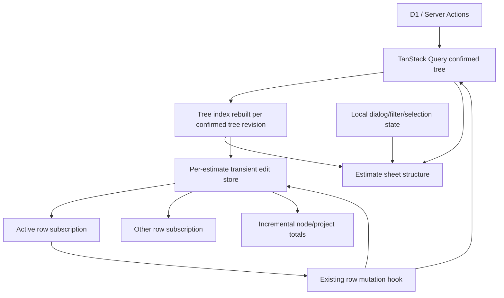

# 05 — Target Architecture

## 1. Architecture goal

Make the cost of an interaction proportional to the part of the estimate that changed.

Target complexity:

| Operation | Current shape | Target shape |
|---|---|---|
| Edit one input draft | root record clone + root render + full totals | one row subscription + ancestor total delta |
| Patch one row | full recursive tree scan | indexed node path + path cloning |
| Patch shared component | all rows inspected | exact component row IDs + grouped path cloning |
| Roll back shared component | full scan + repeated full scans | stored exact patches + one grouped patch |
| Selected node path/code | repeated recursive scans | index lookup |
| Closed move dialog | full tree options | zero work |
| Unopened library | full catalogue scan | zero catalogue derivation |
| Search typing | synchronous full transform | minimized transform + deferred view if needed |
| Route open | speculative fast-path architecture | existing route until timing proves need |

## 2. State boundaries



### Server/query state

TanStack Query remains the authority for:

- confirmed nodes and rows;
- row revisions;
- server-confirmed values;
- tabs;
- access/edit capability.

### Transient edit state

A per-estimate store owns:

- draft fields by row ID;
- dirty row IDs;
- last confirmed row baseline;
- current row total by row ID;
- direct and rolled-up node totals;
- optional row-level save state projection.

It does not own:

- project/workspace data;
- component library server dataset;
- tabs;
- permissions;
- historic activity;
- modal visibility;
- collaboration presence.

### Local UI state

Keep near the feature:

- active dialog;
- move source/target;
- detail/activity modal;
- search input;
- facet controls;
- grouping mode;
- proposal preview open;
- library panel open/intent.

## 3. Per-estimate transient store

Use the existing Zustand dependency or a small vanilla external store with React's subscription contract.

Suggested files:

```text
src/components/workshop/estimate-sheet/editing/
  estimate-edit-store.ts
  EstimateEditStoreProvider.tsx
  use-estimate-row-draft.ts
  use-estimate-node-total.ts
  estimate-edit-store-model.ts
```

### Store creation

Create once per mounted estimate:

```ts
const storeRef = useRef<EstimateEditStore>();
if (!storeRef.current) {
  storeRef.current = createEstimateEditStore(initialTree, treeIndex);
}
```

Do not create a process-global store.

Key the provider by `estimateId` and active tab identity if tab trees are independent.

### State shape

```ts
type EstimateEditState = {
  baselineRevision: number;
  draftByRowId: Record<string, EditableRowValue>;
  dirtyRowIds: ReadonlySet<string>;
  rowTotalById: Record<string, number>;
  nodeTotalById: Record<string, number>;
  projectTotal: number;
};

type EstimateEditActions = {
  updateRowDraft(rowId: string, patch: Partial<EditableRowValue>): void;
  confirmRow(rowId: string, confirmedItem: EstimateRowItem): void;
  rejectRow(rowId: string, confirmedItem: EstimateRowItem): void;
  replaceConfirmedTree(tree: EstimateTreeNode[], index: EstimateTreeIndex): void;
  readDraft(rowId: string): EditableRowValue | undefined;
  readAllDrafts(): Record<string, EditableRowValue>;
};
```

Implementation may use `Map` internally if snapshots returned to React remain immutable and selector-stable.

### Row subscription

A row subscribes only to:

- its draft;
- its save/mutation state;
- its selected boolean if selection is moved into the store;
- any relevant UI flag.

An edit to Row A must not change Row B's selector result.

### Aggregate subscriptions

- node header subscribes to `nodeTotalById[nodeId]`;
- project total subscribes to `projectTotal`;
- proposal preview reads a complete snapshot on open rather than subscribing the live root to every field;
- value-dependent filters subscribe to a small `totalsRevision` only while active.

## 4. Tree index

Suggested file:

```text
src/lib/estimates/estimate-tree-index.ts
```

Keep the index pure and narrow.

```ts
type EstimateTreeIndex = {
  nodePathById: Map<string, readonly number[]>;
  parentNodeIdById: Map<string, string | null>;
  rowLocationById: Map<string, {
    nodeId: string;
    rowIndex: number;
    nodePath: readonly number[];
  }>;
  componentRowIdsByComponentId: Map<string, readonly string[]>;
  ancestorNodeIdsByRowId: Map<string, readonly string[]>;
  nodeCodeById: Map<string, string>;
  nodePathLabelsById: Map<string, readonly string[]>;
};
```

Build once when the confirmed tree reference/revision changes.

Do not update the index for every draft field because row identity and location do not change during a normal cell edit.

Rebuild or patch the index for structural operations:

- insert/delete;
- move;
- node create/delete/reorder;
- tab/tree replacement;
- project-component identity change if identity itself changes.

## 5. Indexed structural patches

### Single row

```text
row ID
→ rowLocationById
→ clone row array in containing node
→ clone node
→ clone ancestors along nodePath
→ preserve every unrelated branch
```

### Shared component

```text
initiating row
→ component identity
→ componentRowIdsByComponentId
→ group exact row IDs by node
→ patch each affected node row array once
→ clone union of affected ancestor paths once
→ preserve unrelated branches
```

Do not call `getProjectComponentIdentity` for unrelated rows during mutation.

### Rollback

At optimistic mutation start:

- capture previous values only for exact affected row IDs;
- record operation generation/revision;
- on error, apply all exact previous patches in one grouped operation;
- do not reduce over patches with a full-tree traversal per row;
- never roll back over a newer operation ID.

## 6. Incremental totals

### Initial build

One O(rows + nodes) pass computes:

- row total;
- direct node total;
- rolled-up node total;
- project total.

### Draft update

```text
nextRowTotal = calculate(draft)
delta = nextRowTotal - previousDraftRowTotal
rowTotalById[rowId] = nextRowTotal
for ancestor in ancestorNodeIdsByRowId[rowId]:
  nodeTotalById[ancestor] += delta
projectTotal += delta
```

Complexity is O(depth), not O(total tree).

### Confirm

When server confirms:

- update baseline row;
- retain same effective draft value;
- clear dirty state;
- replace row revision;
- no visible total jump.

### Reject/conflict

- restore draft baseline from authoritative confirmed row;
- apply reverse delta;
- keep failure message;
- if tree refetch occurs, rebuild store/index once.

## 7. Estimate sheet component split

Do not split components merely to reduce file length. Split by subscription and lifecycle.

Suggested target:

```text
EstimateSheetContent
  EstimateSheetShell
  EstimateSheetHeader
  EstimateSheetSearchAndFilters
  EstimateTreeViewport
    EstimateSheetBranch
      EstimateRowItemsTable
        EstimateRowItemTableRow
  LazyPanels
```

### Root responsibilities

- query/tree identity;
- selected node ID;
- major panel state;
- store provider;
- mutation hook integration;
- structural actions;
- layout.

### Row responsibilities

- its own draft;
- its own computed amounts;
- synchronous input state;
- commit/blur;
- row details actions.

### Header/total responsibilities

- subscribe to aggregate values only.

## 8. Derived view activation

### Move options

```ts
const rowMoveNodeOptions = rowMoveDialog
  ? collectRowMoveNodeOptions(estimateTree)
  : EMPTY_NODE_OPTIONS;
```

Better after index:

- derive from indexed nodes only while dialog open.

### Component library catalogue

Build only after:

- library intent exists; or
- library panel is open; or
- drag operation requires catalogue matching.

### Search

- input state synchronous;
- normalized query primitive;
- filtered tree uses deferred query if trace still shows blocking;
- do not defer row cell edits.

### Facets/grouping

Separate two classes:

- structural/string filters depend on confirmed tree and filter controls;
- value filters depend on totals revision only when active.

Inactive filters return the original selected node reference.

### Modal rows

Continue current pattern:

- flatten rows only when detail/activity/move surface needs them;
- close unmounts or releases large derived arrays where practical.

## 9. Query cache integration

Existing mutation hooks already patch query data.

Refactor helpers to accept an index or build it once per `onMutate` snapshot.

Do not:

- read tree from query cache multiple times in one mutation;
- independently scan for initiating row, component siblings, rollback rows, and patch targets;
- invalidate/refetch successful local patches by default.

Do:

- capture tree once;
- resolve affected rows once;
- patch optimistic tree once;
- patch component projection caches only when their query exists;
- apply server confirmation to exact rows;
- refetch only on revision conflict or uncertain integrity.

## 10. Component library projection

Current cache projection mapping loops through library items. This may be acceptable because the projection dataset is smaller and separate from the 5,000-row tree.

Activation rule:

- do not redesign this path in UNIT-001;
- instrument only if project-component mutation remains slow after tree fan-out is fixed;
- if needed, use existing projection metadata to index item by instance row ID in the query adapter, not a new global graph.

## 11. Route architecture

Remove:

- mode loader import;
- server environment mode resolution;
- mode prop;
- provider;
- DOM attributes.

Keep:

- route Suspense;
- route context query;
- server timing;
- lazy tree/content;
- existing D1 repository.

Conditional route fix:

- if route-context span exceeds target and dominates, optimize the exact query sequence;
- implement a direct fast path only if it removes a measured round trip or expensive build;
- no parallel legacy/new route systems without a rollout need.

## 12. Virtualization architecture

Keep current virtualizers.

Potential later improvement only if measured:

- keep active express editor pinned while virtualizing other rows;
- avoid disabling the whole row virtualizer;
- cache branch flattening by tree/expansion revision;
- use index-based visible branch traversal.

This is conditional, not part of the default critical path.

## 13. Complexity guardrails

The target implementation must not add:

- a general-purpose entity graph library;
- a custom selector framework;
- a second query cache;
- a second mutation engine;
- a generic performance-mode registry;
- a worker protocol;
- a new schema;
- a new dependency.

Expected new production concepts:

1. one pure tree index;
2. one per-estimate transient edit store;
3. grouped indexed patch helpers.

Everything else is simplification or adaptation.
