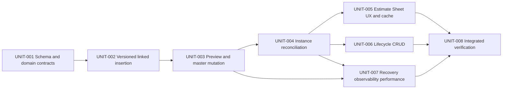

# Canonical Implementation Plan

## 1. Objective And Stop Condition

Implement durable linked Estimate Template instances without replacing the current materialized Estimate Sheet architecture. The implementation is complete only when:

1. every new linked insertion has one stable instance record and complete node/row mappings;
2. every confirmed master-owned mutation advances a master version and targets all active instances exactly once;
3. each instance reaches the target version atomically or exposes a truthful `updating`/`failed` state with class-appropriate retry, remediation, and authorized detach actions;
4. instance-owned takeoff fields survive propagation while master-owned fields, topology, membership, and order converge;
5. whole-instance detach preserves current Estimate content and prevents all later master propagation;
6. linked visuals and warnings work in recursive and virtualized branch rendering without broad rerenders or layout shift;
7. Template archive/delete, instance delete/duplicate, component-source updates, history, publication revisions, and stale retries obey the contracts below; and
8. the scoped implementation evidence is fresh and no required repository-controlled work remains.

## 2. Accepted Requirements

| ID | Requirement |
| --- | --- |
| `REQ-001` | Persist a versioned Template master, durable linked instance identity, and stable master-to-Estimate node/row mappings. |
| `REQ-002` | Propagate each confirmed master-owned mutation to every active instance while skipping detached instances and exposing query-safe current/updating/retryable-failed/terminal-failed convergence state. |
| `REQ-003` | Route master-owned Estimate Sheet and Template Editor actions through zero/one/many impact preview, one-owner bulk classification, explicit confirmation, stale reconfirmation, receipt-first same-intent outcome resolution, and authoritative reconciliation. |
| `UX-001` | Give linked instances distinct, accessible, virtualization-safe treatment with deterministic multi-root ownership, global Template progress, focus recovery, and clear current/updating/failed/detached semantics. |
| `DATA-001` | Preserve atomicity, idempotency, tenant authorization, server-authoritative topology, field ownership, live Component-source precedence, history, and publication correctness. |
| `PERF-001` | Keep Estimate reads materialized and bounded, use set-based linked writes and indexed recovery, avoid N+1 work and broad React invalidation, and recover fan-out without long user-blocking transactions. |
| `OPS-001` | Define every linked/copy insertion entry point, empty-source rule, detach/retry/delete, archive/restore, atomic permanent delete, duplicate, legacy-copy, and composition lifecycle behavior. |
| `SEC-001` | Enforce workspace/project/estimate/tab/parent/mapping/job/Template ownership on every preview, mutation, reconciliation, detach, and delete path. |

## 3. Architecture Decision

### Selected

Use **versioned materialized instances with a D1 propagation job**.

- `estimate_templates.current_version_number` is the master revision.
- `estimate_template_versions` stores an immutable flat graph snapshot for every revision.
- `estimate_template_instances` stores active/detached identity plus applied and target versions.
- node/row mapping tables preserve stable correspondence while a link is active.
- `estimate_template_propagation_jobs` stores one coalescing, leased recovery job per instance.
- the confirmed master transaction writes the source revision and all target job state atomically.
- the request immediately invokes the same durable processor used by cron, prioritizing the initiating instance.
- the existing `*/5 * * * *` Worker schedule resumes pending/expired jobs.
- every instance apply is a separate guarded D1 transaction, so no partially reconciled branch becomes visible.

### Rejected

| Alternative | Decision |
| --- | --- |
| Keep snapshot copy only | Reject: it cannot satisfy propagation or detach semantics. |
| Live read-through from Template tables | Reject: it moves merge/version logic into hot reads, calculations, publication, history, and export. |
| One synchronous all-instance batch | Reject as the only path: it couples request latency and failure to unbounded fan-out and D1 limits. |
| Dedicated new Cloudflare Queue | Defer: it is an unbound resource and unnecessary while the existing schedule plus immediate drain meets MVP recovery. |
| Reuse upload or Client Portal Queue | Reject: those bindings, payloads, retries, DLQs, and observability are domain-specific. |

## 4. Immutable Product Invariants

1. **One source revision:** a master mutation either commits one new Template version plus target jobs or commits nothing.
2. **No silent fan-out:** master-owned actions never mutate only the visible instance.
3. **No pre-confirm optimistic shared edit:** the UI previews impact before changing local state.
4. **Per-instance atomicity:** topology, rows, mappings, history, publication revision, applied version, and job state commit together.
5. **Stable IDs:** master node/row IDs remain stable across revisions; instance Estimate IDs remain stable for corresponding surviving master items.
6. **Field ownership:** propagation never overwrites instance-owned takeoff fields or a newer Component Library version.
7. **Whole detach:** detach removes active mappings/jobs in one transaction and preserves materialized Estimate data.
8. **No historical inference:** old copied branches remain independent unless manually replaced by a new linked insertion.
9. **No cross-workspace work:** every source, instance, estimate, and job query carries and guards `workspace_id`.
10. **Truthful state:** `linked-current`, `updating`, `failed`, and detached/local presentation derives from authoritative D1 state.
11. **One bulk owner:** a bulk command is local, or one deterministic mutation against one Template master; mixed-owner/multi-master commands fail before mutation.
12. **Server-authoritative topology:** background reconciliation never waits for a client draft; a deleted dirty row leaves the active graph while its unsaved values remain recoverable as a bounded session draft.
13. **No invisible link:** an empty Template cannot create a linked instance, and multi-root instances have one deterministic status/action owner plus sheet-level announcements.

## 5. Execution Graph

## 6. Implementation Units

### `UNIT-001` — Schema And Domain Contracts

**Goal:** add the additive D1 schema and typed domain/read contracts without changing existing insert behavior.

**Primary files**

- `migrations/0092_linked_estimate_template_instances.sql`
- `src/lib/component-library/estimate-templates.ts`
- `src/lib/estimates/types.ts`
- new `src/lib/component-library/template-link-types.ts`
- `src/lib/repositories/component-library-repository.ts`
- `src/lib/estimates/estimate-tree-read-repository.ts`

**Required work**

- add `current_version_number`, `archived_at`, and `archived_by` to `estimate_templates`;
- create immutable version, instance, tenant-bearing node-map/row-map, propagation-job, and durable shared-mutation-intent tables and indices from `01-ARCHITECTURE-AND-D1.md`;
- persist job `failure_class`/`retryable` state and enforce one unresolved server-owned intent per Template;
- enforce Template/workspace, project/workspace, estimate/project, tab/estimate, parent/tab, mapping/instance/target, and job/instance scope through composite FKs and aborting D1 triggers;
- leave current tabless Estimate content untouched; linked identity requires an active tab and uses a typed copy-only fallback rather than migration inference;
- backfill version `1` flat snapshots for existing Templates while creating no instances for historical Estimate copies;
- encode Component-linked version rows as topology/membership plus Component identity/selected variant only; never freeze Component-owned descriptive/pricing truth into replayable snapshot fields;
- add compact `templateLink` read types without cloning row objects;
- enforce active-state/template FK and detached-state/null-template invariants;
- keep current insertion and editor behavior unchanged until later units switch callers.

**Acceptance:** `AC-001`, `AC-008`; D1 schema inspection proves constraints/indices/backfill; current Template and Estimate read contracts still have one authoritative owner.

### `UNIT-002` — Versioned Linked Insertion

**Goal:** create a complete linked instance atomically while retaining explicit copy insertion.

**Primary files**

- `src/lib/estimates/d1-intents/templates.ts`
- `src/lib/estimates/actions.ts`
- `src/lib/component-library/template-versioning-d1.ts` (new)
- `src/components/workshop/estimate-sheet/use-estimate-template-insertion.ts`
- `src/components/workshop/library/templates-browse/InsertIntoEstimatePicker.tsx`

**Required work**

- split the command contract into `linked` and `copy` modes; linked is the primary whole-Template action;
- refuse linked insertion for an empty Template and implement the exact picker/drag/drop/subtree/multi-Template/composition matrix in artifact `02`;
- preflight-reject a tabless/archived target or parent with `template_link_requires_active_tab`, preserve the selected target, and offer `Insert copy instead` using current nullable-tab semantics;
- create/resume version `1` snapshot before the first linked insertion;
- precompute stable IDs and use bounded `json_each(?)` node, row, node-map, and row-map inserts so linked statement count does not grow per graph item;
- copy the current source graph, create the tenant-scoped instance, and write complete node/row mappings in one guarded D1 batch;
- initialize `applied_version_number = target_version_number = current_version_number` and `link_state = 'linked'`;
- retain intent IDs, unavailable Component snapshot confirmation, history/outbox, publication revision, and authoritative tree refresh;
- keep whole/subtree and multi-Template copy behavior independent; do not create inferred instance metadata.

**Acceptance:** a non-empty linked insert returns one authoritative instance ID, all root/node/row IDs and mappings, exact source version, and refreshed tree; retry replays the same IDs/mode/target; copy mode creates no link records; graph size does not create one D1 statement per item.

### `UNIT-003` — Impact Preview And Master Mutation

**Goal:** convert master-owned edits into one guarded master revision plus durable target jobs.

**Primary files**

- new `src/lib/component-library/template-link-impact-d1.ts`
- new `src/lib/component-library/template-linked-mutation-d1.ts`
- `src/lib/component-library/template-editor-actions.ts`
- `src/lib/component-library/actions.ts`
- `src/lib/estimates/actions.ts`
- `src/components/workshop/estimate-sheet/rows/row-commit-intent.ts`

**Required work**

- implement workspace-scoped impact preview returning instance/project/estimate counts, bounded labels, current version, and an impact fingerprint;
- classify node/row actions and fields as master-owned or instance-owned using the matrix in artifact `02`;
- require confirmation for every master-owned action with at least one active instance; Template Editor edits with zero instances version normally, while a mapped Estimate command with zero is stale and must refresh;
- preflight bulk delete/replace/clear/move/reorder/duplicate by field owner and Template ID; allow one deterministic one-master patch and reject mixed-owner or multi-master commands before optimistic state/Undo registration;
- on confirmation, recheck Template revision and the exact impact fingerprint;
- create/resume a server-owned pending intent before source mutation; resolve post-submit disconnects by intent ID from its normalized D1 payload, with receipt-first committed, definite not-applied, and still-unknown outcomes; block a fresh same-Template shared intent while pending;
- mutate the master, increment version, write an immutable snapshot, target all active instances, coalesce one job per instance, write activity/publication intent and a committed receipt in one batch;
- return the committed version and progress summary, then invoke the durable processor with the initiating instance first.

**Acceptance:** stale previews fail before mutation and return a fresh reconfirmable preview; same-intent resolution distinguishes committed/not-applied/unknown without duplicate versions; no active instance is omitted from `target_version_number`; detached instances never receive a job; every add-row/add-Component action with a linked instance warns exactly once.

### `UNIT-004` — Deterministic Instance Reconciliation

**Goal:** reconcile one materialized instance atomically to an immutable target version.

**Primary files**

- new `src/lib/component-library/template-instance-reconciler.ts`
- new `src/lib/component-library/template-propagation-jobs.ts`
- `src/lib/component-library/component-mutation-d1.ts`
- `src/lib/estimates/d1-intents/history-events.ts`
- `src/lib/estimates/d1-intents/intent-context.ts`

**Required work**

- lease one job; load the immutable snapshot, tenant-scoped active instance/mappings, and current Component sources;
- build a deterministic plan keyed by stable master IDs;
- add missing mapped nodes/rows, update surviving master-owned fields and topology, delete removed mapped data, and preserve instance-owned takeoff values;
- for component-linked rows, preserve source identity/selected variant, resolve current Component data, guard the expected Component version in the apply batch, and ignore all Component-owned values in historical Template snapshots;
- commit Estimate graph changes, mappings, row revisions, estimate history/outbox, project publication revision, instance applied/state, and job state in one D1 batch;
- if a newer target arrived during processing, leave the coalesced job pending and continue from the newly committed applied version;
- extend Component mutation synchronization to refresh linked Template row snapshots without creating a Template structural version.

**Acceptance:** each visible instance is internally consistent before/after; retries are idempotent; out-of-order or duplicate triggers cannot regress `applied_version_number`; a failed job leaves the last complete instance version readable.

### `UNIT-005` — Estimate Sheet UX, Styling, And Cache Convergence

**Goal:** make linkage obvious and route every shared action safely without destabilizing the sheet.

**Primary files**

- `src/components/workshop/EstimateSheetContent.tsx`
- `src/components/workshop/estimate-sheet/rows/branch.tsx`
- `src/components/workshop/estimate-sheet/rows/virtual-branch-list.tsx`
- `src/components/workshop/estimate-sheet/rows/row-table.tsx`
- `src/components/workshop/estimate-sheet/use-estimate-row-handlers.ts`
- `src/components/workshop/estimate-tree/use-estimate-tree-crud.ts`
- `src/hooks/use-estimate-query.ts`
- Template Editor files under `src/components/workshop/library/template-editor/`

**Required work**

- add fixed-geometry linked rail, root badge, master name, applied/target version, and updating/failed affordances;
- mirror the existing shared Component single-flight lifecycle with action-specific Template copy, loading/error/stale/reconfirm/submitting states, exact singular/plural scope, and no pre-confirm mutation;
- implement deterministic multi-root ordinals/primary action owner plus one sheet-level status announcer and context access from every root;
- expose persistent Template Editor progress with current/updating/failed counts, virtualized target detail, retry scope, and navigation;
- cover progress loading/stale/query-error states and map redacted retryable/terminal failure classes to exact copy/actions; never bulk-retry terminal instances;
- offer `Detach this instance…` from any mapped descendant but execute only the whole-instance flow; never auto-replay the pending shared edit;
- preserve ordinary dirty drafts during non-destructive refresh; when the master deletes a dirty row, remove it authoritatively, retain a bounded 24-hour session draft, show copy/dismiss recovery, and move focus deterministically;
- apply targeted authoritative patches or invalidate only affected Estimate query keys; poll only while visible instances are updating;
- update memo comparators with stable scalar link fields and avoid new per-row cloned link objects;
- maintain stable-ID viewport anchoring, expansion/selection survival, focus fallback, ARIA status, compact overflow behavior, contrast, and virtual list height.

**Acceptance:** `AC-003`, `AC-004`, `AC-006`; local quantity edits remain immediate and warning-free; shared edits warn once and converge; unrelated branches do not rerender from unstable linkage props.

### `UNIT-006` — Lifecycle CRUD And Safe Deletion

**Goal:** close every lifecycle path without orphaning or unexpectedly deleting Estimate content.

**Primary files**

- `src/lib/component-library/actions.ts`
- `src/lib/component-library/template-editor-actions.ts`
- new `src/lib/component-library/template-instance-actions.ts`
- `src/components/workshop/library/templates-browse/TemplatesBrowseManager.tsx`
- `src/components/workshop/library/templates-browse/TemplateGallery.tsx`
- `src/components/workshop/component-library/index.tsx`
- linked-instance branch/context-menu controls

**Required work**

- implement whole-instance detach, retry, delete, duplicate-linked, and duplicate-as-copy;
- allow detach from current/updating/failed while preserving the last complete applied version and explicitly abandoning any higher target;
- make root placement local to the instance while internal topology remains master-owned;
- add non-destructive Template archive/restore plus Active/Archived filters, empty/error/retry states, and post-restore navigation;
- replace current Template hard delete with typed-name impact confirmation and one atomic set-based `Detach all instances and delete master` transaction;
- commit the permanent-delete intent/result in that same batch before deleting the master so a disconnect can replay the surviving deletion receipt;
- preserve all materialized Estimate data when detaching for master delete;
- keep Template duplicate and save-as-Template independent; keep nested composition and AI package apply copy-only;
- write activity/history for every detach, retry, archive, restore, and permanent delete.

**Acceptance:** no master delete cascades into Estimate nodes/rows; active instances block raw master deletion; detach clears mappings/jobs atomically; permanent delete leaves a replayable committed intent after the master is gone; detached content becomes ordinary local data.

### `UNIT-007` — Recovery, Observability, And Performance

**Goal:** make eventual propagation bounded, inspectable, and recoverable using existing Worker infrastructure.

**Primary files**

- `worker.ts`
- `src/lib/component-library/template-propagation-jobs.ts`
- `src/lib/admin/observability-repository.ts`
- Admin observability surface only if an existing generic job summary can be reused cleanly

**Required work**

- invoke the shared job drain in the existing `*/5 * * * *` schedule alongside Client Portal notification enqueueing; do not return before both scheduled responsibilities are registered;
- resume leased pending shared-mutation intents before/alongside propagation jobs so a closed client cannot leave a Template blocked indefinitely;
- use a five-minute lease, exponential `available_at`, ten-attempt dead state, bounded redacted error codes, and class-guarded manual/bulk retry only for `retryable = 1`;
- normalize job failures into the artifact `02` taxonomy, keep re-plannable races pending, derive bulk retry eligibility server-side, and omit detached/deleted targets from active failure counts;
- use partial ready and expired-processing indices so pending claim and `lease_expires_at` recovery do not scan unrelated job states;
- initial request budget: finish the initiating instance first, then process up to eight targets or 750 ms of additional drain time, whichever comes first after the current atomic target completes;
- scheduled budget: process at most 25 target instances sequentially per trigger; D1 writes are not parallelized against the single database;
- log redacted counts and duration by source version; expose pending/updating/failed counts in existing observability conventions;
- enforce the performance budgets in artifact `02` and keep D1 statements set-based with JSON payloads where fan-out would otherwise create per-row statements.

**Acceptance:** an interrupted request leaves a durable resolvable intent/job; expired leases resume; failed/dead jobs remain visible; only retryable classes can reset or enter bulk retry, while terminal classes expose only authorized remediation/detach actions; no Queue binding or new cron is introduced.

### `UNIT-008` — Integrated Verification And Handoff Closure

**Goal:** reconcile requirements, implementation evidence, docs, and plan state without overstating hosted readiness.

**Primary files**

- changed implementation files from `UNIT-001` through `UNIT-007`
- this plan pack’s `LOOP_LEDGER.md` and `plan-pack.json`
- current-state or feature authority only if implementation materially changes project truth

**Required work**

- run the cheapest decisive static validation first: migration inspection, typecheck/LSP, scoped lint, plan validator, diff check, GitNexus change detection;
- request explicit user authorization before running proposed automated tests, browser automation, screenshots, or visual QA;
- if authorized, execute only the focused D1/React/browser commands named in artifact `03` and record exact pass/fail evidence;
- perform independent architecture/readiness/UX reviews of tenant constraints, version races, set-based insertion, detach/delete, Component precedence, mixed bulk, dirty deletion, multi-root accessibility, and failed-job recovery;
- update package state only from fresh evidence and keep deployment/hosted proof separate.

**Acceptance:** all eight requirements map to verified units and passing criteria; no active core risk lacks a disposition; no test is reported as passed unless actually run.

## 7. Gates

| Gate | Current | Pass condition |
| --- | --- | --- |
| `GATE-DATA-001` | `FAIL` | Schema, backfill, linked insert, version commit, reconciliation, detach, and delete invariants are proven against local D1. |
| `GATE-UX-001` | `FAIL` | Shared warnings, instance visuals/status, local-field bypass, focus, virtualization, and cache convergence meet artifact `02`. |
| `GATE-VERIFY-001` | `FAIL` | Static checks pass; proposed tests are either explicitly authorized and pass or remain truthfully unrun; independent review has no unresolved P0/P1 issue. |

## 8. Authorization And Test Boundary

`AUTH-001` is resolved for local implementation because the plan uses only repository source, additive migrations against the already bound `ARCH_DB`, and the existing scheduled Worker trigger. Actual remote migration apply, deployment, hosted mutation, paid service, or a new Queue remains outside this pack.

For this planning task, product tests, builds-as-tests, browser automation, screenshots, and visual QA are not authorized and are not run. Artifact `03` records focused `TEST_PROPOSAL` commands for a later implementation task. Static plan validation is allowed.

## 9. Continuation Rule

Start at `UNIT-001`. Continue automatically through the dependency graph for clear local implementation work. Stop only when all required units are verified, a real external/destructive boundary is reached, or materially different recovery attempts prove a core deliverable technically impossible. Do not use Queue provisioning, optional browser proof, or unrun tests as a false implementation blocker.
