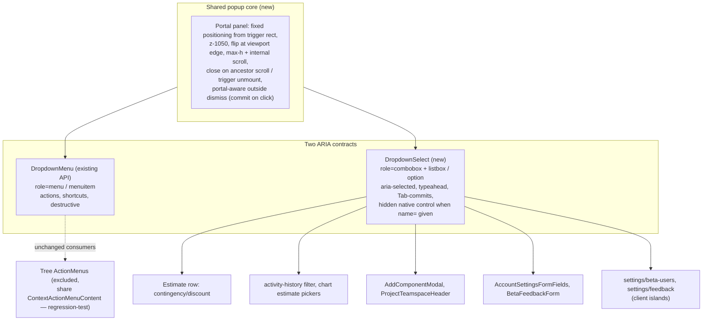

# refactor: Standardize workshop dropdowns on the shared DropdownMenu system

## Summary

Adopt the shared dropdown system (`src/components/ui/dropdown-menu.tsx`, Storybook `Menus/DropdownMenu`) as the single dropdown affordance across all workshop surfaces. The system gains a select-semantics variant (`DropdownSelect`) and a clipping-safe portal core; a low-risk pilot (activity filter, chart pickers) validates the core, then the estimate-row contingency/discount picker migrates, followed by every other workshop value picker. `ControlSelect` and `ToolbarIconSelect` retire at the end.

## Problem Frame

The workshop has one new, well-built dropdown primitive with zero production adoption, and roughly 25 value-picker dropdowns spread across four different implementations: `ControlSelect` (native select wrapper), raw `<select>` elements, `ToolbarIconSelect`, and one-off comboboxes. Visual and interaction behavior differ per surface, which violates the component reuse contract in `DESIGN.md` ("a visible duplicated button/search/input/icon-button implementation is a blocking design-system defect"). The first user-facing target is the contingency/discount mode picker in estimate rows (`src/components/workshop/EstimateSheetContent.tsx`).

Two facts make this more than a mechanical swap:

1. `DropdownMenu` is an action-menu (`role="menu"`, click items, no selection state). Every major design system (Radix, React Aria, Headless UI, shadcn/ui) ships select and menu as separate primitives because value pickers need a different ARIA contract and keyboard model. A select variant must be built, not faked with checkmarks.
2. The panel does not portal. The estimate sheet's `overflow-hidden` section wrappers and sticky header stack (`z-10`/`z-[20]`/`z-30`) will clip or occlude an inline-absolute panel, and the outside-dismiss listener (`pointerdown` against the root ref) would treat clicks on a portaled panel as outside-clicks, closing the menu before any option can commit.

---

## Requirements

**Component system**

- R1. The dropdown system exposes a select variant (`DropdownSelect`) with value-picker semantics: trigger shows the current value, options indicate selection, keyboard follows the select-only combobox contract (see R3), and the API is value-shaped (current value in, committed value out).
- R2. Both `DropdownMenu` and `DropdownSelect` render their panel through a shared, portal-based popup core that is never clipped by `overflow-hidden`/`overflow-auto` ancestors and paints at the established menu layer (`z-[1050]`, above modal `z-[1000]`).
- R3. `DropdownSelect` meets the keyboard/a11y contract: open focuses the selected option (skipping disabled placeholders), typeahead while open, Home/End, Enter/Space commit and close, Tab commits then moves on, Escape closes without changing the value and restores focus to the trigger, the closed trigger's accessible name includes label plus current value, and long lists scroll the active option into view.
- R4. Escape pressed inside an open dropdown hosted in a modal closes only the dropdown; the modal stays open.

**Adoption**

- R5. The estimate-row cost-adjustment mode picker (Contingency/Discount) renders via `DropdownSelect` with identical persistence behavior: commit on select, contingency persists as positive percentage, discount as negative, no new blur/focus ordering against the adjacent percentage input, and the row-table memo contract intact (identity-stable handlers, module-scope option arrays).
- R6. All other workshop value pickers render via `DropdownSelect`: chart estimate selectors (`ProjectChartsClient`), activity event-type filter (`activity-history`), `AddComponentModal` lifecycle-state and cost-confidence pickers, `ProjectTeamspaceHeader` role/access pickers, `AccountSettingsFormFields` (5), `BetaFeedbackForm` (2), and the settings admin pages `beta-users` (3) and `feedback` (2).
- R7. Tree right-click/kebab menus stay on `ActionMenu`, and the landing `ContactForm` select stays native. Creatable/searchable comboboxes (`CreatableCombobox`, the `AddComponentModal` cost-history combobox) are out of scope.
- R8. `ControlSelect` and `ToolbarIconSelect` are removed from `src/components/ui/` and the barrel once no call sites remain.

**Compatibility**

- R9. Form-posting surfaces submit identical `FormData`/query strings as today: hidden native input carries `name=`/value (present even when value is empty, so `?status=` filters keep working), and values survive React 19's post-action form reset without desyncing from the visible trigger.
- R10. `required` selects in `AccountSettingsFormFields` still block submit with visible, focusable feedback when unselected.
- R11. Surfaces that disable pickers during `useTransition` pending states keep focus and screen-reader announcement working after commit (no focus dropped to body).
- R12. Existing excluded consumers of the shared menu internals (tree `ActionMenu` surfaces) behave identically after the popup-core rewrite.

**Quality gates**

- R13. Stories cover the select variant per the menu story matrix (Default, Variants, States, LongContent, KeyboardFocus); `scripts/check-storybook-component-coverage.mjs` is updated for the new story and the retired `Forms/Select` exports.
- R14. All touched UI passes `bun run lint:design-system` (12px cap, labels ≤9px, `rounded-xs`, `tracking-normal`, regular-weight icons) and `npx impeccable detect --strict`.

---

## Key Technical Decisions

- **Separate select variant over shared mechanics, not checkmarked menu items.** `DropdownSelect` gets the APG select-only combobox contract (`role="combobox"` trigger with `aria-expanded`/`aria-controls`/`aria-activedescendant`, `role="listbox"` panel, `role="option"` items with `aria-selected`). `DropdownMenu` keeps `menu`/`menuitem`. This mirrors how Radix/React Aria/Headless UI structure the same split internally; a closed `menuitemradio`'s state is not perceivable to screen readers, and select keyboard semantics (Tab-commits, open-focuses-selected, typeahead) conflict with menu semantics. The repo's `creatable-combobox.tsx` already uses listbox/option conventions and placement flipping — reuse its option-id and `data-*-popup-placement` conventions rather than inventing a second pattern.
- **Portal the popup core by default.** Extract open/dismiss/positioning/focus-return from `dropdown-menu.tsx` into a shared core used by both variants: body portal, `position: fixed` from the trigger rect, `z-[1050]`, flip-to-top at viewport edge, `max-h` with internal scroll, close on ancestor scroll (panel-internal scroll exempt), close on trigger unmount. `DropdownMenu` has zero production consumers, so changing its internals is safe — but the tree `ActionMenu` surfaces share `ContextActionMenuContent`, so one tree menu is regression-tested explicitly (R12).
- **Outside-dismiss must be portal-aware and commit-safe.** The dismiss listener checks both the trigger root and the portaled panel ref; selection commits on `click`, not `pointerdown`, so the dismiss handler can never race the commit. This is the highest-risk mechanic in the migration; it gets dedicated tests before any adoption.
- **Commit API is `onValueChange(value)` reading latest props at commit time.** No snapshotting option handlers at open time (the current `buildActionGroups` memoizes children) — a realtime row update or the adjacent input's blur-commit between open and select must not produce stale writes. Estimate-row handlers wrap in `useStableCallback` and option arrays live at module scope, honoring the row-table memo contract (`.ai/10_state/decisions.md`, 2026-06-11 perf entry).
- **Form association via hidden native control with reset resync.** When `name` is provided, `DropdownSelect` renders a visually hidden but focusable native select mirroring the value (React Aria `HiddenSelect` precedent): `FormData` and `required` constraint validation keep working, and `invalid` redirects focus to the trigger. The component listens for the form `reset` event to resync its display state after React 19's post-action reset. Browser autofill on these custom selects is consciously forfeited; noted in Risks.
- **Pending-state surfaces use `aria-disabled`, not `disabled`.** `ProjectTeamspaceHeader` flips `disabled={isPending}` after commits; a disabled button can't receive the focus-return, stranding keyboard users and muting the value announcement. `aria-disabled` plus ignored activation keeps focus stable.
- **Modal Escape layering is fixed centrally.** `src/components/ui/overlays/dialog.tsx` closes on any document keydown without checking `event.defaultPrevented`; the dropdown core prevents-default and stops propagation on Escape, and the dialog honors `defaultPrevented`. Fixed once in the shared overlay, with tests, so every modal-hosted picker works.
- **Admin server pages become client islands, accepting the no-JS regression.** `settings/beta-users` and `settings/feedback` are server components today; their selects work pre-hydration. Migrating them (per the confirmed "all workshop dropdowns" scope) means extracting small client components per select. These are internal beta-admin tools; the GET filter forms keep their explicit Filter submit buttons (no auto-submit exists today, none is added).
- **Value-shaped API keeps a future native path cheap.** Chrome/Edge 135+ ship customizable `<select>` (`appearance: base-select`); it is not Baseline, so it can't be the mechanism now, but `DropdownSelect`'s string-value/options API deliberately stays shaped so a future migration back to enhanced-native is a rendering swap.

---

## High-Level Technical Design

Surface-to-unit map:

| Surface | File | Today | Unit |
|---|---|---|---|
| Contingency/discount mode (per row) | `src/components/workshop/EstimateSheetContent.tsx` | `ControlSelect` | U5 |
| Chart estimate picker (per column) | `src/components/workshop/project-charts/ProjectChartsClient.tsx` | `ControlSelect` | U4 |
| Activity event-type filter | `src/components/workshop/estimate-sheet/activity-history.tsx` | raw `<select>` | U4 |
| Lifecycle state, cost confidence | `src/components/workshop/component-library-manager/AddComponentModal.tsx` | `ControlSelect` x2 | U6 |
| Invite role, collaborator role, sheet access, sheet invite role | `src/components/workshop/ProjectTeamspaceHeader.tsx` | raw `<select>` x4 | U6 |
| Profile/workspace settings selects | `src/components/workshop/AccountSettingsFormFields.tsx` | `ControlSelect` x5 (server-action forms) | U7 |
| Feedback type, severity | `src/components/workshop/BetaFeedbackForm.tsx` | raw `<select>` x2 (server-action form) | U7 |
| Add-user status, status filter (GET), per-row status | `src/app/workshop/settings/beta-users/page.tsx` | raw `<select>` x3 (server component) | U8 |
| Status filter (GET), per-row review status | `src/app/workshop/settings/feedback/page.tsx` | raw `<select>` x2 (server component) | U8 |
| (none — zero call sites) | `src/components/ui/toolbar-icon-select.tsx` | `ToolbarIconSelect` | U9 |

---

## Implementation Units

### U1. Shared popup core: portal, positioning, dismiss

**Goal:** Both dropdown variants render through a clipping-safe, commit-safe popup core.

**Requirements:** R2, R12

**Dependencies:** none

**Files:**
- `src/components/ui/dropdown-menu.tsx` (extract/rewrite internals; public API unchanged)
- `src/components/ui/index.tsx`
- `tests/vitest/ui-dropdown-popup-core.test.tsx` (new)

**Approach:** Extract open-state, trigger wiring, outside-dismiss, keyboard plumbing, and panel rendering into a shared core (hook + panel component) inside the dropdown module. Panel portals to body with `position: fixed` computed from the trigger rect, `z-[1050]`, flip-to-top near the viewport bottom (reuse `creatable-combobox.tsx` placement conventions), `max-h` with internal overflow scroll, reposition-or-close on ancestor scroll/resize (close, except scrolls originating inside the panel), close on trigger unmount with a defined focus fallback. Outside-dismiss checks trigger root and panel refs; item activation commits on `click`. `DropdownMenu`'s public API (`trigger`, `Item`, `Group`, `align`, `side`) is preserved.

**Patterns to follow:** z-layer map (modal `z-[1000]`, menu `z-[1050]`, tooltip `z-[1100]`); `creatable-combobox.tsx` placement flip and option-id conventions; portal precedent in `src/components/ui/overlays/` and `toolbar-icon-select.tsx` tooltip.

**Test scenarios:**
- Open menu inside a container with `overflow: hidden` — panel is fully visible (portaled), positioned adjacent to the trigger.
- Click an item — `onClick` fires exactly once, menu closes; the `pointerdown` on the item does not dismiss-before-commit.
- Click outside both trigger and panel — menu closes without firing any item.
- Scroll an ancestor while open — menu closes; scrolling inside a long panel does not close it.
- Unmount the trigger while open (simulate row removal) — panel unmounts, no orphaned portal node, focus falls back per spec.
- Escape — closes, focus returns to trigger, `defaultPrevented` is set on the event.
- ArrowDown/Up/Home/End roving focus still works through the portaled panel; first item focused on open (menu variant).
- Panel opened near viewport bottom flips above the trigger.

**Verification:** New core tests green; existing `Menus/DropdownMenu` stories render and operate in Storybook; one tree kebab `ActionMenu` (e.g. estimate tree row menu) manually exercised plus `tests/vitest/estimate-tree-context-menu.test.tsx` green (R12 blast-radius check).

### U2. DropdownSelect variant

**Goal:** A select-semantics dropdown with the full keyboard/a11y and form-association contract.

**Requirements:** R1, R3, R9, R10

**Dependencies:** U1

**Files:**
- `src/components/ui/dropdown-select.tsx` (new)
- `src/components/ui/index.tsx`
- `src/stories/menus/dropdown-select.stories.tsx` (new)
- `scripts/check-storybook-component-coverage.mjs`
- `tests/vitest/ui-dropdown-select.test.tsx` (new)

**Approach:** `DropdownSelect` composes the U1 core with the select-only combobox ARIA contract: combobox trigger (accessible name = label + current value), listbox panel, options with `aria-selected`, `aria-activedescendant` tracking. Value-shaped API: `{ value/defaultValue, onValueChange, options or Option children, placeholder, name?, required?, disabled?, ariaDisabled? }`. Controlled and uncontrolled modes. When `name` is given, render a visually hidden but focusable native select mirroring the value (form posts, `required` validation, `invalid` → focus trigger) and resync on form `reset`. Disabled options (placeholder pattern `value=""`) are skipped by open-focus and typeahead. Trigger styling supports the compact registers in use (estimate cell needs `text-[8px]` at a 74px footprint; settings forms use `ControlField` label wiring via `aria-labelledby`).

**Test scenarios:**
- Closed trigger announces "label, current value" (accessible name assertion); changing value updates it.
- Open via click/ArrowDown/Enter — focus lands on the currently selected option, not the first; selected option scrolled into view in a long list.
- Open when value is the disabled placeholder — focus skips to the first enabled option.
- Typeahead while open: "d" focuses Discount; multi-character buffer distinguishes shared prefixes ("Estimate 1" vs "Estimate 10"); disabled options skipped.
- Enter/Space commits and closes; `onValueChange` receives the option value; Escape closes without committing and restores the previous value and trigger focus; Tab commits the focused option and moves focus onward.
- Controlled mode: value prop drives display; uncontrolled mode: `defaultValue` + internal state.
- With `name="status"` and empty value, the hidden control still serializes `status=` into `FormData`.
- `required` + empty value: form submit blocked with focus redirected to the trigger and visible feedback (no silent "not focusable" failure).
- After a form `reset` event (React 19 post-action reset), trigger display matches the reset value; a second submit posts the default, not the stale choice.
- Label click (wrapped in `ControlField`/`<label>`) focuses the trigger; the hidden control is not the label's first labelable descendant.
- `aria-disabled` mode: trigger keeps focus, activation is ignored.

**Verification:** Unit tests green; story matrix (Default, Variants incl. placeholder/disabled option, States, LongContent, KeyboardFocus) renders in Storybook; coverage script passes with the new required story.

### U3. Dialog Escape layering fix

**Goal:** Escape inside any popup hosted in a modal closes only the popup.

**Requirements:** R4

**Dependencies:** U1 (core sets `defaultPrevented` on Escape)

**Files:**
- `src/components/ui/overlays/dialog.tsx`
- `tests/vitest/ui-modal-tooltip.test.tsx` (extend — the established suite for the overlay primitives; Escape and overlay-click close paths are currently untested there)

**Approach:** The dialog's document-level Escape handler ignores events with `defaultPrevented`. Overlay-click dismissal likewise ignores the click that dismissed an open popup (first click closes only the listbox). The only Escape coverage today is indirect (`tests/vitest/release-announcement-modal.test.tsx`); this unit adds direct Escape and overlay-click cases on the primitive.

**Test scenarios:**
- Open a dropdown inside a dialog, press Escape — dropdown closes, dialog stays open; second Escape closes the dialog.
- Plain dialog with no popup: Escape still closes it (no regression).
- Click the dialog overlay while a dropdown is open — only the dropdown closes.

**Verification:** New tests green; existing modal suites (`tests/vitest/ui-modal-tooltip.test.tsx` and dialog-dependent suites) green.

### U4. Pilot adoptions: activity filter and chart estimate pickers

**Goal:** Prove the select variant on two low-risk controlled surfaces before the estimate row.

**Requirements:** R6, R3

**Dependencies:** U2, U3

**Files:**
- `src/components/workshop/estimate-sheet/activity-history.tsx`
- `src/components/workshop/project-charts/ProjectChartsClient.tsx`
- `tests/vitest/estimate-sheet-activity-history-ui.test.tsx` (new — nothing renders this component today; the filter select carries `aria-label="Filter activity by event type"`)
- `tests/vitest/project-charts-ui.test.tsx` (extend — it renders the pickers via `getByLabelText("Chart 1 estimate")` but never changes a value)

**Approach:** Swap the raw select (activity event-type filter, modal-hosted) and the per-column `ControlSelect` (chart estimate picker). The chart column remounts on commit (`key` includes the estimate id), so post-commit focus is restored by re-finding the trigger via a stable `data-` attribute. Long estimate lists exercise `max-h` + scroll-into-view.

**Test scenarios:**
- Activity filter: pick an event type — list refetches with the filter; Escape inside the activity modal closes only the dropdown.
- Chart picker: commit a different estimate — column rerenders with new data and focus lands back on the (remounted) trigger; keyboard-only flow can immediately reopen.
- Chart picker with many estimates: open focuses the selected option, scrolled into view, page/modal body does not scroll.

**Verification:** Both surfaces behave identically to today for mouse users; keyboard walkthrough (open → arrow → commit → reopen) clean; affected vitest suites green.

### U5. Estimate-row contingency/discount picker

**Goal:** The first-priority swap, with the perf and persistence contracts intact.

**Requirements:** R5

**Dependencies:** U2, U3 (and the U4 pilot having validated the core in the sheet's modal/scroll context)

**Files:**
- `src/components/workshop/EstimateSheetContent.tsx`
- `tests/vitest/estimate-sheet-cost-inputs.test.tsx`
- `tests/vitest/estimate-sheet-library-insert.test.tsx`

**Approach:** Replace the `ControlSelect` at the adjustment cell (`COST_ADJUSTMENT_MODE_OPTIONS` stays module-scope) with `DropdownSelect`, preserving the `absolute left-1.5 top-1.5 w-[74px]` footprint, `text-[8px]` trigger text, and the cell highlight geometry. Commit handler wraps in `useStableCallback` and reads the row's latest draft values at commit time (no open-time snapshot) — mode commit applies sign to the current percentage exactly as today. This file is HIGH-risk (prior impact: 666 nodes); the implementer should run impact analysis on touched symbols before editing per `CLAUDE.md`.

**Execution note:** Characterization-first — update the two existing suites to drive the new trigger/listbox interaction before changing behavior-adjacent code; keep the render-count probe from the perf pack as a regression check.

**Test scenarios:**
- Pick Discount with percentage 10 — `updateEstimateRowItem` called with `contingencyPercentage: -10` and correct `expectedRowRevision` (mirrors the existing `selectOptions`-based assertions, rewritten for listbox interaction).
- Type a new percentage (draft, unblurred) → click the mode trigger (input blurs and commits) → pick Discount — committed percentage is the fresh value, negated (stale-closure guard).
- Open the picker on a row near the bottom of the sheet's scroll container — panel visible, not clipped by the section's `overflow-hidden` wrapper; near the sticky header — panel paints above it.
- Row removed while its picker is open (collaborator delete) — panel closes, no orphaned portal.
- Keystroke perf guard: editing the percentage input does not rerender non-edited row tables (existing render-probe assertion still holds).
- Tab from the open listbox lands on the adjacent percentage input.

**Verification:** Both updated suites green; manual browser check in the live sheet (open near sticky header, near container bottom, inside a collapsed/expanded section); `bun run lint:design-system` passes.

### U6. Modal and teamspace surfaces

**Goal:** Migrate the controlled pickers living inside modals and pending-state flows.

**Requirements:** R6, R11

**Dependencies:** U2, U3

**Files:**
- `src/components/workshop/component-library-manager/AddComponentModal.tsx`
- `src/components/workshop/ProjectTeamspaceHeader.tsx`
- `tests/vitest/component-library-manager-ui.test.tsx` (extend for the modal pickers)
- `tests/vitest/teamspace-collaboration-header.test.tsx` (extend — it renders the header and asserts the selects disabled, but no select-change path is tested today)

**Approach:** AddComponentModal's lifecycle-state and cost-confidence `ControlSelect`s swap directly (controlled drafts). ProjectTeamspaceHeader's four role/access selects swap with `aria-disabled` during `isPending` (replacing `disabled={isPending}`) so focus-return and value announcement survive commits that fire server actions.

**Test scenarios:**
- AddComponentModal: pick lifecycle state — draft updates; Escape closes only the listbox (modal stays); overlay click while listbox open closes only the listbox.
- Teamspace per-collaborator role: commit fires the server action; during pending, the trigger is `aria-disabled` (still focusable), activation ignored; after settle, focus is on the trigger and the new value is in its accessible name.
- Per-sheet access select near the modal's bottom edge flips upward.

**Verification:** Existing teamspace/modal suites green with updated interactions; manual check of a role change round-trip.

### U7. Uncontrolled form surfaces

**Goal:** Settings and feedback forms keep native-form behavior through the hidden-control path.

**Requirements:** R6, R9, R10

**Dependencies:** U2

**Files:**
- `src/components/workshop/AccountSettingsFormFields.tsx`
- `src/components/workshop/BetaFeedbackForm.tsx`
- `tests/vitest/account-settings-form-fields-ui.test.tsx` (new — no rendered coverage exists; only href-level source contracts touch these pages)
- `tests/vitest/beta-feedback-form-ui.test.tsx` (new — `tests/vitest/beta-feedback.test.ts` covers parsing/persistence logic only, never renders the form)

**Approach:** Swap the seven uncontrolled selects to `DropdownSelect` with `name`/`defaultValue`/`required` passing through to the hidden control. `AccountSettingsFormFields` currently has no `"use client"` — adding the interactive primitive makes it (or extracted field components) a client component; the surrounding server-action `<form action>` pattern is unchanged.

**Test scenarios:**
- Submit profile form — `FormData` contains the same keys/values as today for all five selects.
- Submit with required category unselected — submit blocked, focus moves to the trigger, visible invalid feedback (no silent constraint-validation dead-end).
- BetaFeedbackForm: submit, then change nothing and submit again — second post carries the post-reset default values and the triggers display them (React 19 reset resync).
- Whole-form `disabled` flag propagates to triggers.

**Verification:** Form suites green; one manual profile-settings save round-trip confirming persisted values.

### U8. Admin server pages become client islands

**Goal:** The beta-users and feedback admin pages adopt the shared dropdown without changing their form semantics.

**Requirements:** R6, R9

**Dependencies:** U2, U7 (hidden-control pattern proven)

**Files:**
- `src/app/workshop/settings/beta-users/page.tsx`
- `src/app/workshop/settings/feedback/page.tsx`
- small client components for the selects (new, colocated, e.g. `src/app/workshop/settings/_components/` or alongside each page)
- `tests/vitest/closed-beta-allowlist-admin-ui.test.tsx` (new rendered suite; the existing `closed-beta-allowlist-admin.test.ts` is source-contract only and stays)
- `tests/vitest/beta-feedback-review-ui.test.tsx` (new rendered suite for the feedback review page islands)

**Approach:** Pages stay server components; each select extracts into a small client island wrapping `DropdownSelect` with `name`/`defaultValue`. GET filter forms keep their explicit Filter submit buttons; the hidden control serializes `status` (including empty → `?status=`). Per-row server-action forms keep hidden `id`/`notes` inputs and Save buttons unchanged.

**Test scenarios:**
- Filter form submits `?status=<value>` and `?status=` for "All" — identical query strings to today.
- Per-row status change + Save posts the same `FormData` shape to the server action.
- Page renders without client JS errors; islands hydrate independently per row.

**Verification:** Admin pages function end-to-end in the browser (filter, add user, per-row update); suites green.

### U9. Retirement and gate cleanup

**Goal:** One dropdown system remains; gates and stories reflect it.

**Requirements:** R8, R13, R14

**Dependencies:** U4–U8 (no remaining call sites)

**Files:**
- `src/components/ui/control-select.tsx` (delete)
- `src/components/ui/toolbar-icon-select.tsx` (delete; zero production call sites today)
- `src/components/ui/index.tsx`
- `src/stories/forms/select.stories.tsx` (retire; its `KeyboardFocus` copy documents the now-inverted "no custom menu dependency" rationale)
- `src/stories/primitives/forms.stories.tsx`, `src/stories/ui-library/story-canvas.tsx` (remove ControlSelect references)
- `scripts/check-storybook-component-coverage.mjs` (drop `Forms/Select` requirement, keep `Menus/DropdownSelect`)
- `tests/vitest/ui-modal-tooltip.test.tsx` (remove the ToolbarIconSelect tooltip case or repoint it at a surviving portal consumer)
- `DESIGN.md` (component reuse contract: name `DropdownSelect`/`DropdownMenu` as the canonical dropdown primitives)

**Approach:** Pure deletion and gate sync after a final grep for `ControlSelect`, `ToolbarIconSelect`, and `<select` across `src/` (excluding landing and the hidden control inside `dropdown-select.tsx`) — the design-system lint does not catch native-select stragglers, so the grep is the enforcement step.

**Test scenarios:** Test expectation: none — deletion and configuration unit; correctness is proven by the full gate run.

**Verification:** `bun run validate` fully green (tsc, eslint, design-system lint, impeccable detect, unit + vitest suites); Storybook coverage and boundary scripts pass; grep finds no stragglers.

---

## Scope Boundaries

**In scope:** everything in the surface table above; the shared popup core; the dialog Escape fix; gate/story updates.

**Deferred to follow-up work**
- Consolidating `CreatableCombobox` and the `AddComponentModal` cost-history combobox onto the shared popup core (same listbox conventions, separate searchable/creatable pattern).
- A `menuitemradio` view-control variant for transient in-menu selection (sort/density toggles), if a surface ever needs it.
- Migrating to native customizable `<select>` (`appearance: base-select`) once Baseline — the value-shaped API keeps this cheap.
- `TreePanelHeader` search-suggestions dropdown (a combobox, not a value picker).

**Out of scope by decision**
- Tree right-click/kebab context menus stay on `ActionMenu` (same menu internals; different interaction pattern).
- Landing `ContactForm` select stays native (different design register; public form benefits from native mobile pickers).

---

## Risks & Dependencies

- **Portal dismiss/commit race (highest).** If outside-dismiss isn't portal-aware, every option click closes the menu before committing. Mitigated by U1's dedicated tests before any adoption.
- **Shared-core blast radius.** Tree `ActionMenu` surfaces share `ContextActionMenuContent`; the dialog fix touches every modal. Both get explicit regression tests (R12, U3).
- **Assistive-tech and mobile regressions vs native selects.** Custom selects lose OS pickers and some AT muscle memory; the select-only combobox pattern is the best-tested mitigation (Higley study). The 74px/8px estimate-row trigger is below touch-target minimums — unchanged from today's footprint, but custom rendering makes it fully our responsibility now.
- **Autofill forfeited** on settings forms (hidden inputs don't autofill reliably; React Aria's own `HiddenSelect` has open autofill issues). Accepted: these are workspace-profile fields, not address/payment fields.
- **No-JS/pre-hydration regression on admin pages** (U8): native selects worked before hydration; client islands won't. Accepted for internal beta-admin tools per the confirmed scope.
- **Estimate-row perf contract**: per-row triggers must not break the `EstimateRowItemsTable` memo comparator; guarded by the existing render-probe test and the module-scope/`useStableCallback` rules.
- **React 19 post-action reset desync** (U7) — handled in the component, but it is subtle; the double-submit test scenario is the guard.

---

## Sources & Research

- Inventory, primitive APIs, z-layer map, gate mechanics: repo research across `src/components/ui/dropdown-menu.tsx`, `control-select.tsx`, `toolbar-icon-select.tsx`, `action-menu.tsx`, `creatable-combobox.tsx`, `scripts/check-storybook-component-coverage.mjs`, `scripts/enforce-app-design-system.mjs`.
- Institutional constraints: `.ai/10_state/decisions.md` (2026-06-11 estimate-sheet perf contract; 2026-05-21 action-menu architecture and z-layer map; 2026-05-25 xs-radius), `.ai/09_archive/2026-06-06-ui-component-optimization-componentization/` (migration evidence pack, story matrix ST-MEN-001, "editable estimate surfaces last" ordering — partially overridden here by user priority, mitigated via U4 pilot).
- ARIA contract and keyboard model: WAI-ARIA APG Menu Button pattern, Select-Only Combobox example; Sarah Higley, "Select your poison" parts 1–2 (24a11y).
- Library precedent for the select/menu split and hidden-control form association: Radix Select vs DropdownMenu, React Aria Select (`HiddenSelect`, autofill issues #7660/#8032), Headless UI Listbox, shadcn/ui Select.
- Future native path: Chrome customizable `<select>` (`appearance: base-select`, `::picker(select)`, `<selectedcontent>`), MDN customizable select guide.
