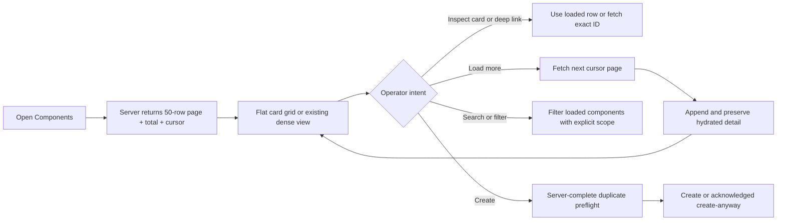
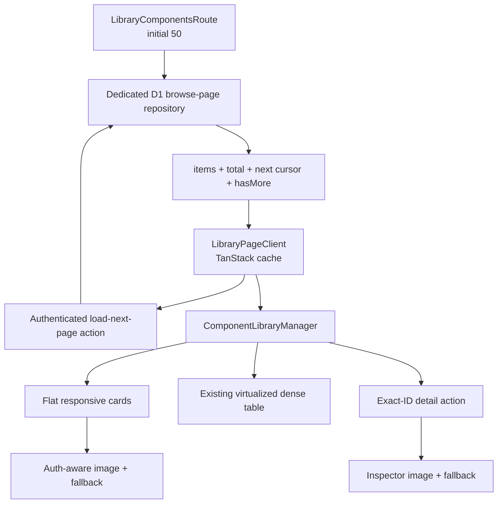

# Component Library production-core improvement

## Goal Capsule

Improve `/workshop/library/components` into a fast, dependable operator catalogue for the first Archestimator users without hiding the remaining enterprise release gaps.

Authority order:

1. The user's requested catalogue-management outcome and explicit browser/test authorization.
2. Current repository behavior and `AGENTS.md` safety, Cloudflare, Next.js 16, and user-test contracts.
3. The audited action/path matrix and architect-approved research decision.
4. This plan's implementation boundaries.

Execution profile: one local, reversible production-core pass across the D1 browse contract, TanStack cache integration, catalogue UI, and focused verification. Preserve concurrent work, use existing dependencies and primitives, and do not deploy, commit, push, or mutate hosted data.

Stop when U1–U4 meet their verification and done criteria, the focused code review is clean, adversarial browser QA passes, and abandoned implementation attempts are removed. Do not claim that the whole page is enterprise-release-ready while the documented Next/deferred release gates remain.

## Product Contract

### Summary

The Components page already has the right basic product shape—tree scoping, card and dense views, inspector, edit/duplicate/archive workflows, filters, and TanStack-backed data—but its browse contract and visual projection are not trustworthy at scale. The initial 24 rows make valid deep links disappear, the unbounded Load all path can replace richer hydrated rows, card rendering is grouped into narrow mini-grids, authenticated thumbnails are incorrectly sent through Next's optimizer, and empty/no-match states collapse to blank space.

This pass converts that foundation into a bounded operator catalogue: one responsive flat card grid with folder context, fixed media behavior, explicit recovery states, canonical orange creation, 50-row keyset load-more, direct-ID resolution, explicit loaded-row selection scope, and containment of destructive lifecycle claims.

### Actors

- **Viewer / estimator:** browse, search the loaded result set, inspect a component, and follow a direct component link without seeing mutation entry points.
- **Editor / cost manager:** all viewer actions plus create, edit, duplicate, organize, archive, and exact-ID bulk work.
- **Workspace admin / library owner:** same current surface authority as editor; true governed purge and restore are deliberately not invented in this pass.
- **Ops / support:** diagnose browse, image, and mutation failures from truthful UI state and existing correlation/telemetry surfaces.

### Requirements

- **R1 — Bounded browse:** initial and subsequent workspace browse reads return at most 50 visible components plus one lookahead row, use a stable `(updated_at DESC, id ASC)` cursor, and never reintroduce an unbounded Load all request.
- **R2 — Accurate paging state:** the page exposes loaded count, exact active-component total, `hasMore`, next cursor, loading, and recoverable load-more error state. Appending a page deduplicates by ID and preserves any already-hydrated detail fields.
- **R3 — Durable direct links:** a valid `?component=<uuid>` outside the current page is fetched directly before not-found is decided. A transient error retains the URL and exposes Retry; an actual missing/inaccessible row is reported before the URL is cleaned up.
- **R4 — Honest loaded-slice query scope:** until workspace-complete server search/facets ship, every search, facet, result summary, count, empty/no-match state, and Select visible control explicitly says it applies to loaded components. The UI always pairs `N loaded` with the exact workspace total when more pages exist, never presents a filtered loaded count as the whole-workspace result count, and never says the workspace has no matching components when unloaded matches may exist.
- **R5 — Flat operator grid:** card mode renders one responsive flat list with stable ecommerce-style card widths, consistent scan hierarchy, and folder/category breadcrumb on each card. The left tree remains the hierarchy/navigation owner. Existing dense mode and its virtualization remain available and behaviorally unchanged.
- **R6 — Resilient media:** authenticated same-origin `/api/...` thumbnails render unoptimized, fixed media geometry remains stable, accurate `sizes` are supplied, and card plus inspector show deterministic fallback content after missing or failed images.
- **R7 — Empty and recovery states:** empty-library and no-match states explain what happened and expose the relevant Clear search, Clear filters, Retry load, and manager-only Add actions.
- **R8 — Canonical creation:** the Components surface has one permission-correct Add entry in the manager and it uses the existing orange brand button treatment. The unconditional outer Library Add dead-end is removed from this route flow.
- **R9 — Selection truth:** checkbox labels are generic (`Select <name>`), card controls meet the current target/focus baseline, visible selection is capped at the server's 500-ID action limit, and destructive previews remain frozen exact-ID operations—not “all matching” operations.
- **R10 — Workspace-complete duplicate protection:** create preflight/commit uses a workspace-scoped server lookup for the existing name/category/supplier-or-brand identity. The loaded page may accelerate presentation but cannot be the correctness boundary. Explicit “create anyway” remains possible only through an acknowledged request.
- **R11 — Lifecycle containment:** editor-facing permanent purge is not exposed from the Components card/inspector/bulk flow. Archive confirmation does not promise restoration until an Archived view and restore action exist. Existing server purge code is not broadened or silently redefined in this pass.
- **R12 — Evidence:** focused static/type/lint checks, relevant component/repository tests, live desktop and compact-width browser QA, and before/after screenshots cover the changed behaviors.

### Primary flows



### Acceptance examples

- Given 5,000 active components, opening the route returns 50 cards and an exact total; choosing Load 50 more appends the next stable page and keeps the first selected inspector's history intact.
- Given two consecutive cursor pages contain the same ID because that row changed during paging, append updates that card in place, renders it once, retains deterministic first-page ordering for existing rows, and advances from the server-returned next cursor without looping.
- Given `?component=<valid-unloaded-id>`, the URL remains intact while the exact row loads, the inspector opens, and its detail graph hydrates once.
- Given an exact-ID fetch fails transiently, the page shows a retry status and does not silently strip the URL. Given the row is truly absent/inaccessible, the page announces that outcome and removes only the invalid component parameter.
- Given an authenticated `/api/projects/images?...` thumbnail, Next's optimizer is bypassed. Given that request still fails, both card and inspector show the same stable fallback without a broken-image icon or layout shift.
- Given only page one is loaded and a search has zero loaded matches, the centre panel says “No loaded components match,” retains `50 loaded of 5,000`, does not claim the workspace has zero matches, and offers Clear search / Clear filters / Load 50 more; a manager also sees the orange Add component action.
- Given a viewer, neither the outer Library Add dead-end nor manager mutation actions render.
- Given more than 500 loaded matching cards, Select visible selects at most 500 and states the cap. Archive preview receives those frozen IDs. Permanent delete is absent.
- Given a possible duplicate outside the current 50-row page, server preflight still identifies it; Create anyway requires an explicit acknowledgement carried to the server.

### Success criteria

- Initial browse payload and DOM are bounded independently of workspace size.
- No valid direct component link is rejected solely because it is outside the current page.
- No authenticated thumbnail is sent through the optimizer path that drops auth headers.
- Card mode uses the available width as a single coherent grid rather than nested skinny groups.
- Existing dense virtualization remains intact.
- Partial/local scope, destructive scope, and lifecycle recovery claims are truthful.

### Scope boundaries

Now:

- R1–R12 and U1–U4.
- One additive D1 index migration if the existing index cannot support the default keyset path.
- Focused changes to the Components route and shared components only where the route requires them.

Next, not silently included:

- Workspace-complete URL-backed search, facets, sort, counts, saved views, and query-wide selection/export.
- Archived browser, restore, admin-only governed purge, draft resume/discard, and complete filtered/all export.
- Error/offline sophistication beyond the browse/deep-link/load-more states changed here.

Deferred behind evidence:

- CSV/XLSX catalogue import. When onboarding demand confirms it, use the staged upload → map → dry-run validate → preview → publish → row-error receipt contract from the research artifact.
- Cloudflare Images/R2 media-pipeline migration, public image variants, card virtualization, D1 read replication, and saved views.

Explicit non-goals:

- No hosted deployment, Cloudflare resource mutation, migration application, branch/commit/push, new dependency, global redesign of every Add button, or refactor of unrelated concurrent estimate/admin work.
- No destructive server-semantic rewrite for permanent delete. This pass removes unsafe exposure while the product-level delete/detach/recovery contract remains a separate decision.

### Dependencies and sources

- Current UX/action truth: [action-path matrix](../../.ai/02_audits/2026-07-15-component-library-production-audit/action-path-matrix.md).
- External evidence and phased decision: [enterprise UX/performance research](../../.ai/13_research/2026-07-15-component-library-enterprise-ux-performance.md).
- Current route seed: `src/components/workshop/library/LibraryComponentsRoute.tsx`.
- Current client cache: `src/components/workshop/LibraryPageClient.tsx`.
- Current browse/detail repository: `src/lib/repositories/component-library-repository.ts`.
- Current server actions: `src/lib/component-library/actions.ts`.
- Current manager/card/dense/direct-link behavior: `src/components/workshop/component-library-manager/ComponentLibraryManager.tsx`.
- Current inspector media/actions: `src/components/workshop/library/ComponentInspectorDock.tsx`.
- Current outer Add action: `src/components/workshop/library/LibraryTabsLayoutClient.tsx`.
- Next.js 16 local authority: `node_modules/next/dist/docs/01-app/02-guides/server-actions.md` and `node_modules/next/dist/docs/01-app/03-api-reference/02-components/image.md`.

## Planning Contract

### Key Technical Decisions

- **KTD1 — Keyset pages, not offset or client pagination.** Add a dedicated browse-page repository/action contract rather than changing the existing unbounded repository hub's semantics. Cursor input is a validated typed object containing `updatedAt` and UUID `id`; the query orders by `updated_at DESC, id ASC`, reads `pageSize + 1`, and emits the last visible row as the next cursor.
- **KTD2 — Append-only browse cache.** `LibraryPageClient` owns page appends through the existing TanStack cache entry. A merge helper deduplicates IDs, preserves the original ordering, and prefers already-present detail-only fields when the incoming browse row is slimmer.
- **KTD3 — Exact-ID path is independent of pages.** The manager attempts `loadCostLibraryComponentRowDetail()` when a route ID is not loaded. It inserts the returned row into local/cache state before normal inspector hydration; transient errors remain actionable and do not masquerade as not-found.
- **KTD4 — Flat projection, existing hierarchy.** Reuse the existing `CatalogueCard` outline/path calculation, flatten it once, and render a single semantic list. Do not delete the left tree or rebuild taxonomy. Remove nested branch chrome from the card projection; retain breadcrumb text on cards.
- **KTD5 — Browser rendering fix before media migration.** A small shared source predicate identifies authenticated same-origin `/api/` paths. Those paths use `unoptimized`; each image-owning component keeps local failure state keyed by the source and renders the existing Phosphor image icon fallback.
- **KTD6 — Permission-correct Add by removing duplication.** The manager already receives server-derived `canManageLibrary`; it is the canonical Add owner. Remove the unconditional layout-level Add action instead of creating a second permission fetch in persistent layout chrome.
- **KTD7 — Exact-ID bulk containment.** Keep current server preview-hash semantics, cap visible selection to 500, make labels neutral, and stop passing permanent-delete handlers to Components UI. Do not claim query-wide bulk semantics.
- **KTD8 — Server duplicate authority.** Add a narrow, authorized server lookup/preflight and recheck it inside create. Normalize with the same existing identity functions. Carry an explicit acknowledgement field when the operator chooses Create anyway so concurrent/out-of-page duplicates cannot bypass the warning contract.
- **KTD9 — Additive index only.** If added, the migration is a partial composite index for the active browse path. Because concurrent migrations are present, create the next free migration file but do not apply the migration locally or remotely in this run.

### High-level technical design



### Assumptions

- `updated_at` and UUID `id` form a stable deterministic cursor for the default recent-first browse order.
- Current mutation paths update `updated_at`; moving an item between page requests can change its page, which is acceptable for a live catalogue as long as IDs are deduplicated and no unbounded snapshot is claimed.
- Existing D1 auth and workspace resolution remain authoritative; all new actions call `requireCurrentUserContext()` and repository queries constrain `workspace_id`.
- Project-scoped component projections keep their current loader; workspace browse pagination applies only when `projectId` is absent.
- The existing 500-item server bulk limit is the hard UI selection cap for this pass.

### Sequencing and impact

1. U1 establishes types, repository page contract, action, initial route seed, and optional index.
2. U2 consumes U1 in cache paging and direct-ID resolution; it must land before the old Load all UI is removed.
3. U3 changes presentation, media, Add visibility, selection wording, and lifecycle exposure against U2's stable data contract.
4. U4 locks behavior, validates the focused diff, runs browser comparison/QA, and records final evidence.

GitNexus pre-edit evidence found the manager/card/inspector/repository action surface low risk individually, `LibraryTabsLayoutClient` medium/high because it feeds all Library tabs, and the legacy full repository loader high/critical through shared estimate/sidebar consumers. Therefore U1 adds a separate page function and avoids changing the established full-loader contract.

## Implementation Units

### U1. Add a bounded D1 browse-page contract

**Goal:** make workspace browse cost and payload independent of total catalogue size.

**Requirements:** R1, R2, R10.

**Files:**

- `src/lib/repositories/component-library-repository.ts`
- `src/lib/component-library/actions.ts`
- `src/components/workshop/library/LibraryComponentsRoute.tsx`
- `migrations/0083_component_library_browse_cursor_index.sql` if the next free migration remains `0083`

**Approach:**

- Add exported cursor/page types and a page-size constant of 50.
- Add a dedicated repository page function that validates cursor values, counts active rows, reads 51 lightweight row identities in the default order, hydrates only the first 50 browse rows without the detail graph, preserves the query order, and returns `hasMore` plus next cursor.
- Add an authenticated server action for subsequent pages.
- Seed the Components route from the new page function.
- Add the server-complete duplicate identity lookup and create-time recheck without changing duplicate policy for acknowledged requests.
- If necessary, add an active-row partial index aligned to workspace + updated_at + id; do not apply migrations in the shared dirty worktree.

**Test scenarios:** first/last page, equal timestamps with ID tie-break, malformed cursor, archived exclusion, exact total, 50/51 boundary, cross-workspace denial, and concurrent duplicate create.

**Verification:** focused repository/action Vitest files, scoped TypeScript diagnostics, SQL/static inspection, and `git diff --check`.

**Dependencies:** none.

### U2. Append pages safely and resolve deep links directly

**Goal:** consume bounded pages without losing detail or valid route state.

**Requirements:** R2, R3, R4.

**Files:**

- `src/components/workshop/LibraryPageClient.tsx`
- `src/components/workshop/component-library-manager/ComponentLibraryManager.tsx`
- relevant cache/hydration tests under `tests/vitest/`

**Approach:**

- Replace full refetch/Load all props with `hasMore`, cursor, exact total, loading/error, and `onLoadMore`.
- Append pages into the existing query cache with deterministic ID dedupe. Preserve existing detail-only fields and paging metadata.
- For a route component not present locally, fetch exact detail before declaring not-found. Insert success into local/cache state; maintain retryable status on transient failure; clean only a confirmed absent/inaccessible route ID.
- Reset or retain paging state predictably after mutations; do not resurrect archived rows through an in-flight append.
- Change scope copy from ambiguous `24+`/whole-workspace language to exact `N loaded of total` language. Search/facets, their counts, no-match copy, and Select visible must repeat loaded-component scope whenever `hasMore` is true; no UI string may imply an unloaded workspace-wide result.

**Test scenarios:** page-one and page-two loaded/total copy; zero loaded matches without a false workspace-empty claim; two-page append; duplicate IDs across a moving cursor with one rendered row and forward progress; hydrated inspector history preserved after append; valid deep link whose row exists only beyond page one; actual missing ID; transient detail failure/retry; and project-mode non-regression.

**Verification:** `library-components-cache`, manager hydration, route-state authz, and focused source/type checks.

**Dependencies:** U1.

### U3. Ship the flat grid, resilient states, safe actions, and media repair

**Goal:** make the primary interaction surface legible, fast to scan, permission-correct, and visibly dependable.

**Requirements:** R5–R11.

**Files:**

- `src/components/workshop/component-library-manager/ComponentLibraryManager.tsx`
- `src/components/workshop/library/ComponentInspectorDock.tsx`
- `src/components/workshop/library/LibraryTabsLayoutClient.tsx`
- `src/components/workshop/component-library-manager/AddComponentModal.tsx` only for the workspace-complete duplicate acknowledgement contract
- `src/components/workshop/BulkDestructivePreviewModal.tsx` only if archive recovery wording is owned there
- relevant UI tests under `tests/vitest/`

**Approach:**

- Flatten existing outline cards into one semantic list and update grid tracks to a practical operator-card width while preserving path labels and dense-mode fallback/virtualization.
- Rebalance each card around a fixed 4:3 media slot, readable name, cost/unit, supplier/brand, freshness/lifecycle, and accessible actions.
- Make `/api/` images unoptimized and use deterministic local error fallbacks in card and inspector.
- Add distinct empty-library, no-match, and load-error states with relevant recovery buttons.
- Render the manager Add action with the existing `Button` brand variant and remove the unconditional persistent-header Add action.
- Rename selection controls, enlarge repeated hit targets where needed, cap Select visible at 500, and keep scope copy explicit.
- Stop passing/showing permanent-delete actions on this page. Remove archive restoration promise while leaving archive execution and server purge implementation untouched.
- Connect the Add modal's duplicate warning/acknowledgement to U1's server-complete contract with the smallest conflict-safe patch after rereading concurrent edits.

**Test scenarios:** grid and dense projections, broken `/api/` and external images, empty/no-match recovery for viewer vs manager, orange Add, viewer action absence, generic selection label/cap, purge absence, truthful archive copy, and server-found out-of-page duplicate.

**Verification:** focused manager/UI/inspector/header/destructive-copy tests, scoped lint/typecheck, keyboard browser pass, desktop/compact visual comparison, and `git diff --check`.

**Dependencies:** U1, U2.

### U4. Reconcile, review, and adversarially verify

**Goal:** prove the production-core slice works and report remaining enterprise gaps truthfully.

**Requirements:** R12 and all prior requirements as a reconciliation gate.

**Files:**

- `.ai/02_audits/2026-07-15-component-library-production-audit/` for after screenshots and completion notes
- no unrelated product files

**Approach:**

- Reread all shared targets and inspect the focused diff for concurrent-change overlap.
- Run the narrow authorized tests, scoped lint/typecheck/static checks, and GitNexus `detect_changes()`.
- Use the existing in-app browser only. Validate desktop and compact widths, core keyboard paths, direct link, load-more, no-match, Add, card/dense switch, inspector, image fallback, and destructive-action containment.
- Compare before and after at matching viewports; fix visible or behavioral regressions.
- Run a native code-review gate, repair every finding, then run native UltraQA/adversarial QA and repeat until clean.
- Record actual evidence and explicit gaps; do not present unrun tests, local migration files, or local screenshots as hosted Cloudflare proof.

**Test scenarios:** end-to-end acceptance examples above plus regression checks for folder scope, edit/duplicate/archive, cache mutation, and dense virtualization.

**Verification:** all commands and browser receipts in the Verification Contract plus clean review and QA verdicts.

**Dependencies:** U1–U3.

## Verification Contract

Automated tests and browser QA are authorized by the user for this goal (`TEST_TASK`). Start narrow and expand only when a failure or touched shared surface justifies it.

Required static evidence:

```bash
bunx tsc --noEmit --pretty false
bunx eslint src/components/workshop/LibraryPageClient.tsx src/components/workshop/library/LibraryComponentsRoute.tsx src/components/workshop/library/LibraryTabsLayoutClient.tsx src/components/workshop/library/ComponentInspectorDock.tsx src/components/workshop/component-library-manager/ComponentLibraryManager.tsx src/lib/component-library/actions.ts src/lib/repositories/component-library-repository.ts
git diff --check
```

The broad `tsc` command may surface unrelated concurrent errors; any such output must be separated from touched-file diagnostics and never misreported as caused or fixed here.

Required focused product tests, adjusted only to the smallest actual touched set:

```bash
bunx vitest run --config vitest.config.ts \
  tests/vitest/library-components-cache.test.tsx \
  tests/vitest/component-library-manager-hydration.test.tsx \
  tests/vitest/component-library-manager-ui.test.tsx \
  tests/vitest/library-route-state-authz.test.tsx \
  tests/vitest/mass-deletion-ui-contract.test.ts \
  tests/vitest/workshop-library-consolidation-ui.test.tsx
```

Add or update a focused repository page-contract test if no existing test proves cursor, count, archived exclusion, and lookahead semantics. Do not run the repository-wide integrated gate unless focused evidence reveals cross-surface uncertainty.

Required browser evidence in the in-app browser:

- Desktop: 2502 × 1324 or the same available viewport used by the before capture.
- Compact: 390 × 844.
- States: default card grid, dense mode, no-match while unloaded rows remain, filters, exact loaded/total count, two load-more pages, deterministic duplicate-ID append, valid direct ID beyond page one, missing ID, details inspector with history retained across append, broken-image fallback, Add modal, viewer-action absence where a viewer fixture is available, keyboard focus/selection, and archive without permanent purge.
- Save matching after screenshots beside the five existing before captures and visually compare at the same viewport/state.

Required graph evidence:

- Run GitNexus impact before every newly touched symbol not already assessed.
- Run `detect_changes()` after implementation and confirm affected symbols/flows stay inside the planned surface. The index is known stale because the repo-safe reindex wrapper refused a floating `gitnexus@latest`; record that caveat.

Cloudflare/D1 evidence boundary:

- Inspect/validate the SQL and local binding path only.
- Do not apply concurrent migrations or claim hosted query-plan/cache proof in this run.
- The new page contract itself must make rows returned and retained bounded; later D1 telemetry and hosted query-plan proof remain Next-phase work.

## Definition of Done

Global completion requires:

- R1–R12 reconciled against fresh source, test, browser, and diff evidence.
- No unbounded Load all path remains on the workspace Components page.
- Direct unloaded IDs, broken images, empty/no-match, permission-correct Add, selection scope, and lifecycle containment behave as specified.
- Existing dense virtualization, edit, duplicate, archive, tree scope, and cache mutation still work.
- No new dependency, unrelated rewrite, hosted mutation, or concurrent-work overwrite occurred.
- Every test/check is reported as passed, failed, or unavailable with the exact boundary; no invented proof.
- Architect then critic approved this plan before implementation; code review then UltraQA are clean after implementation.
- Abandoned code, temporary debug logging, dead components, and unused imports from rejected approaches are removed.
- Remaining release blockers are named: workspace-complete URL query/facets/counts, export, archived restore/admin purge, and draft recovery; import remains conditional on confirmed onboarding need.

Per-unit completion:

- **U1:** page contract is bounded, cursor-stable, authorized, counted, and tested; optional migration is additive and unapplied.
- **U2:** append preserves rich detail and direct links resolve independently of loaded pages with truthful recovery.
- **U3:** one coherent grid, reliable media fallback, explicit empty states, orange/permission-correct Add, accessible exact-ID selection, and no editor purge exposure.
- **U4:** focused validation, live comparison, graph scope, clean review, clean QA, and evidence handoff are complete.

## Appendix

### Research-phase decision record

The strict architect review initially failed because the first research draft tried to combine server query architecture, query-wide selection, durable imports, media migration, accessibility, and telemetry in one “smallest” slice while overlooking existing dense virtualization and immediate authenticated-image behavior. The revised report passed after separating Now/Next/Defer, preserving existing functionality, adding browser-platform authority, and containing partial-dataset/destructive correctness. This plan implements only the approved Now contract and keeps the broader action matrix as the release roadmap.
